<!-- Created: 2026-10-05 by Constructor Tech -->

# Technical Design — Application Manager

How the Application Manager runs each seed and uninstall as an operation: it makes quick synchronous checks, answers with an operation id, validates whole manifests, dispatches sections to its section plugins in priority order, records audit events in a transactional outbox and delivers them to one audit plugin, and keeps a minimal platform-wide registry of seeded applications. Written for gear implementers, section-plugin authors, and audit-plugin authors.

- [ ] `p3` - **ID**: `cpt-cf-application-manager-design-overview`

<!-- toc -->

- [1. Architecture Overview](#1-architecture-overview)
  - [1.1 Architectural Vision](#11-architectural-vision)
  - [1.2 Architecture Drivers](#12-architecture-drivers)
  - [1.3 Architecture Layers](#13-architecture-layers)
- [2. Principles & Constraints](#2-principles--constraints)
  - [2.1 Design Principles](#21-design-principles)
  - [2.2 Constraints](#22-constraints)
- [3. Technical Architecture](#3-technical-architecture)
  - [3.1 Domain Model](#31-domain-model)
  - [3.2 Component Model](#32-component-model)
  - [3.3 API Contracts](#33-api-contracts)
  - [3.4 Internal Dependencies](#34-internal-dependencies)
  - [3.5 External Dependencies](#35-external-dependencies)
  - [3.6 Interactions & Sequences](#36-interactions--sequences)
  - [3.7 Database schemas & tables](#37-database-schemas--tables)
  - [3.8 Deployment Topology](#38-deployment-topology)
- [4. Additional context](#4-additional-context)
  - [4.1 Design-Level Terms](#41-design-level-terms)
  - [4.2 Concurrent Requests for the Same Application](#42-concurrent-requests-for-the-same-application)
  - [4.3 Security Considerations](#43-security-considerations)
  - [4.4 Data Protection](#44-data-protection)
  - [4.5 Fault Tolerance](#45-fault-tolerance)
  - [4.6 Observability](#46-observability)
  - [4.7 Configuration](#47-configuration)
  - [4.8 Testability](#48-testability)
  - [4.9 Compliance](#49-compliance)
  - [4.10 Deviations from Platform Baselines](#410-deviations-from-platform-baselines)
  - [4.11 Guidance for Plugin Authors](#411-guidance-for-plugin-authors)
  - [4.12 Assumptions, Dependencies and Migration Impact](#412-assumptions-dependencies-and-migration-impact)
  - [4.13 Capacity and Resource Efficiency](#413-capacity-and-resource-efficiency)
- [5. Traceability](#5-traceability)

<!-- /toc -->

## 1. Architecture Overview

### 1.1 Architectural Vision

The Application Manager is a thin orchestrating gear built on the ToolKit gear model. It owns one manifest envelope, one small registry table, one operations table, one audit outbox queue, and one fixed sequence of checks, audit event inserts, and plugin calls. All domain meaning lives in section plugins, and all lasting audit storage lives in one audit plugin. Section plugins may provision data into platform gears or into systems outside the platform, such as an identity provider or API gateway routes. The gear never talks to those targets. Vocabulary follows the canonical [PRD glossary](./PRD.md#14-glossary); the few design-level terms that the PRD does not define are glossed in [§4.1](#41-design-level-terms).

The design rests on four decisions. First, the plugin set is fixed at startup: every section plugin registers a GTS (Global Type System) instance of the Application Manager's section plugin type and a scoped ClientHub client, which is a plugin client resolved by its exact GTS instance id. The startup component enumerates them once into an in-memory key map and a priority order ([ADR 0001](./ADR/0001-cpt-cf-application-manager-adr-section-plugin-fan-out.md)). Second, seed and uninstall run as operations. The gear makes the synchronous checks, then creates the operation record and its accepted event in one transaction, answers 202 Accepted with the operation id, and runs the rest in the background. The caller reads the operation by its id to learn how it ended. Third, every seed follows validate-then-dispatch inside its operation: schemas are fetched live from every section plugin, the whole manifest is validated, and only then are sections dispatched one at a time in priority order, continuing after failures ([ADR 0002](./ADR/0002-cpt-cf-application-manager-adr-plugin-served-section-schemas.md), [ADR 0003](./ADR/0003-cpt-cf-application-manager-adr-validate-all-then-dispatch.md)). Fourth, trace before change: each audit event is inserted into the gear's `toolkit-db` transactional outbox in the same transaction as the change it describes, and nothing is dispatched until the operation's accepted event is committed. The finished event commits in the same transaction as the operation's final report and, for a seed, its registry write. A dispatcher delivers the events to the audit plugin through a versioned plugin trait, at least once and in order per operation, apart from request handling ([ADR 0004](./ADR/0004-cpt-cf-application-manager-adr-audit-via-plugin.md)).

Outside the plugin calls, the gear is stateless apart from three stores. The registry is a rebuildable view of each application's last seed ([ADR 0005](./ADR/0005-cpt-cf-application-manager-adr-minimal-application-registry.md)). The operation records hold the status and report of each operation until the operation retention ends. The audit outbox holds events only until the audit plugin confirms them. At most one operation runs for an application at a time: a unique index on the operations table enforces it, and a second request for a busy application is refused as conflict ([§4.2](#42-concurrent-requests-for-the-same-application)). Every operation reaches a final state within its run window: a status guard on every write and an interrupted sweeper make sure of it. Synchronous refusals use the standard platform error format, and §3.3 holds the one outcome table.

The gear is headless. Frontend architecture, client state management, responsive design, progressive enhancement, and offline support are not applicable because it has no user interface. The developer experience of callers and plugin authors is covered by §3.3 and §4.11.

### 1.2 Architecture Drivers

Requirements that significantly influence architecture decisions.

#### Functional Drivers

| Requirement | Design Response |
|---|---|
| `cpt-cf-application-manager-fr-manifest-envelope` | The schema validator (`cpt-cf-application-manager-component-schema-validator`) owns the envelope schema: an `application` object with exactly `id` and `version`, and a `sections` object (`cpt-cf-application-manager-entity-manifest`). The envelope check, including the envelope limits, runs when the request is received. An envelope problem ends the seed as a synchronous refusal at rank 5, with a refused event, no operation, and nothing dispatched. |
| `cpt-cf-application-manager-fr-application-id` | The id is opaque: no case folding, trimming, or normalisation. It is stored and compared as exact text on every supported database backend, and no code path parses or orders it (`cpt-cf-application-manager-dbtable-application-registry`, `cpt-cf-application-manager-dbtable-operations`). The envelope limits are checked before acceptance. Uninstall takes the id in the path or in the request body and compares it the same way (§3.3). |
| `cpt-cf-application-manager-fr-opaque-version` | The version is stored as text, passed unchanged to `apply` and `remove`, and carried in the audit events and the operation report. No component compares or sorts versions. |
| `cpt-cf-application-manager-fr-required-sections` | The validator requires exactly the key set: a missing key or an unknown key is a problem at `/sections/<key>`. When the key set is empty, `sections` must be an empty object. Keys follow the SDK token pattern, so the location needs no JSON Pointer escaping. |
| `cpt-cf-application-manager-fr-unique-section-keys` | The startup component reads `key` from each section plugin instance and fails startup on a repeated key or on a key outside the token pattern. The key map is immutable until the next start (`cpt-cf-application-manager-seq-startup`). |
| `cpt-cf-application-manager-fr-section-priority` | The priority is the registered GTS instance priority. The startup component sorts lowest value first and fails startup on an equal priority. The same order drives dispatch on seed and on uninstall. |
| `cpt-cf-application-manager-fr-startup-checks` | Every listed failure fails startup (`cpt-cf-application-manager-component-startup-registration`). The settings, including `operation_retention` and `run_window_margin`, are checked in `init`. The start capability makes each other check once, in this order: the types registry listing, the checks that the listing answers (priorities and the audit plugin count), the scoped client resolution, the `key` reads with the key pattern and repeated-key checks, and the start of the audit outbox. The types registry is the platform gear that stores GTS types and instances. Each plugin and types registry call is bounded by `plugin_call_timeout`, the outbox queue registration by `registry_operation_timeout`, and none is retried. A listing or a `key` call that fails or does not answer within its bound fails startup like any other failed check. A failed check makes `start` return an error, so the host's start phase fails and the host exits with a non-zero status. The reasons are catalogued in §4.6. An answering types registry that lists no section plugins gives an empty key set. |
| `cpt-cf-application-manager-fr-validate-before-dispatch` | Inside every seed operation, the orchestrator fetches every schema, with no cache. The validator then checks the whole manifest and collects every problem with its JSON Pointer location. Dispatch runs only on a clean result. Envelope problems are found before acceptance and go into the synchronous refusal. Section problems go into the operation report. |
| `cpt-cf-application-manager-fr-plugin-served-schemas` | The gear holds no section rules: the `schema` operation is the only source, and compiled schemas do not outlive the operation. Each section schema is a GTS type schema that the section plugin owns. The gear reads it as JSON Schema Draft 2020-12 with references inside the served document. Anything else is a section-plugin defect, reported with reason `unusable` (`cpt-cf-application-manager-component-schema-validator`). |
| `cpt-cf-application-manager-fr-plugin-extensibility` | Section plugins are separate gears that register an instance of the section plugin GTS type. The Application Manager depends only on its own SDK types and the types registry, never on plugin crates. |
| `cpt-cf-application-manager-fr-async-operations` | The request orchestrator splits each seed and uninstall into a synchronous phase and an operation (`cpt-cf-application-manager-component-request-orchestrator`). The synchronous phase makes no plugin call. It ends in a synchronous refusal with its refused event, or in one transaction that inserts the operation record (`cpt-cf-application-manager-entity-operation`) and its accepted event, followed by 202 Accepted with the operation id. The operation then runs in the background in the same request task: the schema phase, validation, dispatch or removal, the registry write, and the final transaction with the report and the finished event. Every write to an operation record is guarded by its status and run deadline, so an operation has exactly one final state. The operation sweeper (`cpt-cf-application-manager-component-operation-sweeper`) records an operation that is still open after its run deadline as interrupted, with its finished event, in one transaction. |
| `cpt-cf-application-manager-fr-idempotency-key` | Seed and uninstall accept an optional `Idempotency-Key` header. The key scope is the caller subject, the action, and the application id. The storage step, which runs only for a permitted caller, looks up the scope before the busy and not-found checks. Same key and same content returns the existing operation with 202, starts nothing, records no audit event, and is logged and counted. Same key and different content is a conflict. The operation record keeps the key, the caller subject, and the request digest, and the key ends with the record (`cpt-cf-application-manager-dbtable-operations`). |
| `cpt-cf-application-manager-fr-one-operation-per-application` | A unique index on the operations table allows one open operation per application id: status accepted or running (`cpt-cf-application-manager-dbtable-operations`). The storage step reads the open operation and refuses as conflict at rank 3, naming its id. An insert that still violates the index, because a concurrent request won, is the same conflict. Operations for different applications never touch the same index entry and never wait for each other (§4.2). |
| `cpt-cf-application-manager-fr-ordered-dispatch` | The section plugin router walks the priority-ordered list one section plugin call at a time, records each section outcome in the operation record, and continues after every failure kind. Each seed and uninstall runs, from receive, as a request task detached from the HTTP request, so a caller disconnect or the gateway deadline cannot stop it midway. |
| `cpt-cf-application-manager-fr-pass-through` | `apply` receives the envelope and the parsed section value as sent. The registry and the operations table have no section column, and nothing about sections is kept after the operation. |
| `cpt-cf-application-manager-fr-plugin-owned-semantics` | The section plugin interface offers no cancel, undo, batch, or transaction operation. After a failure, the orchestrator never calls that section plugin again for the same operation. An idempotent replay starts no operation. |
| `cpt-cf-application-manager-fr-outcome-categories` | The orchestrator decides exactly one of the eight categories per request (`cpt-cf-application-manager-entity-outcome-category`), apart from an idempotent replay and an interrupted operation. The outcome table in §3.3 states which categories are synchronous refusals and which appear only in the operation report. |
| `cpt-cf-application-manager-fr-outcome-precedence` | The orchestrator applies the precedence table in `cpt-cf-application-manager-component-request-orchestrator`, which follows the PRD order: ranks 1 to 5 before acceptance, then acceptance, then ranks 6 and 7 inside a seed operation, then the after-dispatch order. Storage is consulted only for a permitted caller, so a refused caller ends as not permitted even while storage cannot answer. |
| `cpt-cf-application-manager-fr-response-content` | A synchronous refusal is a standard canonical Problem that carries its category, its cause, and its request id (§3.3). The operation read returns the operation report (`cpt-cf-application-manager-entity-outcome-report`) as its 200 body once the operation is final: the category, each section outcome, every problem, the operation id, and the registry effect. |
| `cpt-cf-application-manager-fr-bounded-plugin-calls` | The plugin call guard (`cpt-cf-application-manager-component-plugin-call-guard`) caps every plugin call with the one configured time limit. It stops waiting without cancelling the call, and each call kind maps its timeout as the PRD states. The run deadline of each operation is derived from the same limit and the plugin count, plus `run_window_margin` (§4.7). |
| `cpt-cf-application-manager-fr-dependency-failures` | Access control, registry storage, and operation storage are consulted before the operation is created and before any section plugin call. An operation record and accepted event that cannot be committed end the request as temporarily unavailable, with nothing dispatched. A registry write or delete failure after dispatch counts as an internal failure: the report states the registry effect, and the finished event records the failure. A final report that cannot be recorded is logged, and the operation is recorded as interrupted at its run deadline. |
| `cpt-cf-application-manager-fr-uninstall` | Once an uninstall is accepted, the operation deletes the entry and then calls `remove` in priority order with the last seeded version. A failed delete still runs removal and ends as internal failure (`cpt-cf-application-manager-seq-uninstall`). |
| `cpt-cf-application-manager-fr-application-registry` | The repository upserts the entry after dispatch with the version, the last result (derived as §3.1 states), the seed time, and the operation id, in the same transaction as the seed's final report and finished event. Requests that end before dispatch never reach a write. The entry keeps the operation id after the operation record is purged. |
| `cpt-cf-application-manager-fr-retry` | Every request is independent and the registry holds no applied state, so a repeated seed, or a seed followed by an uninstall, is the retry path. A retry carries no key or a new key, and it is accepted once the earlier operation of the application is final. Once a delete succeeded, only a seed followed by an uninstall repeats removal. |
| `cpt-cf-application-manager-fr-plugin-rollout` | Validation rules are the same before and after a plugin-set change. No operation fills in sections, replays seeds, or starts re-seeds. |
| `cpt-cf-application-manager-fr-discovery` | The read service lists keys from the in-memory section plugin set. It serves one key's schema or the combined schema live, through the plugin call guard, with each schema version (`cpt-cf-application-manager-seq-discovery`). |
| `cpt-cf-application-manager-fr-list-applications` | The read service lists the registry with no plugin call, after a permit from PolicyEnforcer, the platform policy enforcement point. The response is an object with an `items` array (`cpt-cf-application-manager-seq-list-applications`). |
| `cpt-cf-application-manager-fr-operation-read` | The read service reads one operation record by id after a permit for the separate action `read_operation`, with no plugin call and no audit event (`cpt-cf-application-manager-seq-operation-read`). It returns the status, and the report once the operation is final. It never returns the caller subject, the idempotency key, or any manifest content. An unknown or purged id gives 404. The operation sweeper purges final records after `operation_retention`. |
| `cpt-cf-application-manager-fr-authentication` | Every route is registered `.authenticated()` through OperationBuilder and receives the platform `SecurityContext`. There is no anonymous route and no gear-owned login. Plugins receive an identity-only caller context with the bearer token removed (`cpt-cf-application-manager-entity-caller-identity`). |
| `cpt-cf-application-manager-fr-authorization` | PolicyEnforcer checks five separate actions on the application resource type: `seed`, `uninstall`, `list`, `read_schema`, and `read_operation` (permission matrix in §3.3). An idempotent replay needs the permit of its action too. A section plugin's extra refusal returns the `NotPermitted` error kind. |
| `cpt-cf-application-manager-fr-audit-event` | The SDK defines the versioned in-process trait `AuditPluginV1` (`cpt-cf-application-manager-interface-audit-plugin-api`), and the startup component requires exactly one audit plugin instance. The orchestrator assembles the accepted, finished, and refused events (`cpt-cf-application-manager-entity-audit-event-content`), and the repository inserts them into the audit outbox queue. Accepted and finished events carry the operation id. Refused events carry the request id. The audit dispatcher (`cpt-cf-application-manager-component-audit-dispatcher`) delivers each event at least once, in order per operation, with a stable event id that the plugin uses to drop duplicates. No REST operation returns audit data or outbox content, the gear never writes manifest content to logs, traces, metrics, or error text, and the plugin trait states the default-off exposure obligation. |
| `cpt-cf-application-manager-fr-audit-ordering` | The accepted event is inserted in the same transaction that creates the operation record, and dispatch starts only after that commit. The finished event is inserted in the same transaction as the final report and, for a dispatched seed, the registry upsert. An interruption records its finished event in the transaction that marks the operation interrupted. Every synchronous refusal, including one at the not-ready gate or at the request-task cap, inserts its refused event in a transaction of its own before it answers. When that insert fails, the refusal keeps its category and is logged with an operator signal. An idempotent replay records no event. Platform-rejected requests never reach the gear. |
| `cpt-cf-application-manager-interface-seeding` | `cpt-cf-application-manager-interface-rest-api`: the seed route and both uninstall forms, with the optional `Idempotency-Key` header, answer 202 with the operation id or a synchronous refusal (§3.3). |
| `cpt-cf-application-manager-interface-operations` | `cpt-cf-application-manager-interface-rest-api`: the operation read route returns the status and, once final, the operation report (§3.3). |
| `cpt-cf-application-manager-interface-discovery` | `cpt-cf-application-manager-interface-rest-api`: the key list, the single-schema and combined-schema reads with schema versions, and the listing (§3.3). |
| `cpt-cf-application-manager-contract-section-plugin` | `cpt-cf-application-manager-interface-section-plugin-api`: `key`, `schema` with its schema version, `apply`, and `remove`, with the error kinds and the in-flight cap rules (§3.3). |

#### NFR Allocation

This table maps non-functional requirements from PRD to specific design/architecture responses, demonstrating how quality attributes are realized.

| NFR ID | NFR Summary | Allocated To | Design Response | Verification Approach |
|---|---|---|---|---|
| `cpt-cf-application-manager-nfr-audit-completeness` | One accepted event per operation, in the transaction that creates it; one finished event per operation that reaches a final state; one refused event per synchronous refusal unless storage cannot record it; every recorded event delivered to the audit plugin at least once | `cpt-cf-application-manager-component-request-orchestrator`, `cpt-cf-application-manager-component-registry-repository`, `cpt-cf-application-manager-component-operation-sweeper`, `cpt-cf-application-manager-component-audit-dispatcher`, `cpt-cf-application-manager-component-rest-api` | Every path through `cpt-cf-application-manager-seq-pre-dispatch-gate` ends in a refused event insert, in an idempotent replay with no event, or in the acceptance transaction that commits the operation and its accepted event together. Every final state commits its finished event in the same transaction: the completion, its fallback, the supervisor's completion after a task failure, and the interruption step. All of them are guarded by the operation status, so at most one commits. An operation whose task stopped, on any replica, is interrupted by the sweeper after its run deadline, with its finished event. The not-ready gate and the request-task cap check insert refused events too. A refused event that cannot be recorded is logged with the missing-event signal. The dispatcher delivers every committed event at least once, in order per operation, until the plugin confirms it or the attempt limit moves it to the outbox dead-letter store with a signal. Platform-rejected requests are logged by the platform, as the PRD exempts them. | Table-driven tests over every outcome category, the not-ready and at-capacity refusals, idempotent replays, a storage failure at each insert, an HTTP request dropped at each step, a panic injected at each point of the request task, and a replica stopped during an operation, with a recording test audit plugin that counts events by kind and duplicates by event id, and that also refuses, fails, and exceeds the time limit. In production, the recorded and not-recorded event counters, `outbox_pending_rows`, and `outbox_rejections_total` (§4.6) reconcile with the operation and refusal counters. |
| `cpt-cf-application-manager-nfr-platform-scope` | One platform-wide registry and one platform-wide set of operation records, reachable only through access checks | `cpt-cf-application-manager-component-registry-repository`, PolicyEnforcer, SecureConn | Two tables with no per-tenant partition and no tenant column. Both entities are declared unrestricted in the secure ORM, so they carry no owner tenant and no scoping value. Every read and write still runs through SecureConn, the secure ORM database access layer, only after a permit from the PDP (policy decision point, the platform access control service) for the action, and the permit carries no constraint (§3.3, [ADR 0007](./ADR/0007-cpt-cf-application-manager-adr-no-root-tenant.md)). | Inspection of the entity declarations and of the absence of raw SQL outside migrations. Tests on every action show that a refused, constrained, or unanswered decision reaches no registry or operation access. |
| `cpt-cf-application-manager-nfr-authorized-before-plugin` | No section plugin call for a caller who is not authorized | `cpt-cf-application-manager-component-request-orchestrator`, `cpt-cf-application-manager-component-read-service` | The permission decision is the first domain step of every request. The section plugin router is reached only on a permit, for schema, `apply`, and `remove` alike. Operations exist only for permitted callers. | A recording test section plugin shows zero section plugin calls for requests that end as not permitted or with an unanswered permission check, on every action. |
| `cpt-cf-application-manager-nfr-bounded-call-time` | Every plugin call ends within the configured time limit, which is never hardcoded | `cpt-cf-application-manager-component-plugin-call-guard`, gear configuration | Every plugin call (`key`, `schema`, `apply`, `remove`, and each audit event delivery) goes through one guard that stops waiting at the configured limit. The setting is required, has no default, and is validated during `init` (§4.7). | Paused-clock tests with slow test section plugins and a slow test audit plugin. Configuration tests show that a missing or invalid setting fails startup and that a changed value changes behaviour with no code change. |
| `cpt-cf-application-manager-nfr-bounded-request-time` | Every synchronous answer within the platform request deadline, with no plugin call; every operation final within its run window | `cpt-cf-application-manager-component-request-orchestrator`, `cpt-cf-application-manager-component-registry-repository`, `cpt-cf-application-manager-component-operation-sweeper`, gear configuration | The synchronous phase makes no plugin call. It takes at most `pdp_call_timeout` + 3 × `registry_operation_timeout`: the storage step, the acceptance transaction, and the refusal step after a failed acceptance. `init` fails startup when that exceeds the gateway request deadline of 30s. Audit delivery runs apart and adds nothing. Each operation gets a run deadline at acceptance: (N + 1) × `plugin_call_timeout` for a seed and N × `plugin_call_timeout` for an uninstall, where N is the number of registered section plugins, plus `run_window_margin`. Every write to the operation is guarded by that deadline, the task starts no plugin call after it, and the interruption step records the final state once it passes (§3.2, §4.7). | Tests under a paused clock, with test plugins and a test audit plugin that always reach the limit, assert every synchronous answer within the deadline and the number of elapsed time limits, not wall time. A test PDP that never answers ends the request as temporarily unavailable after `pdp_call_timeout`. Tests that stop the task during an operation read it after the run deadline and find it interrupted. Configuration tests cover the `init` budget check. |
| `cpt-cf-application-manager-nfr-no-partial-on-invalid` | Nothing is dispatched for invalid manifests, for temporarily unavailable outcomes, or for conflicts | `cpt-cf-application-manager-component-request-orchestrator`, `cpt-cf-application-manager-component-schema-validator` | Dispatch is reachable only inside an operation whose record and accepted event are committed, after every schema was served and usable and the manifest is valid. Conflicts and every synchronous temporarily unavailable outcome create no operation. The in-operation temporarily unavailable outcome is decided before dispatch. | Counting tests for every invalid-manifest cause, every temporarily unavailable cause, and both conflict causes assert zero `apply` and `remove` calls. |
| `cpt-cf-application-manager-nfr-traceable-subject` | Every audit event carries the authenticated caller subject | `cpt-cf-application-manager-component-request-orchestrator`, `cpt-cf-application-manager-component-rest-api` | Every accepted and refused event includes the caller identity taken from the request's `SecurityContext`, which the platform authentication pipeline guarantees. The finished event joins its accepted event by the operation id, so each joined audit event carries the subject. The gear is supported only with gateway authentication enabled (§4.3). | The recording test audit plugin asserts that the subject is present on every accepted and refused event, and that every finished event shares its operation id with an accepted event, across all outcome categories, interruptions, and gate refusals. |
| `cpt-cf-application-manager-nfr-availability` | Available whenever deploys happen. Listing, key listing, and operation reads survive an audit outage | `cpt-cf-application-manager-component-read-service`, `cpt-cf-application-manager-component-operation-sweeper`, `cpt-cf-application-manager-topology-replicas` | Listing, key listing, and operation reads make no plugin call and record no audit event. Schema reads need only the section plugins. Seed and uninstall need the audit outbox, never the audit plugin, because delivery runs apart from request handling. After startup, readiness depends on no plugin. Replicas are stateless. An operation whose replica stops is interrupted by the sweeper on any replica after its run deadline. During a rolling restart, replicas may briefly hold different key sets (§3.8). | Tests keep the audit plugin unavailable while listing, key listing, operation reads, schema reads, seed, and uninstall succeed, and the held events are delivered once it recovers. Readiness tests show not ready until the startup result is published, and ready during a plugin outage. A test stops a replica during an operation and finds the operation interrupted after its run deadline. |
| `cpt-cf-application-manager-nfr-recovery` | The registry is fully rebuilt by re-seeding, and purged or lost operation records do not affect it | `cpt-cf-application-manager-component-registry-repository` | An entry is a pure function of its application's last seed, written by an upsert keyed by application id. No other registry state exists, so re-seeding restores every entry. The entry holds the operation id as a plain value with no foreign key, so purging or losing operation records leaves it unchanged. The audit outbox and the operation records are not registry state. | A test empties the registry, re-seeds every application, and finds one entry for each. A test purges every operation record and finds every entry unchanged, and its operation read gives 404. |
| `cpt-cf-application-manager-nfr-operational-signals` | Signals for audit events that are not recorded or not delivered, startup failures, and repeated timeouts; counts of outcome categories, timeouts, interrupted operations, idempotent replays, waiting events, and dead letters | `cpt-cf-application-manager-component-request-orchestrator`, `cpt-cf-application-manager-component-operation-sweeper`, `cpt-cf-application-manager-component-audit-dispatcher`, `cpt-cf-application-manager-component-plugin-call-guard`, `cpt-cf-application-manager-component-startup-registration` | Platform telemetry carries the counters, histograms, and log events listed in §4.6, with an alert condition for each signal. A startup failure is a structured error event before the host exits. | Tests read the counters from an in-memory metric exporter and assert the structured log events for each signal condition. |
| `cpt-cf-application-manager-nfr-documentation` | API documentation, plugin contract documentation, operator settings documentation | `cpt-cf-application-manager-interface-rest-api`, SDK crate | OperationBuilder metadata generates the API documentation for the seeding, operations, and discovery routes. The SDK crate is the normative plugin contract, and §3.3 and §4.11 mirror it, including how to choose a priority and how to declare a schema version. Operator settings, including `operation_retention` and `run_window_margin`, are documented in §4.7. | Inspection at each release. The API documentation is generated from route registration, so it matches the released interface by construction. |

#### Key ADRs

ADRs 0001 to 0006 are proposed and predate the asynchronous operation model of the PRD. Where they differ from this DESIGN, the PRD and this DESIGN apply, and those ADRs will be revised. ADR 0007 is accepted.

| ADR ID | Decision Summary |
|---|---|
| `cpt-cf-application-manager-adr-section-plugin-fan-out` | Every section plugin participates. Plugins are discovered once at startup into an in-memory key map and priority order, by GTS instance and scoped ClientHub client. |
| `cpt-cf-application-manager-adr-plugin-served-section-schemas` | Section plugins serve their own schemas, fetched on every seed with no caching, and every registered section is required. |
| `cpt-cf-application-manager-adr-validate-all-then-dispatch` | Validate the whole manifest first, then dispatch one at a time in priority order, continue after failures, and leave rollback to section plugins. |
| `cpt-cf-application-manager-adr-audit-via-plugin` | Deliver audit events through a plugin trait and the transactional outbox: exactly one audit plugin behind `AuditPluginV1`, each event inserted into the `toolkit-db` outbox in the same transaction as the change it describes, and delivered at least once. The audit plugin drops duplicates by event id and owns audit data. |
| `cpt-cf-application-manager-adr-minimal-application-registry` | The registry stores only id, version, last result, last seed time, and the id that links to the audit events of the last seed. A re-seed overwrites the entry. An accepted uninstall deletes it. Re-seeding rebuilds it. In this DESIGN the link is the operation id. |
| `cpt-cf-application-manager-adr-outcome-http-mapping` | Outcome categories map to HTTP statuses. In this DESIGN, only synchronous refusals have an HTTP status, and the outcome table in §3.3 is the one mapping. The ADR is to be revised. |
| `cpt-cf-application-manager-adr-no-root-tenant` | No root tenant: the PDP decides platform-level permission; the registry and the operation records are unrestricted. |

### 1.3 Architecture Layers

The diagram shows the gear's three code layers, the SDK crate, and the platform services that each layer reaches. Solid arrows are runtime calls. Dotted arrows are compile-time relationships: infrastructure implements the ports that the domain owns, and plugins implement the SDK interfaces.

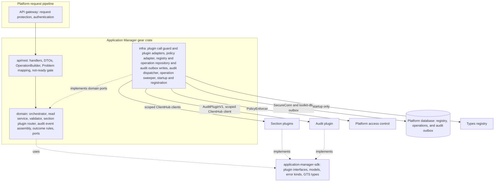

- [ ] `p3` - **ID**: `cpt-cf-application-manager-tech-layers`

The gear uses the platform's single layer model: `api/rest/`, `domain/`, and `infra/` ([gear layout and SDK pattern](../../../../docs/toolkit_unified_system/02_gear_layout_and_sdk_pattern.md)). Orchestration and the outcome rules are domain logic, so there is no separate application layer.

| Layer | Responsibility | Technology |
|---|---|---|
| API (`api/rest/`), the presentation layer | REST routes, request and response data transfer objects (DTOs), outcome-to-status mapping for synchronous refusals, standard canonical Problem bodies, the not-ready gate, and generated API documentation | Axum handlers registered through ToolKit OperationBuilder; the platform canonical error format, which is RFC 9457 Problem Details |
| Domain (`domain/`) | Request orchestration in precedence order, the operation lifecycle and its status guard, read flows, envelope and schema validation, the section plugin set and dispatch order, translation of plugin results into section outcomes, outcome ranking, and assembly of the outcome report and the accepted, finished, and refused events. It owns the ports that infrastructure implements. | Services marked `#[domain_model]` holding ports as trait objects; JSON Schema Draft 2020-12 through the workspace `jsonschema` crate; SHA-256 for request digests and for never-storable ids |
| Infrastructure (`infra/`) | Guarded plugin calls and ClientHub adapters, the PolicyEnforcer adapter, registry and operation persistence and audit outbox inserts, the audit dispatcher, the operation sweeper, startup checks, the readiness healthcheck, and telemetry | ClientHub scoped clients by GTS id; types registry `list_instances`; PolicyEnforcer; SeaORM through SecureConn; the `toolkit-db` transactional outbox with a leased handler; a hand-implemented start capability; platform OpenTelemetry |
| SDK crate (`application-manager-sdk`), the contract | The section plugin interface, the audit plugin trait `AuditPluginV1`, shared models, plugin error kinds, SDK constants, and GTS type definitions | Rust traits and models; GTS |

The software development kit (SDK) crate is the only crate that plugin gears depend on. The gear registers no public ClientHub client of its own, so REST is the only consumer surface. Planned code locations, relative to `gears/system/application-manager/`:

| Item | Location |
|---|---|
| Section plugin interface | `application-manager-sdk/src/section_plugin_api.rs` |
| Audit plugin interface | `application-manager-sdk/src/audit_plugin_api.rs` |
| Shared models: outcome categories, section outcomes, outcome report, operation status, audit events, caller identity, section schema with schema version | `application-manager-sdk/src/models.rs` |
| Plugin error kinds | `application-manager-sdk/src/errors.rs` |
| GTS type definitions: the two plugin types, the application resource type, the outcome report type | `application-manager-sdk/src/gts.rs` |
| Composition root, capabilities, healthcheck registration | `application-manager/src/gear.rs` |
| Typed configuration | `application-manager/src/config.rs` |
| REST layer | `application-manager/src/api/rest/` (`dto.rs`, `handlers.rs`, `routes.rs`) |
| Domain services and ports | `application-manager/src/domain/`, with the ports in `domain/ports.rs` |
| Adapters, registry and operation entities, repository, migrations | `application-manager/src/infra/`, with storage under `infra/storage/` (`entity/`, `repo.rs`, `migrations/`) |
| Operation sweeper | `application-manager/src/infra/operations/sweeper.rs` |
| Audit outbox queue and dispatcher | `application-manager/src/infra/audit/` (`outbox.rs`, `dispatcher.rs`) |

## 2. Principles & Constraints

### 2.1 Design Principles

When two principles pull in different directions, the earlier one in this order wins: Trace Before Change; Honest, Deterministic Outcomes; Validate Everything, Then Dispatch; Bounded Waiting, No Cancellation; Pass Through, Never Interpret; Plugin Set Fixed at Startup; Minimal, Rebuildable State. For example, a valid manifest is still not dispatched when its operation record and accepted event cannot be committed, and a call the gear stopped waiting for is reported as `timed_out`, meaning its outcome is unknown, never as succeeded.

#### Pass Through, Never Interpret

- [ ] `p2` - **ID**: `cpt-cf-application-manager-principle-pass-through`

The gear validates shape against schemas it does not own. It moves sections unchanged to their owners and never gives meaning to versions, re-seeds, schema versions, or section content. Domain logic, idempotency of plugin work, rollback, and version rules stay in the section plugins, so a new kind of seeded data never requires a gear change.

**ADRs**: `cpt-cf-application-manager-adr-validate-all-then-dispatch`, `cpt-cf-application-manager-adr-minimal-application-registry`

#### Plugin Set Fixed at Startup

- [ ] `p2` - **ID**: `cpt-cf-application-manager-principle-startup-fixed-plugin-set`

The section plugin set, its keys and priority order, and the audit plugin client are resolved once at startup, before the startup result is published, and then kept immutable. Request paths never consult the types registry, so key and priority conflicts surface at deploy time and an operation can never see the plugin set change midway.

**ADRs**: `cpt-cf-application-manager-adr-section-plugin-fan-out`, `cpt-cf-application-manager-adr-audit-via-plugin`

#### Validate Everything, Then Dispatch

- [ ] `p2` - **ID**: `cpt-cf-application-manager-principle-validate-then-dispatch`

Dispatch happens only after every pre-dispatch step has passed: permission, storage, the conflict checks, the envelope check, the committed operation record and accepted event, every live schema, and the whole-manifest validation. Seed validation and the discovery combined schema are built by the same composition rule, so a manifest built from discovery passes validation.

**ADRs**: `cpt-cf-application-manager-adr-plugin-served-section-schemas`, `cpt-cf-application-manager-adr-validate-all-then-dispatch`

#### Trace Before Change

- [ ] `p2` - **ID**: `cpt-cf-application-manager-principle-trace-before-change`

No section plugin receives data or a removal request unless the operation's record and accepted event are committed together. Every audit event is durable in the gear's database before the gear relies on it. Each final state of an operation commits together with its finished event, and a seed's registry write commits with them. Delivery to the audit plugin runs apart from request handling, at least once, so an audit plugin outage never blocks or changes a request. Duplicates are possible, and the audit plugin drops them by event id.

**ADRs**: `cpt-cf-application-manager-adr-audit-via-plugin`

#### Honest, Deterministic Outcomes

- [ ] `p2` - **ID**: `cpt-cf-application-manager-principle-honest-outcomes`

Every seed and uninstall ends in exactly one outcome category chosen by a fixed precedence, apart from an idempotent replay, which returns an existing operation, and an interrupted operation, which has no category. A caller is never told "not permitted", "conflict", or "not found" when the gear could not check, and a partial failure is never reported as success. When a dependency cannot answer, the gear fails closed. An operation has exactly one final state, because every write to it is guarded by its status and run deadline.

**ADRs**: `cpt-cf-application-manager-adr-outcome-http-mapping`, `cpt-cf-application-manager-adr-validate-all-then-dispatch`

#### Bounded Waiting, No Cancellation

- [ ] `p2` - **ID**: `cpt-cf-application-manager-principle-bounded-waiting`

The gear stops waiting for a plugin call at the configured time limit, but it never cancels or undoes work a plugin has started. A timed-out call keeps running detached from the operation, within the per-plugin in-flight cap, and its late result is logged by metadata only and discarded. For the same reason, each seed and uninstall runs, from receive, as a request task detached from the HTTP request. An interrupted operation starts no new plugin call, and the calls it already started may still complete.

**ADRs**: `cpt-cf-application-manager-adr-validate-all-then-dispatch`, `cpt-cf-application-manager-adr-audit-via-plugin`

#### Minimal, Rebuildable State

- [ ] `p2` - **ID**: `cpt-cf-application-manager-principle-minimal-state`

The only lasting gear state is one registry entry per seeded application, derived entirely from that application's last seed. Operation records hold outcomes and timestamps only, and each is purged once `operation_retention` has passed after its final state. The audit outbox holds each audit event only until the audit plugin confirms it, or until an operator settles it in the dead-letter store, which is the outbox table that keeps events rejected at the attempt limit. Sections and schemas are never persisted by the gear, and manifests are persisted only inside those waiting events. Recovery from any registry drift is a re-seed.

**ADRs**: `cpt-cf-application-manager-adr-minimal-application-registry`, `cpt-cf-application-manager-adr-audit-via-plugin`

### 2.2 Constraints

#### ToolKit Gear and Plugin Model

- [ ] `p2` - **ID**: `cpt-cf-application-manager-constraint-toolkit-plugin-model`

The gear follows the ToolKit SDK, domain, API, and infrastructure split, and the platform plugin model: plugin types are GTS types derived from the platform plugin base type, plugin instances are registered in the types registry, and plugin clients are resolved from ClientHub by exact GTS instance id ([ClientHub and plugins](../../../../docs/toolkit_unified_system/03_clienthub_and_plugins.md)). ClientHub cannot enumerate scoped clients ([client_hub.rs](../../../../libs/toolkit/src/client_hub.rs)), so the types registry instance list is the enumeration source. The Application Manager never depends on plugin crates. Discovery is eager, at startup, which departs from the plugin guide's lazy resolution (§4.10). Plugin gears run in the same host process (§3.8).

**ADRs**: `cpt-cf-application-manager-adr-section-plugin-fan-out`, `cpt-cf-application-manager-adr-audit-via-plugin`

#### Platform Authentication and Policy Enforcement

- [ ] `p2` - **ID**: `cpt-cf-application-manager-constraint-platform-auth`

Authentication belongs to the platform pipeline, and every route is authenticated. Authorization uses PolicyEnforcer against the platform access control service, and the gear never constructs an AccessScope, the compiled access constraint that PolicyEnforcer returns, by hand ([AuthN, AuthZ and secure ORM](../../../../docs/toolkit_unified_system/06_authn_authz_secure_orm.md)). The gear holds no credentials of its own. Plugins receive `CallerIdentity`, built from the request's `SecurityContext` with the bearer token removed, so the gear never forwards caller credentials to plugins (§3.3).

**ADRs**: `cpt-cf-application-manager-adr-validate-all-then-dispatch`

#### Secure ORM for the Registry and Operations

- [ ] `p2` - **ID**: `cpt-cf-application-manager-constraint-secure-orm`

All registry and operation access goes through SecureConn with entities declared unrestricted in the secure ORM. The registry and the operation records are platform-wide, so the entities have no tenant column and no scoping value, and the PDP decides who may reach them ([ADR 0007](./ADR/0007-cpt-cf-application-manager-adr-no-root-tenant.md), [database patterns](../../../../docs/toolkit_unified_system/11_database_patterns.md)). There is no raw SQL outside migrations. The physical schema, including the one-open-operation index, arrives through the gear's migrations, run by the platform migration phase.

**ADRs**: `cpt-cf-application-manager-adr-minimal-application-registry`, `cpt-cf-application-manager-adr-no-root-tenant`

#### Canonical Error Model

- [ ] `p2` - **ID**: `cpt-cf-application-manager-constraint-canonical-errors`

Every error response is a standard canonical Problem (RFC 9457) built from a canonical error category, with the GTS error type, title, and status fixed by the [canonical error system](../../../../docs/arch/errors/DESIGN.md). The gear uses only the members and the category contexts that the platform defines: field violations for an invalid manifest, the `aborted` reason for a conflict, and the retry delay for temporarily unavailable. It adds no extension member, and it does not use the reserved `extra` member. Production `internal` errors carry no diagnostic text. Only synchronous refusals and failed reads are errors. The outcome of an accepted operation is data in the operation report, which the operation read returns with 200 (§3.3).

**ADRs**: `cpt-cf-application-manager-adr-outcome-http-mapping`

#### No Manifest Content Outside the Audit Outbox and the Audit Plugin

- [ ] `p2` - **ID**: `cpt-cf-application-manager-constraint-no-manifest-content`

Section content and the manifest body exist in the gear in memory, while the request task runs, including the background operation, or while a detached plugin call that holds them runs, whichever ends later. The per-plugin in-flight cap bounds how many such calls exist, and `max_request_tasks` bounds the request tasks. The full manifest is also stored in the audit outbox, inside the accepted event, or the refused event of a seed, until the audit plugin confirms that event. An event that the dispatcher rejects keeps its manifest in the outbox dead-letter store until an operator replays or discards it. The gear offers no operation that reads the outbox or the dead-letter store, so it never exposes a waiting manifest. Operation records never hold manifest bodies or section content: the request digest is a SHA-256 value, and problem messages are written from schema-side constraints. Content leaves the gear only in the plugin calls that carry it: each section in its own `apply`, and the full manifest in the delivery of those events. It never appears in the registry, the operation records, logs, traces, metrics, error text, or diagnostics. Errors may name locations and section keys, never values. The application id and version are registry data and may appear in responses, logs, and span attributes. Logs and span attributes carry them escaped and length-bounded, never with a raw control character (§4.6). The PDP property and the audit events carry them exactly, within the per-action rules of §3.1.

**ADRs**: `cpt-cf-application-manager-adr-audit-via-plugin`, `cpt-cf-application-manager-adr-minimal-application-registry`

#### Restart for Plugin Changes

- [ ] `p2` - **ID**: `cpt-cf-application-manager-constraint-restart-for-plugin-change`

Adding, removing, or re-prioritizing a section plugin, or replacing the audit plugin, takes effect only when the Application Manager restarts, because the plugin set is built once at startup. No rollout order is prescribed.

**ADRs**: `cpt-cf-application-manager-adr-section-plugin-fan-out`

#### Configured Time Limit Only

- [ ] `p2` - **ID**: `cpt-cf-application-manager-constraint-configured-time-limit`

The plugin-call time limit comes only from gear configuration. It has no compiled default and no extra handling margin, and it is the same for every plugin call kind. The run window adds `run_window_margin` to whole operations, never to a single plugin call.

**ADRs**: `cpt-cf-application-manager-adr-validate-all-then-dispatch`, `cpt-cf-application-manager-adr-audit-via-plugin`

## 3. Technical Architecture

### 3.1 Domain Model

**Technology**: Rust domain types marked `#[domain_model]`; GTS types for the plugin specifications, the authorization resource type, the outcome report, and the section schemas that section plugins own; JSON Schema Draft 2020-12 for the envelope and section schemas.

**Location**: shared models in `application-manager-sdk/src/models.rs`, GTS definitions in `application-manager-sdk/src/gts.rs`, and domain services in `application-manager/src/domain/` (§1.3). The persisted shapes are defined in §3.7.

**Core Entities**:

- [ ] `p2` - **ID**: `cpt-cf-application-manager-entity-registry-entry`

**Application registry entry.** One entry per seeded application id: the application id, the last seeded version, the last result, the last seed time (the receive time of that seed), and the operation id of that seed, which its accepted and finished events carry. The operation id stays in the entry after the operation record is purged, and reading that operation then gives 404. The entry is platform-wide. The secure ORM treats it as unrestricted, and it has no tenant owner and no tenant column.

The last result is derived from the section outcomes of that seed:

- every section `succeeded`, including an empty key set: `succeeded`;
- at least one `succeeded` and at least one other section outcome: `partially_failed`;
- no `succeeded`: the after-dispatch winner, which is `not_permitted`, `plugin_rejected`, or `internal_failure`.

- [ ] `p2` - **ID**: `cpt-cf-application-manager-entity-manifest`

**Manifest.** A JSON object with exactly two members: `application`, the envelope, and `sections`, an object with one member per registered section key, whose value is that section. No object anywhere in the body may repeat a member name. The envelope holds exactly `id` and `version`. Each is non-empty text within the configured maximum length (`max_envelope_text_length`, §4.7), with no control character (as §4.1 defines it, which includes NUL). The id is never case-folded, trimmed, or normalised. The envelope rules are the gear's own. Section rules come from each section plugin's schema.

- [ ] `p2` - **ID**: `cpt-cf-application-manager-entity-section`

**Section.** The JSON value under one key of `sections`. The gear passes it unchanged to the owning section plugin's `apply`, together with the envelope.

- [ ] `p2` - **ID**: `cpt-cf-application-manager-entity-outcome-category`

**Outcome category and section outcome.** The request-level category is one of the eight PRD categories: succeeded, plugin rejected, not permitted, conflict, not found, invalid manifest, internal failure, and temporarily unavailable. An idempotent replay has no category of its own, and an interrupted operation has none. The outcome table in §3.3 states where each category appears. Each section outcome is one of `succeeded`, `rejected`, `not_permitted`, `internal_failure`, `timed_out`, `not_sent`, or `not_dispatched`. `timed_out` counts as an internal failure and means the outcome is unknown: the call may still complete after the gear stopped waiting, and that late result is not recorded in any audit event. `not_sent` also counts as an internal failure, but the outcome is known: the plugin's in-flight cap was full, so the call never reached the plugin and nothing was applied or removed. `not_dispatched` means the section plugin was not called, because the request task failed first.

- [ ] `p2` - **ID**: `cpt-cf-application-manager-entity-outcome-report`

**Outcome report.** The PRD's operation report: the caller-facing result of one operation. The gear writes it into the operation record while the operation runs, and the operation read returns it once the operation is final. It validates against the outcome report GTS type. Its members:

| Member | Content | Values |
|---|---|---|
| `operation_id` | The operation id, which the accepted and finished events carry | Time-ordered UUID |
| `action` | The action of the operation | `seed`, `uninstall` |
| `category` | The outcome category of a completed operation. Absent while the operation is open and for an interrupted operation. | `succeeded`, `plugin_rejected`, `not_permitted`, `invalid_manifest`, `internal_failure`, `temporarily_unavailable` |
| `interrupted` | True when the operation was interrupted at its run deadline. The report then holds the section outcomes recorded so far. | Boolean |
| `application` | Seed: `id` and `version` from the envelope. Uninstall: `id` and the last seeded `version`. | Opaque text |
| `partial` | True when at least one section succeeded and at least one did not. It matches the registry's `partially_failed`. | Boolean |
| `sections` | One item per section plugin with a recorded outcome, in priority order: `key`, `outcome`, `schema_version` for a seed section that was validated, and, for `rejected` and `not_permitted`, the plugin's `detail`, truncated to the bound that the SDK fixes, and optional `location` | `outcome`: the section outcomes above |
| `problems` | Section validation problems: `location` (JSON Pointer), `rule`, and `message` | `rule`: the failed JSON Schema keyword, such as `required`, `type`, or `additionalProperties`, or a gear token: `missing_section`, `unknown_section` |
| `unavailable` | For a seed operation that ends at rank 6: each section schema that could not be used, as an unavailable item | Unavailable items with `dependency` `section_schema` |
| `registry_effect` | What the operation did to its entry. `not_updated` and `delete_failed` mean the change is not confirmed: the write failed, or it timed out after it started, in which case it may still have taken effect. | `updated`, `not_updated`, `unchanged`, `deleted`, `delete_failed` |

An unavailable item has `dependency`, `key` for a section schema, and `reason`. The same shape is used in refused events (`cpt-cf-application-manager-entity-audit-event-content`). Dependencies are `access_control`, `registry_storage`, `operation_storage` (including an acceptance transaction that could not commit), `section_schema`, and `application_manager` (the gear itself refused at its gate). Reasons are `unreachable`, `timed_out`, `unusable`, `not_sent` (the plugin's in-flight cap was full), `not_ready` (refused before readiness or while stopping), and `at_capacity` (refused at the request-task cap).

When the request task fails, or the operation is interrupted, the registry effect follows the record. For a seed, it is `not_updated` once dispatch had begun and `unchanged` before that, because the upsert commits only with the completion. For an uninstall, it is `deleted` when the guarded delete transaction recorded it, and `delete_failed` otherwise.

- [ ] `p2` - **ID**: `cpt-cf-application-manager-entity-operation`

**Operation record.** The PRD's operation record: one per accepted seed or uninstall. It holds the operation id, the application id, the action, the status, the outcome category once completed, the outcome report as written so far, the accepted, started, and finished times, the run deadline, and the finished event id. When the request carried a valid idempotency key, it also holds the key, the caller subject id, the idempotency scope, and the request digest. It never holds manifest bodies, section content, or any other part of the caller identity. It is platform-wide, and the secure ORM treats it as unrestricted, with no tenant column.

The status moves as the PRD states: accepted, then running, then completed; an open operation, accepted or running, can instead become interrupted. Completed and interrupted are final.

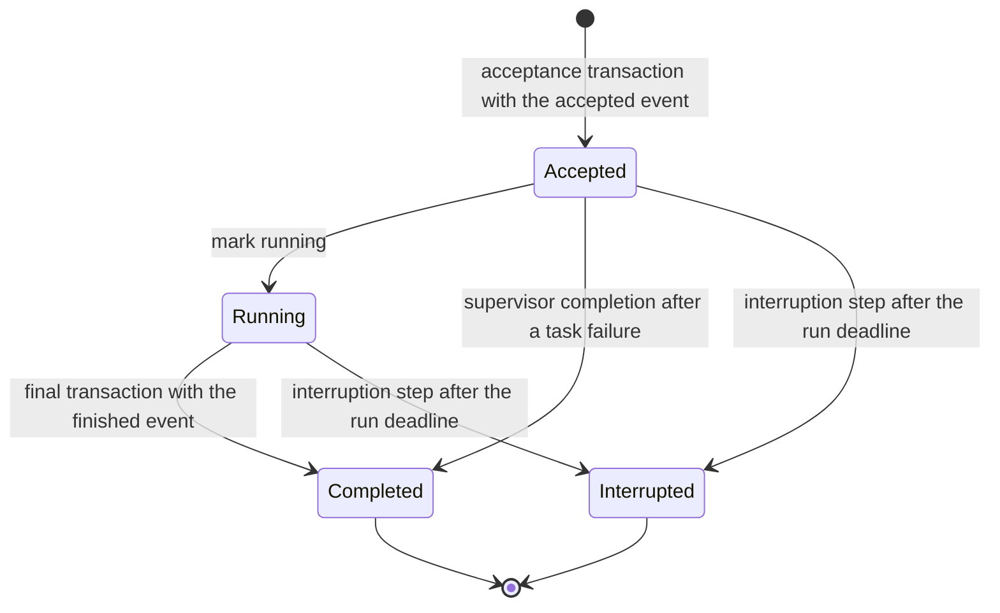

- **Run deadline.** Set at acceptance: the receive time plus (N + 1) × `plugin_call_timeout` for a seed, or N × `plugin_call_timeout` for an uninstall, plus `run_window_margin`. N is the size of the accepting replica's section plugin set. A seed makes one concurrent schema phase and one `apply` per section plugin, and an uninstall one `remove` per section plugin, so this is the PRD's run window.
- **Status guard.** Every write to an open operation is an update conditioned on its status. Mark running, each section outcome update, the guarded delete transaction, the completion, its fallback, and the supervisor's completion match only an open operation whose run deadline has not passed. The interruption step matches only an open operation whose run deadline has passed. A write whose condition does not match changes nothing, and the transaction that holds it is rolled back. So the first final write wins, and no later write changes the final state.
- **Interruption step.** One transaction: the guarded update sets status interrupted and the finish time, keeps the report with the section outcomes recorded so far and sets `interrupted`, and inserts the finished event, built from the record with the stored finished event id. The operation sweeper runs it, and so do the operation read and the acceptance transaction when they meet an open operation past its run deadline. An interrupted operation frees its application.
- **Idempotency key.** Opaque text of 1 to `IDEMPOTENCY_KEY_MAX_BYTES` bytes of visible ASCII (U+0021 to U+007E). `IDEMPOTENCY_KEY_MAX_BYTES` is a gear constant, published in the API documentation. A key that breaks this rule is an invalid manifest problem at rank 5, located at `Idempotency-Key`, and it is not stored. Its scope is the caller subject id, the action, and the application id. The idempotency scope is the SHA-256 digest of those three values and the key, in a fixed length-prefixed encoding. It gives the unique index a fixed size on every backend.
- **Request digest.** The SHA-256 digest of the request content in the gear's fixed serialization: object members sorted by name in UTF-8 byte order, no insignificant whitespace, and strings and numbers written as the JSON parser kept them. For a seed, the content is the parsed manifest. For an uninstall, it is the application id, so a repeated uninstall key in its scope always matches. Two requests have the same content when their parsed values are equal: members in any order and any formatting count as the same, and numbers count as equal only as parsed, so `1` and `1.0` differ. The serialization is internal to the gear. Changing it makes retained keys compare as different content, so a change ships with a release note.
- **Retention.** A final record is purged by the operation sweeper once `operation_retention` has passed after its finish time. Its key goes with it, and a later request with that key is a new request. A refused request creates no record, so its key is not kept.

- [ ] `p2` - **ID**: `cpt-cf-application-manager-entity-caller-identity`

**Caller identity.** The identity-only context that the gear passes to every section plugin call and places in every accepted and refused event: the subject id, subject type, subject tenant id, and token scopes, copied from the request's `SecurityContext`. It never carries the bearer token. The request task holds it in memory until the operation ends, and the operation record never stores it. The SDK ships a constructor that turns it back into a `SecurityContext` with no bearer token, copying the subject id, subject type, subject tenant id, and token scopes, so that a plugin can make its own PolicyEnforcer check (§3.3).

- [ ] `p2` - **ID**: `cpt-cf-application-manager-entity-audit-event-content`

**Audit event content.** Each audit event is one of three kinds: accepted, finished, or refused. A request has either one refused event, or one accepted event followed by one finished event. An idempotent replay has none. The audit plugin contract (§3.3) lists the exceptions. Every event carries:

- the event id, a time-ordered UUID that the gear assigns per event kind when the request is received. The finished event id is stored in the operation record, so the completion, its fallback, the supervisor, and the interruption step all use it, and every delivery of the event carries it. The audit plugin drops duplicates by it;
- the event kind and the action, seed or uninstall;
- the correlation id. Accepted and finished events carry `operation_id`. A refused event carries `request_id`. The gear assigns one time-ordered UUID per request when it is received: it becomes the operation id when the request is accepted, and it is the request id of a refusal. An acceptance transaction that timed out but did commit therefore shares one id with its refused event;
- the application. Accepted and finished events: the id and the version, for seed from the envelope, and for uninstall the last seeded version. Refused event of a seed: the id and the version as structured fields, each only when it was extracted and is within the envelope limits. Refused event of an uninstall: the id exactly as submitted when it can be stored, and the last seeded version when the entry was found. A never-storable uninstall id (§4.1) is never carried as a field. The event carries its length in bytes and the SHA-256 digest of its bytes as received, and nothing else of it.

The manifest member, for seed, holds the manifest as sent, as the JSON value that the platform's JSON extractor parsed. A body that is not valid JSON never reaches the gear (§3.2), so every seed event carries a parsed manifest.

The accepted event also carries:

- the caller identity;
- the receive time;
- the manifest member (seed).

The finished event also carries:

- the validation result with its problems;
- the per-section outcomes, each with the schema version of the schema used. `timed_out` means the outcome is unknown, and no late result is sent;
- the overall outcome category, or, for an interrupted operation, the interrupted marker with no category;
- the registry effect, including a registry write or delete that failed or is not confirmed;
- the completion time.

The finished event carries no caller identity. It joins its accepted event by the operation id, so the joined audit event names the caller, and the interruption step needs no caller data in the operation record.

The refused event also carries:

- the caller identity;
- the receive time;
- the manifest member (seed);
- the outcome category of the synchronous refusal, with the envelope problems for invalid manifest, the cause and the busy operation id for conflict, and the unavailable items for temporarily unavailable;
- the completion time.

- [ ] `p2` - **ID**: `cpt-cf-application-manager-entity-schema-version`

**Schema version.** The PRD's schema version, declared by the section plugin. The `schema` operation returns it together with the schema, as opaque text of 1 to `SCHEMA_VERSION_MAX_BYTES` bytes of UTF-8. `SCHEMA_VERSION_MAX_BYTES` is fixed by the SDK. The section plugin must change it whenever the schema content changes. The gear never derives, parses, compares, or orders it. It records it verbatim, per section, in the finished event and in the report, and returns it with the schema in discovery. A missing, empty, or too long version makes that schema `unusable`, like any other schema the gear cannot use. The gear cannot detect a plugin that returns the same version for different content. That is a section-plugin defect, which the plugin's contract conformance test covers. The gear stores a schema version only inside the finished event until delivery and inside the operation report until the record is purged. Logs carry it escaped and length-bounded, like an application id (§4.6).

| Entity | Description | Schema |
|---|---|---|
| ApplicationRegistryEntry | Last-seed view of one application | §3.7 `cpt-cf-application-manager-dbtable-application-registry` |
| Operation | Status, report, and timestamps of one accepted seed or uninstall | §3.7 `cpt-cf-application-manager-dbtable-operations` |
| Manifest | Envelope plus sections, as submitted | Envelope schema owned by the gear; combined schema served by discovery (§3.3) |
| Section | One section plugin's part of a manifest | Served live by that section plugin as a GTS type schema |
| OutcomeCategory and SectionOutcome | Request and per-section results | Fixed sets in `application-manager-sdk/src/models.rs` |
| OutcomeReport | Caller-facing result of an operation, returned by the operation read | GTS type `gts.cf.core.application_manager.outcome_report.v1~`, defined in `application-manager-sdk/src/gts.rs` |
| CallerIdentity | Identity passed to plugins | `application-manager-sdk/src/models.rs` |
| AuditEventContent | Content of the accepted, finished, and refused events | `application-manager-sdk/src/models.rs`, used by `AuditPluginV1`, and stored as the outbox payload until delivery |
| SchemaVersion | Plugin-declared version of a section schema | `application-manager-sdk/src/models.rs`, as part of the section schema that `schema` returns |

**Relationships**:
- Manifest → Section: one section per registered section key, addressed by the key.
- Manifest → Operation: a seed that passes the synchronous checks creates one operation for its envelope application id.
- Operation → ApplicationRegistryEntry: a seed operation that passes validation creates or overwrites the entry, which keeps its operation id. An uninstall operation deletes it.
- Operation → OutcomeReport: one report per operation, final once the operation is final.
- Operation → AuditEventContent: the accepted and finished events carry the operation id.
- OutcomeReport → SectionOutcome: one section outcome per section plugin with a recorded outcome, in priority order.
- Section → SchemaVersion: each validated section carries the schema version of the schema it was checked against.
- AuditEventContent → CallerIdentity: every accepted and refused event names the caller.

### 3.2 Component Model

The diagram places each component in its layer. Domain components call ports, and infrastructure components implement them (dotted arrows). The startup result holder is a domain type. The startup component publishes into it through the domain-owned startup port (dotted arrow), and the domain components and the REST not-ready gate read it.

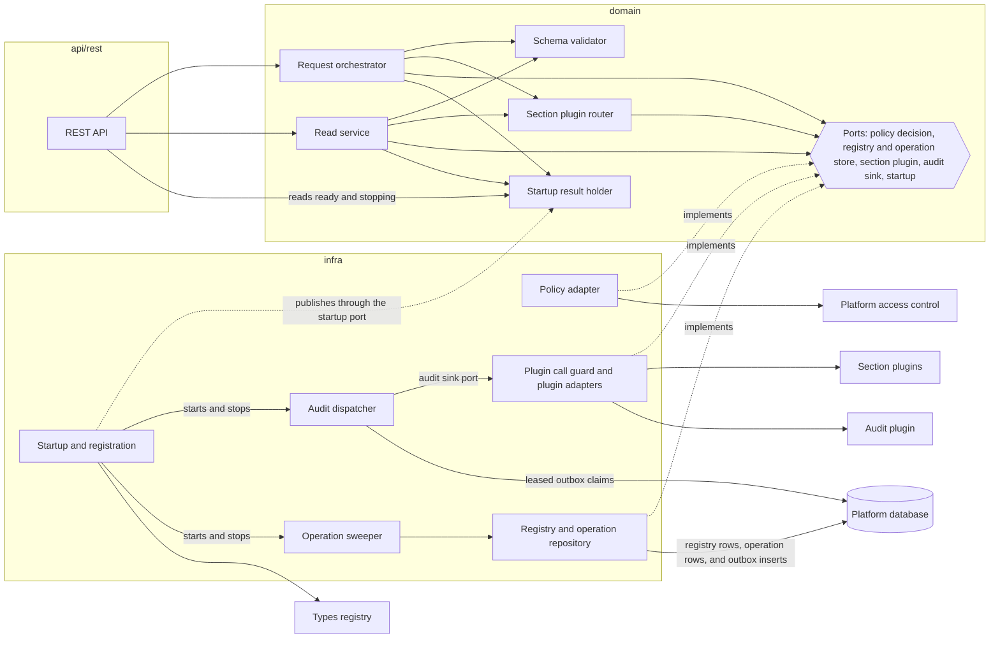

#### REST API

- [ ] `p2` - **ID**: `cpt-cf-application-manager-component-rest-api`

##### Why this component exists — REST API

It is the only caller-facing surface. It turns HTTP requests into domain calls, and domain results into 202 answers, 200 bodies, and the synchronous refusal statuses of the outcome table in §3.3.

##### Responsibility scope — REST API

- Registers the eight operations of `cpt-cf-application-manager-interface-rest-api` through OperationBuilder, with versioned paths, `.authenticated()`, no license requirement, request and response schemas, tags, the declared statuses, and the gateway throttling zones.
- Reads the seed body through the platform's typed JSON extractor, `toolkit::api::rest::extract::Json`, as a JSON value. A body that is not valid JSON, or has the wrong content type, is refused by the extractor with 400 `invalid_argument` before the gear sees it: it is a platform-rejected request, it creates no operation, and it is not audited. Reading the body as a JSON value means the extractor never reports a data error. The gateway body limit and `serde_json`'s recursion limit still apply.
- Reads the optional `Idempotency-Key` header on seed and on both uninstall forms, and passes it to the orchestrator unchanged. The orchestrator checks the key rule.
- Owns the not-ready gate: until the startup result is published, and once `stop` has set the stopping flag, it refuses every request as temporarily unavailable. For seed and uninstall, the refusal is logged and counted as refused before readiness, and its refused event names `application_manager` with reason `not_ready`. Before the audit outbox has started (§3.2, startup), the refused event cannot be recorded: the refusal keeps its category and is logged with the missing-event signal. Reads, including the operation read, are refused the same way, with no refused event.
- Owns the request-task cap check. After the not-ready gate, for seed and uninstall, it takes one of the orchestrator's `max_request_tasks` permits before the request task is started. When none is free, the request is refused as temporarily unavailable, logged, and counted as refused at the cap. Its refused event names `application_manager` with reason `at_capacity`.
- Gate refusals run their refused event insert in the REST handler, bounded by `registry_operation_timeout`, because they have no request task. The refusal is logged before the insert, so a caller that disconnects during the insert still leaves the log entry.
- Writes the answers. An accepted operation and an idempotent replay get 202 with a body that holds the operation id and its status, and a `Location` header with the operation read path. A synchronous refusal gets the standard Problem of its row in the outcome table (§3.3). The operation read gets the operation document as its 200 body.
- With the permit taken, has the orchestrator start each seed and uninstall as a supervised request task, and awaits only the synchronous answer, through a one-shot channel. Dropping the HTTP request drops only this wait, so the request task still completes its synchronous phase and its operation.
- Holds no business rules.

##### Responsibility boundaries — REST API

It does not authenticate or authorize, which belong to the platform pipeline and the domain services. It does not decide categories and does not log manifest content. Platform-rejected requests, such as unauthenticated requests, oversized bodies, malformed JSON, wrong content types, and throttled requests, never reach it.

##### Related components (by ID) — REST API

- `cpt-cf-application-manager-component-request-orchestrator` — calls for seed and uninstall
- `cpt-cf-application-manager-component-read-service` — calls for listing, discovery, and the operation read
- `cpt-cf-application-manager-component-startup-registration` — reads the ready and stopping flags it publishes

#### Request Orchestrator

- [ ] `p1` - **ID**: `cpt-cf-application-manager-component-request-orchestrator`

##### Why this component exists — Request Orchestrator

The PRD's precedence, acceptance, audit ordering, and dispatch rules form one sequence that must be the same on every path. One component owns that sequence, so no branch can skip a step.

##### Responsibility scope — Request Orchestrator

For seed and uninstall, one request task runs two phases.

**Synchronous phase.** It makes no plugin call, and it ends with exactly one answer to the REST handler.

1. Receive: one time-ordered UUID, which becomes the operation id on acceptance and is the request id of a refusal, the receive time, one event id per event kind, and the application id. Seed reads the envelope from the body that the platform's JSON extractor parsed, and checks the envelope limits on it. When `application.id` is missing or not a string, no id is extracted, and the request continues to its rank. The envelope check runs on that parsed body, through the schema validator: the top level holds exactly `application` and `sections`, `sections` is an object, and `application` holds exactly `id` and `version`, each within the envelope limits. Its problems are kept for rank 5. Uninstall takes the id from the path or the body and checks only whether it could ever be stored. When the request carries an `Idempotency-Key`, the key rule is checked (§3.1). A key that breaks it is kept as a rank 5 problem and is not used. For a valid key, the request digest is computed.
2. The permission decision for `seed` or `uninstall`, through the policy decision port, bounded by `pdp_call_timeout`. The application id is sent as a resource property only when one was extracted and it can be stored (§3.3).
3. For a permitted caller only, the storage step: one bounded read, within `registry_operation_timeout`, of the operation in the key's scope when a valid key was sent, the open operation of the application id, and the registry entry. It proves that registry storage and operation storage can answer, and yields the last seeded version for uninstall. An uninstall id that can never be stored cannot name any entry or operation, so it is decided as not found with no storage read. That never-storable id is empty, contains a control character (§4.1), or is longer than `REGISTRY_TEXT_MAX_BYTES` (§3.7). Any other uninstall id is looked up, including one longer than `max_envelope_text_length`, which applies to seed only. A seed with no extracted id, or with an id that can never be stored, reads the empty id, which no entry or operation can have, so the step still proves that storage can answer.
4. Replay check. When the key's scope has an operation and its request digest equals this request's digest, the request is an idempotent replay. The answer is 202 with that operation's id and current status. No operation is created, nothing is dispatched, no audit event is recorded, and the replay is logged and counted. When the digests differ, the request is decided as conflict with cause `idempotency_key_reused`.
5. Ranks 3 to 5, from what the storage step read. An open operation whose run deadline has not passed decides conflict with cause `application_busy`, naming that operation's id. An uninstall with no entry decides not found. A seed with an envelope problem, or a key that breaks the key rule, decides invalid manifest. An open operation whose run deadline has passed does not make the application busy: the acceptance transaction interrupts it first (step 7).
6. Refusal. When ranks 1 to 5 decide a category, the refused event is inserted into the audit outbox queue in a transaction of its own, bounded by `registry_operation_timeout`, and the refusal is answered. When that insert fails or times out, the refusal keeps its category, and the missing event is logged and counted, which raises the operator signal (§4.6).
7. Acceptance, when nothing is decided: one transaction, bounded by `registry_operation_timeout`. It first runs the interruption step (§3.1) for an open operation of the application whose run deadline has passed, when step 3 found one. It then inserts the operation record with status accepted, its run deadline, its finished event id, and, with a valid key, the key fields, and it inserts the accepted event into the audit outbox queue. When the insert violates the one-open-operation index or the idempotency scope index, because a concurrent request won, one bounded refusal step reads the winning operation and decides as steps 4 and 5 do. A replay is answered as a replay and records nothing. A conflict records its refused event in the same transaction as that read. When the acceptance transaction fails or times out for any other reason, the request is decided as temporarily unavailable, with an `operation_storage` unavailable item, and refused as in step 6.
8. Answer: 202 with the operation id and status accepted, sent to the REST handler as soon as the acceptance commits.

**Operation phase.** The same task continues in the background.

9. Mark running: a guarded update sets status running and the start time.
10. Seed: the schema-fetch phase, then the validation of the sections, which can decide rank 6 or 7. Uninstall: the guarded delete transaction, which deletes the registry entry and records registry effect `deleted` in the report together.
11. Dispatch in priority order through the section plugin router: `apply` on seed, `remove` on uninstall. After each call, the section outcome is recorded in the report by a guarded update. No plugin call starts after the run deadline.
12. The final transaction, guarded: the report with its category, status completed, the finish time, the finished event, and, for a seed that was dispatched, the registry upsert. A seed that ends at rank 6 or 7 records registry effect `unchanged`. When the final transaction of a dispatched seed fails or times out, the fallback transaction records the same without the upsert, with registry effect `not_updated`. When the first transaction did commit, the fallback's guard finds the operation completed and changes nothing. A final report that cannot be recorded is logged and counted, and the interruption step records the operation as interrupted after its run deadline.

A guarded write that finds the operation final ends the task with no further plugin call or registry change. A guarded write that fails because storage cannot answer does not stop dispatch: the task keeps the outcome in memory and writes the full report in the final transaction. Uninstall runs the delete (step 10) before removal (step 11), so the entry is deleted whatever the section plugins return.

**Request task, supervisor, and request state.** The orchestrator starts a supervisor as a detached task of its own, and the supervisor starts the request task and awaits it. Neither task is a child of the REST handler, so a caller disconnect or the gateway deadline cuts no step short, including the permission decision, the storage step, the acceptance, and the whole operation. The task keeps a small in-memory request state that the supervisor reads: the correlation id and the event ids, the retained receive-time fields, the acceptance state (not started, started, committed, or failed), the refused event state, and whether the answer was sent. If the request task panics or fails to join, the supervisor:

- when the acceptance committed, completes the operation as internal failure through the guarded completion, with the section outcomes in the record, `not_dispatched` for every section plugin not yet called, and the registry effect that §3.1 derives from the record. A guard that finds the operation final changes nothing. When the completion fails, the interruption step ends the operation after its run deadline;
- otherwise, unless the refused event is committed, inserts the refused event with category internal failure, which is a gear defect outside the precedence table. When the acceptance had started but is not confirmed, the operation may exist, and the interruption step ends it after its run deadline;
- answers the REST handler when no answer was sent: 202 with the operation id when the acceptance committed, and otherwise the platform's generic 500 `internal`, with no diagnostic text.

The supervisor makes no plugin call and no registry write. Its only writes are the guarded completion and the refused event insert.

**Request task ownership.** The orchestrator owns the request tasks: a task tracker holding the `max_request_tasks` permits, the in-flight request task gauge, and `drain(deadline)`. The REST handler takes a permit before the orchestrator starts the supervisor. The permit moves into the supervisor and is released when the supervisor ends: right after the answer for a refusal or a replay, and after the final state for an operation. The orchestrator starts every supervisor in its tracker. `drain(deadline)` closes the tracker to new tasks, then waits for the running supervisors until the deadline, then logs how many it abandoned, by action. An abandoned operation is interrupted after its run deadline. The startup component calls `drain` from `stop` (`cpt-cf-application-manager-component-startup-registration`).

The orchestrator records a decided category the moment one applies and keeps it through the refused event or the report. This table is the normative precedence. Other sections of this document refer to it and do not restate it:

| Stage | Rank | When | Category |
|---|---|---|---|
| Synchronous | 1 | The not-ready gate or the request-task cap refuses the request; platform access control cannot answer; or, for a permitted caller, the storage step cannot answer (registry storage or operation storage) | Temporarily unavailable |
| Synchronous | 2 | Platform access control refuses the caller | Not permitted |
| Synchronous | 3 | The idempotency key was used in its scope for different content, or the application has an open operation whose run deadline has not passed | Conflict |
| Synchronous | 4 | Uninstall of an id with no entry. An id that can never be stored is decided here with no storage read (step 3). | Not found |
| Synchronous | 5 | Seed with an envelope problem: the body breaks the envelope schema or the envelope limits; or an idempotency key that breaks the key rule | Invalid manifest |
| Acceptance | none | The operation record and the accepted event cannot be committed. Checked only when ranks 2 to 5 do not match. | Temporarily unavailable |
| Operation, seed only | 6 | A schema is not served or is unusable | Temporarily unavailable |
| Operation, seed only | 7 | A section problem: a missing or unknown key, or a section that breaks its schema | Invalid manifest |
| After dispatch | 1 | Any section ends `not_permitted` | Not permitted |
| After dispatch | 2 | Any section ends `rejected` | Plugin rejected |
| After dispatch | 3 | Any section ends `internal_failure`, `timed_out`, or `not_sent`, or the registry write or delete fails or times out | Internal failure |
| After dispatch | none | No rank applies | Succeeded |

The first matching rank decides. An idempotent replay is not ranked: it is recognised after rank 2 and before rank 3, only for a permitted caller whose storage step answered. Ranks 1 to 5 and acceptance give synchronous refusals: each gets a refused event, creates no operation, and is never dispatched. Ranks 6 and 7 and the after-dispatch ranks are decided inside an operation, and they appear only in its report and its finished event. A seed with both an envelope problem and a section problem ends at rank 5 with its envelope problems only, because the sections are validated only inside the operation. The outcome table in §3.3 maps each row to its HTTP status, for synchronous refusals only.

Invariants:
- No `apply` or `remove` before a committed operation record with its accepted event, and a permit.
- No registry or operation access without a permit.
- No registry change for requests that end before dispatch, and none for an idempotent replay.
- A dispatched seed's upsert never commits without its final report and its finished event, because all three are in one transaction.
- At most one final state per operation: every write is guarded by the status and the run deadline.
- No plugin call starts after the run deadline or after the operation is final.
- One event id per event kind per request. The finished event id is stored in the operation record, and every writer of the finished event uses it.
- The request task completes even when the HTTP request is dropped, at any step.
- One parse, one id: for seed, the id is taken once, from the single parse of the body. Every use of the id is that value: the PDP property, the storage step, the operation record, the audit events, validation, `apply`, and the registry write. A use that §3.1 omits carries no id, never another value. The one exception is that the storage step reads the empty id when the value can never be stored. The PDP property is omitted in that case.

##### Responsibility boundaries — Request Orchestrator

It holds no plugin set, which the router holds, and no schema logic, which the validator holds. It never calls the audit plugin, which only the audit dispatcher does. It never cancels or undoes a plugin call, and never resumes or replays an interrupted operation. It does not sweep or purge operation records, which the operation sweeper does.

##### Related components (by ID) — Request Orchestrator

- `cpt-cf-application-manager-component-registry-repository` — reads and writes registry entries and operation records, and inserts audit events, through the registry and operation store port
- `cpt-cf-application-manager-component-audit-dispatcher` — delivers the events that it records
- `cpt-cf-application-manager-component-schema-validator` — validates the manifest
- `cpt-cf-application-manager-component-section-plugin-router` — fetches schemas and dispatches
- `cpt-cf-application-manager-component-operation-sweeper` — interrupts the operations that its tasks leave open
- `cpt-cf-application-manager-component-rest-api` — called by, and answered through a one-shot channel

#### Read Service

- [ ] `p2` - **ID**: `cpt-cf-application-manager-component-read-service`

##### Why this component exists — Read Service

Listing, discovery, and the operation read have different availability rules from seed and uninstall: they record no audit event, and they produce no outcome category. Keeping them apart keeps them available during an audit outage.

##### Responsibility scope — Read Service

- Runs the permission decision for `list`, `read_schema`, or `read_operation` first.
- Lists registry entries after the permit, as an object with an `items` array, unpaginated and in unspecified order (§4.10).
- Lists section keys in priority order from the in-memory section plugin set.
- Fetches one key's schema, or every schema concurrently for the combined schema, and returns each schema version with its schema.
- Reads one operation record by id, bounded by `registry_operation_timeout`. It returns the operation document: the operation id, the action, the application id and version, the status, the accepted, started, and finished times, the run deadline, and, once the operation is final, the report. It never returns the idempotency key, the caller subject, the idempotency scope, or the request digest. When the record is open and its run deadline has passed, it first runs the interruption step (§3.1), within the same bound, and then returns the operation as interrupted.

##### Responsibility boundaries — Read Service

No audit event, no registry writes, no caching of schemas, and no plugin call for the listing, the key list, or the operation read. Its only write is the interruption step. A read is not a seed, so read failures use canonical errors directly: permission denied, not found for an unknown key or for an unknown, malformed, or purged operation id, and service unavailable with the retry delay. A read 503 carries the standard Problem only. The dependency and the reason behind it go to logs and metrics (§4.6).

##### Related components (by ID) — Read Service

- `cpt-cf-application-manager-component-registry-repository` — lists entries, reads operation records, and runs the interruption step through the registry and operation store port
- `cpt-cf-application-manager-component-section-plugin-router` — fetches live schemas
- `cpt-cf-application-manager-component-schema-validator` — composes the combined schema and checks each schema version

#### Schema Validator

- [ ] `p2` - **ID**: `cpt-cf-application-manager-component-schema-validator`

##### Why this component exists — Schema Validator

Whole-manifest validation and the combined schema must follow one rule, so that discovery is a reliable contract for seeding callers.

##### Responsibility scope — Schema Validator

- Owns the envelope schema and the envelope limits: non-empty text, within the configured maximum length, with no NUL or other control characters.
- Reads each served section schema as defined through GTS: it is the JSON Schema of the GTS type that the section plugin owns for its section. JSON Schema Draft 2020-12 is the dialect, so the gear compiles it as Draft 2020-12. A missing `$schema` means Draft 2020-12. Any of these makes that key's schema `unusable`: a `$schema` that names another dialect, a reference that leaves the served document, including a reference to another GTS type, a pattern that the linear-time engine cannot compile within its compile limits, a schema larger than `SERVED_SCHEMA_MAX_BYTES`, a schema version that is missing, empty, or longer than `SCHEMA_VERSION_MAX_BYTES`, or any other compile failure.
- Configures the workspace `jsonschema` crate explicitly. The draft is pinned to 2020-12. `pattern` and `patternProperties` use the crate's linear-time engine, the `regex` crate, through the crate's pattern options with explicit compile limits: the gear constants `SCHEMA_REGEX_SIZE_LIMIT` and `SCHEMA_REGEX_DFA_SIZE_LIMIT`. That syntax has no lookaround and no backreferences. The retriever refuses every external reference. No network or file resolution can happen, whatever crate features the workspace enables.
- Checks the size of each served schema before compiling it: a schema whose serialization is longer than the gear constant `SERVED_SCHEMA_MAX_BYTES`, which the SDK publishes, is `unusable`.
- Runs compilation and validation on the blocking thread pool, off the async executor.
- Composes the combined schema: the envelope schema with a `sections` object whose properties are every current section schema under its key, all keys required, and no other members allowed. Each section schema is embedded as its own schema resource with a distinct `$id` that the gear assigns: the gear-owned URN `urn:cf:application-manager:section:<key>`, built from its section key. A top-level `$id` in the served schema, such as its GTS type id, is replaced by the assigned one. A `$ref` that relies on the served `$id`, such as an absolute URI built from it, therefore becomes an external reference, and the schema is `unusable`. References local to the served document, such as `#/$defs/item`, resolve inside that resource and never collide across section plugins.
- Validates the manifest against that composition in one pass and collects every problem.
- Writes problem messages from the failed keyword and the schema-side constraint, never from instance values.
- Passes each schema version through verbatim, for the finished event, the report, and discovery.

##### Responsibility boundaries — Schema Validator

It resolves nothing outside the served document, and it never consults the types registry. It keeps no compiled schema beyond the operation or the read, and owns no section rules.

##### Related components (by ID) — Schema Validator

- `cpt-cf-application-manager-component-request-orchestrator` — called during the synchronous phase for the envelope and during a seed operation for the sections
- `cpt-cf-application-manager-component-read-service` — called for discovery

#### Section Plugin Router

- [ ] `p1` - **ID**: `cpt-cf-application-manager-component-section-plugin-router`

##### Why this component exists — Section Plugin Router

Routing must depend only on the startup-built section plugin set, so that a manifest can never select or add a section plugin.

##### Responsibility scope — Section Plugin Router

- Holds the immutable section plugin set from the startup result: each section plugin's key, priority, GTS instance id, and section plugin port, in priority order.
- Fetches all schemas concurrently, with their schema versions, and reports every key whose schema was not served, with its reason.
- Calls `apply` or `remove` one at a time in priority order, when the orchestrator asks for the next call.
- Translates each port result into a section outcome.
- Passes the caller identity to every call, and the operation id to `apply` and `remove`.

##### Responsibility boundaries — Section Plugin Router

It never calls the types registry after startup, never selects a plugin per request, and never retries a call. It does not record outcomes or check the run deadline, which the orchestrator does between calls. Each call goes through the guarded adapter behind the section plugin port.

##### Related components (by ID) — Section Plugin Router

- `cpt-cf-application-manager-component-plugin-call-guard` — wraps every call behind the section plugin port
- `cpt-cf-application-manager-component-startup-registration` — receives the section plugin set from it

#### Plugin Call Guard

- [ ] `p2` - **ID**: `cpt-cf-application-manager-component-plugin-call-guard`

##### Why this component exists — Plugin Call Guard

The time-limit rule applies to every plugin call kind, and in an asynchronous runtime, dropping a timed-out call would cancel it. One guard makes "stop waiting, never cancel" uniform. The guard and the ClientHub adapters together implement the section plugin port and the audit sink port.

##### Responsibility scope — Plugin Call Guard

- Runs each plugin call as a task detached from its caller, and waits for it up to the configured time limit.
- On expiry, returns a timeout to the caller and lets the task run to completion. The late result is logged by metadata only (operation id, plugin kind, section key, call kind, elapsed time, and result kind) and discarded.
- Enforces the per-plugin in-flight cap (`plugin_max_in_flight`, §4.7). It counts the calls in flight to each plugin instance, including detached calls still running after their timeout. When the cap is reached, the new call is not sent and ends at once with a cap refusal, which is distinct from a timeout because the call is known never to have reached the plugin. Each call kind maps it to reason or outcome `not_sent`. No running call is cancelled.
- Turns a panic, a transport error, or a missing client into an internal error.
- Provides `drain(deadline)`, which the startup component calls from `stop`: it waits for detached calls until the stop deadline, then abandons the rest and logs their count per plugin. Detached calls do not take the shutdown token, so the gear never cancels plugin work (§4.10).
- Records call duration, timeouts, cap refusals, and the number of calls still running after their timeout, with the plugin kind, the call kind, and the section key as labels.

##### Responsibility boundaries — Plugin Call Guard

It does not decide what a timeout means for the caller of the guard; the router, the audit dispatcher, and the startup component map it. It adds no margin to the limit.

##### Related components (by ID) — Plugin Call Guard

- `cpt-cf-application-manager-component-section-plugin-router` — wraps section plugin calls
- `cpt-cf-application-manager-component-audit-dispatcher` — wraps each audit event delivery
- `cpt-cf-application-manager-component-startup-registration` — wraps `key` calls

#### Audit Dispatcher

- [ ] `p1` - **ID**: `cpt-cf-application-manager-component-audit-dispatcher`

##### Why this component exists — Audit Dispatcher

Audit events are committed to the outbox with the change they describe, but the audit plugin may be slow or down. One component delivers them apart from request handling, so the audit trail is complete at least once and an audit outage never blocks or changes a request. It is the only caller of the audit plugin.

##### Responsibility scope — Audit Dispatcher

- Is a `toolkit-db` Outbox leased handler, per message, registered on the audit outbox queue named by `audit_outbox_queue`, with `AUDIT_OUTBOX_PARTITIONS` partitions. The outbox framework owns claiming each partition under a database lease, redelivery after a lease expires, the cancel point that drops the handler before its lease ends, and the dead-letter store.
- Keeps the events of one operation in order. Every event is enqueued to the partition derived from its correlation id, the operation id or the request id, and the framework hands each partition's events to the handler in sequence order, so the accepted event of an operation is delivered before its finished event.
- Decodes each message into the event and calls `AuditPluginV1` through the audit sink port, so each call goes through the plugin call guard and is bounded by `plugin_call_timeout`. A lease cancel point that drops the handler never cancels the plugin call itself, because the guard runs it detached.
- Acknowledges a message only when the plugin returns success.
- Returns Retry for an error kind, a timeout, a cap refusal, or any other failure, while the message's `OutboxMessage.attempts` is below `audit_delivery_max_attempts`. Retry holds that event and the later events of its partition, and the framework delivers them again with backoff, so the plugin may receive an event more than once.
- At the attempt limit, returns Reject with the last failure reason. The framework moves the event to the dead-letter store with its payload, and the dispatcher logs the rejection with the correlation id, the event id, and the event kind, never the content, and increments `outbox_rejections_total`, which raises the operator signal. A message that cannot be decoded is rejected at once, because no retry can fix it. The later events of the partition continue.
- Counts every failed delivery attempt by reason in `audit_delivery_failures_total`, and reports `outbox_pending_rows` for the queue (§4.6).

##### Responsibility boundaries — Audit Dispatcher

It never inserts events: the orchestrator, the read service, and the operation sweeper assemble them, and the repository inserts them. It never blocks or changes a request, never reads registry entries or operation records, and never exposes event content. It joins no cluster election, because the outbox lease fences each partition to one handler at a time across replicas. It does not replay or discard dead letters, which are operator actions (§4.12). Recording, deduplication by event id, and retention belong to the audit plugin.

##### Related components (by ID) — Audit Dispatcher

- `cpt-cf-application-manager-component-plugin-call-guard` — wraps each delivery behind the audit sink port
- `cpt-cf-application-manager-component-registry-repository` — inserts the events that it drains
- `cpt-cf-application-manager-component-startup-registration` — starts it with the audit sink, and stops it

#### Registry and Operation Repository

- [ ] `p2` - **ID**: `cpt-cf-application-manager-component-registry-repository`

##### Why this component exists — Registry and Operation Repository

It is the only writer of the gear's persisted data: the registry, the operation records, and the audit outbox inserts. It enforces the secure-ORM rules on every registry and operation access, and it owns the status guard. It implements the registry and operation store port.

##### Responsibility scope — Registry and Operation Repository

- The storage step: in one bounded read, the operation in an idempotency scope, the open operation of an application id, and the registry entry.
- The acceptance transaction: the interruption step for an expired open operation of the application when one was found, the operation insert, and the accepted event enqueue. A violation of the one-open-operation index or the idempotency scope index is reported as a distinct error kind, and the refusal step that follows reads the winning operation and enqueues the refused event in one transaction.
- Guarded updates of an operation: mark running, and record one section outcome in the report.
- The guarded delete transaction of an uninstall: the guarded report update with registry effect `deleted`, and the delete of the entry. Deleting an entry that does not exist counts as deleted.
- The guarded completion transaction: the report, the category, status completed, the finish time, and the finished event enqueue, with the registry upsert for a dispatched seed. The upsert is keyed by application id and overwrites every field. The fallback is the same transaction without the upsert.
- The interruption step, for the operation sweeper, the read service, and the acceptance transaction.
- Reads of one operation by id, the listing of all registry entries, the selection of expired open operations, and the purge of final records past retention, in bounded batches.
- Insert of one refused event into the audit outbox queue, in a transaction of its own. Every event goes to the partition derived from its correlation id. After each commit that enqueued an event, it flushes the outbox wake, so the dispatcher sees the new row.
- Declares both entities unrestricted in the secure ORM: no scoping value is stamped on any write, and the AccessScope of a permit with no constraints is applied as it is.
- Bounds every registry and operation access and every event insert with `registry_operation_timeout` on every backend, and stops waiting when it expires.
- Reports "storage cannot answer" as a distinct error kind for storage errors, for the pool acquire timeout, for a backend statement timeout where one is set, and for an expired `registry_operation_timeout`. For a write, an expired `registry_operation_timeout` means not confirmed: the transaction may still commit. A guarded write that matches no row is reported as "operation final", distinct from both.

##### Responsibility boundaries — Registry and Operation Repository

It stores no field beyond §3.7, never interprets the id or the version, and never orders or paginates the listing (§4.10). It never reads the outbox or delivers an event. It decides no category and runs no schedule; the orchestrator, the read service, and the operation sweeper call it.

##### Related components (by ID) — Registry and Operation Repository

- `cpt-cf-application-manager-component-request-orchestrator` — called by for seed and uninstall, and for gate refusals
- `cpt-cf-application-manager-component-read-service` — called by for listing and the operation read
- `cpt-cf-application-manager-component-operation-sweeper` — called by for interruptions and purges
- `cpt-cf-application-manager-component-audit-dispatcher` — drains the events it inserts

#### Operation Sweeper

- [ ] `p2` - **ID**: `cpt-cf-application-manager-component-operation-sweeper`

##### Why this component exists — Operation Sweeper

A request task can stop in the middle of an operation: its replica stops or crashes, its storage writes fail, or it is abandoned at the stop deadline. Every operation must still reach a final state with its finished event, and final records must not grow without bound. One background component does both.

##### Responsibility scope — Operation Sweeper

- Every `SWEEP_INTERVAL`, selects up to `MAINTENANCE_BATCH_SIZE` open operations whose run deadline has passed, oldest deadline first, and runs the interruption step (§3.1) for each. The step keeps the section outcomes recorded so far, records status interrupted, and inserts the finished event, which states that the operation was interrupted, in one transaction. A step whose guard finds the operation final changes nothing.
- Every `PURGE_INTERVAL`, deletes final operation records whose finish time is older than `operation_retention`, in batches of up to `MAINTENANCE_BATCH_SIZE`, until a batch comes back short. The idempotency key of a purged record goes with it. Registry entries keep their operation id.
- Runs on every replica. Every step is a guarded or idempotent transaction, so replicas that sweep or purge at the same time never record two final states and never fail each other. It joins no cluster election.
- Logs and counts every interruption, by action, every purged record, and every failed sweep or purge step. A failed step is tried again at the next interval.
- Takes a child cancellation token of the gear's lifecycle. Stopping between steps, or during one, is safe, because each step is one transaction.

##### Responsibility boundaries — Operation Sweeper

It makes no plugin call, never changes the registry, and never resumes, replays, or completes an operation. It never deletes an open record. The interruption step is the same one that the read service and the acceptance transaction run when they meet an expired open operation, so the sweeper only bounds how long an expired operation stays open when nobody reads it or seeds its application.

##### Related components (by ID) — Operation Sweeper

- `cpt-cf-application-manager-component-registry-repository` — runs the interruption steps and purges through the registry and operation store port
- `cpt-cf-application-manager-component-audit-dispatcher` — delivers the finished events that it records
- `cpt-cf-application-manager-component-startup-registration` — starts it and stops it

#### Startup and Registration

- [ ] `p1` - **ID**: `cpt-cf-application-manager-component-startup-registration`

##### Why this component exists — Startup and Registration

Every configuration and plugin-set problem must stop the gear at deploy time. This component performs all the startup checks and publishes the immutable startup result.

##### Responsibility scope — Startup and Registration

- During `init`: reads the gear configuration with the strict accessor and validates every setting (§4.7), and registers the section plugin and audit plugin GTS types in the types registry. `init` does not register migrations. The gear returns them from `DatabaseCapability::migrations()`, and the platform migration phase runs them before `init` ([contracts.rs](../../../../libs/toolkit/src/contracts.rs), [host_runtime.rs](../../../../libs/toolkit/src/runtime/host_runtime.rs)).
- Call bound: every startup call to the types registry or a plugin is bounded by `plugin_call_timeout`. This covers the types registry listing and each `key` call. The audit outbox queue registration is bounded by `registry_operation_timeout`. Each check is made once, with no retry. Scoped client resolution is a synchronous ClientHub lookup that cannot wait ([client_hub.rs](../../../../libs/toolkit/src/client_hub.rs)).
- During the start phase, through a hand-implemented start capability that waits on no other gear, runs each check once, in this order:
  - lists the section plugin instances and the audit plugin instances from the types registry, which is in ready mode before the start phase, and reads each registered priority. A listing that fails, or does not answer within `plugin_call_timeout`, fails startup with `types_registry_unreachable` and is never read as an empty listing;
  - runs the checks that the listing answers: an unreadable priority, an equal priority, no audit plugin, and more than one audit plugin;
  - resolves each scoped client by exact GTS id, for every section plugin and for the audit plugin;
  - reads every section plugin's key concurrently through the call guard, followed by the key pattern and repeated-key checks;
  - checks `run_window_margin` once N is known: when it is below (N + 3) × `registry_operation_timeout`, it only logs a warning and counts it (§4.7);
  - builds and starts the audit outbox: the queue named by `audit_outbox_queue` with the audit dispatcher as its leased handler, holding the audit sink. Registering the queue is one database step, bounded by `registry_operation_timeout`. A failure fails startup with `audit_outbox_unavailable`;
  - starts the operation sweeper;
  - then publishes the startup result once, through the startup port, into the domain's one-time-initialised startup result holder: the section plugin set and the outbox handle for event inserts. The orchestrator, the read service, and the REST not-ready gate read it from that holder.
- Fault handling: a failed check makes `start` emit the structured startup failure event, which names the reason and the instances involved, and return the error. The host's start phase fails, and the host process exits with a non-zero status (§4.6 catalogue).
- Stop: the start capability's `stop` sets the stopping flag in the startup result holder, which the REST not-ready gate treats as not ready. It then calls the orchestrator's `drain`, then stops the operation sweeper and the audit outbox, and then calls the call guard's `drain`, each within the stop deadline (§3.8). Events still waiting stay in the outbox, and any replica's dispatcher delivers them later. Operations still open are interrupted by any replica's sweeper after their run deadline.
- Start order: the host runs the gears' start capabilities one after another ([host_runtime.rs](../../../../libs/toolkit/src/runtime/host_runtime.rs)). `start` waits on no other gear. It makes one bounded listing, one concurrent bounded `key` phase, and the bounded queue registration, so it delays the gears that start after it by at most two `plugin_call_timeout` and one `registry_operation_timeout`. The gear does not use the `WithLifecycle` spawn-and-log helper, which only logs a task error and keeps the host running ([lifecycle.rs](../../../../libs/toolkit/src/lifecycle.rs)). §4.10 records the hand-implemented capability.
- Registers the gear healthcheck through `RestApiCapability::healthcheck`. It reports not ready until the startup result is published. After that it reports ready and probes no plugin, no audit plugin, no access control, and no storage, because each of those failures already has a defined per-request outcome.
- Records the startup duration and emits a structured startup failure event that names the reason and the instances involved.

##### Responsibility boundaries — Startup and Registration

It never re-runs after startup, never filters plugin instances by vendor, and never uses `choose_plugin_instance`, the platform helper that picks one plugin instance by vendor and lowest priority. Each check failure stops the host with a named reason. The types registry is not consulted after the startup result is published.

##### Related components (by ID) — Startup and Registration

- `cpt-cf-application-manager-component-section-plugin-router` — owns the section plugin set it publishes
- `cpt-cf-application-manager-component-audit-dispatcher` — started with the audit sink, and stopped from `stop`
- `cpt-cf-application-manager-component-operation-sweeper` — started in the start phase, and stopped from `stop`
- `cpt-cf-application-manager-component-plugin-call-guard` — wraps `key` calls and receives the time limit and the in-flight cap
- `cpt-cf-application-manager-component-rest-api` — reads the ready and stopping flags
- `cpt-cf-application-manager-component-request-orchestrator` — its request tasks are drained from `stop`

#### Ports and Composition

The domain owns five ports, plus a clock and an id source. Infrastructure implements them, and tests replace them with doubles:

| Port | Operations | Implemented by | Test double |
|---|---|---|---|
| Policy decision | Decide an action for a caller, with resource properties: permit (with or without constraints), refused, or cannot answer | Policy adapter over PolicyEnforcer, built with the `pdp_call_timeout` deadline | A test PDP that permits, refuses, cannot answer, or permits with a constraint, such as a tenant subtree predicate or a predicate on any property |
| Registry and operation store | The storage step, the acceptance transaction, guarded operation updates, the guarded delete, the guarded completion with or without the upsert, the interruption step, operation reads, the listing, the sweep selection, the purge, and the refused event insert | Registry and operation repository | A test database per test, or an in-memory store for domain tests that can fail, time out, or report an index violation at each write |
| Section plugin | `key`, `schema`, `apply`, and `remove`, each returning a guarded result | Call guard and the section plugin ClientHub adapter | Test section plugins that count, delay, fail, reject, refuse, change schemas and schema versions, panic, or never return |
| Audit sink | Deliver one audit event through `AuditPluginV1`, returning a guarded result | Call guard and the audit plugin ClientHub adapter | A recording test audit plugin that counts events by kind and duplicates by event id, and that confirms, refuses, fails, or delays |
| Startup | Publish the startup result once, and set the stopping flag. Domain components and the REST gate read the holder. | Startup component, into the domain's startup result holder | A holder that tests publish or mark stopping directly |
| Clock and id source | Receive time, run deadlines, completion time, and time-ordered correlation ids and event ids | System clock and UUID generator | A controllable clock and a fixed id sequence |

`gear.rs` is the composition root. It returns the registry and operations migrations and the `toolkit-db` outbox migration, under the gear's outbox table prefix, from `DatabaseCapability::migrations()`, which the platform runs before `init`. In `init` it validates the configuration, registers the GTS types, and builds the policy adapter, the repository, and the orchestrator with its request-task tracker. In the start phase, the startup component runs its checks, builds the plugin adapters, starts the audit outbox with the dispatcher, starts the operation sweeper, and publishes the startup result. In the stop phase, the startup component drains the request tasks, stops the sweeper and the audit outbox, and drains the detached plugin calls. Domain services hold their ports as trait objects and never see transport, storage, or ClientHub types. Tests build the domain services directly with doubles, and run the startup component against a fake types registry and ClientHub.

### 3.3 API Contracts

This section realizes the PRD public interfaces `cpt-cf-application-manager-interface-seeding`, `cpt-cf-application-manager-interface-operations`, and `cpt-cf-application-manager-interface-discovery`, the PRD integration contract `cpt-cf-application-manager-contract-section-plugin`, and the audit plugin contract that `cpt-cf-application-manager-fr-audit-event` states. The SDK crate is the normative statement of the two plugin contracts, and the plugin tables below mirror it.

- [ ] `p2` - **ID**: `cpt-cf-application-manager-interface-rest-api`

- **Contracts**: `cpt-cf-application-manager-interface-seeding`, `cpt-cf-application-manager-interface-operations`, `cpt-cf-application-manager-interface-discovery`
- **Technology**: REST over HTTP, JSON bodies, standard canonical Problem errors (RFC 9457), and OpenAPI, the machine-readable REST description format, generated from OperationBuilder registration ([REST OperationBuilder](../../../../docs/toolkit_unified_system/04_rest_operation_builder.md))
- **Location**: the platform's generated OpenAPI document. There is no hand-written API specification file.

**Endpoints Overview**:

| Method | Path | Description | Stability |
|---|---|---|---|
| `POST` | `/application-manager/v1/applications` | Seed: submit a manifest, with an optional `Idempotency-Key` header. Answers 202 with the operation id, or a synchronous refusal. The operation creates or overwrites the registry entry for the envelope's application id. Permission `seed`. | unstable |
| `DELETE` | `/application-manager/v1/applications/{application_id}` | Uninstall by application id, given as one percent-encoded path segment and compared as exact text after one decoding, with an optional `Idempotency-Key` header. Answers 202 with the operation id, or a synchronous refusal. Permission `uninstall`. | unstable |
| `POST` | `/application-manager/v1/applications:uninstall` | Uninstall with the application id in the JSON body as `application_id`, for ids that a path segment cannot carry, such as `.`, `..`, or ids containing `/`. Same behaviour, header, and exact comparison as the path form. Permission `uninstall`. | unstable |
| `GET` | `/application-manager/v1/operations/{operation_id}` | Read one operation: its status and, once final, its report. No plugin call and no audit event. Permission `read_operation`. | unstable |
| `GET` | `/application-manager/v1/applications` | List seeded applications: an object with an `items` array, each item with id, version, last result, last seed time, and the operation id of the last seed. No plugin call. Permission `list`. | unstable |
| `GET` | `/application-manager/v1/section-keys` | List current section keys in priority order. No plugin call. Permission `read_schema`. | unstable |
| `GET` | `/application-manager/v1/section-keys/{section_key}/schema` | Read one key's live schema and its schema version. Permission `read_schema`. | unstable |
| `GET` | `/application-manager/v1/manifest-schema` | Read the live combined schema, with the schema version of every section. Permission `read_schema`. | unstable |

**Operation registration.** Each route is registered through OperationBuilder with:

- an operation id in the `application_manager.*` namespace (`seed`, `uninstall`, `uninstall_by_body`, `get_operation`, `list_applications`, `list_section_keys`, `get_section_schema`, `get_manifest_schema`);
- `.authenticated()` and `.no_license_required()`;
- the request and response schemas and a tag;
- the statuses each route can return;
- for seed, both uninstall forms, the operation read, and the combined-schema read, a binding to gateway rate-limit and in-flight zones whose limits live in the gateway configuration (§4.13).

Seed and uninstall declare 202, 400, 403, 404 (uninstall only), 409, 500, and 503. The operation read declares 200, 403, 404, and 503. The other reads declare 200, 403, 404 (single schema only), and 503. Responses that the platform pipeline produces itself, such as authentication, body-limit, malformed JSON, content-type, and throttling refusals and the gateway's deadline-exceeded response, are outside the gear's mapping (§4.5). The seed request schema in the generated documentation describes only the envelope, because section schemas are live, and points callers to the combined-schema operation for the full shape. The seeding interface documentation states that manifests must not carry secrets, states the idempotency key rule and its scope, and states that callers read the operation for the result.

The REST interface is `unstable` until the first stable release and follows the PRD breaking-change policy.

**Answers.** An accepted seed or uninstall gets 202 Accepted with a body that holds `operation_id` and `status` (`accepted`), and a `Location` header with the operation read path. An idempotent replay gets the same answer for the existing operation, with its current status. The operation read gets 200 with the operation document that the read service builds (§3.2): the status, the timestamps, the run deadline, and, once final, the outcome report (`cpt-cf-application-manager-entity-outcome-report`), typed by the outcome report GTS type.

**Outcome table.** This is the one normative mapping of outcome categories to HTTP. Ranks are those of the precedence table in `cpt-cf-application-manager-component-request-orchestrator`. Every other section of this document links here and does not restate statuses.

| Rank | Outcome category | Decided | Canonical error category | HTTP (synchronous refusals only) | Retriable |
|---|---|---|---|---|---|
| 1 | Temporarily unavailable: gate, access control, or storage | Synchronous refusal | `service_unavailable` | 503 | Yes, after the retry delay |
| 2 | Not permitted by platform access control | Synchronous refusal | `permission_denied` | 403 | No. Obtain the permission first. |
| 3 | Conflict: application busy, or idempotency key reused with different content | Synchronous refusal | `aborted` | 409 | Busy: yes, once the named operation is final. Key reuse: no; send the request with a new key. |
| 4 | Not found (uninstall) | Synchronous refusal | `not_found` | 404 | No. Check the id. |
| 5 | Invalid manifest: envelope or key problem | Synchronous refusal | `invalid_argument` | 400 | No. Fix the request. |
| Acceptance | Temporarily unavailable: the operation and its accepted event cannot be committed | Synchronous refusal | `service_unavailable` | 503 | Yes, after the retry delay |
| 6 | Temporarily unavailable: a section schema cannot be served or used | Operation report | none | none | Yes, with a new request. For reason `unusable`, only after the section plugin is fixed. |
| 7 | Invalid manifest: section problem | Operation report | none | none | No. Fix the named sections. |
| After dispatch 1 | Not permitted by a section plugin | Operation report | none | none | No. Obtain the extra permission that the section plugin requires, then seed again. |
| After dispatch 2 | Plugin rejected | Operation report | none | none | No. Fix the named sections, then seed again. |
| After dispatch 3 | Internal failure | Operation report | none | none | Seed: seed again. Uninstall: uninstall again when the effect is `delete_failed`; otherwise seed again, then uninstall. |
| none | Succeeded | Operation report | none | none | Not applicable |

An operation report category has no HTTP status of its own: the operation read that returns it answers 200. An interrupted operation has no category; its caller seeds or uninstalls again. Conflict uses `aborted` for both causes. Both are clashes with another operation of the same application, and one status lets a caller handle conflict in one place. The cause is in the context. A request task that fails before it answers is a gear defect outside this table: the caller gets the platform's generic 500 `internal`, with no diagnostic text (§3.2). This follows the platform category table in the [canonical error system §1.2](../../../../docs/arch/errors/DESIGN.md#12-canonical-error-categories), with no status override.

**Synchronous refusal bodies.** Every synchronous refusal is a standard canonical Problem, with no extension member and no `extra`:

- The `detail` of every refusal states the request id, which the refused event carries, so an operator can find the audit event. The platform fills `trace_id`, which links the refusal to the gear's logs.
- Temporarily unavailable: the `service_unavailable` context carries the retry delay, the gear constant `REFUSAL_RETRY_AFTER_SECONDS`. The dependency and the reason are not in the response. They go to the refused event, the logs, and the dependency-unavailable metrics (§4.6).
- Not permitted: the `permission_denied` context reason names the refused action.
- Conflict: the `aborted` context reason is `application_busy` or `idempotency_key_reused`. For a busy application, the `detail` also names the id of the open operation, so the caller can read it until it is final.
- Not found: the resource name carries the id only when the id can be stored, and is unset for a never-storable id ([error.rs](../../../../libs/toolkit-canonical-errors/src/error.rs)).
- Invalid manifest: each envelope problem, and a key that breaks the key rule, is a field violation: field is the location, reason is the rule token (a JSON Schema keyword, `max_length`, `control_character`, or `idempotency_key`), and description is the message ([context.rs](../../../../libs/toolkit-canonical-errors/src/context.rs)).

Read failures use the same standard Problems: 403 `permission_denied`, 404 `not_found`, and 503 `service_unavailable` with the retry delay. A read 503 never names its dependency in the response.

Requests that fail platform authentication get the platform's 401 and never reach the gear.

**Safe wire errors.**

- The text of a section plugin's `Internal` error, timeout details, PDP internals, and storage errors never appear in responses or reports. They are logged under the request's trace id. Plugin `Internal` text is logged length-bounded, under the plugin-diagnostic log classification.
- A section plugin's `Rejected` and `NotPermitted` detail is returned in the operation report as caller-facing text, truncated to a bounded length that the SDK fixes. The section plugin contract forbids putting manifest values in it.
- Validation messages name locations, rule tokens, and schema-side constraints, never manifest values.
- Unknown and missing keys are named, because the caller needs them to fix the manifest.

**Authorization.** PolicyEnforcer evaluates the resource type `gts.cf.core.application_manager.application.v1~` with actions `seed`, `uninstall`, `list`, `read_schema`, and `read_operation`. The permission is platform-level, and the PDP decides it ([ADR 0007](./ADR/0007-cpt-cf-application-manager-adr-no-root-tenant.md), `cpt-cf-application-manager-adr-no-root-tenant`). The gear holds no tenant of its own and looks up no tenant. Every decision is requested with no context tenant, no owner tenant, and no tenant mode. A decision without a context tenant falls back to the caller's own tenant, so policy authors must grant each action as a platform-level permission, not per tenant ([enforcer.rs](../../../../gears/system/authz-resolver/authz-resolver-sdk/src/pep/enforcer.rs), [models.rs](../../../../gears/system/authz-resolver/authz-resolver-sdk/src/models.rs)). The application resource type declares no tenant property. Seed and uninstall also send the application id as the resource property `application_id`, when one was extracted and it can be stored, so that policies can later narrow a grant to some applications with no change in the gear. For seed, that id is the `application.id` string from the single parse of the body, the same value that is validated, recorded in the operation record and the audit events, applied, and written (§3.2). An idempotent replay needs the permit of its action like any other request. A `read_operation` decision carries no `application_id`, because the gear reads the operation record only after the permit. A permit with no constraints is allowed, and SecureConn applies its unconstrained AccessScope to the unrestricted entities. A deny is not permitted. The gear compiles no constraint, so a permit that carries any constraint fails closed as not permitted. Each decision is bounded by `pdp_call_timeout`, which the policy adapter sets through `PolicyEnforcer::with_deadline` ([enforcer.rs](../../../../gears/system/authz-resolver/authz-resolver-sdk/src/pep/enforcer.rs)). Enforcer results map as follows:

- `EvaluationFailed`, including a decision that exceeds `pdp_call_timeout`: platform access control cannot answer, rank 1 for seed and uninstall, and 503 for a read;
- `Denied` and `CompileFailed`: not permitted, rank 2 for seed and uninstall, and 403 for a read.

**Permission matrix.** Each action is granted separately. Holding one never implies another, and the seed and uninstall permissions do not grant operation reads.

| Action | Operations | What a permit allows | Intended holders |
|---|---|---|---|
| `seed` | Seed | Create or overwrite any application's entry, and have every section plugin apply its section with that plugin's own service credentials | Each application's deployment pipeline, as a service subject. Granted narrowly. |
| `uninstall` | Both uninstall forms | Delete any application's entry, and have every section plugin remove that application | Operators. Granted separately from `seed`. |
| `read_operation` | Read an operation | Read the status and the report of any operation, which never include manifests, section content, or caller subjects | Seeding callers that track their own operations, and operators |
| `list` | List seeded applications | Read every registry entry | Operators and application teams |
| `read_schema` | List section keys, read one schema, read the combined schema | Read the keys, the live schemas, and their schema versions | Seeding callers and application teams |

- [ ] `p2` - **ID**: `cpt-cf-application-manager-interface-section-plugin-api`

- **Contracts**: `cpt-cf-application-manager-contract-section-plugin`
- **Technology**: ToolKit plugin model. The asynchronous plugin interface lives in the SDK crate, the GTS plugin type is `gts.cf.toolkit.plugins.plugin.v1~cf.core.application_manager_section.plugin.v1~`, and the client is a scoped ClientHub client under the instance's GTS id.
- **Location**: `application-manager-sdk/src/section_plugin_api.rs`; the GTS type in `application-manager-sdk/src/gts.rs`

| Operation | Called | Receives | Returns | Time-limit outcome |
|---|---|---|---|---|
| `key` | Once, by `start`, after every gear's `init` | Nothing | Its one section key, following the SDK token pattern: lower-case letters, digits, `-`, `_`, and `.`, within a bounded length that the SDK fixes | A failure or a timeout fails startup, with no retry |
| `schema` | In every seed operation, after acceptance, and on every schema discovery read | Caller identity | The section schema: `schema`, the JSON Schema of the plugin's GTS type for its section, in Draft 2020-12 with references inside the document, and `schema_version`, opaque text of 1 to `SCHEMA_VERSION_MAX_BYTES` bytes (`cpt-cf-application-manager-entity-schema-version`) | The seed operation ends as temporarily unavailable at rank 6, and a read ends with 503, reason `timed_out` |
| `apply` | In a seed operation, on dispatch, in priority order | Caller identity, the operation id, the envelope (id, version), and its own section unchanged | Success, or one error kind | Section is `timed_out`, an internal failure; dispatch continues |
| `remove` | In an uninstall operation, in priority order | Caller identity, the operation id, and the envelope (id, last seeded version) | Success, or one error kind | Section is `timed_out`, an internal failure; dispatch continues |

A call that the plugin's in-flight cap refuses is never sent, so it gives `not_sent`, not `timed_out`. For `schema` that is the reason `not_sent`, for `apply` and `remove` the section outcome `not_sent`, an internal failure with dispatch continuing, and for `key` the startup failure `section_key_unavailable`.

Priority is not an operation. It is the `priority` of the plugin's registered GTS instance, read from the instance listing at startup, with the lowest value first. The instance `vendor` is not used for selection.

**Section schemas through GTS.** Each section plugin defines the schema of its section through GTS: the schema is the JSON Schema of a GTS type that the plugin owns, and `schema` returns that document together with its schema version. The plugin serves it self-contained. A reference to another GTS type, or to anything outside the served document, is an external reference and makes the schema `unusable`. The gear replaces a top-level `$id`, such as the GTS type id, when it composes the combined schema (`cpt-cf-application-manager-component-schema-validator`). The plugin must change the schema version whenever the schema content changes. Returning the same version for different content, or a missing, empty, or too long version, is a section-plugin defect.

**Answerable after `init`.** A section plugin must answer `key`, and must have its instance, priority, and scoped client registered, once its own `init` has finished. Neither may depend on the plugin's start phase, because the gear may read them before that plugin gear starts. The same holds for the audit plugin's instance and scoped client.

| Error kind | Carries | Request effect |
|---|---|---|
| `Rejected` | Caller-facing detail, and optionally a JSON Pointer location inside the section | Section outcome `rejected`, which counts as plugin rejected |
| `NotPermitted` | Caller-facing detail | Section outcome `not_permitted`, which counts as not permitted. This is the extra-authorization refusal: the caller is permitted by the gear but lacks a permission the section plugin requires. |
| `Internal` | Diagnostic detail, logged only and length-bounded. It must not contain manifest values or secrets. | Section outcome `internal_failure` |

Any other failure, such as a panic, a transport failure, or a client that cannot be resolved, is treated as `Internal`.

**Caller identity.** Every section plugin call receives `CallerIdentity` (`cpt-cf-application-manager-entity-caller-identity`), never the raw `SecurityContext`, and every accepted and refused event carries it. Calls inside an operation run after the HTTP request has ended, with the identity that the gear captured at receive. It has no bearer token, so no plugin can reuse the caller's credentials. A section plugin uses it to identify the caller and to make its own authorization decision. For a PolicyEnforcer check, the plugin builds a `SecurityContext` with the SDK's constructor, which copies the subject id, subject type, subject tenant id, and token scopes, and sets no bearer token. Copying the scopes matters, because an empty scope list means that no capability was granted ([context.rs](../../../../libs/toolkit-security/src/context.rs)). The enforcer does not serialize the bearer token into the PDP request ([models.rs](../../../../gears/system/authz-resolver/authz-resolver-sdk/src/models.rs)), so a check from that context needs no token. Section plugins use their own service credentials for any work they do. Only a plugin that needs the caller's raw token, for its own downstream calls, cannot have it (§4.3).

**Contract evolution.** Additive changes within a `v1` plugin type are allowed: new optional model fields and new audit content members, as the PRD compatibility rule states. Anything else, such as a new operation, a changed signature, a new error kind, or a changed meaning, is a new GTS type version. A gear release that supports a new version lists the instances of every version it supports at startup, and the key, priority, and single-audit-plugin checks apply across versions. The running gear does not list instances of a version it does not support. A plugin therefore moves to a new version only after the gear supports it, as the PRD's coordinated-update rule requires, and the key listing shows which section plugins took part.

- [ ] `p2` - **ID**: `cpt-cf-application-manager-interface-audit-plugin-api`

- **Contracts**: `cpt-cf-application-manager-fr-audit-event`, which states the audit plugin contract and the event catalog
- **Technology**: ToolKit plugin model with an asynchronous Rust trait, `AuditPluginV1`, in the SDK crate. The GTS plugin type is `gts.cf.toolkit.plugins.plugin.v1~cf.core.application_manager_audit.plugin.v1~`, and the client is a scoped ClientHub client under the instance's GTS id.
- **Versioning**: the trait version follows the GTS type version. Additive changes within `v1` are allowed: new optional event members. Anything else, such as a new method, a changed signature, a new error kind, or a changed meaning, is `AuditPluginV2` with a new GTS type version.
- **Location**: `application-manager-sdk/src/audit_plugin_api.rs`; the GTS type in `application-manager-sdk/src/gts.rs`

**`AuditPluginV1`** has one method, `deliver`. It takes one audit event (`cpt-cf-application-manager-entity-audit-event-content`) and returns success, or an `AuditDeliveryError`. Only the audit dispatcher calls it, outside request handling and with no caller `SecurityContext`. Each accepted and refused event carries the caller identity of the request it describes.

| Method | Called | Receives | Returns | Time-limit outcome |
|---|---|---|---|---|
| `deliver` | By the audit dispatcher, at least once per recorded event, in order per operation | One accepted, finished, or refused event, with its event id | Success once the plugin has stored the event durably, or an error kind | The delivery counts as failed, and the dispatcher retries it |

| Error kind | Meaning | Dispatcher effect |
|---|---|---|
| `Unavailable` | The audit plugin temporarily cannot store the event | Retry, up to `audit_delivery_max_attempts` |
| `Refused` | The audit plugin declines the event, for example content it cannot record | Retry, up to `audit_delivery_max_attempts`. The gear never drops an event on one plugin answer. |

Any other failure, such as a panic, a transport error, a timeout, or a cap refusal (`not_sent`), counts as a failed delivery and is retried the same way. At the attempt limit, the event is rejected into the outbox dead-letter store, and the rejection is logged and signalled (`cpt-cf-application-manager-component-audit-dispatcher`). No delivery result ever changes a request outcome.

The audit contract, on the gear's side:

- **Cardinality.** Exactly one audit plugin instance must be registered. Startup fails when none or more than one is registered. A client that cannot be resolved fails startup.
- **Success.** Success means the event is stored durably. The dispatcher then acknowledges the outbox message, and the gear keeps no copy.
- **Idempotency.** The plugin must be idempotent by event id. Every delivery of one event carries the same event id. The plugin keeps the first delivery of an event id and drops the others.
- **Correlation.** The operation id links the accepted and finished events of one operation into one audit event. The request id links a refused event to its audit event. The finished event carries no caller identity; the accepted event with the same operation id carries it.
- **Order.** The events of one operation arrive in the order they were committed. Retry holds the later events of the same partition, so a finished event never overtakes its accepted event.
- **Exceptions to the normal pair.** The plugin must accept an accepted event with no finished event for a long time: the operation is still open, or storage could not yet record its interruption. It must accept a finished event with no accepted event: the accepted event was rejected at the attempt limit. It must accept a refused event that shares its id with an accepted event, followed by a finished event that states the operation was interrupted: the acceptance transaction timed out but did commit, the request was refused, and the operation was interrupted at its run deadline with nothing dispatched.
- **Late results.** A `timed_out` section outcome means the outcome is unknown, and the gear never sends a late result.
- **Obligations.** Retention, purge, erasure, exposure (off by default, operator-enabled, and documented as security-relevant), immutability, and the conformance test are audit plugin obligations, as `cpt-cf-application-manager-fr-audit-event` lists.

### 3.4 Internal Dependencies

| Dependency Gear | Interface Used | Purpose |
|---|---|---|
| types-registry | `TypesRegistryClient` from its SDK | Register the two plugin GTS types during `init`. List section plugin and audit plugin instances once at startup, in the start phase. |
| authz-resolver | PolicyEnforcer from `authz-resolver-sdk` | Permission decisions for `seed`, `uninstall`, `list`, `read_schema`, and `read_operation`, and AccessScope compilation |
| api-gateway | Platform REST host and authentication middleware | Request protection, authentication, `SecurityContext`, the readiness probe, and route hosting |
| Section plugin gears | `cpt-cf-application-manager-interface-section-plugin-api` (scoped clients) | Keys, schemas with schema versions, `apply`, and `remove` |
| Audit plugin gear | `cpt-cf-application-manager-interface-audit-plugin-api` (`AuditPluginV1`, scoped client) | Delivery of the accepted, finished, and refused events |

**Dependency Rules** (per project conventions):
- No circular dependencies
- Always use sdk modules for inter-gear communication
- No cross-category sideways deps except through contracts
- Only integration/adapter gears talk to external systems
- `SecurityContext` must be propagated across all in-process calls

How the rules apply here. The `SecurityContext` propagates to every platform client. Plugins receive `CallerIdentity` instead, which is the one deliberate narrowing of the propagation rule (§3.3). The startup checks, the audit dispatcher's deliveries, and the operation sweeper have no caller and propagate no `SecurityContext`. Each delivered accepted or refused event carries the caller identity of its request as data. The gear talks to no external system. Its only adapters reach platform services and plugin gears. A section plugin may provision data into a system outside the platform, but that is the plugin's own integration.

The gear declares `deps = [types_registry, authz_resolver]` and the capabilities `db`, `rest`, and `stateful`, with a hand-implemented start capability rather than a lifecycle helper. Plugin gears depend on `application-manager-sdk` and on the types registry, as the platform plugin pattern does. The Application Manager depends on neither plugin crates nor plugin gears, in line with the platform plugin isolation rule. The order in which the gear and the plugin gears run `init` does not matter, because the types registry validates instances against types when it enters ready mode, after every gear's `init` and before the start phase.

### 3.5 External Dependencies

#### Platform Relational Database

- **Contract**: platform storage baseline through SecureConn. The gear defines no contract of its own.

| Dependency | Interface Used | Purpose |
|---|---|---|
| Platform database (through toolkit-db) | SeaORM via SecureConn, the `toolkit-db` transactional outbox, and migrations run by the platform migration phase | Holds the registry table, the operations table, and the audit outbox tables. The PRD's registry storage and operation storage are these two tables. The repository bounds each access and each event insert with the gear's own `registry_operation_timeout` on every backend. The database pool acquire timeout and, on PostgreSQL only, an optional statement timeout are platform settings that may end an access earlier (§4.5, §4.7). |

#### Platform Observability Backend

- **Contract**: platform telemetry baseline. The gear defines no contract of its own.

| Dependency | Interface Used | Purpose |
|---|---|---|
| Platform telemetry (OpenTelemetry) | ToolKit tracing, metrics and structured logging | Carries logs, metrics, traces, and operator signals. Losing signals does not affect request handling. |

The dependency rules of §3.4 apply unchanged.

### 3.6 Interactions & Sequences

#### Startup and Plugin Discovery

**ID**: `cpt-cf-application-manager-seq-startup`

**Use cases**: `cpt-cf-application-manager-usecase-plugin-change`

**Actors**: `cpt-cf-application-manager-actor-operator`

The diagram shows the successful path. Any failed check ends startup as the description states. The section plugins and platform storage take part as dependencies (PRD section 10), not as actors.

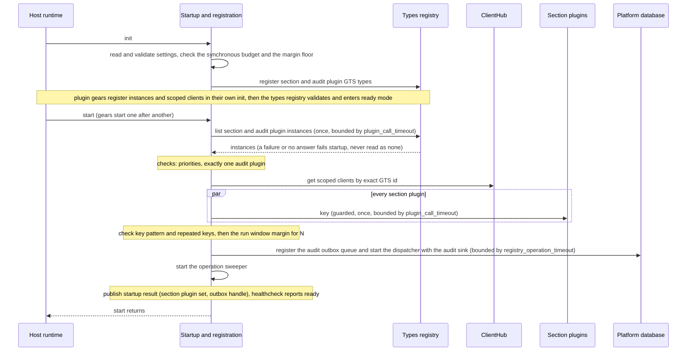

**Description**: The host runs the gears' start capabilities one after another, so `start` runs every check once, after every gear has finished `init` and the types registry is in ready mode. It waits on no other gear. It makes one types registry listing, resolves the scoped clients, reads the keys concurrently, starts the audit outbox, and starts the operation sweeper, so it delays the gears that start after it by at most two `plugin_call_timeout` and one `registry_operation_timeout`. Each plugin and types registry call is bounded by `plugin_call_timeout` (§3.2), the queue registration by `registry_operation_timeout`, and none is retried. Events that earlier runs left in the outbox are delivered once any replica's dispatcher claims their partitions, and operations that earlier runs left open are interrupted by any replica's sweeper after their run deadline. The `key` calls run concurrently, so the key phase takes at most one time limit. Any failed check, including a listing or a `key` call that fails or does not answer within its bound, makes `start` emit a structured error event that names the reason and the instances involved, and return the error (§4.6 catalogue). The host's start phase then fails, and the host exits with a non-zero status. The replica never becomes ready, so platform orchestration reports a failed rollout. If the types registry answers with no section plugin instances, the key set is empty. Until the startup result is published, the healthcheck reports not ready, so the platform keeps the replica out of traffic. A request that reaches it anyway is refused by the not-ready gate (`cpt-cf-application-manager-seq-pre-dispatch-gate`).

#### Synchronous Checks and Acceptance

**ID**: `cpt-cf-application-manager-seq-pre-dispatch-gate`

**Use cases**: `cpt-cf-application-manager-usecase-first-seed`, `cpt-cf-application-manager-usecase-reseed`, `cpt-cf-application-manager-usecase-retry`, `cpt-cf-application-manager-usecase-uninstall`

**Actors**: `cpt-cf-application-manager-actor-seeding-caller`, `cpt-cf-application-manager-actor-operator`

The diagram shows the synchronous phase that seed and uninstall share, up to the refusal, the replay, or the committed acceptance. Platform access control and platform storage take part as dependencies. Rank labels refer to the precedence table in the request orchestrator, and the outcome table in §3.3 gives the status of each refusal. For readability, the diagrams in this section draw the orchestrator calling the section plugins directly, and draw the registry and operation repository and the audit outbox as one participant. Every section plugin call goes through the section plugin router and the plugin call guard, and every write through the repository (§3.2). No diagram in this section calls the audit plugin, because only the audit dispatcher does, apart from the request.

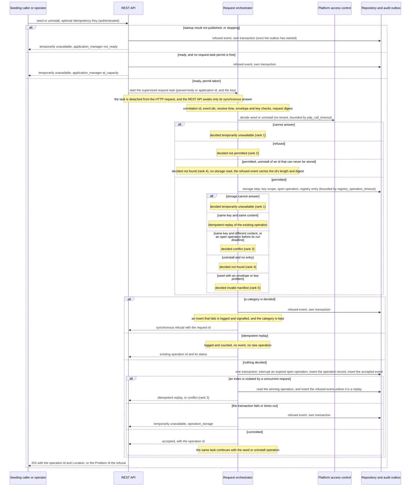

**Description**: Each request takes exactly one of these paths. Every path after the not-ready gate and the request-task cap check runs inside the request task, so a dropped HTTP request cuts none of them short. No path makes a plugin call. On every refusal path, the refused event is inserted in a transaction of its own before the answer. When that insert fails, the refusal keeps its category, and the missing event is logged and counted, which raises the operator signal. The response of each refusal is the row of its rank in the outcome table (§3.3).

1. Not ready, before the startup result is published or once `stop` has begun: temporarily unavailable, with `application_manager` and reason `not_ready` in the refused event. It is logged and counted. Before the audit outbox has started, its refused event cannot be recorded and is logged as missing.
2. At the request-task cap, with no permit free: temporarily unavailable, with `application_manager` and reason `at_capacity`. It is logged and counted.
3. Platform access control cannot answer: temporarily unavailable, rank 1.
4. The caller is refused: not permitted, rank 2.
5. The storage step cannot answer for a permitted caller: temporarily unavailable, rank 1. Its refused event usually cannot be recorded either, and the refusal is logged as missing its event.
6. Same key and same content in the key's scope: idempotent replay. 202 with the existing operation id and its current status. No operation, no dispatch, no audit event. The replay is logged and counted.
7. Same key and different content: conflict with cause `idempotency_key_reused`, rank 3.
8. An open operation of the application before its run deadline: conflict with cause `application_busy`, rank 3, naming that operation's id.
9. Uninstall of an id with no entry: not found, rank 4.
10. Uninstall, by a permitted caller, of a never-storable id (§4.1): no storage read. The refused event carries the id's length and SHA-256 digest, never the id, and the outcome is not found, rank 4.
11. Seed with an envelope problem, or a key that breaks the key rule: invalid manifest, rank 5, with every envelope problem as a field violation.
12. Undecided, and the acceptance transaction violates an index because a concurrent request won: the winning operation decides an idempotent replay or a conflict, as in paths 6 to 8.
13. Undecided, and the acceptance transaction fails or times out: temporarily unavailable, with `operation_storage` in the refused event. Nothing is dispatched. After a timeout, the transaction may still have committed: the operation then waits with no task, and the interruption step ends it after its run deadline (§4.5).
14. Undecided, and the acceptance commits: 202 with the operation id. The seed or uninstall operation continues in the same request task.

A seed by a permitted caller with no extracted id, or with a never-storable id, reads the empty id at the storage step, which no entry or operation can have, so the step still proves that storage can answer. Its envelope problems then end it at rank 5, on path 11, unless storage cannot answer.

#### Seed Operation

**ID**: `cpt-cf-application-manager-seq-seed`

**Use cases**: `cpt-cf-application-manager-usecase-first-seed`, `cpt-cf-application-manager-usecase-reseed`, `cpt-cf-application-manager-usecase-retry`

**Actors**: `cpt-cf-application-manager-actor-seeding-caller`

The diagram continues a seed in the background, after the acceptance committed and the 202 was sent. It runs in the same detached request task, under its supervisor. The section plugins and platform storage take part as dependencies. As in the previous diagram, the section plugin calls drawn directly go through the section plugin router and the plugin call guard. Every write marked guarded matches only an open operation before its run deadline (§3.1).

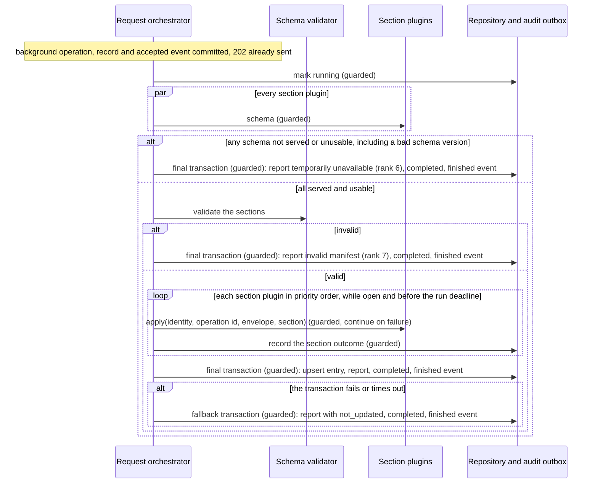

**Description**: Each seed operation takes exactly one of these paths:

1. A schema is not served, is unusable, or comes with a missing, empty, or too long schema version: the report is temporarily unavailable (rank 6), naming each key with reason `unreachable`, `timed_out`, `not_sent`, or `unusable`. Nothing is dispatched, and the registry effect is `unchanged`.
2. The sections are invalid: the report is invalid manifest (rank 7), with every problem. Nothing is dispatched, and the registry effect is `unchanged`.
3. The manifest is valid: every section plugin receives `apply`, each outcome is recorded as it comes, and the entry, the report, the completion, and the finished event commit in one transaction. The after-dispatch ranking gives the category.

A re-seed follows the same sequence. The upsert overwrites the entry, and each section plugin decides what the repeat means. The last result is derived as §3.1 states, and the entry keeps the new operation id. If the final transaction fails or times out, the fallback transaction records the operation as an internal failure under the after-dispatch ranking, with registry effect `not_updated`, and the failure is logged. After a timeout, `not_updated` means not confirmed. When the first transaction did commit, the fallback's guard finds the operation completed and records nothing, so the report and the finished event are those of the first transaction. Seeding again repairs the entry either way. When neither transaction can be recorded, the failure is logged and counted, and the operation is interrupted after its run deadline, with the section outcomes recorded so far. A guarded write that finds the operation final stops the task: no further `apply` and no registry write. A guarded write that fails because storage cannot answer only keeps the outcome in memory, and dispatch continues. The task holds the manifest until the operation is final. The caller reads the operation for the result (`cpt-cf-application-manager-seq-operation-read`).

#### Uninstall Operation

**ID**: `cpt-cf-application-manager-seq-uninstall`

**Use cases**: `cpt-cf-application-manager-usecase-uninstall`

**Actors**: `cpt-cf-application-manager-actor-operator`, `cpt-cf-application-manager-actor-seeding-caller`

The diagram continues an uninstall in the background, after the acceptance committed for an existing entry and the 202 was sent. It runs in the same detached request task, under its supervisor. The section plugin calls drawn directly go through the section plugin router and the plugin call guard. An id that can never be stored never reaches this sequence. It ends as not found in the synchronous phase, with no storage read. Any other id, including one longer than `max_envelope_text_length`, is looked up, so lowering that setting never strands an existing entry.

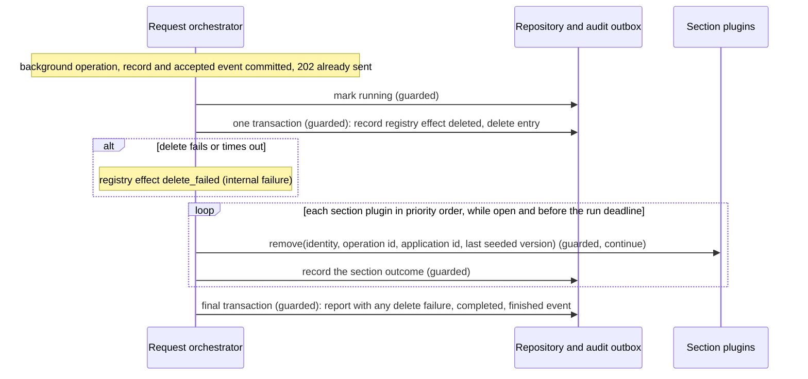

**Description**: Once accepted, an uninstall deletes the entry whatever the section plugins return. The delete and the report's registry effect `deleted` commit together, guarded by the operation status, so an interrupted operation never deletes later. If the delete fails or times out, removal still runs in priority order, the registry effect is `delete_failed`, which after a timeout means not confirmed, and the operation ends as an internal failure ranked by the after-dispatch order: a section plugin's not permitted or rejected result still ranks higher. The delete runs before removal, so it has a transaction of its own, and the final transaction follows removal, recording the delete result in the report and the finished event. The delete failure is also logged. A final transaction that cannot be recorded is logged and counted, and the operation is interrupted after its run deadline. Calling uninstall again completes a failed delete, and the section plugins receive `remove` again, which their idempotency rules handle. If a delete that was not confirmed did commit, the repeated uninstall ends as not found. Once the delete has succeeded, a repeated uninstall ends as not found with no section plugin call. To repeat removal after a failed or interrupted `remove`, the caller seeds again and then uninstalls. An empty key set gives a succeeded uninstall with no section plugin call.

#### Read an Operation

**ID**: `cpt-cf-application-manager-seq-operation-read`

**Use cases**: `cpt-cf-application-manager-usecase-track-operation`

**Actors**: `cpt-cf-application-manager-actor-seeding-caller`, `cpt-cf-application-manager-actor-operator`

The diagram shows one operation read. Platform access control and platform storage take part as dependencies.

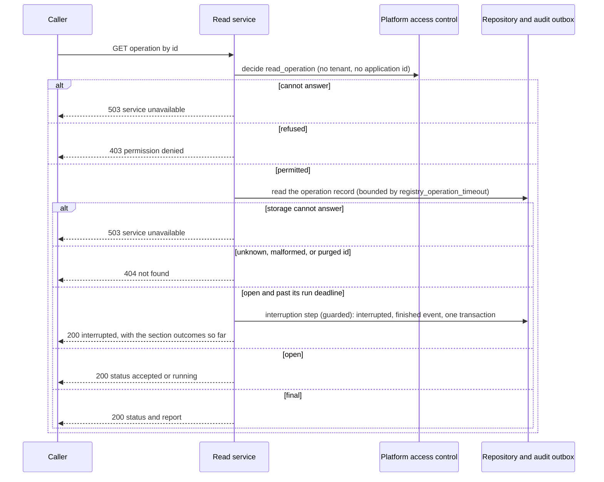

**Description**: The read makes no plugin call and records no audit event, so it works while the audit plugin or a section plugin is down. It needs the separate `read_operation` permit, which `seed` and `uninstall` do not grant. The body never holds the idempotency key, the caller subject, the request digest, a manifest, or section content. An id that is not a UUID cannot name an operation, so it gives 404 after the permit, like an unknown or purged id. When the record is open past its run deadline, the read runs the interruption step before it answers, so a caller never sees an operation as interrupted before its finished event is committed. When that step cannot be recorded, the read ends with 503. The listing still shows how the application's last seed ended after its operation record is purged.

#### Interrupted Sweep and Purge

**ID**: `cpt-cf-application-manager-seq-operation-sweep`

**Use cases**: `cpt-cf-application-manager-usecase-track-operation`, `cpt-cf-application-manager-usecase-first-seed`, `cpt-cf-application-manager-usecase-uninstall`

**Actors**: `cpt-cf-application-manager-actor-operator`

The diagram shows the two background jobs of the operation sweeper on one replica. Every replica runs them.

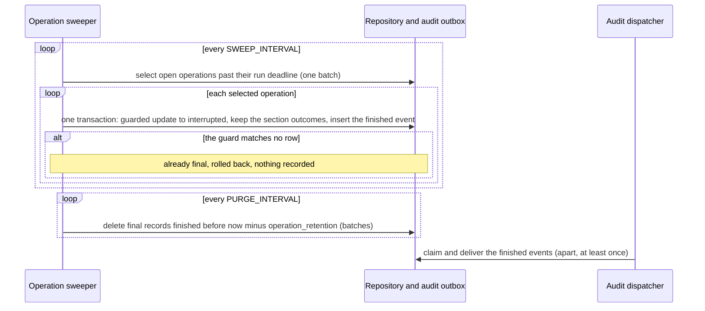

**Description**: The sweeper ends every operation that its request task left open: a replica that stopped or crashed, a task abandoned at the stop deadline, an acceptance that timed out but committed, or a final transaction that could not be recorded. The interruption step keeps the section outcomes recorded so far and records status interrupted and the finished event, which states that the operation was interrupted, in one transaction. A plugin call that the stopped task had started may still complete, but its result is never recorded, and no new call starts for the operation. The application is free again once the step commits. Because the operation read and the acceptance transaction run the same step when they meet an expired open operation, a caller sees the interruption as soon as the run deadline has passed; the sweeper covers operations that nobody reads. The purge deletes final records once `operation_retention` has passed after their finish time, with their idempotency keys. Registry entries keep their operation id, and reading a purged operation gives 404. Each step is guarded or idempotent, so replicas that run the jobs at the same time do not conflict. A step that fails is logged and counted, and the next interval tries again.

#### List Seeded Applications

**ID**: `cpt-cf-application-manager-seq-list-applications`

**Use cases**: `cpt-cf-application-manager-usecase-list-applications`

**Actors**: `cpt-cf-application-manager-actor-operator`

The diagram shows a listing request from an operator or an application team. Platform access control and platform storage take part as dependencies.

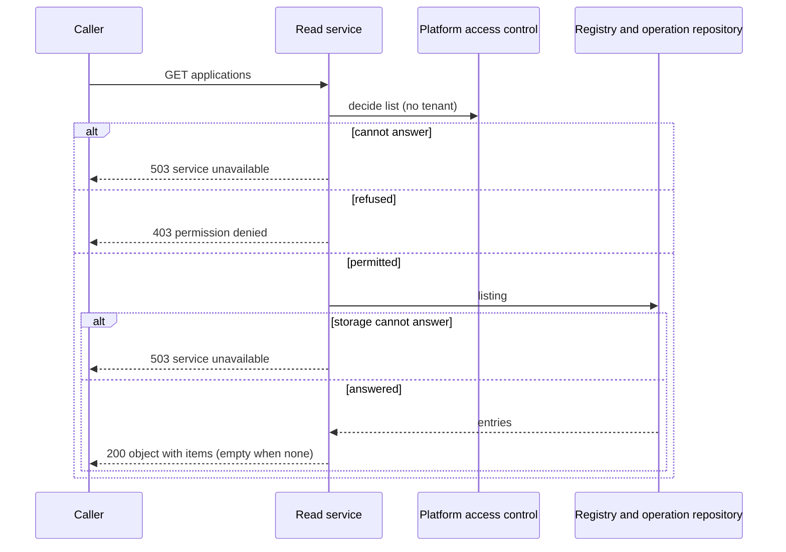

**Description**: Listing makes no plugin call and records no audit event, so it stays available during an audit or section plugin outage. Entries are returned in an `items` array, in unspecified order, with no pagination (§4.10). Each item carries the operation id of the last seed, which may name a purged operation.

#### Discovery of Keys and Schemas

**ID**: `cpt-cf-application-manager-seq-discovery`

**Use cases**: `cpt-cf-application-manager-usecase-discovery`

**Actors**: `cpt-cf-application-manager-actor-seeding-caller`, `cpt-cf-application-manager-actor-operator`

The diagram shows the three discovery reads. The section plugins take part as dependencies.

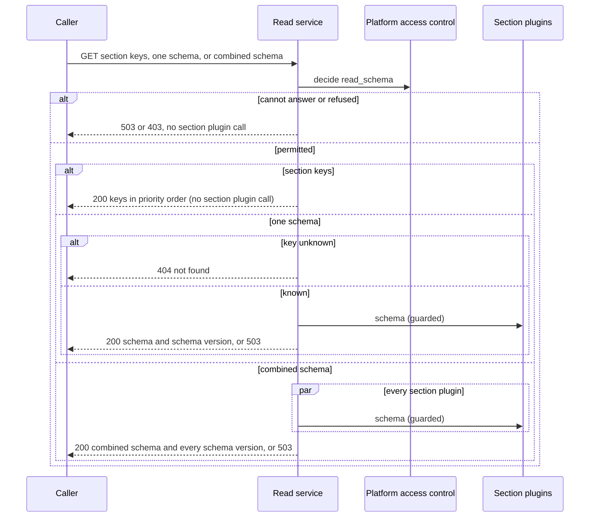

**Description**: Discovery serves the same live schemas, and the same composition, that seed validation uses, together with each schema version as the section plugin declared it. It needs no audit plugin. A schema read 503 is the standard Problem with the retry delay. Each key and reason behind it, or `access_control` when the PDP cannot answer, is logged and counted (§4.6). A schema that is served but unusable (another dialect, an external reference, a pattern beyond the compile limits, an oversized schema, a missing, empty, or too long schema version, or a compile failure) is reported with reason `unusable` in the logs, counted as a section plugin defect, and raises the unusable-schema signal (§4.6).

### 3.7 Database schemas & tables

- [ ] `p3` - **ID**: `cpt-cf-application-manager-db-registry`

The gear owns two tables in the platform database, created by its migrations: the registry and the operations table. It also owns the `toolkit-db` outbox tables of its audit outbox. The two gear tables hold no section content, no manifest, and no personal data apart from the caller subject id in operation records that carry an idempotency key. They are reachable only through SecureConn, after a PolicyEnforcer permit. Supported backends are those of the platform database layer: PostgreSQL, MySQL, and SQLite.

#### Table: application_registry

**ID**: `cpt-cf-application-manager-dbtable-application-registry`

**Schema**:

| Column | Type | Description |
|---|---|---|
| `application_id` | bounded text, `REGISTRY_TEXT_MAX_BYTES` | Opaque application id. A seed also applies the configured maximum length, which may be lower. Compared exactly on every backend, never normalized. |
| `version` | bounded text, `REGISTRY_TEXT_MAX_BYTES` | Last seeded version, opaque and non-empty |
| `last_result` | small enumerated text | `succeeded`, `partially_failed`, `plugin_rejected`, `not_permitted`, or `internal_failure` |
| `last_seeded_at` | timestamp with time zone | Receive time of the last seed |
| `operation_id` | UUID | Operation id of the last seed, which that seed's accepted and finished events carry. No foreign key: it stays when the operation record is purged. |

**PK**: `application_id`

**Constraints**: every column NOT NULL. `application_id` and `version` are non-empty. `last_result` is limited to the listed values, so changing that list needs a migration. The text columns compare with a binary, no-pad collation on every backend: `C` on PostgreSQL, `BINARY` on SQLite, and a binary no-pad collation such as `utf8mb4_0900_bin` on MySQL. Case, trailing spaces, and Unicode normalization forms therefore always make ids distinct. The column size of `application_id` and `version` is the gear constant `REGISTRY_TEXT_MAX_BYTES`, in bytes of UTF-8, fixed by the initial migration. It caps the accepted range of `max_envelope_text_length`, and `init` rejects a larger value. It is also the ceiling of the uninstall storable-id rule: an id longer than it can never name an entry (§3.2).

**Additional info**: no secondary indexes, because the primary key is the only lookup. The entity is declared unrestricted in the secure ORM, with no tenant, resource, owner, or type dimension, and no scoping column. It has no foreign keys and no triggers. Adding or removing a section plugin never requires a migration. The complete query list is: read one entry by primary key, upsert on the primary key, delete on the primary key, and list all entries. The upsert shares its transaction with the seed's completion and the enqueue of its finished event. The delete shares its transaction with the guarded report update of its uninstall operation. One initial migration creates the table. The gear returns it from `DatabaseCapability::migrations()`, and the platform migration phase runs it before `init`, under the platform's per-gear migration history. Its down step drops the table, which loses only data that re-seeding rebuilds.

Partitioning, sharding, replica tiers, hot, warm, and cold storage, and archival are not applicable, because the registry is one small platform-wide table in the shared platform database and its rows live until uninstall. Backup and replication follow the platform storage baseline. The gear has no data catalog or master-data role, and the lineage of an entry is its operation id. Registry drift is not detected; re-seeding is the only reconciliation.

**Example**:

| application_id | version | last_result | last_seeded_at | operation_id |
|---|---|---|---|---|
| `billing` | `2.4.1` | `partially_failed` | `2026-10-15T09:12:44Z` | `01929a3c-5e1f-7b2a-9c4d-3f8e6a1b2c7d` |

#### Table: operations

**ID**: `cpt-cf-application-manager-dbtable-operations`

**Schema**:

| Column | Type | Description |
|---|---|---|
| `operation_id` | UUID | Time-ordered operation id, assigned at receive |
| `application_id` | bounded text, `REGISTRY_TEXT_MAX_BYTES` | Application id of the operation, compared exactly, with the same collation as the registry |
| `action` | small enumerated text | `seed` or `uninstall` |
| `status` | small enumerated text | `accepted`, `running`, `completed`, or `interrupted` |
| `category` | small enumerated text, nullable | Outcome category of a completed operation: `succeeded`, `plugin_rejected`, `not_permitted`, `invalid_manifest`, `internal_failure`, or `temporarily_unavailable`. NULL while open and for an interrupted operation. |
| `report` | JSON document | The outcome report (§3.1), written as the operation runs. It holds the section outcomes recorded so far and never holds manifest or section content. |
| `accepted_at` | timestamp with time zone | Receive time of the request |
| `started_at` | timestamp with time zone, nullable | Set by mark running |
| `finished_at` | timestamp with time zone, nullable | Set with status completed or interrupted. Retention counts from it. |
| `run_deadline` | timestamp with time zone | End of the run window, set at acceptance (§3.1) |
| `finished_event_id` | UUID | Event id of the operation's finished event, assigned at receive and used by every writer of that event |
| `idempotency_key` | bounded text, `IDEMPOTENCY_KEY_MAX_BYTES`, nullable | The key, only when the request carried a valid one |
| `caller_subject_id` | UUID, nullable | Subject id of the caller, only when the request carried a key. It is never returned by any read. |
| `idempotency_scope` | 32 bytes, nullable | SHA-256 of the caller subject id, the action, the application id, and the key (§3.1). NULL when there is no key. |
| `request_digest` | 32 bytes, nullable | SHA-256 of the request content in the gear's fixed serialization (§3.1). NULL when there is no key. |

**PK**: `operation_id`

**Constraints**: `operation_id`, `application_id`, `action`, `status`, `report`, `accepted_at`, `run_deadline`, and `finished_event_id` are NOT NULL. `category` is set exactly when the status is `completed`, and `finished_at` exactly when the status is final. The four key columns are all NULL or all set. The enumerated columns are limited to the listed values, so changing a list needs a migration.

- **One open operation per application.** A unique partial index on `application_id`, over the rows whose status is `accepted` or `running`, on PostgreSQL and SQLite. MySQL has no partial index, so the migration adds a stored generated column that holds the application id while the status is `accepted` or `running` and is NULL otherwise, with a unique index on it, in the same binary collation. The effect is the same on every backend: a second open operation for the same exact id cannot be inserted. An insert that violates the index is the synchronous conflict at rank 3, naming the open operation's id (§3.2). Operations for different applications never touch the same index entry.
- **One operation per idempotency scope.** A unique index on `idempotency_scope`. NULL values never collide on any backend, so requests with no key never meet it.

**Additional info**: a secondary index on (`status`, `run_deadline`) serves the sweep selection, and one on `finished_at` serves the purge. The entity is declared unrestricted in the secure ORM, with no tenant column and no scoping value ([ADR 0007](./ADR/0007-cpt-cf-application-manager-adr-no-root-tenant.md)). It has no foreign keys and no triggers. The complete query list is: the storage step reads, by `idempotency_scope` and by open `application_id`; the insert in the acceptance transaction; the guarded updates by `operation_id` with the status and run deadline condition; the read by `operation_id`; the sweep selection by status and run deadline; and the purge by `finished_at`. One initial migration creates the table and its indexes, raw SQL being allowed only in migrations. Its down step drops the table, which loses only records that are purged anyway, and the registry is not affected.

Growth is one row per accepted seed or uninstall, removed after `operation_retention`, so the table holds at most the operations of one retention period. Partitioning, sharding, and archival are not applicable. Backup and replication follow the platform storage baseline. A lost record does not affect the registry, and reading it gives 404.

**Example**:

| operation_id | application_id | action | status | category | accepted_at | finished_at | run_deadline | idempotency_key |
|---|---|---|---|---|---|---|---|---|
| `01929a3c-5e1f-7b2a-9c4d-3f8e6a1b2c7d` | `billing` | `seed` | `completed` | `plugin_rejected` | `2026-10-15T09:12:44Z` | `2026-10-15T09:12:51Z` | `2026-10-15T09:14:44Z` | `deploy-2026-10-15-billing-2.4.1` |

**Audit outbox tables.** The audit outbox is one `toolkit-db` outbox queue, named by `audit_outbox_queue`, with `AUDIT_OUTBOX_PARTITIONS` partitions. Its tables are the outbox framework's own body, partition, incoming, outgoing, dead-letter, and processor tables, under the gear constant table prefix `AUDIT_OUTBOX_TABLE_PREFIX`. The gear returns the framework's outbox migration with that prefix from `DatabaseCapability::migrations()`, next to its own migrations. The gear defines no columns of its own there. Each message payload is one serialized audit event (§3.1), so a waiting accepted event, or the refused event of a seed, holds a full manifest and a caller identity.

Each event is enqueued to the partition derived from its correlation id, the operation id or the request id, so the events of one operation keep their order. A message leaves the outgoing table once the dispatcher acknowledges it, and the framework's vacuum removes its body. A rejected message moves to the dead-letter table with an inline copy of its payload, and stays there until an operator replays, resolves, or discards it (§4.12). The gear never reads these tables outside the dispatcher, and no operation exposes them. They are not registry state: re-seeding does not rebuild them, and they hold only events that wait for delivery or for an operator decision.

### 3.8 Deployment Topology

- [ ] `p3` - **ID**: `cpt-cf-application-manager-topology-replicas`

The gear runs inside the platform host process on each replica, behind the platform API gateway. The supported topology has the section plugin and audit plugin gears in the same host process, where they register during their own `init`, before the start phase. Out-of-process plugins are not supported. The host spawns out-of-process gears only after the start phase ([host_runtime.rs](../../../../libs/toolkit/src/runtime/host_runtime.rs)), so their instances would be missing when the gear enumerates them, and the platform does not yet guarantee remote scoped-client registration before dependants start (§4.12). Replicas are stateless apart from the shared registry table, operations table, and audit outbox in the platform database. Each replica builds its own startup result in its start phase, and runs its own audit dispatcher and operation sweeper. The outbox leases each partition to one replica's dispatcher at a time, so any replica can deliver events that another replica recorded. The status guard makes the sweepers of all replicas safe to run at the same time.

The diagram shows replicas behind the platform gateway, sharing the registry table, the operations table, and the audit outbox.

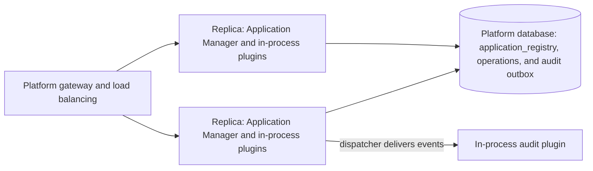

An operation runs on the replica that accepted it, from acceptance to its final state. Any replica can read it, and any replica can interrupt it after its run deadline. The one-open-operation index works across replicas, because it lives in the shared database. A replica that stops in the middle of an operation leaves it open, and a sweeper, the next read, or the next seed or uninstall of the application records it as interrupted after its run deadline. The caller then seeds or uninstalls again.

A section plugin change needs a restart. As a consequence of this design, while a rolling restart is in progress replicas may briefly hold different key sets. Each operation is validated and dispatched against the key set of the replica that accepted it, consistently from start to end, and its run deadline is computed from that replica's plugin count. Seeding callers re-seed after the rollout completes (PRD `cpt-cf-application-manager-nfr-availability`).

The gear's healthcheck reports not ready until its startup result is published, so the platform keeps a starting replica out of traffic. After startup, readiness never depends on the audit plugin, section plugins, access control, or storage, so their outages do not remove replicas from rotation. Liveness is the platform host's own probe. The gear adds none. Its background work is the audit dispatcher, whose outbox lease fences each claim and whose plugin calls are bounded by the guard, and the operation sweeper, whose steps are guarded transactions. Detached plugin calls are bounded by the in-flight cap, request tasks by `max_request_tasks` and their run deadlines (§4.7), and every startup call by `plugin_call_timeout`.

Graceful shutdown: when shutdown begins, the host turns its readiness to draining ([host_runtime.rs](../../../../libs/toolkit/src/runtime/host_runtime.rs)), and the platform stops routing to the replica. The gear's `stop`, run by the startup component, then does two things in order. First, it sets the stopping flag, so the not-ready gate refuses any request that still arrives. Second, it drains the request tasks through the orchestrator, stops the operation sweeper and the audit outbox, and drains the detached plugin calls through the call guard, each within the stop deadline, and abandons the rest with a log. Operations still running are left open and are interrupted after their run deadline, as §4.5 describes. Events not yet delivered stay in the outbox, and the next dispatcher that claims their partition delivers them.

Packaging, container images, orchestration, environment promotion, infrastructure as code, immutable infrastructure, tagging, and auto-scaling are inherited from the platform host, and the gear adds nothing to them. Scale-out is by replica count, because replicas are stateless. Rollback is a redeploy of the previous release; the only schema changes are the initial registry and operations migrations and the outbox migration. Canary and blue-green rollouts are not applicable beyond the platform's rolling restart, because replicas may already differ during a rollout and callers re-seed after it.

## 4. Additional context

### 4.1 Design-Level Terms

These terms add to the [PRD glossary](./PRD.md#14-glossary) and do not redefine any term in it. Common platform terms are glossed at their first use in the body.

| Term | Meaning |
|---|---|
| Control character | Any Unicode code point in the general category Cc: U+0000 to U+001F, which includes NUL, and U+007F to U+009F. The envelope limits, the never-storable id rule, and the log escaping rule all use this one definition. |
| Never-storable id | An application id that no registry entry or operation can have: empty, containing a control character, or longer than `REGISTRY_TEXT_MAX_BYTES` (§3.2 step 3, §3.7). |
| Section plugin set | The immutable, startup-built list of section plugins: key, priority, GTS instance id, and client, in priority order. |
| Key set | The section keys of the section plugin set. A manifest's `sections` must have exactly this set. |
| Plugin set | The section plugin set together with the audit plugin client. |
| Startup result | The section plugin set and the audit outbox handle, published once by `start`. |
| Section plugin call | A plugin call to a section plugin (`key`, `schema`, `apply`, or `remove`), as opposed to an audit event delivery. |
| Request task | The task that runs one seed or uninstall from receive, detached from the HTTP request: its synchronous phase and, once accepted, its operation. A supervisor task watches it. |
| Request state | The small in-memory state of one request task that its supervisor reads after a task failure (§3.2). |
| Synchronous phase | The part of a request task that ends with the answer: the checks, the storage step, and the refusal or the acceptance. It makes no plugin call. |
| Storage step | The one bounded read of the synchronous phase: the operation in the key's scope, the open operation of the application, and the registry entry (§3.2 step 3). |
| Acceptance transaction | The one transaction that inserts the operation record and its accepted event (§3.2 step 7). |
| Correlation id | The one time-ordered UUID that the gear assigns per request: the operation id when the request is accepted, and the request id of a refusal. |
| Open operation | An operation whose status is accepted or running. Completed and interrupted operations are final. |
| Run deadline | The end of an operation's run window, stored in its record at acceptance (§3.1). |
| Status guard | The condition on every write to an operation: open and before the run deadline, or, for the interruption step, open and past it (§3.1). |
| Interruption step | The one transaction that records an expired open operation as interrupted, with its finished event (§3.1). |
| Idempotency scope | The SHA-256 digest of the caller subject id, the action, the application id, and the idempotency key, which a unique index covers (§3.1). |
| Request digest | The SHA-256 digest of a request's content in the gear's fixed serialization, used to tell an idempotent replay from a key reused for other content (§3.1). |
| Decided category | A category fixed by the synchronous checks, at ranks 1 to 5. It ends the request as a synchronous refusal with a refused event. |
| Rank | A position in the precedence table of `cpt-cf-application-manager-component-request-orchestrator`. |
| Audit outbox | The `toolkit-db` transactional outbox queue in the gear's database that holds each audit event from its insert until the audit plugin confirms it (§3.7). |
| Audit dispatcher | The outbox leased handler that delivers audit events to the audit plugin (`cpt-cf-application-manager-component-audit-dispatcher`). |
| Operation sweeper | The background component that runs the interruption step for expired open operations and purges final records after `operation_retention` (`cpt-cf-application-manager-component-operation-sweeper`). |
| Missing event | A refused event, or a final report with its finished event, that the gear could not record. It is logged and counted, and raises the operator signal. |
| Caller identity | The identity-only context passed to plugins, with no bearer token (`cpt-cf-application-manager-entity-caller-identity`). |
| Not-ready gate | The REST layer's refusal of requests that arrive before the startup result is published or after `stop` has begun. |
| Time limit, timeout | `plugin_call_timeout` is the PRD's time-limit setting. "Time limit" is the value. "Timeout" and `timed_out` name the event of exceeding it. |
| Outcome report | The PRD's operation report, as the gear stores and returns it (`cpt-cf-application-manager-entity-outcome-report`). |
| Registry effect | What an operation did to its registry entry: updated, not updated, unchanged, deleted, or delete failed. Not updated and delete failed mean not confirmed: after a timeout, the write may still have taken effect. |

### 4.2 Concurrent Requests for the Same Application

This section resolves PRD open question OQ2, as `cpt-cf-application-manager-fr-one-operation-per-application` states it. The gear runs at most one open operation per application id, and the database enforces it:

- The storage step reads the open operation of the application. When one exists and its run deadline has not passed, the request is refused as conflict at rank 3, with cause `application_busy`, and the refusal names the open operation's id. Nothing is dispatched. The caller reads that operation until it is final, then sends the request again.
- Two requests that both pass the storage step race in the acceptance transaction. The unique index on open operations (§3.7) admits exactly one insert. The other insert fails, and the refusal step reads the winner. A request with the same key and content as the winner is answered as its idempotent replay. Any other request is refused as conflict, naming the winner. This holds across replicas, because the index lives in the shared database.
- An open operation whose run deadline has passed no longer makes its application busy. The next acceptance transaction for that application first records it as interrupted, with its finished event, and then inserts the new operation, all in one transaction.
- Seed and uninstall share the rule, so a seed and an uninstall for the same application never overlap. An uninstall that arrives while the first seed of an application is still open ends as conflict, not as not found, because conflict ranks first.
- Applications are compared by their exact id, with the binary collation of §3.7.

Operations for different applications use different index entries, so they never wait for each other. A section plugin therefore never receives interleaved dispatches for one application from two operations. The one overlap left is a call of an earlier operation that timed out, or whose operation was interrupted, and that is still running when the next operation starts (§4.11). The registry entry of an application reflects its last completed seed or uninstall, and the audit trail of each application is one sequence of operations.

### 4.3 Security Considerations

**Trust boundaries and assumptions.**

- Callers are authenticated by the platform pipeline. The gear trusts the `SecurityContext` it receives.
- The gear is supported only with gateway authentication enabled. The gateway's `auth_disabled` mode gives every request one fixed default subject and tenant ([gear.rs](../../../../gears/system/api-gateway/src/gear.rs)). Every audit event would then name the same subject, every idempotency scope would share it, and `cpt-cf-application-manager-nfr-traceable-subject` and the separate permission grants would be hollow (§4.12).
- Section plugins and the audit plugin are gears that the operator deploys into the same host process, with the host's privileges. They are trusted with the data they receive: each section plugin its own section, and the audit plugin the full manifest and the caller identity. The gear does not sandbox them.
- Plugin calls are in-process, with no network hop. Out-of-process plugins are not supported (§3.8), so no plugin transport protection is needed today. If they become supported, the platform's ClientHub transport authentication and encryption baseline applies.
- Encryption in transit is the platform gateway's Transport Layer Security (TLS) for caller traffic. In-process plugin calls stay in memory. Encryption at rest follows the platform database baseline. The registry holds no sensitive data. Operation records hold outcomes, and a caller subject id only with an idempotency key, until retention ends. The audit outbox holds manifests and caller identities only until delivery, or in the dead-letter store until an operator acts (§3.7).
- Plugin clients are resolved by exact GTS instance id, and instances are registered through the types registry by gears deployed in the host.

| Threat or concern | Design control | Residual |
|---|---|---|
| A caller selects or adds a section plugin through the manifest | Routing uses only the startup section plugin set. An unknown key makes the manifest invalid. | None |
| An unauthorized caller probes schemas or triggers plugin work | The permission decision comes first on every request. The router is unreachable without a permit, and operations exist only for permitted callers. | None |
| PDP outage lets requests through | Fail closed: temporarily unavailable, no storage access, no operation, no section plugin call | Seeding waits for the PDP |
| A `seed` holder acts through every section plugin's service credentials (confused deputy) | `seed` and `uninstall` are granted separately and narrowly (permission matrix, §3.3). The application id is sent to the PDP as a resource property, so policies can narrow a grant per application. Each section plugin should make its own authorization decision with the caller identity and refuse with `NotPermitted`. The audit event records the subject. | A section plugin that skips its own check. When a later section plugin refuses, earlier ones have already applied, and the operation reports not permitted with the partial effect. |
| A caller reads the results of other callers' operations | Reads need the separate `read_operation` permit, which seed and uninstall do not grant. A read never returns manifests, section content, the idempotency key, or the caller subject. | A `read_operation` holder sees the status and report of every operation, by design: the permission is platform-level. |
| An idempotency key collides with, or guesses, another caller's key | The key scope includes the caller subject id, the action, and the application id, so another caller's equal key never matches. A replay needs the permit of its action. | None |
| A malicious or impersonating plugin | Clients are resolved by exact GTS instance id. Only gears deployed in the host register instances. A second audit plugin fails startup. | A malicious plugin gear that the operator deploys has the host's privileges. Plugin review and supply-chain controls are the platform's. |
| A served schema is hostile (external references, heavy patterns, size) | Schemas are untrusted input. The retriever refuses every external reference, including references to other GTS types. Patterns use the explicitly configured linear-time engine with the compile limits `SCHEMA_REGEX_SIZE_LIMIT` and `SCHEMA_REGEX_DFA_SIZE_LIMIT`. A schema larger than `SERVED_SCHEMA_MAX_BYTES` is refused before compilation. Compilation and validation run off the async executor. Compile failures make the schema `unusable`. | A schema within the caps still costs CPU on every seed. Section plugins are trusted, operator-deployed code. |
| Oversized or unstorable id, version, key, or schema version | The envelope limits (maximum length, no control characters) are checked on seed at receive time, before any audit event is built. The idempotency key is bounded by `IDEMPOTENCY_KEY_MAX_BYTES` and limited to visible ASCII. A schema version is bounded by `SCHEMA_VERSION_MAX_BYTES`. Uninstall decides a never-storable id as not found with no storage read, and looks up any other id. A never-storable id is never carried as a field: the refused event carries its length and digest, and the not-found Problem names no resource. Keys follow the token pattern, checked at startup. The gateway body limit bounds the manifest. Comparison is exact on every backend. | None |
| Log injection: an id, version, or schema version with control characters forges or splits log lines | Logs and span attributes carry these values escaped, with every control character (§4.1) written as an escape, and cut at `LOG_TEXT_MAX_BYTES` (§4.6) | None |
| Many accepted operations, or callers that disconnect, pile up request tasks | `max_request_tasks` bounds the request tasks on a replica, including background operations, and the REST layer takes a permit before any task starts. Each operation ends by its run deadline. A request with no free permit is refused as temporarily unavailable, with reason `at_capacity`, and the request-task alert fires (§4.6). | While the cap is full, new seeds and uninstalls on that replica are refused |
| A caller reads operations in a tight loop | Operation reads make no plugin call and are bound to gateway rate-limit and in-flight zones. Every operation reaches a final state by its run deadline. | Read load on the operations table, bounded by the gateway zones |
| Errors or logs leak manifest content | `cpt-cf-application-manager-constraint-no-manifest-content`. Validation messages never include instance values. The section plugin contract forbids manifest values and secrets in any plugin text. Plugin `Internal` text is logged length-bounded under the plugin-diagnostic classification, and late results are logged by metadata only. The operation record keeps only a digest of the request content. | A section plugin that echoes values in its text breaks its contract and puts content into gear logs or reports. Detail is truncated, and the contract conformance review covers it. |
| A section plugin acts with caller credentials | Plugins receive `CallerIdentity`, which has no bearer token. The contract requires the plugin's own service credentials. For its own PolicyEnforcer check, the plugin builds a token-less `SecurityContext` with the SDK constructor, which copies the subject, the tenant, and the token scopes (§3.3). | A section plugin that needs the caller's raw token for its own downstream calls cannot make them with the caller's credentials. It uses its own service credentials, or it refuses. |
| A hung plugin exhausts tasks or memory | The per-plugin in-flight cap bounds calls in flight, including detached ones, and refused calls end at once as `not_sent`. The run deadline ends each operation. `max_request_tasks` and the gateway rate-limit and in-flight zones bound requests. | One time limit of waiting per call while the plugin hangs. A call that never ends holds its slot until the replica restarts (§4.5). |
| Audit exposure leaks other section plugins' data | The audit plugin contract makes manifest exposure off by default, operator-enabled, and documented as security-relevant. The gear offers no operation that reads the audit outbox or its dead-letter store. | See the four concerns below |
| Manifests at rest in the audit outbox | Events wait only until the plugin confirms them, and the framework's vacuum then removes their bodies. Rejected events wait in the dead-letter store until an operator replays or discards them. Access is the gear's database access, under the platform database baseline. | Anyone with direct database access to the gear's tables can read waiting manifests. A long audit plugin outage lengthens that window, which `outbox_pending_rows` shows (§4.6). |
| Secrets inside manifests | The seeding interface documentation states that manifests must not carry secrets. The gear persists manifests only in the audit outbox until delivery. | The gear cannot detect secrets; the outbox holds and the audit plugin stores what is sent |

Audit exposure concerns that operators and security reviewers must weigh when an audit plugin enables exposure:

1. Other section plugins' section data can leak, bypassing those plugins' authorization.
2. Access through the audit plugin falls outside the Application Manager's PolicyEnforcer checks.
3. Swapping the audit plugin silently changes exposure and lasting durability, because the gear keeps an event only until the audit plugin confirms it and then relies entirely on the audit plugin.
4. The Application Manager cannot know which section content is sensitive.

### 4.4 Data Protection

The registry holds application ids, versions, results, times, and operation ids. None of it is personal data, and erasure requests for it need no gear-specific handling. Operation records hold outcomes, timestamps, and reports with no manifest or section content. A record that carries an idempotency key also holds the caller subject id, only so that a replay can be recognised. No read returns it, and the sweeper deletes it with the record once `operation_retention` has passed, which is the gear's erasure for operation records. The caller identity is the only personal data the gear handles. It is read from the `SecurityContext`, placed in every accepted and refused event, and passed to every section plugin in its calls, never with the bearer token. Manifests exist in the gear in memory, for the life of the request task or of a detached plugin call that holds them, whichever ends later, and in the audit outbox, inside the accepted event or the refused event of a seed, until the audit plugin confirms that event. The in-flight cap bounds the detached calls. The full manifest leaves the gear only in the delivery of those events. The gear handles erasure for the outbox by removing each event once it is confirmed, and an operator discards dead letters that must not wait. The audit plugin owns storage, retention, pseudonymization, and erasure of audit events. Each section plugin owns its own data, including data that consumer services (`cpt-cf-application-manager-actor-consumer-service`) rely on, and data it provisions into systems outside the platform. Uninstall never removes audit events or operation records. Data residency follows the platform baseline, and because plugins run in the same host process, the gear adds no data transfer.

### 4.5 Fault Tolerance

| Failure | Behaviour | Caller sees | Recovery |
|---|---|---|---|
| PDP cannot answer, including a decision that exceeds `pdp_call_timeout` | No storage access, refused event inserted, no operation, no section plugin call | Temporarily unavailable, as a synchronous refusal | Retry after the delay |
| Registry or operation storage cannot answer at the storage step, including an expired `registry_operation_timeout` and the pool acquire timeout | No operation and no section plugin call, registry unchanged. The refused event is attempted and usually cannot be recorded either, so the refusal is logged as missing its event. | Temporarily unavailable, as a synchronous refusal | Retry after the delay |
| A request reaches a replica before readiness, or after `stop` began | Refused by the not-ready gate, logged and counted, refused event inserted once the audit outbox has started, otherwise logged as missing | Temporarily unavailable, as a synchronous refusal | Retry after the delay |
| The request-task cap is reached | A new seed or uninstall finds no free permit. It is refused before any task starts, logged, counted as refused at the cap, and its refused event is inserted. | Temporarily unavailable, as a synchronous refusal | Retry after the delay. Operators act on the request-task alert (§4.6). |
| The acceptance transaction fails or times out | Nothing dispatched, the refused event is attempted, failure logged and counted. After a timeout, the transaction may still have committed. That operation has no task: the application stays busy until its run deadline, and then the interruption step records it with its finished event. The audit plugin then holds a refused event and an accepted event with one id, followed by the finished event. | Temporarily unavailable, as a synchronous refusal | Retry after the delay. A retry that meets the committed operation gets conflict naming it, or, with the same key and content, that operation. |
| A refused event cannot be recorded | The refusal keeps its category. The missing event is logged with the request id and counted, which raises the operator signal. | The refusal's own category | None needed from the caller. Operators restore storage. |
| Concurrent requests for the same application id | The index admits one open operation. The other request is refused as conflict naming it, or answered as its idempotent replay when it carries the same key and content (§4.2). | Conflict, or the existing operation | Read the named operation until it is final, then send the request again |
| A schema is not served, is unusable, or has a bad schema version | Nothing dispatched, final transaction with the finished event. An unusable schema raises the unusable-schema signal. | Operation report: temporarily unavailable, naming each key and reason | `unreachable` or `timed_out`: retry after the section plugin recovers. `unusable`: retry after the section plugin is fixed. |
| A section plugin fails or times out during dispatch | That section is `internal_failure` or `timed_out`, whose outcome is unknown. The remaining section plugins are still called. The late result is logged by metadata only and discarded. | Operation report: after-dispatch category with section outcomes | Seed: seed again. Uninstall: seed again, then uninstall. |
| A plugin's in-flight cap is reached | The new call is not sent and ends at once as `not_sent`, which is known to have had no effect. Nothing is cancelled. | As for a failure of that call kind, with `not_sent` as the section outcome or reason | Retry after the plugin catches up. Calls that never end keep their slots until the replica restarts, which the operator does when the hung-plugin alert shows a plugin that does not recover (§4.6). |
| A section outcome update fails | The outcome stays in memory, dispatch continues, and the final transaction writes the full report | Nothing different | None |
| The final transaction of a dispatched seed fails or times out | The fallback transaction records internal failure in the after-dispatch ranking, with registry effect `not_updated`, and its finished event. The failure is logged. After a timeout, the first transaction may still have committed; the fallback's guard then changes nothing, and the first report stands. | Operation report: internal failure or a higher-ranked category, section outcomes, registry update not confirmed | Seeding again repairs the entry |
| Registry delete fails or times out in an uninstall operation | Removal still runs in priority order. Counts as internal failure in the after-dispatch ranking, registry effect `delete_failed`, recorded in the report and the finished event, logged. After a timeout, the effect is not confirmed: the delete may still have committed. | Operation report: internal failure or a higher-ranked category, with section outcomes | Uninstalling again completes the delete, or ends as not found when the delete had committed |
| The final report cannot be recorded: the final transaction, and for a seed its fallback, both fail | Logged and counted as a missing event, which raises the operator signal. The operation stays open until its run deadline. The interruption step then records it as interrupted, with the section outcomes recorded so far and its finished event. | Operation read: running, then interrupted | Seed or uninstall again |
| A replica stops or crashes during an operation, or the stop deadline abandons it | The gear does not resume it. Plugin calls already started may complete on their own, and their results are not recorded. After the run deadline, the interruption step, on any replica, records the operation as interrupted with its finished event and frees the application. A seed leaves the registry unchanged, because its upsert commits only with the completion. An uninstall's delete is recorded when it committed. | Operation read: running, then interrupted | Seed: seed again. Uninstall: uninstall again while the entry exists, otherwise seed again, then uninstall. |
| The request task panics or fails to join | The supervisor reads the request state. After a committed acceptance, it completes the operation as internal failure through the guarded completion. Otherwise it inserts the refused event as a gear defect. When it cannot complete, the interruption step ends the operation after its run deadline. The failure is logged. | Before acceptance: the platform's generic 500. After acceptance: 202, then an operation report with internal failure. | Seed: seed again. Uninstall: uninstall again while the entry exists, otherwise seed again, then uninstall. |
| The caller disconnects, or the gateway deadline passes, during the synchronous phase | The request task completes the phase: the refusal with its refused event, or the acceptance and then the whole operation | A transport failure or the gateway's deadline-exceeded response | Send the request again with the same idempotency key to get the operation id, or read the listing |
| Operation storage cannot answer an operation read | No plugin call, nothing recorded | 503 for the read | Read again later |
| A sweep or purge step fails | Logged and counted, and the next interval tries again. An expired operation stays open until a read, a new request for its application, or a later sweep records it. A purge delay only keeps records longer. | Nothing, or a read that records the interruption itself | Operators restore storage when the maintenance alert fires (§4.6) |
| The audit plugin is down, slow, or refuses | No request is affected. The dispatcher retries each event with backoff, holding its partition, and `outbox_pending_rows` grows. At `audit_delivery_max_attempts`, it rejects the event into the dead-letter store, logs it, and raises the rejection signal. | Nothing | Delivery resumes once the plugin recovers. Operators replay rejected events from the dead-letter store after the plugin is fixed (§4.12). |
| A startup fault | `start` emits the startup failure event with a named reason, fails the start phase, and the process exits with a non-zero status. Each check was made once, with no retry. | The replica never becomes ready, and orchestration reports a failed rollout | The operator fixes the configuration, the plugins, or the failing dependency, then redeploys or restarts the replica |

The gear keeps no retry queue for requests, and it never resumes or replays an operation. Operation records are durable, but they are a record of outcomes, not a work queue: no component continues work from them. Every recovery of a request is a new request from the caller, which keeps behaviour after a failure the same on every replica. The audit outbox is the one durable queue: it keeps committed events across restarts, and every replica's dispatcher can deliver them.

**Timeouts outside the plugin calls.** The gear owns both bounds. The PDP decision is bounded by `pdp_call_timeout`, which the policy adapter sets through `PolicyEnforcer::with_deadline`. The enforcer's own default is 30s ([enforcer.rs](../../../../gears/system/authz-resolver/authz-resolver-sdk/src/pep/enforcer.rs)), the same as the gateway deadline, so the gear never relies on it. On expiry, the enforcer returns `EvaluationFailed`. Every registry and operation access and every event insert is bounded by `registry_operation_timeout`, which the repository applies on every backend. The platform database settings cannot give that bound on every backend:

- the toolkit-db pool acquire timeout defaults to 30s ([lib.rs](../../../../libs/toolkit-db/src/lib.rs)), the same as the gateway deadline;
- `statement_timeout` is a PostgreSQL-only `database.params` key with no default ([config.rs](../../../../libs/toolkit-db/src/config.rs));
- MySQL rejects unknown parameters, and SQLite offers only `busy_timeout`.

Before acceptance, every such timeout counts as "cannot answer". Inside an operation, a timed-out upsert or delete counts as a failed registry write under the existing rules. The statement may still complete in the database, so the entry may already reflect the operation. The registry effect `not_updated` or `delete_failed` therefore means not confirmed (§3.1), and a repeated seed or uninstall settles it either way. A timed-out guarded write cannot give a second final state, because the guard rejects every later final write.

**Explicitly not applicable.** Circuit breakers are not used: the per-plugin in-flight cap is the bulkhead, and a hung plugin costs at most one time limit per call. Sagas and compensation are not applicable, because the gear leaves rollback to section plugins (ADR 0003). The only dead-letter store is the audit outbox's, described above. Backup, point-in-time recovery, and disaster recovery of the registry and the operation records follow the platform storage baseline. Beyond that, re-seeding rebuilds every entry (`cpt-cf-application-manager-nfr-recovery`).

### 4.6 Observability

**Logs.** Structured platform logs carry the correlation id (the operation id or the request id), the trace id, the action, the application id and version, the outcome category or final state, the section key, and the call kind, as relevant to each event. They never carry section content, the manifest body, schema bodies, the idempotency key, or the request digest. The application id, the version, and a schema version are written escaped and length-bounded. Every control character (§4.1) is written as an escape, never raw. A value longer than the gear constant `LOG_TEXT_MAX_BYTES` is cut at that bound, and its full length in bytes and SHA-256 digest are added. Events include:

- an operation accepted, and an operation that reached its final state, with its category or the interrupted marker;
- an idempotent replay, with the action and the operation id;
- a conflict refusal, with its cause and the busy operation id;
- audit event not recorded: a missing refused event, a final report with its finished event that could not be recorded, or an acceptance transaction that could not be committed, with the event kind, the correlation id, and the reason;
- audit event rejected by the dispatcher at the attempt limit, with the event kind, the correlation id, the event id, and the last failure reason;
- audit delivery failure, with the event kind, the event id, the attempt count, and the reason, at a lower level than the rejection;
- plugin call timeout, cap refusal (`not_sent`), and late plugin result (metadata only);
- section plugin internal error detail, length-bounded;
- registry write or delete failure, including a write that timed out and is not confirmed;
- dependency unavailable, with the dependency and reason, including the dependency of every read 503;
- unusable schema, with the section key and the cause, such as a bad schema version;
- a request refused before readiness or while stopping;
- a request refused at the request-task cap, with the action;
- an operation interrupted, with the action, the operation id, and who recorded it: the sweeper, a read, or an acceptance;
- operation records purged per purge run, and a failed sweep or purge step;
- detached calls abandoned at the stop deadline, with the count per plugin, and request tasks abandoned at the stop deadline, with the count per action;
- a request task that panicked or failed to join, with the action and the correlation id;
- a run window margin below (N + 3) × `registry_operation_timeout` once N is known, with N and the margin (§4.7);
- startup progress, and the startup failure event, which names the reason and the instances involved.

**Metrics** (platform OpenTelemetry):

- synchronous answers, by action and result: accepted, idempotent replay, or the refusal category;
- synchronous answer duration histograms, by action;
- operations accepted, by action;
- operations completed, by action and outcome category;
- operations interrupted, by action and by who recorded the interruption;
- idempotent replays, by action;
- conflict refusals, by cause;
- operation duration histograms, from acceptance to the final state, by action and final state;
- read request counts and durations, by read and result;
- PDP decision duration, and storage access duration by access kind;
- dependency-unavailable counts, by dependency and reason;
- plugin call duration and timeout counts, by plugin kind, call kind, and section key;
- cap refusal counts, by plugin kind and section key;
- a gauge of calls still running after their timeout, by plugin kind and section key;
- a gauge of request tasks in flight, by action and phase (synchronous or operation), including tasks whose HTTP request was dropped;
- audit events recorded and not recorded, by event kind;
- `outbox_pending_rows`, the events waiting in the audit outbox queue, which needs a `toolkit-db` pending-count API (§4.12, platform dependency 4);
- `outbox_rejections_total`, the events rejected into the dead-letter store, incremented by the dispatcher on each Reject;
- `audit_delivery_failures_total`, the failed delivery attempts, by reason: `unavailable`, `refused`, `timed_out`, `not_sent`, or `internal`;
- requests refused before readiness, by action;
- requests refused at the request-task cap, by action;
- unusable schema counts, by section key;
- registry write failure counts, by write kind;
- operation records purged, and failed sweep and purge steps, by job;
- startup duration, startup failure counts by reason, and run window margin warning counts.

The section key is a safe label, because keys follow the token pattern and the key set is small and bounded. The application id, the operation id, and the schema version are never labels.

**Alert conditions.** Operators set the thresholds and windows in platform monitoring. The gear emits the signals, and this table documents the conditions. Support routing follows `cpt-cf-application-manager-nfr-operational-signals`.

| Signal | Condition |
|---|---|
| Audit events not recorded | Any refused event not recorded, any final report with its finished event not recorded, or any acceptance transaction that could not be committed, within the window |
| Audit delivery backlog | `outbox_pending_rows` stays above the operator's threshold, or `audit_delivery_failures_total` keeps rising, over the window |
| Audit events rejected | Any increase of `outbox_rejections_total` |
| Interrupted operations | The count of interrupted operations rises above the operator's threshold over the window |
| Repeated section plugin timeouts | The timeout rate for one section key exceeds the operator's threshold over the window |
| Hung plugin | The gauge of calls running after their timeout keeps rising for a key, or cap refusals occur |
| Unusable schema | Any unusable schema for a key |
| Dependency unavailable | Dependency-unavailable counts for one dependency exceed the operator's threshold |
| Registry write failures | Any registry write or delete failure |
| Operation maintenance failing | Failed sweep or purge steps continue over the window |
| Request tasks at the cap | The request-task gauge stays at `max_request_tasks`, or any request is refused at the cap |
| Run window margin | Any startup margin warning: `run_window_margin` is below (N + 3) × `registry_operation_timeout` once N is known |
| Startup failure | Any startup failure event, or a replica that never becomes ready |

There is no gear-specific SLO. The platform baseline applies, as the PRD's NFR exclusions state.

**Startup failure catalogue.** Each reason is named in the startup failure event. Operator documentation includes a troubleshooting table keyed by these reasons. The reason names are part of the operator contract and change only with a release note.

| Reason | Trigger | Operator action |
|---|---|---|
| `invalid_setting` | A required setting is missing or invalid, including `operation_retention` and `run_window_margin`; the synchronous time budget exceeds the gateway deadline; or `run_window_margin` is below 3 × `registry_operation_timeout` (§4.7). The event names the settings. Found in `init`. | Fix the configuration |
| `invalid_section_key` | A key is empty or breaks the token pattern | Fix the section plugin |
| `duplicate_section_key` | Two instances report the same key; the event names both | Remove or re-key one section plugin |
| `equal_priority` | Two instances share a priority; the event names both | Change one priority |
| `priority_unreadable` | An instance has no readable priority | Fix the instance registration |
| `no_audit_plugin` | No audit plugin instance is registered | Deploy one audit plugin |
| `multiple_audit_plugins` | More than one audit plugin instance is registered; the event names them | Remove the extra audit plugins |
| `types_registry_unreachable` | The types registry listing failed or did not answer within `plugin_call_timeout` | Restore the types registry, then restart the replica |
| `section_key_unavailable` | A `key` call failed, timed out, or was refused by the in-flight cap | Restore the section plugin, then restart the replica |
| `plugin_client_unresolved` | A scoped client could not be resolved | Check the plugin gear's registration |
| `audit_outbox_unavailable` | The audit outbox queue could not be registered, or the outbox did not start, within `registry_operation_timeout` | Restore the database, check the outbox migration, then restart the replica |

`init` reports `invalid_setting`. `start` reports every other reason, each from a check made once.

**Traces.** One span per request for the synchronous phase, with child spans for the permission decision, the storage step, and each event insert. The operation has a span of its own, linked to the request span, with child spans for mark running, each section plugin call, each guarded write, and the final transaction. Each delivery by the dispatcher, and each sweep and purge run, has a span of its own. A delivery span carries the event kind, the event id, and the correlation id, so it can be found from the request. Section plugin call spans carry the section key and call kind. No span attribute carries manifest content. A span attribute that carries the application id or version follows the same escaping and `LOG_TEXT_MAX_BYTES` bound as the logs.

### 4.7 Configuration

The gear's settings live under `gears.application-manager.config` in the host configuration. The gear reads them with the strict accessor, so a missing section fails `init`. Durations are humantime strings with a unit, such as seconds or milliseconds. Values may differ per environment.

| Setting | Meaning | Validation |
|---|---|---|
| `plugin_call_timeout` | The PRD's time-limit setting: the one time limit for every plugin call, including `key` at startup and each audit event delivery. It is also the limit of the startup call to the types registry (§3.2), and the unit of each operation's run window. | Required, no default, a positive duration |
| `run_window_margin` | The PRD's run-window margin: added to an operation's plugin-call time to give its run deadline (§3.1). It covers the storage steps inside the operation and scheduling delay. | Required, no default, a positive duration of at least 3 × `registry_operation_timeout` |
| `operation_retention` | How long a final operation record is kept after its finish time. The operation sweeper then purges it, with its idempotency key. | Required, no default, a positive duration |
| `plugin_max_in_flight` | Per plugin instance, the most calls in flight at once, counting detached calls still running after their timeout | Required, no default, a positive integer |
| `max_request_tasks` | Per replica, the most request tasks in flight at once: the synchronous phases and the background operations of seed and uninstall, counting tasks whose HTTP request was dropped. A request that finds no free permit is refused with reason `at_capacity`. | Required, no default, a positive integer |
| `max_envelope_text_length` | The maximum length of the application id and of the version on seed, in bytes of UTF-8 | Required, no default, a positive integer no larger than `REGISTRY_TEXT_MAX_BYTES` (§3.7) |
| `pdp_call_timeout` | The deadline for one PDP decision, set through the PolicyEnforcer deadline option. A decision that exceeds it counts as access control cannot answer. | Required, no default, a positive duration |
| `registry_operation_timeout` | The bound that the repository applies around every registry and operation access and every audit event insert on every backend, and the bound of the queue registration at startup. An access that exceeds it counts as storage cannot answer. | Required, no default, a positive duration |
| `audit_outbox_queue` | The name of the audit outbox queue in the gear's outbox tables. Replicas of one deployment share it. | Required, no default, a name that the `toolkit-db` queue name rule accepts |
| `audit_delivery_max_attempts` | The number of failed deliveries of one event after which the dispatcher rejects it into the dead-letter store, compared with `OutboxMessage.attempts` | Required, no default, a positive integer within the range of `OutboxMessage.attempts` |

A missing or invalid setting fails `init` with reason `invalid_setting`. There is no extra handling margin on the time limit. The outbox lease is built from the time limit: its handler budget, the lease duration minus its headroom, is at least `plugin_call_timeout`, so one delivery always fits in a claim. Size `audit_delivery_max_attempts` together with the outbox retry backoff to cover the audit plugin outages that operators expect, because an event that reaches the limit waits in the dead-letter store for an operator. Set `operation_retention` long enough for callers to read each operation after it ends, as the PRD assumes. Audit exposure settings belong to the audit plugin's own configuration, which its documentation describes.

The gear constants `SWEEP_INTERVAL`, `PURGE_INTERVAL`, and `MAINTENANCE_BATCH_SIZE` pace the operation sweeper. `REFUSAL_RETRY_AFTER_SECONDS` is the retry delay of temporarily unavailable refusals. `IDEMPOTENCY_KEY_MAX_BYTES` bounds the idempotency key. They are not settings.

`max_envelope_text_length` applies to seed only. Lowering it affects new seeds only: an existing entry whose id is longer stays listed and can still be uninstalled, because uninstall looks up every id that could be stored (§3.2). A re-seed of that id ends as invalid manifest until the setting is raised again.

**Sizing the caps.** Each request task makes at most one call at a time to a given section plugin. Size `plugin_max_in_flight` at or above `max_request_tasks` plus the schema reads expected at once, with headroom for calls still running after their timeout. The audit plugin receives only the dispatcher's deliveries, at most one per outbox partition at a time on each replica, so `plugin_max_in_flight` must also be at least `AUDIT_OUTBOX_PARTITIONS`, with the same headroom. A plugin then meets its cap only when it hangs, which the hung-plugin alert shows (§4.6). An operation holds its request-task permit until its final state, up to its run window, while the HTTP request ends with the 202. Size `max_request_tasks` for the operations expected at once on a replica during an environment-wide re-seed, plus the synchronous phases in flight. A smaller value refuses requests with `at_capacity` during bursts.

**Synchronous time budget.** The synchronous phase takes at most `pdp_call_timeout` + 3 × `registry_operation_timeout`, plus the gear's own processing time. The three storage bounds are the storage step, the acceptance transaction, and the refusal step after a failed or violated acceptance. A gate refusal takes one `registry_operation_timeout`. No plugin call and no audit delivery is part of the budget. The budget must be at most the gateway request deadline, which the gateway fixes at 30s ([gear.rs](../../../../gears/system/api-gateway/src/gear.rs)). The gateway does not expose that value to gears, so the gear holds it as the constant `GATEWAY_REQUEST_DEADLINE`. The constant's source comment cites the gateway's timeout layer, and a pin test guards it (§4.8, §4.12 platform dependency 3). `init` checks the budget and fails with `invalid_setting` when it exceeds the deadline. The budget does not depend on N, so adding a section plugin never breaks it.

**Run window.** Each operation's run deadline is its receive time plus (N + 1) × `plugin_call_timeout` for a seed, or N × `plugin_call_timeout` for an uninstall, plus `run_window_margin` (§3.1). Inside an operation the gear makes at most N + 3 bounded storage steps: mark running, one section outcome update per section plugin, the delete or the final transaction, and the seed's fallback or the uninstall's final transaction. Two checks apply:

- `init` knows the settings but not N. It requires `run_window_margin` to be at least 3 × `registry_operation_timeout`, and fails with `invalid_setting` otherwise.
- `start` checks the margin once N is known. When it is below (N + 3) × `registry_operation_timeout`, it logs a structured warning with N and the margin, increments the margin warning count, and startup continues. A small margin does not break correctness: operations reach their run deadline sooner, more of them end as interrupted, and the status guard still gives each one final state. The operator raises the margin, guided by the warning.

An expired operation that nobody reads and nobody seeds again is recorded as interrupted at most `SWEEP_INTERVAL` after its run deadline, when the sweep step succeeds.

The gear also relies on these platform settings:

| Setting | Owner | Rule |
|---|---|---|
| Gateway request deadline | api-gateway, fixed at 30s ([gear.rs](../../../../gears/system/api-gateway/src/gear.rs)) | The synchronous time budget above must be at most it |
| Gateway body limit | api-gateway configuration, `defaults.body_limit_bytes` | Bounds the seed body, which the platform's JSON extractor reads before the gear sees it (§3.2) |
| Gateway rate-limit and in-flight zones | api-gateway configuration, bound per operation | Back-pressure for re-seed bursts and for operation reads (§4.13). They bound the synchronous phases only, because the HTTP request ends at 202. |
| Database pool acquire timeout | `gears.application-manager.database`, `pool.acquire_timeout` (toolkit-db). It defaults to 30s, the same as the gateway deadline. | Operators set it below `registry_operation_timeout`, so that a pool wait ends with the pool's own error first |
| Database statement timeout | `gears.application-manager.database`, `params.statement_timeout`, PostgreSQL only, with no default. MySQL rejects unknown parameters, and SQLite offers only `busy_timeout`. | Optional. `registry_operation_timeout` gives the bound on every backend. On PostgreSQL, a statement timeout also ends the statement in the database. |
| PolicyEnforcer evaluation deadline | authz-resolver SDK, default 30s | Replaced by `pdp_call_timeout` through `with_deadline` |

### 4.8 Testability

Every test level and its scope:

| Level | Scope | Runs in |
|---|---|---|
| Unit | The precedence table and after-dispatch ranking as table-driven cases, including a refused caller with storage down (not permitted), conflict before not found, a replay before the busy check, and each enforcer error kind; the outcome table mapping of each synchronous rank to its canonical category and status; the last-result derivation; the registry effect derivation from a record after a task failure or an interruption; the envelope limits, the idempotency key rule, the never-storable id rule, the control character definition, and the key token pattern; the run deadline formula for seed and uninstall; the request digest, equal for members in any order and any formatting, and different for `1` and `1.0`; the idempotency scope; the per-action id rules of the report and the audit events, including the length and digest for a never-storable uninstall id; the content of each event kind, with no caller identity in the finished event; one event id per kind, and the stored finished event id reused by every writer; the schema version rule, where a missing, empty, or too long version gives `unusable`; the escaping and `LOG_TEXT_MAX_BYTES` bound of ids and schema versions in logs and span attributes; problem messages free of instance values; the standard Problem of each synchronous refusal, with no extension member; outcome report member names and tokens, including `interrupted`, `not_sent`, and `at_capacity`; the decision request with no context tenant, no owner tenant, the `application_id` property for seed and uninstall, and none for `read_operation`; a permit with no constraints allowing the action, a deny giving not permitted, and a permit with any constraint giving not permitted; the `init` checks of the synchronous budget and the margin floor | Domain services with port doubles |
| Integration | Orchestrator, read service, operation sweeper, and audit dispatcher with test section plugins, a recording test audit plugin, a test PDP, and a test database with the audit outbox. They cover every NFR threshold in §1.2. A seed returns 202 before any plugin call, and its operation record and accepted event exist before the first `schema` call. Two seeds of one application sent at once from parallel callers give one operation and one conflict naming it; with the same key and content they give one operation and one replay; seeds of different applications run at once. A replay creates no operation, records no event, and makes no call. A key reused with other content gives conflict with `idempotency_key_reused`. A purged key is treated as unused. A task stopped during an operation, at each step, leaves an operation that the sweeper, a read, or a new acceptance records as interrupted after the run deadline, with one finished event and the section outcomes so far, and no later write changes it. A final transaction that commits and then times out gives a fallback that changes nothing. The purge removes final records after `operation_retention` and leaves the registry unchanged, and their reads give 404. Uninstall after `max_envelope_text_length` was lowered still finds the longer id. An uninstall of an id that can never be stored gives not found with no storage read, even with storage down. With `max_request_tasks` request tasks in flight, a further seed or uninstall is refused with `at_capacity` and records its refused event. A storage failure injected at each write shows the behaviour of §4.5. A test PDP that permits with any constraint gives not permitted. A test with the entities shows no tenant column and no scoping value on any row. | SQLite always; PostgreSQL and MySQL in the integration lane, through `libs/test-containers`, which also covers the generated-column index on MySQL |
| Startup | Every reason in the startup failure catalogue, each reported by `init` or `start` as §4.6 states; a types registry listing that does not answer within `plugin_call_timeout`, a `key` call that does not answer within it, and a scoped client that cannot be resolved, each failing startup with no retry; `start` returning an error, so that the host stops with a non-zero status; `start` waiting on no other gear; the margin warning event and count once N is known; the empty plugin set; the sweeper started before publication and stopped from `stop`; not ready until publication, and not ready again once `stop` sets the stopping flag; `stop` draining the request tasks and the detached calls until the stop deadline | Startup harness with a fake types registry and ClientHub |
| REST and Problem contract | Each route through the real HTTP stack: 202 with the operation id and `Location`; the status per synchronous rank from the outcome table; the `application/problem+json` type; field violations for invalid manifest; the `aborted` reason for both conflict causes and the busy operation id in the detail; the retry delay on 503; the request id in every refusal detail; no extension member on any Problem; the operation read body with the report validating against the outcome report type and with no key, subject, or digest; 404 for unknown, malformed, and purged operation ids; the `items` listing; a seed body that is not valid JSON gets the platform's 400, creates no operation, and leaves no audit event | The gear's REST layer in an in-process host |
| End to end | Seed, re-seed, both uninstall forms, operation reads until the final state, listing, and discovery through the gateway with test plugins, including a dropped HTTP request, a repeated request with the same key after a lost answer, and an operation whose replica stops | The platform E2E lane ([testing guide](../../../../docs/TESTING.md)) |
| Security | (a) Schemas with an external or file reference, a reference to another GTS type, a `$ref` that relies on the served `$id`, another dialect, a size above `SERVED_SCHEMA_MAX_BYTES`, a bad schema version, or an uncompilable body become `unusable`, with no network or file access. (b) A catastrophic pattern runs on the linear-time engine, and the operation ends within its bound. A pattern beyond the regex compile limits, or one with lookaround or a backreference, makes the schema `unusable`. (c) A sentinel manifest value sent through every outcome path is absent from logs, spans, metric labels, Problem bodies, operation records, and operation reads. (d) Plugin `Internal` text is absent from responses and reports. (e) No plugin observes a bearer token. (f) Ids that differ by case, trailing space, or Unicode normalization form stay distinct on every backend lane, in the registry and in the one-open-operation index, and ids such as `.`, `..`, and `a/b` uninstall through the body form. (g) An uninstall id with a control character or above `REGISTRY_TEXT_MAX_BYTES` reaches no audit event field, record, or not-found resource name: the refused event carries only its length and digest. (h) No operation reads the audit outbox or its dead-letter store, and a sentinel manifest value appears in the outbox only inside an accepted or refused event payload. Ids with control characters appear only escaped in logs and spans. (i) The same idempotency key from another caller never matches. | Integration lane |
| Fuzz | The envelope reader and the request digest on arbitrary parsed JSON values, the dispatcher's decoding of outbox payloads, and schema compilation with served schemas as input | Fuzz lane |
| Performance | Not a load test. The synchronous budget tests and the N + 1 and N run window tests under a paused clock are the performance check. Capacity is covered by §4.13. | Integration lane |
| Platform pin | A test pins `GATEWAY_REQUEST_DEADLINE` to the gateway's 30s, and its message cites the gateway's timeout layer, so a change to either needs a deliberate edit. The end-to-end test with a slow synchronous phase detects a gateway change that the pin cannot see. | Unit, and the platform E2E lane |
| Contract conformance | The section plugin pass-through check compares what a test section plugin receives with what the caller sent, and checks that the plugin returns a non-empty schema version within `SCHEMA_VERSION_MAX_BYTES` that changes when its schema changes. Audit-plugin authors own their conformance test for the recording obligations, including idempotency by event id and the exceptions to the normal event pair (§3.3). | Integration lane |
| Inspection | No audit or outbox read operation, no fill-in, replay, resume, or cancel operation, no section rules in configuration or source, and no raw SQL outside migrations | Review |

**Clock.** Timing tests run under a paused, controllable runtime clock. They assert the number of elapsed time limits, never wall time, because the bound has no margin. A test PDP that never answers ends the request as temporarily unavailable once `pdp_call_timeout` elapses, with its refused event recorded. A storage double that never answers does the same once `registry_operation_timeout` elapses. Advancing the clock past a run deadline makes the next sweep, read, or acceptance record the interruption.

**Guard tests.** A call that completes after the limit has its side effect observed after the operation moved on. The late result is logged once, by metadata only, and discarded. A panicking plugin yields an internal error and does not affect later calls. No cancel signal reaches a plugin. The in-flight cap refuses without cancelling, and the refused call is reported as `not_sent`, never as `timed_out`. At the stop deadline, detached calls are abandoned with a log.

**Request task tests.** The HTTP request is dropped at each step of the synchronous phase: during the permission decision, the storage step, the acceptance transaction, and the refused event insert. Each time, the request task completes, and the recorded events and records match. A panic is injected at each point of the request task: before and after the acceptance starts, after it commits and before the answer, during the schema phase, between sections, and before and after the final transaction starts. Each time, the caller gets the platform's 500 before acceptance or the 202 after it, and the recording test audit plugin, after removing duplicates by event id, holds either one refused event, or one accepted event and exactly one finished event once the run deadline has passed. The in-flight request task gauge returns to zero after each test, and a stop test shows `drain` abandoning a never-ending operation at the stop deadline with a log, and the sweeper interrupting it after its run deadline.

**Audit dispatcher tests.** A test audit plugin that is down, then recovers, receives every event, in commit order per operation. A plugin that fails or exceeds `plugin_call_timeout` gets the event again, with the same event id, until it succeeds, and the later events of that partition wait. At `audit_delivery_max_attempts`, the event moves to the dead-letter store, `outbox_rejections_total` rises, and the later events of the partition continue. A payload that cannot be decoded is rejected at once. A lease that expires during a delivery gives a redelivery on another processor, and the detached plugin call is not cancelled. Two replicas draining one queue deliver each event at least once, and no answer waits for any delivery.

**Test seams and data.** The ports of §3.2 are the seams. The clock and the id source are injectable. Shared test plugins and fixtures (manifests, served schemas with schema versions, idempotency keys, and sentinel values) live in the gear's test-support module. Each test gets its own database, or its own application ids on a shared one.

**Coverage target.** 90% or more, as the PRD testing strategy states. That is above the platform-wide threshold.

PRD acceptance criteria map to levels as follows:

| PRD §9 criteria about | Level |
|---|---|
| Operation ids before any plugin call, operation states, and operation reads | Integration and REST contract |
| Idempotency keys, replays, and key reuse | Unit and integration |
| One operation per application and concurrent seeds of different applications | Integration |
| Run windows, interruption, and purge | Integration, under a paused clock |
| Validation, required sections, envelope limits, key changes | Unit and integration |
| Dispatch order, continuing after failures, per-section results, extra-permission refusals, timeouts | Integration, under a paused clock |
| Uninstall, delete failure, not found | Integration and end to end |
| Permissions and refused callers, including storage down | Unit and integration |
| Audit events per kind, at-least-once delivery and duplicates, the not-ready refusal | Integration |
| Dependency failures and precedence | Unit and integration |
| Schemas not served or unusable | Integration and security |
| Startup failures and the empty plugin set | Startup |
| Discovery, listing, operation reads, and availability during an audit outage | Integration and end to end |
| No audit read surface, no resume or cancel | Inspection |

### 4.9 Compliance

There are no gear-specific regulatory obligations, and platform baselines apply. The gear's own data is non-personal, apart from the caller subject id in operation records that carry an idempotency key, which the gear purges after `operation_retention`. Obligations for stored audit content, including data-subject requests, belong to the audit plugin, and those for section data belong to each section plugin. The deterministic precedence and the per-section outcomes in every finished event give reviewers a reproducible account of each operation.

Consent management and a privacy impact assessment are not applicable to the gear: the caller identity is its only personal data, the gear stores it only in audit events that wait in the outbox for delivery and, as a subject id, in keyed operation records until retention ends, and the audit plugin owns the audit content, as the PRD's NFR exclusions state. The gear adds no cross-border transfer, because plugins run in the same host process.

Audit trail controls: the event rules are in §3.1, §3.2, and §3.3, the `cpt-cf-application-manager-nfr-audit-completeness` allocation in §1.2, and the failure handling in §4.5. The evidence is the audit events together with the recorded and not-recorded event counters, the operation counters, `outbox_pending_rows`, and `outbox_rejections_total` (§4.6). Monitoring is the not-recorded, backlog, rejection, and interrupted-operation alerts.

### 4.10 Deviations from Platform Baselines

Status values: **Accepted** means recorded in an ADR. **Proposed** means awaiting the review owner. **Pending platform decision** means the design depends on a platform change.

| Baseline | Deviation | Rationale | Review owner | Status | Validation |
|---|---|---|---|---|---|
| Plugin guide: resolve the plugin lazily on first use ([TOOLKIT_PLUGINS.md](../../../../docs/TOOLKIT_PLUGINS.md#1-lazy-plugin-resolution)); select one instance with `choose_plugin_instance` | Eager, one-time discovery of every instance at startup, after the types registry is ready, with no `choose_plugin_instance`. The listing, the client resolution, and the key reads run once in the start phase, each bounded. | ADR 0001 and `cpt-cf-application-manager-fr-startup-checks`: conflicts fail at deploy time, and the plugin set is immutable per operation. Starting after ready mode removes the race that lazy resolution avoids. A fault fails startup, with no retry. | Platform plugin model owners | Proposed | Startup tests for every catalogue reason |
| Lifecycle: background tasks take child cancellation tokens ([lifecycle guide](../../../../docs/toolkit_unified_system/08_lifecycle_stateful_tasks.md)) | Guarded plugin calls and the request tasks, with their supervisors and their background operations, run detached and do not take the shutdown token. At stop, the orchestrator's and the call guard's drains stop waiting at the deadline and abandon them with a log. The operation sweeper follows the baseline and takes a child token. | PRD `cpt-cf-application-manager-fr-bounded-plugin-calls` forbids cancelling plugin work, and the request task must survive a dropped HTTP request at any step. The in-flight cap, `max_request_tasks`, the run deadlines, and the gateway zones bound them, and the interruption step gives every abandoned operation its final state. | ToolKit lifecycle owners | Proposed | Guard tests, the request task tests, and a stop test with a never-returning plugin |
| Lifecycle guide: use `WithLifecycle` for stateful gears with background tasks, and implement `RunnableCapability` by hand only for a custom lifecycle, which is rare | A hand-implemented `RunnableCapability`, owned by the startup component. `start` runs the startup checks once, starts the outbox and the operation sweeper, publishes the startup result, and returns an error when a check fails. `stop` sets the stopping flag, then calls the orchestrator's `drain` for request tasks, stops the sweeper and the outbox, and calls the call guard's `drain` for detached plugin calls, until the stop deadline. | `WithLifecycle` only logs an error from its task and keeps the host running ([lifecycle.rs](../../../../libs/toolkit/src/lifecycle.rs)), so a startup failure would leave a replica up and never ready. `cpt-cf-application-manager-fr-startup-checks` needs `start` to fail the start phase on any failed check. `start` waits on no other gear and makes bounded calls only, so it delays the gears that start later by at most two `plugin_call_timeout` and one `registry_operation_timeout`. | ToolKit lifecycle owners | Proposed | Startup tests for each catalogue reason, for `start` returning an error with no retry, and for `stop` draining |
| Shared list pagination convention | Listing returns every entry in an object with an `items` array, unpaginated, in unspecified order | The PRD says opaque text is never sorted, and every keyset order sorts ids, even `last_seeded_at` with the id as tiebreaker for equal times. The `items` object lets pagination be added later without a breaking change. | Platform API reviewers, with the Application Manager owner | Proposed. Revisit when the listing-duration histogram exceeds the platform read-latency baseline, or when the platform has a pagination convention for unordered keys. | Integration test: every entry is returned in `items` |

### 4.11 Guidance for Plugin Authors

This guidance is for section plugin authors and for audit plugin authors, whose contract `cpt-cf-application-manager-fr-audit-event` states. The SDK crate is the normative contract.

Section plugin authors:

- Choose a priority as the registered instance priority. Lower values run earlier on seed and on uninstall. Leave gaps between values so later plugins can be placed between existing ones, and document why the plugin needs its position. Two plugins with the same priority stop the gear from starting, and a priority change is an intentional order change.
- Choose a key that follows the SDK token pattern: lower-case letters, digits, `-`, `_`, and `.`, within the bounded length. Any other key stops the gear from starting.
- Register the instance, its priority, and the scoped client during your `init`, and answer `key` as soon as `init` has finished. Neither may wait for your gear's start phase, because the Application Manager may read them before your gear starts.
- Keep `schema` cheap and free of side effects, because it runs in every seed operation and every schema read, under the time limit. During an environment-wide re-seed, it is called once per seed, so its cost is a capacity obligation (§4.13).
- Define your section schema through GTS: serve the JSON Schema of the GTS type that you own for your section, in JSON Schema Draft 2020-12, with every reference inside the served document. Do not reference other GTS types; resolve them into the document. A missing `$schema` is read as Draft 2020-12. Do not rely on a top-level `$id`. The gear replaces it with its own `urn:cf:application-manager:section:<key>` when it composes the schema, so a `$ref` that relies on your `$id` becomes external and makes the schema `unusable`. Use references local to the document, such as `#/$defs/item`.
- Return a schema version with every schema: opaque text of 1 to `SCHEMA_VERSION_MAX_BYTES` bytes. Change it whenever the schema content changes, and never reuse one version for different content. The gear records it as you send it, in the finished event, the operation report, and discovery. A missing, empty, or too long version makes the schema `unusable`.
- Write `pattern` and `patternProperties` in the syntax of the `regex` crate, which has no lookaround and no backreferences. A pattern that the crate cannot compile, or one beyond the gear's regex compile limits, makes the schema `unusable`. So does a schema larger than `SERVED_SCHEMA_MAX_BYTES`, which the SDK publishes.
- Make `apply` and `remove` tolerate repeats. The gear runs one operation per application at a time (§4.2), so it never overlaps two operations' calls for one application, with one exception: a call that timed out, or whose operation was interrupted, may still be running when the next operation for that application calls you. The gear never undoes a call that timed out. Use the operation id that `apply` and `remove` receive to correlate your own logs.
- Never put manifest values or secrets in `Rejected`, `NotPermitted`, or `Internal` detail. Use a JSON Pointer location inside the section instead.
- Identify the caller from `CallerIdentity` and make your own authorization decision before acting on its behalf. For a PolicyEnforcer check, build the `SecurityContext` with the SDK constructor, which copies the subject, the tenant, and the token scopes and carries no bearer token (§3.3). Use your own service credentials for any work, including downstream calls to platform gears or to systems outside the platform, because the caller's token is never available. Clean up your own data when the plugin is removed from the environment.

Audit plugin authors:

- Implement `AuditPluginV1`. Return success from `deliver` only once the event is stored durably, and return within the time limit. A slow or failed answer only delays delivery, because the dispatcher retries it.
- Be idempotent by event id. Every delivery of one event carries the same event id, and you may receive an event more than once, including after a restart of either side. Keep the first delivery of an event id and drop the others.
- Correlate accepted and finished events by operation id, and refused events by request id. The finished event carries no caller identity: take it from the accepted event with the same operation id. Expect the exceptions to the normal event pair that §3.3 lists. Treat `timed_out` section outcomes as unknown, and treat a finished event with the interrupted marker as a final state with no category.
- Treat all event content as untrusted input. The manifest is a parsed JSON value of any shape (§3.1). Ids, versions, and schema versions may hold any text that the rules allow, and a never-storable uninstall id arrives only as its length and digest.
- Return `Refused` only for content that you cannot record. The dispatcher retries it like `Unavailable`, and at the attempt limit the event waits in the gear's dead-letter store for an operator.
- Meet every obligation of `cpt-cf-application-manager-fr-audit-event`, including retention, purge, erasure, immutability, and exposure that is off by default, operator-enabled, and documented as security-relevant, and ship the conformance test that shows it.

### 4.12 Assumptions, Dependencies and Migration Impact

- **Assumptions**: the platform plugin model lets each section plugin instance carry a priority, through the plugin base type's priority. Section plugins and the audit plugin are gears in the same host process that register during their own `init`. The types registry is in ready mode before the start phase. The host runs the gears' start capabilities one after another ([host_runtime.rs](../../../../libs/toolkit/src/runtime/host_runtime.rs)). The PDP grants the platform-level permission for the application resource type, because a decision without a context tenant falls back to the caller's own tenant (§3.3). Section plugins and the audit plugin answer `key` and have their registrations in place once their `init` has finished (§3.3). The gear bounds the PDP decision and the storage accesses itself, so it assumes no database timeout setting. Replica clocks follow the platform time-synchronisation baseline, because run deadlines are set on one replica and checked on others; a skew only moves the moment an operation is interrupted, and the status guard still gives one final state. Operators set `operation_retention` long enough for callers to read each operation after it ends. Gateway authentication is enabled: the gear is not supported in the gateway's `auth_disabled` mode, which gives every request one fixed default subject (§4.3).
- **Dependencies**: the types registry at startup; the PDP, the platform database with the `toolkit-db` transactional outbox, and the plugins at run time; platform telemetry for signals. The PRD's platform storage holds the registry, the operation records, and the outbox. The build adds no new workspace dependency: `sha2`, `jsonschema`, and `uuid` are already workspace dependencies. The gear crate enables the `uuid` feature `v7` for time-ordered ids, which the workspace entry does not enable today.
- **Platform dependencies and open questions for platform owners**:
  1. A guarantee that out-of-process gears register their scoped clients and instances before dependants start. Owners: platform plugin model owners. Status: open. Until then, only in-process plugins are supported.
  2. Reconciling the secure ORM guide on an unreachable PDP (403 in the rule, 500 in the mapping example). Owners: platform security architecture owners. Status: open. The gear's mapping is in §3.3.
  3. Exposing the gateway request deadline to gears. Owners: api-gateway owners. Status: open. The gateway fixes it at 30s in code ([gear.rs](../../../../gears/system/api-gateway/src/gear.rs)). Until it is exposed, the gear holds the same value as `GATEWAY_REQUEST_DEADLINE`, whose source comment cites the gateway's timeout layer. A change of the gateway value needs a matching gear change, which the pin test and the end-to-end test surface (§4.8).
  4. A `toolkit-db` pending-count API for one queue, so that the dispatcher can report `outbox_pending_rows`. Owners: `toolkit-db` owners. Status: open. Until it lands, the backlog signal relies on `audit_delivery_failures_total` and `outbox_rejections_total`.
  5. An operator surface for the outbox dead-letter operations (list, replay, resolve, discard), so that rejected audit events can be settled without direct database access. Owners: `toolkit-db` and platform operations owners. Status: open. The gear adds no REST operation for them, because the outbox holds manifests that the gear never exposes.
  6. The platform error format (PRD section 10). Owners: canonical error system owners. Status: open. This design uses only standard Problem members, so it needs no change to the format: the conflict cause is the `aborted` reason, envelope problems are field violations, and the retry delay is in the `service_unavailable` context. The request id, and for a busy application the open operation's id, are carried as text in the `detail`, so a caller reads them from text. Machine-readable members for them would need the platform format to keep content that a gear adds. The gear would adopt that change as an additive change when it lands, and it does not wait for it.
- **Migration impact**: this is a new gear with two new tables, the registry and the operations table, the outbox tables under its own prefix, and no data to migrate. Adding or removing a section plugin never changes the schema. A future change to the outcome categories, the operation states, or the idempotency key rules would be a breaking API change under the PRD breaking-change policy, and a change to the outcome table would supersede ADR 0006.

### 4.13 Capacity and Resource Efficiency

**Load assumption.** This follows the PRD capacity profile. Manifests are small documents sent at deploy time. The registry grows by one entry per seeded application, and the operations table by one record per accepted seed or uninstall, each purged after `operation_retention`. The main burst is an environment-wide re-seed after a section-plugin change: one seed per application. Each seed fetches every schema, makes one `apply` per section plugin, and records two audit events, the accepted one carrying the full manifest. The dispatcher then delivers each event at least once. Callers then read each operation until it is final.

**Burst behaviour.** Requests are independent, and their concurrency comes from the callers. A burst of concurrent seeds multiplies `schema` and `apply` calls on every section plugin by the number of seeds, and combined-schema reads repeat the schema fan-out. This is why `schema` must stay cheap (§4.11). Caching stays excluded by ADR 0002. Seeds for different applications run in parallel, and requests for the same application are refused as conflict rather than queued.

**Back-pressure.** Seed, both uninstall forms, the operation read, and the combined-schema read are bound to gateway rate-limit and in-flight zones. The binding is declared through OperationBuilder, and the limits live in the gateway configuration. The per-plugin in-flight cap protects each plugin, and `max_request_tasks` bounds the request tasks on a replica, including background operations and those whose caller disconnected (§4.7 sizing). The gear has no rate limiter of its own, as the PRD's NFR exclusions state.

**CPU.** Schema compilation and validation run on the blocking thread pool, so they cannot stall the async executor that also serves reads. The request digest and the idempotency scope are one SHA-256 pass over a small serialized value per keyed request.

**Memory and bandwidth per request.** The body, bounded by the gateway body limit, is parsed once by the platform's JSON extractor and shared by reference. The served schemas and their compiled forms live for the operation. Each `apply` carries one section. The accepted event stores one copy of the manifest in the audit outbox until it is delivered, and each delivery reads it once. Detached calls keep their copy until they end, bounded by the in-flight cap, and request tasks keep the body until their operation is final, bounded by `max_request_tasks`. The outbox backlog is the only stored copy, and it grows only while the audit plugin is slow or down.

**Cost.** The cost drivers are the plugin calls, the audit volume, and the operation writes. An accepted seed writes the operation and its accepted event in one transaction, then one update to mark it running, one update per section plugin, and one final transaction with the report, the finished event, and the registry upsert. A refusal writes one refused event. Operation reads are one indexed read each. Storage is the outbox while events wait, and the operation records of one retention period. The gear needs no infrastructure or licences of its own, so cost optimisation beyond that is not applicable.

**Time to market.** Not applicable as a design driver. The gear ships together with its SDK, an audit plugin gear, and its first section plugins.

**Revisit trigger.** The operation duration histograms, the plugin call durations, and the cap refusals during re-seed bursts (§4.6) show when plugin capacity, not the gear, needs attention. `outbox_pending_rows` during a burst shows when the audit plugin, or `AUDIT_OUTBOX_PARTITIONS`, limits delivery. The interrupted-operation count shows when `run_window_margin` is too small.

## 5. Traceability

- **PRD**: [PRD.md](./PRD.md)
- **ADRs**: [ADR/](./ADR/)
  - `cpt-cf-application-manager-adr-section-plugin-fan-out` — [0001](./ADR/0001-cpt-cf-application-manager-adr-section-plugin-fan-out.md)
  - `cpt-cf-application-manager-adr-plugin-served-section-schemas` — [0002](./ADR/0002-cpt-cf-application-manager-adr-plugin-served-section-schemas.md)
  - `cpt-cf-application-manager-adr-validate-all-then-dispatch` — [0003](./ADR/0003-cpt-cf-application-manager-adr-validate-all-then-dispatch.md)
  - `cpt-cf-application-manager-adr-audit-via-plugin` — [0004](./ADR/0004-cpt-cf-application-manager-adr-audit-via-plugin.md)
  - `cpt-cf-application-manager-adr-minimal-application-registry` — [0005](./ADR/0005-cpt-cf-application-manager-adr-minimal-application-registry.md)
  - `cpt-cf-application-manager-adr-outcome-http-mapping` — [0006](./ADR/0006-cpt-cf-application-manager-adr-outcome-http-mapping.md)
  - `cpt-cf-application-manager-adr-no-root-tenant` — [0007](./ADR/0007-cpt-cf-application-manager-adr-no-root-tenant.md)
- **Features**: not applicable — this gear's document set has no separate feature specifications.
- **Platform baselines**: [Architecture Manifest](../../../../docs/ARCHITECTURE_MANIFEST.md), [security guidelines](../../../../guidelines/SECURITY.md), [ClientHub and plugins](../../../../docs/toolkit_unified_system/03_clienthub_and_plugins.md), [plugin guide](../../../../docs/TOOLKIT_PLUGINS.md), [lifecycle](../../../../docs/toolkit_unified_system/08_lifecycle_stateful_tasks.md), [canonical error system](../../../../docs/arch/errors/DESIGN.md), [AuthN, AuthZ and secure ORM](../../../../docs/toolkit_unified_system/06_authn_authz_secure_orm.md), [testing guide](../../../../docs/TESTING.md)
