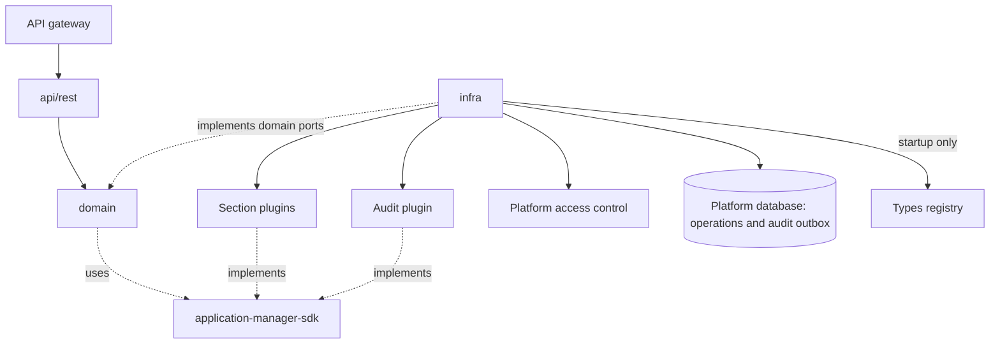
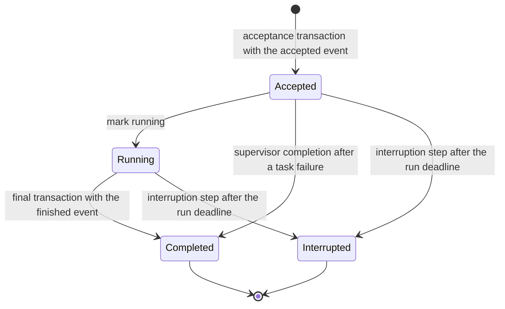
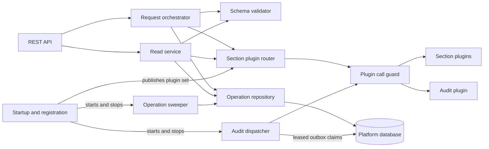
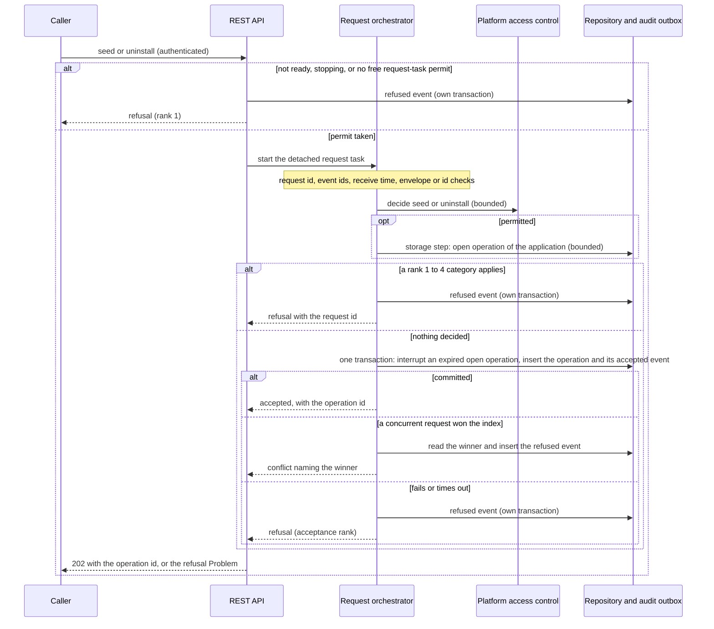
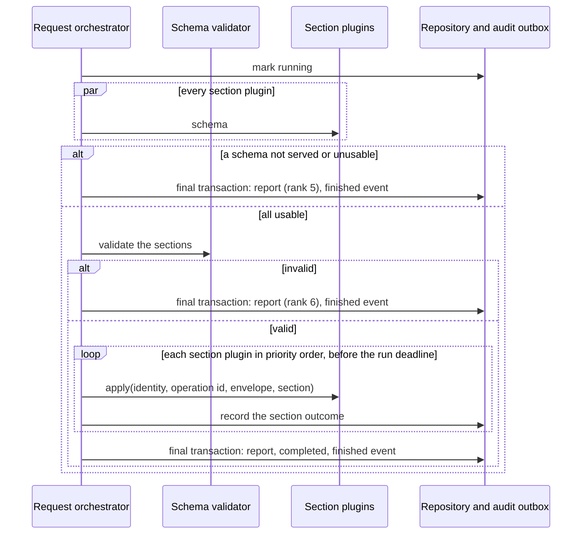
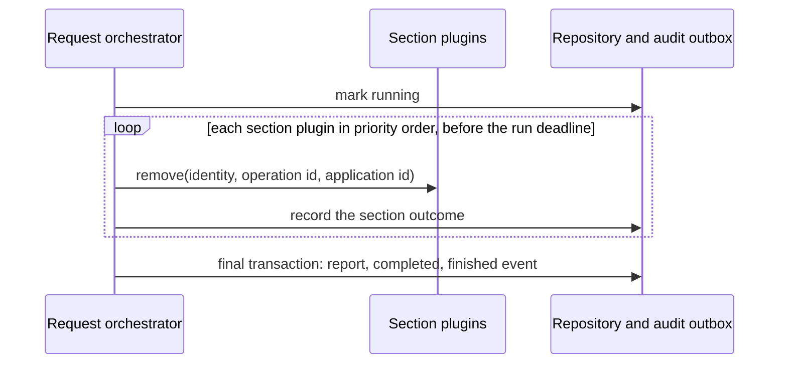
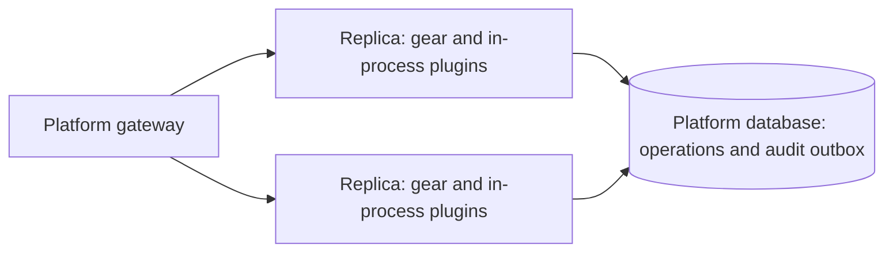

<!-- Created: 2026-10-05 by Constructor Tech -->

# Technical Design — Application Manager

How the Application Manager runs each seed and uninstall as an operation: it makes quick synchronous checks, answers with an operation id, validates whole manifests, dispatches sections to its section plugins in priority order, and records audit events in a transactional outbox that delivers them to one audit plugin. Written for gear implementers, section-plugin authors, and audit-plugin authors.

- [ ] `p3` - **ID**: `cpt-cf-application-manager-design-overview`

<!-- toc -->

- [1. Architecture Overview](#1-architecture-overview)
  - [1.1 Architectural Vision](#11-architectural-vision)
  - [1.2 Architecture Drivers](#12-architecture-drivers)
  - [1.3 Architecture Layers](#13-architecture-layers)
- [2. Principles & Constraints](#2-principles--constraints)
  - [2.1 Design Principles](#21-design-principles)
  - [2.2 Constraints](#22-constraints)
- [3. Technical Architecture](#3-technical-architecture)
  - [3.1 Domain Model](#31-domain-model)
  - [3.2 Component Model](#32-component-model)
  - [3.3 API Contracts](#33-api-contracts)
  - [3.4 Internal Dependencies](#34-internal-dependencies)
  - [3.5 External Dependencies](#35-external-dependencies)
  - [3.6 Interactions & Sequences](#36-interactions--sequences)
  - [3.7 Database schemas & tables](#37-database-schemas--tables)
  - [3.8 Deployment Topology](#38-deployment-topology)
- [4. Additional context](#4-additional-context)
  - [4.1 Concurrent Requests for the Same Application](#41-concurrent-requests-for-the-same-application)
  - [4.2 Security Considerations](#42-security-considerations)
  - [4.3 Fault Tolerance](#43-fault-tolerance)
  - [4.4 Observability](#44-observability)
  - [4.5 Configuration](#45-configuration)
  - [4.6 Platform Deviations and Dependencies](#46-platform-deviations-and-dependencies)
- [5. Traceability](#5-traceability)

<!-- /toc -->

## 1. Architecture Overview

### 1.1 Architectural Vision

The Application Manager is a thin orchestrating gear on the ToolKit gear model. It owns one manifest envelope, one operations table, one audit outbox queue, and one fixed sequence of checks, audit event inserts, and plugin calls. All domain meaning lives in section plugins, and all lasting audit storage lives in one audit plugin. Section plugins may provision data into systems outside the platform. The gear never talks to those systems.

Four decisions shape the design. The plugin set is fixed at startup ([ADR 0001](./ADR/0001-cpt-cf-application-manager-adr-section-plugin-fan-out.md)). Seed and uninstall run as operations: quick checks answer at once, and the rest runs in the background. Every seed fetches live schemas and validates the whole manifest before it dispatches anything ([ADR 0002](./ADR/0002-cpt-cf-application-manager-adr-plugin-served-section-schemas.md)). Every audit event commits in the same transaction as the change it describes, and a dispatcher delivers it to the audit plugin apart from request handling ([ADR 0004](./ADR/0004-cpt-cf-application-manager-adr-audit-via-plugin.md)).

### 1.2 Architecture Drivers

Requirements that significantly influence architecture decisions.

#### Functional Drivers

| Requirement | Design Response |
|---|---|
| `cpt-cf-application-manager-fr-manifest-envelope` | The schema validator owns the envelope schema and checks it before acceptance (`cpt-cf-application-manager-entity-manifest`). |
| `cpt-cf-application-manager-fr-application-id` | The id is checked against fixed limits, stored with a binary collation, compared as exact text, and never parsed (`cpt-cf-application-manager-entity-manifest`, `cpt-cf-application-manager-dbtable-operations`). |
| `cpt-cf-application-manager-fr-opaque-version` | The version is opaque text, passed unchanged to `apply`, and carried in the report and the audit events. |
| `cpt-cf-application-manager-fr-required-sections` | The schema validator requires exactly the key set and names each missing or unknown key (`cpt-cf-application-manager-component-schema-validator`). |
| `cpt-cf-application-manager-fr-unique-section-keys` | Startup fails on a repeated or malformed key, and the key set stays fixed until the next start (`cpt-cf-application-manager-component-startup-registration`). |
| `cpt-cf-application-manager-fr-section-priority` | The priority is the registered GTS instance priority, sorted lowest first, and startup fails on an equal priority. |
| `cpt-cf-application-manager-fr-startup-checks` | The startup component makes each check in its list once, with no retry, and a failed check stops the host (`cpt-cf-application-manager-component-startup-registration`). |
| `cpt-cf-application-manager-fr-validate-before-dispatch` | Each seed operation fetches every schema live and validates the whole manifest before any `apply` (`cpt-cf-application-manager-principle-validate-then-dispatch`). |
| `cpt-cf-application-manager-fr-plugin-served-schemas` | The `schema` call is the only source of section rules, and a compiled schema lives only for one operation or one read. |
| `cpt-cf-application-manager-fr-plugin-extensibility` | Section plugins are separate gears that register an instance of the section plugin GTS type, and the gear depends only on its SDK and the types registry. |
| `cpt-cf-application-manager-fr-async-operations` | The request orchestrator runs a synchronous phase with no plugin call, then a background operation (`cpt-cf-application-manager-component-request-orchestrator`, `cpt-cf-application-manager-entity-operation`). |
| `cpt-cf-application-manager-fr-one-operation-per-application` | A unique index allows one open operation per application id ([§4.1](#41-concurrent-requests-for-the-same-application)). |
| `cpt-cf-application-manager-fr-ordered-dispatch` | The section plugin router calls `apply` or `remove` one at a time in priority order and continues after every failure (`cpt-cf-application-manager-component-section-plugin-router`). |
| `cpt-cf-application-manager-fr-pass-through` | `apply` receives the envelope and its section as the parsed JSON value the caller sent, and the gear stores nothing about sections (`cpt-cf-application-manager-entity-section`). |
| `cpt-cf-application-manager-fr-plugin-owned-semantics` | The section plugin interface has no cancel, undo, batch, or transaction call (`cpt-cf-application-manager-interface-section-plugin-api`). |
| `cpt-cf-application-manager-fr-outcome-categories` | The request orchestrator decides one category per request from the outcome table in [§3.3](#33-api-contracts). |
| `cpt-cf-application-manager-fr-outcome-precedence` | The outcome table in [§3.3](#33-api-contracts) fixes the precedence. |
| `cpt-cf-application-manager-fr-response-content` | Refusals are canonical Problems with the request id, and the operation read returns the outcome report (`cpt-cf-application-manager-entity-outcome-report`). |
| `cpt-cf-application-manager-fr-bounded-plugin-calls` | The plugin call guard stops waiting at `plugin_call_timeout` and never cancels the call (`cpt-cf-application-manager-component-plugin-call-guard`). |
| `cpt-cf-application-manager-fr-dependency-failures` | Access control and operation storage are consulted before acceptance and before any plugin call, and the outcome table decides their failures. |
| `cpt-cf-application-manager-fr-uninstall` | An uninstall operation calls `remove` on every section plugin in priority order, with no check of whether the application is seeded (`cpt-cf-application-manager-seq-uninstall`). |
| `cpt-cf-application-manager-fr-discovery` | The read service lists keys from memory and serves live schemas with their schema versions (`cpt-cf-application-manager-component-read-service`). |
| `cpt-cf-application-manager-fr-operation-read` | The read service reads one operation record after a separate `read_operation` permit, and the operation sweeper purges final records after `operation_retention`. |
| `cpt-cf-application-manager-fr-authentication` | Every route is registered `.authenticated()`, and plugins receive a caller identity without the bearer token (`cpt-cf-application-manager-entity-caller-identity`). |
| `cpt-cf-application-manager-fr-authorization` | PolicyEnforcer decides four separate actions, and a section plugin can refuse with `NotPermitted` ([§3.3](#33-api-contracts)). |
| `cpt-cf-application-manager-fr-audit-event` | Events go into the `toolkit-db` outbox with their change, and the audit dispatcher delivers them to one `AuditPluginV1` (`cpt-cf-application-manager-component-audit-dispatcher`). |
| `cpt-cf-application-manager-fr-audit-ordering` | The accepted event commits with the operation record before any dispatch, and every refusal inserts its refused event before it answers (`cpt-cf-application-manager-principle-trace-before-change`). |
| `cpt-cf-application-manager-interface-seeding` | `cpt-cf-application-manager-interface-rest-api`: seed and both uninstall forms. |
| `cpt-cf-application-manager-interface-operations` | `cpt-cf-application-manager-interface-rest-api`: the operation read. |
| `cpt-cf-application-manager-interface-discovery` | `cpt-cf-application-manager-interface-rest-api`: the key list, one schema, and the combined schema. |
| `cpt-cf-application-manager-contract-section-plugin` | `cpt-cf-application-manager-interface-section-plugin-api`. |

#### NFR Allocation

This table maps non-functional requirements from PRD to specific design/architecture responses, demonstrating how quality attributes are realized.

| NFR ID | NFR Summary | Allocated To | Design Response | Verification Approach |
|---|---|---|---|---|
| `cpt-cf-application-manager-nfr-audit-completeness` | Every request traced, every event delivered | `cpt-cf-application-manager-component-request-orchestrator`, `cpt-cf-application-manager-component-registry-repository`, `cpt-cf-application-manager-component-audit-dispatcher` | Every path ends in a refused event or in the acceptance transaction, every final state commits its finished event, and the dispatcher delivers each event at least once. | Table-driven tests over every category and every storage failure point, with a recording test audit plugin. |
| `cpt-cf-application-manager-nfr-platform-scope` | Platform-wide operation records behind access checks | `cpt-cf-application-manager-component-registry-repository`, PolicyEnforcer | Operation records have no tenant column, are unrestricted in the secure ORM, and are reached only after a permit ([ADR 0007](./ADR/0007-cpt-cf-application-manager-adr-no-root-tenant.md)). | Inspection of the entity declaration, and tests that a refused decision reaches no storage. |
| `cpt-cf-application-manager-nfr-authorized-before-plugin` | No section plugin call without a permit | `cpt-cf-application-manager-component-request-orchestrator`, `cpt-cf-application-manager-component-read-service` | The permission decision is the first domain step, and the router is reachable only after a permit. | A recording test section plugin sees no call for a refused or unanswered decision. |
| `cpt-cf-application-manager-nfr-bounded-call-time` | Every plugin call ends within the configured limit | `cpt-cf-application-manager-component-plugin-call-guard` | Every plugin call goes through the guard, and `plugin_call_timeout` is required with no default ([§4.5](#45-configuration)). | Paused-clock tests with slow test plugins, and configuration tests. |
| `cpt-cf-application-manager-nfr-bounded-request-time` | Quick answer, and every operation final within its run window | `cpt-cf-application-manager-component-request-orchestrator`, `cpt-cf-application-manager-component-operation-sweeper` | The synchronous phase has a checked time budget, and the interruption step ends every operation at its run deadline ([§4.5](#45-configuration)). | Paused-clock tests with test plugins that always reach the limit. |
| `cpt-cf-application-manager-nfr-no-partial-on-invalid` | No dispatch for invalid manifest, temporarily unavailable, or conflict | `cpt-cf-application-manager-component-request-orchestrator` | Dispatch is reachable only after acceptance, usable schemas, and a valid manifest. | Counting tests assert no `apply` or `remove` call for those categories. |
| `cpt-cf-application-manager-nfr-availability` | Available for deploys, independent of the audit plugin | `cpt-cf-application-manager-component-audit-dispatcher`, `cpt-cf-application-manager-topology-replicas` | Requests need the outbox and never the audit plugin, and readiness depends on no plugin after startup. | Tests run seeds, uninstalls, and reads with the audit plugin down, then check delivery after it recovers. |
| `cpt-cf-application-manager-nfr-operational-signals` | Operator signals and counts | `cpt-cf-application-manager-component-audit-dispatcher`, `cpt-cf-application-manager-component-plugin-call-guard`, `cpt-cf-application-manager-component-startup-registration` | Platform telemetry carries the counts and signal conditions of [§4.4](#44-observability). | Tests read the counts from an in-memory exporter and assert the log events. |

#### Key ADRs

| ADR ID | Decision Summary |
|---|---|
| `cpt-cf-application-manager-adr-section-plugin-fan-out` | Every section plugin takes part. Plugins are discovered once at startup into a key map and a priority order. |
| `cpt-cf-application-manager-adr-plugin-served-section-schemas` | Section plugins serve their own schemas, fetched on every seed with no cache, and every section is required. |
| `cpt-cf-application-manager-adr-audit-via-plugin` | One audit plugin behind `AuditPluginV1` receives every event from a transactional outbox, at least once. |
| `cpt-cf-application-manager-adr-no-root-tenant` | No root tenant: the PDP decides platform-level permission, and operation records are unrestricted. |

### 1.3 Architecture Layers

Solid arrows are runtime calls. Dotted arrows are compile-time relationships.

- [ ] `p3` - **ID**: `cpt-cf-application-manager-tech-layers`

The gear uses the platform layer model ([gear layout and SDK pattern](../../../../docs/toolkit_unified_system/02_gear_layout_and_sdk_pattern.md)). The SDK crate is the only crate that plugin gears depend on, and REST is the only consumer surface.

| Layer | Responsibility | Technology |
|---|---|---|
| API (`api/rest/`) | Routes, DTOs, Problem bodies for refusals, the not-ready gate | Axum handlers through OperationBuilder; canonical errors (RFC 9457) |
| Domain (`domain/`) | Orchestration, the operation lifecycle, reads, validation, dispatch order, outcome ranking, report and event assembly; owns the ports | `#[domain_model]` services; JSON Schema Draft 2020-12 through `jsonschema`; SHA-256 |
| Infrastructure (`infra/`) | Call guard and ClientHub adapters, policy adapter, operation repository and outbox inserts, audit dispatcher, operation sweeper, startup, telemetry | ClientHub; types registry; PolicyEnforcer; SeaORM through SecureConn; `toolkit-db` outbox; OpenTelemetry |
| SDK (`application-manager-sdk`) | Section plugin interface, `AuditPluginV1`, models, error kinds, GTS types | Rust traits; GTS |

## 2. Principles & Constraints

### 2.1 Design Principles

When principles conflict, the earlier one in this list wins: Trace Before Change, Honest Outcomes, Validate Everything Then Dispatch, Bounded Waiting, Pass Through, Plugin Set Fixed at Startup, Minimal State.

#### Pass Through, Never Interpret

- [ ] `p2` - **ID**: `cpt-cf-application-manager-principle-pass-through`

The gear checks shape against schemas it does not own and moves each section unchanged to its owner. It never gives meaning to versions, re-seeds, schema versions, or section content.

**ADRs**: `cpt-cf-application-manager-adr-plugin-served-section-schemas`

#### Plugin Set Fixed at Startup

- [ ] `p2` - **ID**: `cpt-cf-application-manager-principle-startup-fixed-plugin-set`

The section plugin set, its keys and priority order, and the audit plugin client are built once at startup and then never change. Key and priority conflicts show up at deploy time, and an operation never sees the plugin set change.

**ADRs**: `cpt-cf-application-manager-adr-section-plugin-fan-out`, `cpt-cf-application-manager-adr-audit-via-plugin`

#### Validate Everything, Then Dispatch

- [ ] `p2` - **ID**: `cpt-cf-application-manager-principle-validate-then-dispatch`

Dispatch starts only after every earlier step has passed: permission, storage, the conflict check, the envelope check, the committed operation with its accepted event, every live schema, and the whole-manifest validation. Sections then go out one at a time in priority order, dispatch continues after a section plugin fails, and rollback stays with the section plugins. Seed validation and the discovery combined schema use one composition rule, so a manifest built from discovery passes validation.

**ADRs**: `cpt-cf-application-manager-adr-plugin-served-section-schemas`

#### Trace Before Change

- [ ] `p2` - **ID**: `cpt-cf-application-manager-principle-trace-before-change`

No section plugin receives anything until the operation record and its accepted event have committed together. Each final state commits with its finished event, and each refusal records its refused event before it answers. Delivery to the audit plugin runs apart from requests, so an audit outage never blocks or changes a request.

**ADRs**: `cpt-cf-application-manager-adr-audit-via-plugin`

#### Honest, Deterministic Outcomes

- [ ] `p2` - **ID**: `cpt-cf-application-manager-principle-honest-outcomes`

Every seed and uninstall ends in exactly one outcome category, chosen by the outcome table in §3.3. The gear fails closed, never claims not permitted or conflict when it could not check, and never reports a partial failure as success. Every write to an operation is guarded, so an operation has exactly one final state.

#### Bounded Waiting, No Cancellation

- [ ] `p2` - **ID**: `cpt-cf-application-manager-principle-bounded-waiting`

The gear stops waiting for a plugin call at the time limit but never cancels or undoes work a plugin has started. Each seed and uninstall runs as a request task detached from the HTTP request, so a caller disconnect cuts no step short.

#### Minimal State

- [ ] `p2` - **ID**: `cpt-cf-application-manager-principle-minimal-state`

The gear keeps only operation records, purged after `operation_retention`, and audit events that wait in the outbox for delivery. It never stores sections or schemas, and manifests appear only inside waiting events.

**ADRs**: `cpt-cf-application-manager-adr-audit-via-plugin`, `cpt-cf-application-manager-adr-no-root-tenant`

### 2.2 Constraints

#### ToolKit Gear and Plugin Model

- [ ] `p2` - **ID**: `cpt-cf-application-manager-constraint-toolkit-plugin-model`

The gear follows the ToolKit SDK, domain, API, and infrastructure split. Plugin types are GTS types, instances are listed from the types registry, and clients are looked up in ClientHub by exact GTS id, because ClientHub cannot enumerate scoped clients ([ClientHub and plugins](../../../../docs/toolkit_unified_system/03_clienthub_and_plugins.md)).

**ADRs**: `cpt-cf-application-manager-adr-section-plugin-fan-out`, `cpt-cf-application-manager-adr-audit-via-plugin`

#### Platform Authentication and Policy Enforcement

- [ ] `p2` - **ID**: `cpt-cf-application-manager-constraint-platform-auth`

Authentication belongs to the platform pipeline, and authorization uses PolicyEnforcer ([AuthN, AuthZ and secure ORM](../../../../docs/toolkit_unified_system/06_authn_authz_secure_orm.md)). The gear holds no credentials and never forwards caller credentials to plugins.

**ADRs**: `cpt-cf-application-manager-adr-no-root-tenant`

#### Secure ORM for Operations

- [ ] `p2` - **ID**: `cpt-cf-application-manager-constraint-secure-orm`

All operation access goes through SecureConn, with the entity declared unrestricted and no tenant column ([database patterns](../../../../docs/toolkit_unified_system/11_database_patterns.md)). Raw SQL appears only in migrations.

**ADRs**: `cpt-cf-application-manager-adr-no-root-tenant`

#### Canonical Error Model

- [ ] `p2` - **ID**: `cpt-cf-application-manager-constraint-canonical-errors`

Every error response is a standard canonical Problem built from a canonical error category ([canonical error system](../../../../docs/arch/errors/DESIGN.md)). The gear adds no extension member, and the outcome of an accepted operation is data in its report, not an error.

#### No Manifest Content Outside the Audit Outbox and the Audit Plugin

- [ ] `p2` - **ID**: `cpt-cf-application-manager-constraint-no-manifest-content`

Manifest content lives in memory while its request task or a detached plugin call holds it, and in the audit outbox inside waiting events. It never appears in operation records, logs, traces, metrics, or error text. Errors name locations and section keys, never values.

**ADRs**: `cpt-cf-application-manager-adr-audit-via-plugin`

#### Restart for Plugin Changes

- [ ] `p2` - **ID**: `cpt-cf-application-manager-constraint-restart-for-plugin-change`

Adding, removing, or re-prioritizing a section plugin, or replacing the audit plugin, takes effect only after a restart.

**ADRs**: `cpt-cf-application-manager-adr-section-plugin-fan-out`

#### Configured Time Limit Only

- [ ] `p2` - **ID**: `cpt-cf-application-manager-constraint-configured-time-limit`

The plugin-call time limit comes only from configuration, has no compiled default and no extra margin, and is the same for every call kind.

## 3. Technical Architecture

### 3.1 Domain Model

**Technology**: Rust types marked `#[domain_model]`; GTS types for the plugin types, the authorization resource type, the outcome report, and the section schemas; JSON Schema Draft 2020-12.

**Location**: shared models in `application-manager-sdk/src/models.rs`, GTS definitions in `application-manager-sdk/src/gts.rs`, and domain services in `application-manager/src/domain/`.

**Core Entities**:

- [ ] `p2` - **ID**: `cpt-cf-application-manager-entity-manifest`

**Manifest.** A JSON object with exactly `application`, the envelope, and `sections`, an object with one member per section key. The envelope holds exactly `id` and `version`. Each is non-empty text of at most `max_envelope_text_length` bytes with no control character (Unicode category Cc, which includes NUL). Uninstall applies the same rules to its id, with the column size `APPLICATION_ID_MAX_BYTES` as the length limit.

- [ ] `p2` - **ID**: `cpt-cf-application-manager-entity-section`

**Section.** The JSON value under one key of `sections`, passed unchanged to the owning section plugin's `apply` together with the envelope.

- [ ] `p2` - **ID**: `cpt-cf-application-manager-entity-outcome-category`

**Outcome category and section outcome.** The request-level category is one of the seven PRD categories, as the outcome table in §3.3 assigns it. A section outcome is `succeeded`, `rejected`, `not_permitted`, or one of four internal failures: `internal_failure`; `timed_out`, whose effect is unknown because the call may still complete; `not_sent`, which had no effect because the in-flight cap refused the call; and `not_dispatched`, where the request task failed before the call.

- [ ] `p2` - **ID**: `cpt-cf-application-manager-entity-outcome-report`

**Outcome report.** The PRD's operation report. The gear writes it into the operation record as the operation runs, and the operation read returns it once the operation is final. It validates against the outcome report GTS type.

| Member | Content |
|---|---|
| `operation_id` | The operation id |
| `action` | `seed` or `uninstall` |
| `category` | The outcome category of a completed operation; absent while open and for an interrupted operation |
| `interrupted` | True when the operation ended at its run deadline |
| `application` | Seed: `id` and `version`. Uninstall: `id`. |
| `sections` | One item per section plugin with a recorded outcome, in priority order: `key`, `outcome`, `schema_version` for a validated seed section, and the plugin's bounded `detail` and optional `location` for `rejected` and `not_permitted` |
| `problems` | Section validation problems: `location` (JSON Pointer), `rule` (a JSON Schema keyword, `missing_section`, or `unknown_section`), and `message` |
| `unavailable` | Unavailable items for a seed whose section schemas could not be used |

An unavailable item has a `dependency` (`access_control`, `operation_storage`, `section_schema`, or `application_manager`), a `key` for a section schema, and a `reason` (`unreachable`, `timed_out`, `unusable`, `not_sent`, `not_ready`, or `at_capacity`). Refused events use the same shape.

- [ ] `p2` - **ID**: `cpt-cf-application-manager-entity-operation`

**Operation record.** One per accepted seed or uninstall: the operation id, application id, action, status, category, report so far, accepted, started, and finished times, run deadline, and finished event id. It never holds manifest content or caller identity, and it has no tenant column.

- **Run deadline.** Set at acceptance from the receive time and the plugin count, as [§4.5](#45-configuration) states. No plugin call starts after it.
- **Status guard.** Every write to an open operation matches only an open record before its run deadline. The interruption step matches only an open record past it. So the first final write wins.
- **Interruption step.** One transaction sets status interrupted, keeps the section outcomes so far, and inserts the finished event with the stored event id. The sweeper, the operation read, and the acceptance transaction run it when they meet an expired open operation.
- **Retention.** The sweeper purges a final record once `operation_retention` has passed after its finish time.

A completed or interrupted operation frees its application.

- [ ] `p2` - **ID**: `cpt-cf-application-manager-entity-caller-identity`

**Caller identity.** The subject id, subject type, subject tenant id, and token scopes, copied from the request's `SecurityContext`, with no bearer token. Every section plugin call receives it, and accepted and refused events carry it. The SDK has a constructor that turns it back into a token-less `SecurityContext` for a plugin's own PolicyEnforcer check.

- [ ] `p2` - **ID**: `cpt-cf-application-manager-entity-audit-event-content`

**Audit event content.** A request has one refused event, or one accepted event followed by one finished event. Operations that end without dispatch also get a finished event. Each event id is a time-ordered UUID assigned at receive, and every delivery of an event carries the same id.

| Field | Accepted | Finished | Refused |
|---|---|---|---|
| Event id, kind, action, write time | Yes | Yes | Yes |
| Correlation id | `operation_id` | `operation_id` | `request_id` |
| Application | Seed: id and version. Uninstall: id. | As accepted | Id and version as sent, when within the limits. An id outside them appears only as its byte length and SHA-256 digest. |
| Caller identity and receive time | Yes | No; joined through the accepted event | Yes |
| Manifest as parsed (seed) | Yes | No | Yes |
| Result | None | Category or interrupted marker, section problems, section outcomes with schema versions | Category, envelope problems, busy operation id, or unavailable items |

One time-ordered UUID per request is the operation id when the request is accepted and the request id when it is refused.

- [ ] `p2` - **ID**: `cpt-cf-application-manager-entity-schema-version`

**Schema version.** Opaque text of 1 to `SCHEMA_VERSION_MAX_BYTES` bytes that a section plugin returns with each schema. The gear records it as sent, in the finished event, the report, and discovery, and never compares it. A missing, empty, or too long version makes the schema `unusable`.

| Entity | Description | Schema |
|---|---|---|
| Operation | Status, report, and times of one accepted request | `cpt-cf-application-manager-dbtable-operations` |
| Manifest | Envelope plus sections | Envelope schema owned by the gear; combined schema from discovery |
| Section | One section plugin's part of a manifest | Served live by its section plugin |
| OutcomeCategory, SectionOutcome | Request and per-section results | `application-manager-sdk/src/models.rs` |
| OutcomeReport | Result of an operation | GTS type `gts.cf.core.application_manager.outcome_report.v1~` |
| CallerIdentity | Identity passed to plugins | `application-manager-sdk/src/models.rs` |
| AuditEventContent | Accepted, finished, and refused events | `application-manager-sdk/src/models.rs`, stored as the outbox payload |
| SchemaVersion | Version of a section schema | Part of the section schema that `schema` returns |

**Relationships**:
- Manifest → Section: one section per section key.
- Operation → OutcomeReport: one report, final once the operation is final.
- Operation → AuditEventContent: accepted and finished events carry the operation id.
- OutcomeReport → SectionOutcome: one per section plugin with a recorded outcome.

### 3.2 Component Model

Domain components call ports, and infrastructure components implement them. Each component below states why it exists, what it owns, what it does not do, and its related components.

#### REST API

- [ ] `p2` - **ID**: `cpt-cf-application-manager-component-rest-api`

**Why**: It is the only caller-facing surface. It turns HTTP requests into domain calls and domain results into the answers of §3.3.

**Scope**: It registers the routes through OperationBuilder and reads the seed body as a parsed JSON value. It owns the not-ready gate and the request-task cap check: a seed or uninstall that arrives before startup ends, after `stop` begins, or with no free permit is refused with a refused event (reason `not_ready` or `at_capacity`), and a read is refused with no event.

**Boundaries**: It does not authenticate, authorize, or decide categories. Requests that the platform rejects, such as malformed JSON or throttled requests, never reach it.

**Related**: `cpt-cf-application-manager-component-request-orchestrator` (starts its request tasks), `cpt-cf-application-manager-component-read-service` (reads).

#### Request Orchestrator

- [ ] `p1` - **ID**: `cpt-cf-application-manager-component-request-orchestrator`

**Why**: Precedence, acceptance, audit ordering, and dispatch must run as one sequence on every path. One component owns it, so no branch can skip a step.

**Scope**: It runs each seed and uninstall as a supervised request task and decides the category by the outcome table in §3.3. Its invariants:

- The synchronous phase makes no plugin call, and every refusal records its refused event before it answers.
- No `apply` or `remove` before a permit and a committed operation record with its accepted event.
- Every write to an operation is guarded, and no plugin call starts after the run deadline or after the operation is final.
- The id is taken once from the single parse of the body, and every use carries that value or none.
- The request task completes even when the HTTP request is dropped.

**Boundaries**: It holds no plugin set and no schema logic, and it never calls the audit plugin. It never cancels, undoes, or resumes work, and it does not sweep or purge.

**Related**: `cpt-cf-application-manager-component-registry-repository` (operations and events), `cpt-cf-application-manager-component-schema-validator` (validation), `cpt-cf-application-manager-component-section-plugin-router` (schemas and dispatch).

#### Read Service

- [ ] `p2` - **ID**: `cpt-cf-application-manager-component-read-service`

**Why**: Discovery and operation reads record no audit event and decide no outcome category. Keeping them apart keeps them available during an audit outage.

**Scope**: After a `read_schema` or `read_operation` permit, it lists keys from memory, fetches one or every live schema with its schema version, or reads one operation record. When the record is open past its run deadline, it runs the interruption step first.

**Boundaries**: It records no audit event, caches no schema, and makes no plugin call for the key list or the operation read. It never returns the caller subject, a manifest, or section content.

**Related**: `cpt-cf-application-manager-component-registry-repository` (operation reads), `cpt-cf-application-manager-component-section-plugin-router` (live schemas), `cpt-cf-application-manager-component-schema-validator` (combined schema).

#### Schema Validator

- [ ] `p2` - **ID**: `cpt-cf-application-manager-component-schema-validator`

**Why**: Seed validation and the combined schema must follow one rule, so that discovery is a reliable contract.

**Scope**: It owns the envelope schema, composes the combined schema with each section schema under its key and the gear-owned `$id` `urn:cf:application-manager:section:<key>`, and collects every problem with its JSON Pointer location. It compiles served schemas as Draft 2020-12 off the async executor, with the linear-time `regex` engine and the limits `SCHEMA_REGEX_SIZE_LIMIT` and `SCHEMA_REGEX_DFA_SIZE_LIMIT`; another dialect, a reference outside the served document, a size above `SERVED_SCHEMA_MAX_BYTES`, a bad schema version, or a compile failure makes a schema `unusable`.

**Boundaries**: It resolves nothing outside the served document and keeps no compiled schema beyond one operation or read. Its messages come from schema-side constraints, never from manifest values.

**Related**: `cpt-cf-application-manager-component-request-orchestrator` and `cpt-cf-application-manager-component-read-service` (callers).

#### Section Plugin Router

- [ ] `p1` - **ID**: `cpt-cf-application-manager-component-section-plugin-router`

**Why**: Routing depends only on the startup-built section plugin set, so a manifest can never select or add a plugin.

**Scope**: It holds the plugin set in priority order, fetches all schemas concurrently, and calls `apply` or `remove` one at a time when the orchestrator asks. It turns each result into a section outcome and passes the caller identity and the operation id to every call.

**Boundaries**: It never consults the types registry after startup and never retries a call. It does not record outcomes or check the run deadline.

**Related**: `cpt-cf-application-manager-component-plugin-call-guard` (wraps every call), `cpt-cf-application-manager-component-startup-registration` (provides the plugin set).

#### Plugin Call Guard

- [ ] `p2` - **ID**: `cpt-cf-application-manager-component-plugin-call-guard`

**Why**: In an async runtime, dropping a timed-out call would cancel it. One guard makes "stop waiting, never cancel" the same for every call kind.

**Scope**: It runs each plugin call detached, waits up to `plugin_call_timeout`, and logs a late result by metadata only. It enforces `plugin_max_in_flight` per plugin instance, so a call over the cap is never sent (`not_sent`), and it turns panics and transport errors into internal errors.

**Boundaries**: It does not decide what a timeout means for its caller, and it adds no margin to the limit.

**Related**: `cpt-cf-application-manager-component-section-plugin-router` (section plugin calls), `cpt-cf-application-manager-component-audit-dispatcher` (audit deliveries).

#### Audit Dispatcher

- [ ] `p1` - **ID**: `cpt-cf-application-manager-component-audit-dispatcher`

**Why**: The audit plugin may be slow or down. Delivering from the outbox apart from requests keeps the trail complete and the requests independent of it.

**Scope**: It is a `toolkit-db` outbox leased handler on the `audit_outbox_queue` queue that delivers each event to `AuditPluginV1` through the call guard, at least once, in order per operation, with the same event id each time. It retries with backoff and, at `audit_delivery_max_attempts`, moves the event to the dead-letter store with a log and a signal, and the later events continue.

**Boundaries**: It never inserts events, never blocks or changes a request, and never exposes event content. It does not replay or discard dead letters.

**Related**: `cpt-cf-application-manager-component-plugin-call-guard` (wraps each delivery), `cpt-cf-application-manager-component-registry-repository` (inserts the events it delivers).

#### Operation Repository

- [ ] `p2` - **ID**: `cpt-cf-application-manager-component-registry-repository`

**Why**: It is the only writer of operation records and audit outbox inserts. It enforces the secure-ORM rules and owns the status guard.

**Scope**: It runs the storage step, the acceptance transaction, the guarded updates, the final transaction, the interruption step, reads, the sweep selection, the purge, and refused-event inserts, each bounded by `storage_call_timeout`. It reports "storage cannot answer", "index violated", and "operation final" as distinct results.

**Boundaries**: It decides no category, runs no schedule, and never reads the outbox.

**Related**: `cpt-cf-application-manager-component-request-orchestrator` (main caller), `cpt-cf-application-manager-component-operation-sweeper` (interruptions and purges).

#### Operation Sweeper

- [ ] `p2` - **ID**: `cpt-cf-application-manager-component-operation-sweeper`

**Why**: A request task can stop mid-operation, yet every operation must reach a final state, and final records must not grow without bound.

**Scope**: On every replica, every `SWEEP_INTERVAL`, it runs the interruption step for up to `MAINTENANCE_BATCH_SIZE` expired open operations. Every `PURGE_INTERVAL` it deletes final records older than `operation_retention`, in batches.

**Boundaries**: It makes no plugin call, never resumes or completes an operation, and never deletes an open record.

**Related**: `cpt-cf-application-manager-component-registry-repository` (runs its steps).

#### Startup and Registration

- [ ] `p1` - **ID**: `cpt-cf-application-manager-component-startup-registration`

**Why**: Every configuration and plugin-set problem must stop the gear at deploy time.

**Scope**: In `init` it validates the settings and registers the two plugin GTS types. A hand-implemented `start` makes each check once, with no retry, and then publishes the startup result. A failed check emits a startup failure event that names one of these reasons, and the host exits with a non-zero status:

- `invalid_setting` (in `init`): a setting is missing or invalid, or the time budget or margin floor of §4.5 is broken;
- `types_registry_unreachable`: the instance listing fails or does not answer in time, and is never read as empty;
- `priority_unreadable`, `equal_priority`, `no_audit_plugin`, `multiple_audit_plugins`, `plugin_client_unresolved`;
- `section_key_unavailable`, `invalid_section_key`, `duplicate_section_key`: a `key` call fails, or a key breaks the SDK token pattern or repeats;
- `audit_outbox_unavailable`: the audit outbox cannot start.

An answering types registry that lists no section plugins gives an empty key set.

**Boundaries**: It never runs again after startup and never selects plugin instances by vendor.

**Related**: `cpt-cf-application-manager-component-section-plugin-router` (receives the plugin set), `cpt-cf-application-manager-component-audit-dispatcher` and `cpt-cf-application-manager-component-operation-sweeper` (started and stopped by it).

#### Ports and Composition

| Port | Operations | Implemented by |
|---|---|---|
| Policy decision | Decide an action: permit, refuse, or cannot answer | Policy adapter over PolicyEnforcer |
| Operation store | Storage step, acceptance, guarded writes, interruption, reads, sweep, purge, refused-event insert | Operation repository |
| Section plugin | `key`, `schema`, `apply`, `remove` | Call guard and ClientHub adapter |
| Audit sink | Deliver one event | Call guard and ClientHub adapter |
| Startup | Publish the startup result once; set the stopping flag | Startup component |
| Clock and id source | Times and time-ordered ids | System clock and UUID generator |

`gear.rs` is the composition root: it returns the migrations, builds the domain services in `init`, and lets the startup component start and stop the background work. Tests replace every port with a double.

### 3.3 API Contracts

This section realizes `cpt-cf-application-manager-interface-seeding`, `cpt-cf-application-manager-interface-operations`, `cpt-cf-application-manager-interface-discovery`, and `cpt-cf-application-manager-contract-section-plugin`.

- [ ] `p2` - **ID**: `cpt-cf-application-manager-interface-rest-api`

- **Contracts**: `cpt-cf-application-manager-interface-seeding`, `cpt-cf-application-manager-interface-operations`, `cpt-cf-application-manager-interface-discovery`
- **Technology**: REST over HTTP with JSON bodies, canonical Problem errors (RFC 9457), and OpenAPI generated from OperationBuilder ([REST OperationBuilder](../../../../docs/toolkit_unified_system/04_rest_operation_builder.md))
- **Location**: the platform's generated OpenAPI document

**Endpoints Overview**:

| Method | Path | Description | Stability |
|---|---|---|---|
| `POST` | `/application-manager/v1/applications` | Seed: submit a manifest. Permission `seed`. | unstable |
| `DELETE` | `/application-manager/v1/applications/{application_id}` | Uninstall by id in one percent-encoded path segment. Permission `uninstall`. | unstable |
| `POST` | `/application-manager/v1/applications:uninstall` | Uninstall with `application_id` in the body, for ids a path segment cannot carry. Permission `uninstall`. | unstable |
| `GET` | `/application-manager/v1/operations/{operation_id}` | Read one operation. Permission `read_operation`. | unstable |
| `GET` | `/application-manager/v1/section-keys` | List section keys in priority order. Permission `read_schema`. | unstable |
| `GET` | `/application-manager/v1/section-keys/{section_key}/schema` | Read one live schema and its schema version. Permission `read_schema`. | unstable |
| `GET` | `/application-manager/v1/manifest-schema` | Read the live combined schema with every schema version. Permission `read_schema`. | unstable |

**Operation registration.** Each route is registered through OperationBuilder with an `application_manager.*` operation id, `.authenticated()`, `.no_license_required()`, its schemas, a tag, and its statuses. Seed, both uninstall forms, the operation read, and the combined-schema read are bound to gateway rate-limit and in-flight zones. The seeding documentation states that manifests must not carry secrets and that callers read the operation for the result.

**Answers.** An accepted request gets 202 with `operation_id`, `status` `accepted`, and a `Location` header with the operation read path. The operation read gets 200 with the id, action, application id and version, status, times, run deadline, and, once final, the outcome report.

**Outcome table.** This is the one normative statement of outcome precedence, placement, and HTTP mapping. The first matching rank decides.

| Rank | Outcome category | Decided in | Canonical error category | HTTP | Retriable |
|---|---|---|---|---|---|
| 1 | Temporarily unavailable: not ready, request-task cap, access control cannot answer, or operation storage cannot answer for a permitted caller | Synchronous refusal | `service_unavailable` | 503 | Yes, after the retry delay |
| 2 | Not permitted by platform access control | Synchronous refusal | `permission_denied` | 403 | No; obtain the permission |
| 3 | Conflict: an open operation of the application before its run deadline | Synchronous refusal | `aborted` | 409 | Yes, once the named operation is final |
| 4 | Invalid manifest: an envelope problem, or an uninstall id outside the limits | Synchronous refusal | `invalid_argument` | 400 | No; fix the request |
| Acceptance | Temporarily unavailable: the operation and its accepted event cannot commit | Synchronous refusal | `service_unavailable` | 503 | Yes, after the retry delay |
| 5 | Temporarily unavailable: a section schema is not served or is unusable (seed) | Operation report | — | — | Yes, with a new request; for `unusable`, after the plugin is fixed |
| 6 | Invalid manifest: a section problem (seed) | Operation report | — | — | No; fix the named sections |
| After dispatch 1 | Not permitted by a section plugin | Operation report | — | — | No; obtain the plugin's permission |
| After dispatch 2 | Plugin rejected | Operation report | — | — | No; fix the named sections |
| After dispatch 3 | Internal failure | Operation report | — | — | Yes, seed or uninstall again |
| — | Succeeded | Operation report | — | — | Not applicable |

Storage is consulted only for a permitted caller, so a refused caller is not permitted even while storage is down. A seed with envelope and section problems ends at rank 4, because sections are checked only inside the operation. An interrupted operation has no category. The audit plugin plays no part in any category, and requests the platform rejects get none. A request task that fails before it answers is a gear defect outside this table: the caller gets the platform's generic 500 `internal`, and the refused event records internal failure.

**Refusal bodies.** Every synchronous refusal is a standard canonical Problem with no extension member:

- the `detail` states the request id, which links the refusal to its refused event, and the platform fills `trace_id`;
- temporarily unavailable carries the retry delay `REFUSAL_RETRY_AFTER_SECONDS`; the dependency and reason go only to the refused event, logs, and metrics;
- not permitted names the refused action;
- conflict has the `aborted` reason `application_busy`, and the `detail` names the open operation's id;
- invalid manifest lists each problem as a field violation: location, rule token (a JSON Schema keyword, `max_length`, or `control_character`), and message.

Read failures are 403 `permission_denied`, 404 `not_found` for an unknown key or an unknown, malformed, or purged operation id, and 503 with the retry delay.

**Safe wire errors.** Plugin `Internal` text, PDP internals, and storage errors are logged under the trace id and never returned. A plugin's `Rejected` and `NotPermitted` detail is returned truncated, and validation messages never contain manifest values.

**Authorization.** PolicyEnforcer evaluates the resource type `gts.cf.core.application_manager.application.v1~` for four actions. The permission is platform-level, and every decision is requested with no tenant ([ADR 0007](./ADR/0007-cpt-cf-application-manager-adr-no-root-tenant.md)), so policy authors grant each action as a platform-level permission. Seed and uninstall send the application id as the resource property `application_id` when it is within the limits. Each decision is bounded by `pdp_call_timeout`. `EvaluationFailed` means access control cannot answer. `Denied`, `CompileFailed`, and a permit with any constraint mean not permitted.

| Action | Operations | What a permit allows | Intended holders |
|---|---|---|---|
| `seed` | Seed | Have every section plugin apply its section | Each application's deployment pipeline, granted narrowly |
| `uninstall` | Both uninstall forms | Have every section plugin remove an application | Operators, granted apart from `seed` |
| `read_operation` | Read an operation | Read the status and report of any operation | Seeding callers and operators |
| `read_schema` | All three discovery reads | Read keys, live schemas, and schema versions | Seeding callers and application teams |

- [ ] `p2` - **ID**: `cpt-cf-application-manager-interface-section-plugin-api`

- **Contracts**: `cpt-cf-application-manager-contract-section-plugin`
- **Technology**: ToolKit plugin model; GTS type `gts.cf.toolkit.plugins.plugin.v1~cf.core.application_manager_section.plugin.v1~`; scoped ClientHub client
- **Location**: `application-manager-sdk/src/section_plugin_api.rs`

| Operation | Called | Receives | Returns | On timeout |
|---|---|---|---|---|
| `key` | Once, at `start` | Nothing | One key in the SDK token pattern: lower-case letters, digits, `-`, `_`, `.` | Startup fails |
| `schema` | In each seed operation and each schema read | Caller identity | A self-contained Draft 2020-12 schema of the plugin's GTS type, with its schema version | Seed: rank 5. Read: 503. |
| `apply` | In a seed operation, in priority order | Caller identity, operation id, envelope, its section | Success or an error kind | `timed_out`; dispatch continues |
| `remove` | In an uninstall operation, in priority order | Caller identity, operation id, application id | Success or an error kind | `timed_out`; dispatch continues |

The priority is the registered GTS instance priority, read at startup. A call refused by the in-flight cap gives `not_sent`.

| Error kind | Carries | Section outcome |
|---|---|---|
| `Rejected` | Caller-facing detail and an optional JSON Pointer location | `rejected` |
| `NotPermitted` | Caller-facing detail | `not_permitted` |
| `Internal` | Diagnostic detail, logged only | `internal_failure` |

**Contract evolution.** Additive changes within `v1` are compatible. Any other change is a new GTS type version, and a plugin moves to it only after the gear supports it.

- [ ] `p2` - **ID**: `cpt-cf-application-manager-interface-audit-plugin-api`

- **Contracts**: `cpt-cf-application-manager-fr-audit-event`
- **Technology**: ToolKit plugin model; trait `AuditPluginV1`; GTS type `gts.cf.toolkit.plugins.plugin.v1~cf.core.application_manager_audit.plugin.v1~`; scoped ClientHub client
- **Location**: `application-manager-sdk/src/audit_plugin_api.rs`

| Method | Called | Receives | Returns | On timeout |
|---|---|---|---|---|
| `deliver` | By the audit dispatcher, at least once per event, in order per operation | One event with its event id | Success once stored, or `Unavailable` or `Refused` | Retried like any failed delivery |

**Contract evolution.** The trait version follows the GTS type version. Additive changes within `v1` are compatible, and any other change is `AuditPluginV2`.

**Plugin obligations.** The SDK crate is the normative plugin contract. Its main obligations:

- Section plugins register their instance, priority, and scoped client in their own `init`, and answer `key` once `init` has finished.
- Section plugins change the schema version whenever the schema content changes, keep `schema` cheap and free of side effects, and tolerate repeated `apply` and `remove`.
- Section plugins put no manifest values or secrets in any detail, use their own service credentials, make their own authorization decision from the caller identity, and clean up their own data when removed.
- The audit plugin confirms an event only once it is stored, drops duplicates by event id and still confirms, joins events by operation or request id, and keeps them unaltered, also after an uninstall.
- The audit plugin accepts an accepted event with no finished event yet, a finished event whose accepted event is dead-lettered, and a refused event that shares its id with an accepted event when an acceptance timed out but committed.
- The audit plugin keeps exposure off by default and documents it as security-relevant, uses content only for tracing, and owns and documents retention, purge, and erasure.
- Each plugin ships a conformance test for its side of the contract.

### 3.4 Internal Dependencies

| Dependency Gear | Interface Used | Purpose |
|---|---|---|
| types-registry | `TypesRegistryClient` | Register the plugin GTS types in `init`, and list plugin instances once at `start` |
| authz-resolver | PolicyEnforcer | Decisions for `seed`, `uninstall`, `read_operation`, and `read_schema` |
| api-gateway | Platform REST host | Request protection, authentication, `SecurityContext`, readiness, and route hosting |
| Section plugin gears | `cpt-cf-application-manager-interface-section-plugin-api` | Keys, schemas, `apply`, and `remove` |
| Audit plugin gear | `cpt-cf-application-manager-interface-audit-plugin-api` | Delivery of audit events |

**Dependency Rules** (per project conventions):
- No circular dependencies
- Always use sdk modules for inter-gear communication
- No cross-category sideways deps except through contracts
- Only integration/adapter gears talk to external systems
- `SecurityContext` must be propagated across all in-process calls

Plugins receive `CallerIdentity` with no bearer token, which is the one deliberate narrowing of the propagation rule, and background work has no caller. The gear declares `deps = [types_registry, authz_resolver]` and the capabilities `db`, `rest`, and `stateful`, and never depends on plugin crates.

### 3.5 External Dependencies

#### Platform Relational Database

- **Contract**: platform storage baseline through SecureConn.

| Dependency | Interface Used | Purpose |
|---|---|---|
| Platform database | SeaORM through SecureConn, the `toolkit-db` outbox, migrations | Holds the operations table and the audit outbox tables |

#### Platform Observability Backend

- **Contract**: platform telemetry baseline.

| Dependency | Interface Used | Purpose |
|---|---|---|
| Platform telemetry | ToolKit tracing, metrics, and structured logging | Logs, metrics, traces, and operator signals |

The dependency rules of §3.4 apply unchanged.

### 3.6 Interactions & Sequences

#### Startup and Plugin Discovery

**ID**: `cpt-cf-application-manager-seq-startup`

At `start`, after every gear's `init`, the startup component lists the plugin instances once, resolves their clients, reads every key concurrently, starts the audit outbox and the sweeper, and publishes the startup result. Any failed check stops the host with a named reason (`cpt-cf-application-manager-component-startup-registration`).

#### Synchronous Checks and Acceptance

**ID**: `cpt-cf-application-manager-seq-pre-dispatch-gate`

**Use cases**: `cpt-cf-application-manager-usecase-first-seed`, `cpt-cf-application-manager-usecase-reseed`, `cpt-cf-application-manager-usecase-uninstall`

**Actors**: `cpt-cf-application-manager-actor-seeding-caller`, `cpt-cf-application-manager-actor-operator`

The diagram draws the repository and the audit outbox as one participant. Ranks refer to the outcome table in §3.3.

**Description**: Each request takes exactly one path, and no path makes a plugin call. When a refused event cannot be recorded, the refusal keeps its category and the missing event is logged and signalled. A seed with no usable id reads the empty id in the storage step, so the step still proves that storage can answer.

#### Seed Operation

**ID**: `cpt-cf-application-manager-seq-seed`

**Use cases**: `cpt-cf-application-manager-usecase-first-seed`, `cpt-cf-application-manager-usecase-reseed`

**Actors**: `cpt-cf-application-manager-actor-seeding-caller`

Every write is guarded (§3.1), and every plugin call goes through the router and the call guard.

**Description**: A re-seed follows the same path, and each section plugin decides what the repeat means. A section outcome update that fails keeps the outcome in memory, and the final transaction writes the full report.

#### Uninstall Operation

**ID**: `cpt-cf-application-manager-seq-uninstall`

**Use cases**: `cpt-cf-application-manager-usecase-uninstall`

**Actors**: `cpt-cf-application-manager-actor-operator`, `cpt-cf-application-manager-actor-seeding-caller`

**Description**: Every section plugin receives `remove`, whether or not the application has ever been seeded, and dispatch continues after failures. An empty key set gives a succeeded uninstall with no plugin call.

#### Read an Operation

**ID**: `cpt-cf-application-manager-seq-operation-read`

After a `read_operation` permit, the read service reads the record, records an expired open operation as interrupted first, and returns the status and, once final, the report. It makes no plugin call and records no audit event.

#### Interrupted Sweep and Purge

**ID**: `cpt-cf-application-manager-seq-operation-sweep`

On every replica, the sweeper interrupts expired open operations and purges final records past `operation_retention`, in guarded batches (`cpt-cf-application-manager-component-operation-sweeper`).

#### Discovery of Keys and Schemas

**ID**: `cpt-cf-application-manager-seq-discovery`

After a `read_schema` permit, the read service returns the key list from memory, or fetches one or every schema live and returns each with its schema version. The combined read fails when any section plugin cannot answer.

### 3.7 Database schemas & tables

- [ ] `p3` - **ID**: `cpt-cf-application-manager-db-registry`

The gear owns the operations table and the `toolkit-db` outbox tables of its audit outbox, created by its migrations. Supported backends are PostgreSQL, MySQL, and SQLite.

#### Table: operations

**ID**: `cpt-cf-application-manager-dbtable-operations`

**Schema**:

| Column | Type | Description |
|---|---|---|
| `operation_id` | UUID | Time-ordered operation id |
| `application_id` | text, at most `APPLICATION_ID_MAX_BYTES` | Exact application id |
| `action` | enumerated text | `seed` or `uninstall` |
| `status` | enumerated text | `accepted`, `running`, `completed`, or `interrupted` |
| `category` | enumerated text, nullable | Category of a completed operation |
| `report` | JSON | The outcome report so far, with no manifest or section content |
| `accepted_at` | timestamp | Receive time |
| `started_at` | timestamp, nullable | Set by mark running |
| `finished_at` | timestamp, nullable | Set with a final status; retention counts from it |
| `run_deadline` | timestamp | End of the run window |
| `finished_event_id` | UUID | Event id of the finished event, used by every writer of that event |

**PK**: `operation_id`

**Constraints**: all columns NOT NULL apart from `category`, `started_at`, and `finished_at`. `category` is set exactly when the status is `completed`, and `finished_at` exactly when the status is final. Text columns use a binary, no-pad collation, so ids that differ in case, trailing spaces, or normalization stay distinct.

**Additional info**: a unique index on `application_id` over rows with status `accepted` or `running` allows one open operation per application. It is a partial index on PostgreSQL and SQLite, and a unique index on a stored generated column on MySQL. Indexes on (`status`, `run_deadline`) and on `finished_at` serve the sweep and the purge. The table grows by one row per accepted request and shrinks with the purge.

**Example**:

| operation_id | application_id | action | status | category | finished_at |
|---|---|---|---|---|---|
| `01929a3c-5e1f-7b2a-9c4d-3f8e6a1b2c7d` | `billing` | `seed` | `completed` | `plugin_rejected` | `2026-10-15T09:12:51Z` |

**Audit outbox tables.** One `toolkit-db` outbox queue, named by `audit_outbox_queue`, with `AUDIT_OUTBOX_PARTITIONS` partitions, under the table prefix `AUDIT_OUTBOX_TABLE_PREFIX`. Each payload is one audit event, partitioned by its correlation id so the events of one operation stay in order. An accepted request adds two events and a refusal one, and the backlog grows only while the audit plugin is slow or down. A confirmed event is removed, and a dead-lettered event waits with its payload for an operator. No operation reads these tables.

### 3.8 Deployment Topology

- [ ] `p3` - **ID**: `cpt-cf-application-manager-topology-replicas`

The gear runs in the platform host process on each replica, with its section and audit plugin gears in the same process. Replicas are stateless apart from the shared database. Each runs its own dispatcher and sweeper, and the outbox lease and the status guard keep them safe together. An operation runs on the replica that accepted it, with that replica's plugin set, and any replica can read or interrupt it.

The healthcheck reports not ready until the startup result is published, and after that it probes no dependency. On shutdown, `stop` sets the stopping flag, drains the request tasks, stops the sweeper and the outbox, and drains the detached plugin calls until the stop deadline. Operations left open are interrupted after their run deadline, and undelivered events stay in the outbox for any replica.

## 4. Additional context

### 4.1 Concurrent Requests for the Same Application

The unique index on open operations admits one open operation per exact application id, across replicas, so a second request is refused as conflict naming the open one. An open operation past its run deadline does not block: the next acceptance interrupts it in the same transaction.

### 4.2 Security Considerations

- Callers are authenticated by the platform, and the gear is supported only with gateway authentication enabled, because `auth_disabled` gives every request the same subject.
- Plugins are operator-deployed gears in the same process, looked up by exact GTS id, and trusted with the data they receive. The gear does not sandbox them.
- A manifest cannot select a plugin, because routing uses only the startup plugin set, and an unknown key makes the manifest invalid.
- The permission decision comes first on every request, and the gear fails closed when the PDP cannot answer.
- `seed` and `uninstall` are granted apart and narrowly, and each section plugin makes its own decision from the caller identity, which limits confused-deputy use of plugin credentials.
- Served schemas are untrusted input: no external reference, a linear-time regex engine, a size cap, and compilation off the async executor.
- Ids and versions are escaped and bounded in logs and spans, which prevents log injection.
- The caller identity is the only personal data the gear handles. It leaves the gear only in audit events, and the audit plugin owns its retention and erasure. Encryption in transit and at rest follows the platform baselines.

### 4.3 Fault Tolerance

| Failure | Behaviour | Recovery |
|---|---|---|
| PDP or operation storage cannot answer | Refused, with no operation and no plugin call | Retry after the delay |
| Not ready, stopping, or request-task cap full | Refused at the gate, logged and counted | Retry after the delay |
| Acceptance fails or times out | Refused. A transaction that timed out but committed leaves an operation with no task, which is interrupted at its run deadline. | Retry; a retry that meets it gets conflict naming it |
| A refused event cannot be recorded | The refusal keeps its category, and the missing event is logged and signalled | Operators restore storage |
| A section schema is not served or unusable | Nothing dispatched; the unusable-schema signal fires | Retry after the plugin recovers or is fixed |
| A section plugin fails, times out, or is at its cap | `internal_failure`, `timed_out`, or `not_sent`; dispatch continues | Seed or uninstall again |
| The final transaction cannot be recorded | Logged and signalled; the operation is interrupted at its run deadline | Seed or uninstall again |
| A replica stops, or a task is abandoned at the stop deadline | Not resumed; any replica interrupts it after the run deadline | Seed or uninstall again |
| The request task panics | After acceptance, the supervisor completes the operation as internal failure, with `not_dispatched` for plugins not yet called | Seed or uninstall again |
| The audit plugin is down, slow, or refuses | No request is affected; delivery retries, then dead-letters at the attempt limit | Delivery resumes; operators replay dead letters |
| A sweep or purge step fails | Logged; the next interval tries again | Operators restore storage |
| A startup check fails | Startup failure event; the host exits | Fix the cause, then restart |

The gear keeps no request retry queue and never resumes an operation. The per-plugin in-flight cap is the bulkhead, so no circuit breaker is used.

### 4.4 Observability

**Logs.** Structured logs carry the correlation id, trace id, action, application id and version, category, section key, and call kind as relevant. They never carry section content, manifest bodies, or schema bodies. Ids, versions, and schema versions are written with every control character escaped and cut at `LOG_TEXT_MAX_BYTES`, with the full length and SHA-256 digest added. Span attributes follow the same rule.

**Metrics.** Synchronous answers by action and result; operations accepted, completed by category, and interrupted; operation durations; plugin call durations, timeouts, cap refusals, and calls still running after their timeout; request tasks in flight; audit events recorded and not recorded; `outbox_pending_rows`, `outbox_rejections_total`, and `audit_delivery_failures_total`; dependency-unavailable counts; unusable schemas; sweep and purge results; startup duration and failures by reason. The section key is a safe label. Application ids and operation ids are never labels.

**Signals.** Operators set thresholds for: audit events not recorded; a growing delivery backlog or repeated delivery failures; dead-lettered events; rising interrupted operations; repeated timeouts or cap refusals for one section key; an unusable schema; an unavailable dependency; failing sweep or purge steps; request tasks at the cap; a run window margin warning; and a startup failure.

**Traces.** Each request has a span for its synchronous phase, linked to a span for its operation, with child spans for plugin calls and guarded writes. Each delivery, sweep, and purge has its own span.

### 4.5 Configuration

Settings live under `gears.application-manager.config`. Each is required with no default, and a missing or invalid value fails `init` with `invalid_setting`.

| Setting | Meaning | Validation |
|---|---|---|
| `plugin_call_timeout` | The one time limit for every plugin call, and the unit of the run window | Positive duration |
| `run_window_margin` | Added to each operation's plugin-call time to give its run deadline | Positive duration, at least 2 × `storage_call_timeout` |
| `operation_retention` | How long a final operation record is kept | Positive duration |
| `plugin_max_in_flight` | Most calls in flight per plugin instance, counting detached calls | Positive integer |
| `max_request_tasks` | Most seed and uninstall request tasks in flight per replica | Positive integer |
| `max_envelope_text_length` | Maximum byte length of the seed id and version | Positive integer, at most `APPLICATION_ID_MAX_BYTES` |
| `pdp_call_timeout` | Deadline of one PDP decision | Positive duration |
| `storage_call_timeout` | Bound of every operation access and event insert | Positive duration |
| `audit_outbox_queue` | Name of the audit outbox queue, shared by replicas | A valid `toolkit-db` queue name |
| `audit_delivery_max_attempts` | Failed deliveries before an event is dead-lettered | Positive integer |

The gear constants are `APPLICATION_ID_MAX_BYTES`, `SCHEMA_VERSION_MAX_BYTES`, `SERVED_SCHEMA_MAX_BYTES`, `SCHEMA_REGEX_SIZE_LIMIT`, `SCHEMA_REGEX_DFA_SIZE_LIMIT`, `LOG_TEXT_MAX_BYTES`, `REFUSAL_RETRY_AFTER_SECONDS`, `SWEEP_INTERVAL`, `PURGE_INTERVAL`, `MAINTENANCE_BATCH_SIZE`, `AUDIT_OUTBOX_PARTITIONS`, `AUDIT_OUTBOX_TABLE_PREFIX`, and `GATEWAY_REQUEST_DEADLINE`.

**Synchronous time budget.** The synchronous phase takes at most `pdp_call_timeout` + 3 × `storage_call_timeout`: the storage step, the acceptance, and the refusal after a failed acceptance. `init` fails when this exceeds `GATEWAY_REQUEST_DEADLINE`, the gateway's fixed 30s.

**Run window.** The run deadline is the receive time plus (N + 1) × `plugin_call_timeout` for a seed, or N × `plugin_call_timeout` for an uninstall, plus `run_window_margin`, where N is the number of section plugins. An operation makes at most N + 2 storage steps, so `start` logs a margin warning when the margin is below (N + 2) × `storage_call_timeout`.

**Sizing.** Size `max_request_tasks` for the operations expected at once during an environment-wide re-seed. Size `plugin_max_in_flight` above `max_request_tasks` and above `AUDIT_OUTBOX_PARTITIONS`, so a plugin meets its cap only when it hangs. Operators set the database pool acquire timeout below `storage_call_timeout`.

### 4.6 Platform Deviations and Dependencies

- **Eager plugin discovery.** The gear discovers every plugin instance once at `start` and does not resolve lazily or use `choose_plugin_instance`, so conflicts fail at deploy time ([ADR 0001](./ADR/0001-cpt-cf-application-manager-adr-section-plugin-fan-out.md)). Review owner: platform plugin model owners.
- **Detached work.** Guarded plugin calls and request tasks do not take the shutdown token, because `cpt-cf-application-manager-fr-bounded-plugin-calls` forbids cancelling plugin work. The drains abandon them at the stop deadline with a log. Review owner: ToolKit lifecycle owners.
- **Hand-implemented lifecycle.** The gear implements `RunnableCapability` itself, because `WithLifecycle` only logs a task error and a failed startup check must fail the start phase. Review owner: ToolKit lifecycle owners.
- **In-process plugins only.** Out-of-process plugins are not supported until the platform guarantees that they register before dependants start. Owner: platform plugin model owners.
- **Gateway deadline.** The gateway does not expose its 30s request deadline, so the gear holds it as `GATEWAY_REQUEST_DEADLINE` with a pin test. Owner: api-gateway owners.
- **Outbox tooling.** `outbox_pending_rows` needs a `toolkit-db` pending-count API, and the backlog signal relies on failure and rejection counts until it exists. Dead-letter replay and discard need an operator surface in `toolkit-db`. Owner: `toolkit-db` owners.
- **Error format.** The platform error format keeps no gear-added members, so refusals carry the request id and the busy operation id as text in `detail`. Owner: canonical error system owners.

## 5. Traceability

- **PRD**: [PRD.md](./PRD.md)
- **ADRs**: [ADR/](./ADR/)
  - `cpt-cf-application-manager-adr-section-plugin-fan-out` — [0001](./ADR/0001-cpt-cf-application-manager-adr-section-plugin-fan-out.md)
  - `cpt-cf-application-manager-adr-plugin-served-section-schemas` — [0002](./ADR/0002-cpt-cf-application-manager-adr-plugin-served-section-schemas.md)
  - `cpt-cf-application-manager-adr-audit-via-plugin` — [0004](./ADR/0004-cpt-cf-application-manager-adr-audit-via-plugin.md)
  - `cpt-cf-application-manager-adr-no-root-tenant` — [0007](./ADR/0007-cpt-cf-application-manager-adr-no-root-tenant.md)
- **Features**: not applicable — this gear's document set has no separate feature specifications.
- **Platform baselines**: [Architecture Manifest](../../../../docs/ARCHITECTURE_MANIFEST.md), [security guidelines](../../../../guidelines/SECURITY.md), [ClientHub and plugins](../../../../docs/toolkit_unified_system/03_clienthub_and_plugins.md), [plugin guide](../../../../docs/TOOLKIT_PLUGINS.md), [lifecycle](../../../../docs/toolkit_unified_system/08_lifecycle_stateful_tasks.md), [canonical error system](../../../../docs/arch/errors/DESIGN.md), [AuthN, AuthZ and secure ORM](../../../../docs/toolkit_unified_system/06_authn_authz_secure_orm.md)
