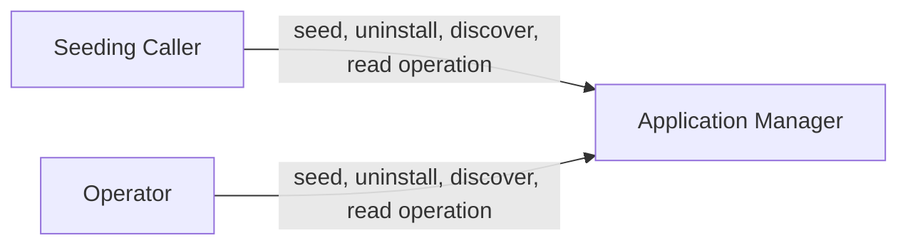
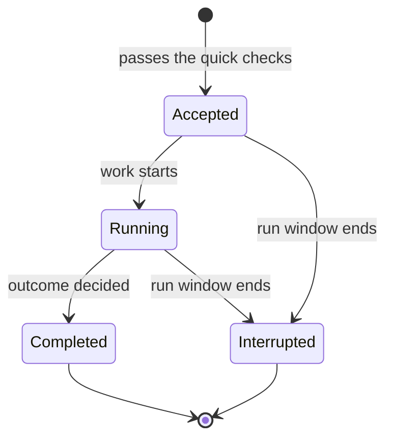

<!-- Created: 2026-10-05 by Constructor Tech -->

# PRD — Application Manager

The Application Manager must give every environment one trusted entry point where an application announces that it is installed, and must pass each part of that announcement to the section plugin that owns it. This PRD is written for platform product owners and for the application teams that seed their applications.

<!-- toc -->

- [1. Overview](#1-overview)
  - [1.1 Purpose](#11-purpose)
  - [1.2 Background / Problem Statement](#12-background--problem-statement)
  - [1.3 Goals (Business Outcomes)](#13-goals-business-outcomes)
  - [1.4 Glossary](#14-glossary)
- [2. Actors](#2-actors)
  - [2.1 Human Actors](#21-human-actors)
  - [2.2 System Actors](#22-system-actors)
  - [2.3 Actor Context](#23-actor-context)
- [3. Operational Concept & Environment](#3-operational-concept--environment)
  - [3.1 Gear-Specific Environment Constraints](#31-gear-specific-environment-constraints)
- [4. Scope](#4-scope)
  - [4.1 In Scope](#41-in-scope)
  - [4.2 Out of Scope](#42-out-of-scope)
- [5. Functional Requirements](#5-functional-requirements)
  - [5.1 Manifest and Validation](#51-manifest-and-validation)
  - [5.2 Dispatch and Outcomes](#52-dispatch-and-outcomes)
  - [5.3 Lifecycle](#53-lifecycle)
  - [5.4 Discovery and Operation Reads](#54-discovery-and-operation-reads)
  - [5.5 Access Control and Audit](#55-access-control-and-audit)
- [6. Non-Functional Requirements](#6-non-functional-requirements)
  - [6.1 Gear-Specific NFRs](#61-gear-specific-nfrs)
  - [6.2 NFR Exclusions](#62-nfr-exclusions)
- [7. Public Library Interfaces](#7-public-library-interfaces)
  - [7.1 Public API Surface](#71-public-api-surface)
  - [7.2 External Integration Contracts](#72-external-integration-contracts)
- [8. Use Cases](#8-use-cases)
  - [First Seed](#first-seed)
  - [Re-Seed or Upgrade](#re-seed-or-upgrade)
  - [Uninstall an Application](#uninstall-an-application)
- [9. Acceptance Criteria](#9-acceptance-criteria)
- [10. Dependencies](#10-dependencies)
- [11. Assumptions](#11-assumptions)
- [12. Risks](#12-risks)
- [13. Open Questions](#13-open-questions)
- [14. Traceability](#14-traceability)

<!-- /toc -->

<!--
=============================================================================
PRODUCT REQUIREMENTS DOCUMENT (PRD)
=============================================================================
PURPOSE: Define WHAT the system must do and WHY — business requirements,
functional capabilities, and quality attributes.

SCOPE:
  ✓ Business goals and success criteria
  ✓ Actors (users, systems) that interact with this gear
  ✓ Functional requirements (WHAT, not HOW)
  ✓ Non-functional requirements (quality attributes, SLOs)
  ✓ Scope boundaries (in/out of scope)
  ✓ Assumptions, dependencies, risks

NOT IN THIS DOCUMENT (see other templates):
  ✗ Stakeholder needs (managed at project/task level by steering committee)
  ✗ Technical architecture, design decisions → DESIGN.md
  ✗ Why a specific technical approach was chosen → ADR/
  ✗ Detailed implementation flows, algorithms → features/

STANDARDS ALIGNMENT:
  - IEEE 830 / ISO/IEC/IEEE 29148:2018 (requirements specification)
  - IEEE 1233 (system requirements)
  - ISO/IEC 15288 / 12207 (requirements definition)

REQUIREMENT LANGUAGE:
  - Use "MUST" or "SHALL" for mandatory requirements (implicit default)
  - Do not use "SHOULD" or "MAY" — use priority p2/p3 instead
  - Be specific and clear; no fluff, bloat, duplication, or emoji
=============================================================================
-->
## 1. Overview

### 1.1 Purpose

The Application Manager is a platform gear that learns which applications are installed in an environment. When an application is deployed, a seeding caller sends it a manifest: one document that describes the application and carries one section for each section plugin.

The Application Manager checks the whole manifest and dispatches each section to the section plugin that owns it. It holds no domain logic. All domain logic and all rollback live in the section plugins. Every seed and uninstall request is traced by an audit plugin, which keeps the audit trail.

Seed and uninstall run as operations. Quick checks refuse a bad request at once. Otherwise the caller gets an operation id and reads the operation to learn how the request ended.

### 1.2 Background / Problem Statement

An environment usually runs only a subset of all applications, and some services need to know which ones. A navigation menu that shows items only for installed applications is one example. There is no single trusted place where an application announces itself, so each service would need its own way to learn about installs.

Without a shared entry point, every application team must know every interested service and call each one differently. Failures are hard to trace, because there is no shared record of what each application sent and when. A new kind of seeded data means changing every application's deployment process by hand.

The Application Manager is that one door. The seeding caller sends one manifest. Section plugins decide what each part means and where the data goes, including systems outside the platform such as an identity provider or an API gateway. Services that rely on seeded data never call the Application Manager. Only section plugins deal with them.

Market positioning: not applicable, because this is an internal platform gear.

### 1.3 Goals (Business Outcomes)

Each goal is met when its success check holds at the first stable release and at every later release.

- **An invalid manifest changes nothing.** Success check: for every request that ends as invalid manifest, no section plugin receives data.
- **Every seed and uninstall is traced.** Success check: every seed and uninstall request that reaches the system, including a failed one, has an audit event delivered to the audit plugin (`cpt-cf-application-manager-nfr-audit-completeness`).
- **New kinds of seeded data need no gear change.** Success check: a section plugin is added and removed with no change to the Application Manager's code (`cpt-cf-application-manager-fr-plugin-extensibility`).
- **Manifests can be built from discovery.** Success check: a manifest built only from the combined schema that discovery returns passes validation.
- **Failures are actionable.** Success check: every failed request states its outcome category, and the caller can tell what to fix, retry, or request without reading the audit trail.

There is no formal user-satisfaction metric, because the user group is small, known, and internal.

### 1.4 Glossary

| Term | Definition |
|------|------------|
| Application id | Non-empty text, within stated limits, that names an application. The system never parses it or checks its format. It only compares two ids by exact text. |
| Manifest | The whole document submitted for one application: an envelope plus its sections. |
| Envelope | The part of a manifest that names the application by its id and version. |
| Section | The part of a manifest meant for one section plugin, addressed by its section key. |
| Section key | The single key that one section plugin owns. |
| Section plugin | A platform plugin that owns one section key and one priority, serves the schema for its section, and applies and removes sections. It owns all domain logic and any rollback. |
| Priority | A value that each section plugin announces. It fixes the order of dispatch on seed and of removal on uninstall. No two section plugins share one. |
| Seed | Submitting a manifest for an application. The system checks it and dispatches each section to its section plugin. |
| Uninstall | Asking every section plugin to remove an application by its id. |
| Operation | The background run of one accepted seed or uninstall request. It has a status (accepted, running, completed, or interrupted) and, once final, a report. A request that fails a quick check is a refusal: it gets an answer at once and no operation. |
| Outcome category | The single overall result of a seed or uninstall request, such as succeeded or invalid manifest (`cpt-cf-application-manager-fr-outcome-categories`). |
| Audit plugin | The one in-process plugin that receives the events of every seed and uninstall request and keeps them as the audit trail (`cpt-cf-application-manager-fr-audit-event`). |

## 2. Actors

> **Note**: Stakeholder needs are managed at project/task level by steering committee. Document **actors** (users, systems) that interact with this gear.

### 2.1 Human Actors

#### Operator

**ID**: `cpt-cf-application-manager-actor-operator`

- **Role**: Runs the platform, deploys section-plugin changes, and sets configuration. Can also act as a seeding caller by hand, for example to re-seed or to uninstall an application.
- **Needs**: To follow an operation and read how it ended. To know which section keys a manifest needs. To get a clear signal when something in the gear fails.

### 2.2 System Actors

#### Seeding Caller

**ID**: `cpt-cf-application-manager-actor-seeding-caller`

- **Role**: An authenticated subject, either a service or an operator, that acts for an application. It sends manifests and uninstall requests, reads discovery and operations when permitted, and never receives calls from the system.

### 2.3 Actor Context

## 3. Operational Concept & Environment

> **Note**: Runtime, OS, architecture, lifecycle policy, and integration patterns are defined once at the project/foundational level, not per gear. Foundational sources for this repository: [Architecture Manifest](../../../../docs/ARCHITECTURE_MANIFEST.md) and the [security guidelines](../../../../guidelines/SECURITY.md). This gear has no parent gear with its own PRD.

### 3.1 Gear-Specific Environment Constraints

- The Application Manager works platform-wide. The whole environment shares one set of seeded applications, with no per-tenant view.
- Every actor, including an operator acting by hand, reaches the gear only as an authenticated subject through the platform's standard authentication. The gear has no login of its own. The platform turns away requests that fail its own checks, and those never reach the gear.
- The system **MUST** state, as a rule of the seeding interface, that manifests must not carry secrets, such as passwords or keys. The system cannot detect them, so keeping them out is each seeding team's responsibility.
- The system **MUST NOT** write manifest content into its own logs, diagnostics, or error text.
- Section plugins own section data. The audit plugin owns audit data, including the manifests and caller subjects in it. The system owns only operation records and the events that wait for delivery to the audit plugin.
- The interfaces are machine-facing, with no end-user screens.

## 4. Scope

### 4.1 In Scope

- A manifest made of an envelope and one required section per section key.
- Checking the whole manifest before any section plugin receives data.
- Dispatch of sections in priority order, and uninstall by application id in the same order.
- Seed and uninstall as background operations, one at a time per application.
- Reading an operation by its id.
- Discovery of section keys and schemas.
- Clear outcome categories for every request.
- An audit trail for every seed and uninstall request, kept by one audit plugin.
- Access control on seed, uninstall, discovery, and operation reads.
- Failing to start on any plugin-set or configuration problem.

### 4.2 Out of Scope

- Kubernetes and deployment tooling. A seeding job or an operator is only an example of a caller.
- Credential provisioning for seeding callers.
- A login of the gear's own. Authentication belongs to the platform.
- Reading or exposing audit data. The audit plugin decides whether and how it is exposed.
- Per-tenant installs.
- Giving meaning to versions or to re-seeds. Section plugins decide.
- Replaying or driving re-seeds. Each application's seeding caller is responsible.
- Rollback across several section plugins. It may come in a later phase.
- Idempotency keys on seed and uninstall requests. They may come in a later phase.
- Retry rules after a failed, partly failed, or interrupted request. They may come in a later phase.
- Validation rules for adding or removing a section plugin. They may come in a later phase.
- A registry of seeded applications, and listing it. It may come in a later phase.
- Reconciliation of section-plugin state with what is seeded. It may come in a later phase.
- An audit event schema on the platform event broker. It may come in a later phase.
- Resuming or cancelling operations.

## 5. Functional Requirements

> **Testing strategy**: All requirements verified via automated tests (unit, integration, e2e) targeting 90%+ code coverage unless otherwise specified. Document verification method only for non-test approaches (analysis, inspection, demonstration).

### 5.1 Manifest and Validation

#### Manifest Envelope

- [ ] `p1` - **ID**: `cpt-cf-application-manager-fr-manifest-envelope`

The system **MUST** accept a manifest made of an envelope and a set of sections, **MUST** require the envelope to carry an application id and a non-empty version, and **MUST** treat a manifest with a missing or empty id or version as invalid.

- **Rationale**: One predictable shape lets every seeding caller and every section plugin rely on the same identity for an application.
- **Actors**: `cpt-cf-application-manager-actor-seeding-caller`

#### Opaque Application Id

- [ ] `p1` - **ID**: `cpt-cf-application-manager-fr-application-id`

The system **MUST** accept any non-empty text within the stated limits (a configurable maximum length, no control characters) as an application id and as a version. It **MUST NOT** parse the id, normalise it, or check its format, and **MUST** compare ids only by exact text. A manifest whose id or version breaks the limits **MUST** be refused at once as invalid manifest, before any operation starts.

- **Rationale**: Application teams already have their own names. Treating the id as opaque avoids a second naming scheme.
- **Actors**: `cpt-cf-application-manager-actor-seeding-caller`

#### Opaque Version

- [ ] `p1` - **ID**: `cpt-cf-application-manager-fr-opaque-version`

The system **MUST** treat the application version as opaque text. It **MUST NOT** parse, compare, or sort versions, and **MUST** pass the version to section plugins on seed.

- **Rationale**: Only a section plugin knows what a version means for its data.
- **Actors**: `cpt-cf-application-manager-actor-seeding-caller`

#### Required Sections

- [ ] `p1` - **ID**: `cpt-cf-application-manager-fr-required-sections`

The system **MUST** require a section for every section key, and **MUST** treat as invalid a manifest with a missing section or with a key that no section plugin owns. The result **MUST** name the missing or unknown keys. When no section plugin exists, a valid manifest has an empty set of sections.

- **Rationale**: Strict rules keep every section plugin in step with every application and make a wrong manifest visible at once.
- **Actors**: `cpt-cf-application-manager-actor-seeding-caller`

#### Unique Section Keys

- [ ] `p1` - **ID**: `cpt-cf-application-manager-fr-unique-section-keys`

The system **MUST** map each section key to exactly one section plugin, **MUST** fail to start when two section plugins claim the same key, and **MUST** keep the key set unchanged until the next start.

- **Rationale**: Conflicts show up at deploy time rather than at seed time, and routing stays clear.
- **Actors**: `cpt-cf-application-manager-actor-operator`

#### Section Plugin Priority

- [ ] `p1` - **ID**: `cpt-cf-application-manager-fr-section-priority`

The system **MUST** use the priority that each section plugin announces to fix the dispatch order on seed and the removal order on uninstall, from the lowest value to the highest, and **MUST** fail to start when two section plugins announce the same priority.

- **Rationale**: A fixed, announced order makes dispatch predictable and lets section-plugin authors decide which section plugin goes first.
- **Actors**: `cpt-cf-application-manager-actor-operator`

#### Startup Checks

- [ ] `p1` - **ID**: `cpt-cf-application-manager-fr-startup-checks`

The system **MUST** fail to start on any plugin-set or configuration problem. It **MUST NOT** read an unreachable plugin registration facility as "no section plugins". When the facility answers with no section plugins, the system **MUST** start with an empty set of section keys.

- **Rationale**: Problems must show up at deploy time, when an operator is watching, and not later at seed time.
- **Actors**: `cpt-cf-application-manager-actor-operator`

#### Per-Seed Schema Fetch and Whole-Manifest Validation

- [ ] `p1` - **ID**: `cpt-cf-application-manager-fr-validate-before-dispatch`

For every seed, the system **MUST** fetch the current schema from every section plugin, without reusing earlier answers, and validate the whole manifest: the envelope, and each section against its section plugin's schema. If any part is invalid, the system **MUST NOT** dispatch anything to any section plugin, and **MUST** list every problem with its location in the manifest.

- **Rationale**: Validating everything first prevents half-applied installs caused by a bad manifest. Fresh schemas let section plugins change their schema without a restart.
- **Actors**: `cpt-cf-application-manager-actor-seeding-caller`

#### Section Schema Ownership

- [ ] `p1` - **ID**: `cpt-cf-application-manager-fr-plugin-served-schemas`

The system **MUST** treat each section plugin as the only source of the schema for its section, **MUST NOT** keep its own copy of a section's rules, and **MUST** apply a schema change from the next seed.

- **Rationale**: The section plugin knows its domain. Keeping the rules in one place avoids drift between schema and behaviour.
- **Actors**: `cpt-cf-application-manager-actor-seeding-caller`
- **Verification Method**: Inspection: no section rules are held outside the section plugins.

#### Section-Plugin-Driven Extensibility

- [ ] `p1` - **ID**: `cpt-cf-application-manager-fr-plugin-extensibility`

The system **MUST** let a kind of seeded data be added or removed only by adding or removing a section plugin, with no change to the system's own code.

- **Rationale**: New kinds of seeded data must not wait for a change to a shared gear.
- **Actors**: `cpt-cf-application-manager-actor-operator`
- **Verification Method**: Demonstration: a test section plugin is added and removed with no change to the system's code.

### 5.2 Dispatch and Outcomes

#### Seed and Uninstall as Operations

- [ ] `p1` - **ID**: `cpt-cf-application-manager-fr-async-operations`

The system **MUST** run every accepted seed and uninstall request as an operation. It **MUST** first make quick checks and refuse a request that fails one at once, with its outcome category, without creating an operation and without calling any section plugin. An accepted request **MUST** get an operation id, and the system **MUST** answer with it before any plugin call. An operation **MUST** be in one of four states: accepted, running, completed, or interrupted. Every operation **MUST** reach a final state, completed or interrupted, within a bounded run window. The system **MUST NOT** resume an interrupted operation.

- **Rationale**: A seed calls every section plugin in turn, so it can take longer than the platform request deadline. Quick checks still answer at once, and the run window gives every operation a known end.
- **Actors**: `cpt-cf-application-manager-actor-seeding-caller`, `cpt-cf-application-manager-actor-operator`

#### One Operation per Application

- [ ] `p1` - **ID**: `cpt-cf-application-manager-fr-one-operation-per-application`

The system **MUST** run at most one seed or uninstall operation per application at a time. While an operation for an application is accepted or running, a new request for the same application **MUST** be refused at once as conflict, and the refusal **MUST** name the running operation. Operations for different applications **MUST NOT** wait for each other.

- **Rationale**: Overlapping operations for one application would interleave dispatches to the section plugins. One operation at a time gives each application one clear current state.
- **Actors**: `cpt-cf-application-manager-actor-seeding-caller`, `cpt-cf-application-manager-actor-operator`

#### Ordered Dispatch That Continues Past Failures

- [ ] `p1` - **ID**: `cpt-cf-application-manager-fr-ordered-dispatch`

After validation succeeds, the system **MUST** dispatch sections to their section plugins one at a time in priority order, **MUST** keep dispatching after a section plugin fails, and **MUST** record the outcome of each section.

- **Rationale**: One failing section plugin must not stop the others from receiving data. One at a time keeps behaviour easy to follow and audit.
- **Actors**: `cpt-cf-application-manager-actor-seeding-caller`

#### Section Dispatch Without Interpretation

- [ ] `p1` - **ID**: `cpt-cf-application-manager-fr-pass-through`

The system **MUST** give each section plugin only its own section, with the same data the caller sent, together with the envelope. It **MUST NOT** compare, merge, or keep history of sections between seeds, and **MUST NOT** keep per-section state.

- **Rationale**: Domain meaning belongs to section plugins. Passing data through unchanged keeps the Application Manager free of domain logic.
- **Actors**: `cpt-cf-application-manager-actor-seeding-caller`

#### Section-Plugin-Owned Rollback and Re-Seed Semantics

- [ ] `p1` - **ID**: `cpt-cf-application-manager-fr-plugin-owned-semantics`

The system **MUST** leave rollback, replace-or-update behaviour, idempotency, and version rules to the section plugins. It **MUST** validate, dispatch, and audit every seed on its own, and **MUST NOT** undo anything after a failed dispatch.

- **Rationale**: Only the section plugin knows what re-seeding or undoing means for its data.
- **Actors**: `cpt-cf-application-manager-actor-seeding-caller`

#### Caller-Visible Outcome Categories

- [ ] `p1` - **ID**: `cpt-cf-application-manager-fr-outcome-categories`

The system **MUST** report every seed and uninstall request as exactly one of these outcome categories. An interrupted operation has none.

- succeeded: every section, or every section plugin for uninstall, succeeded;
- invalid manifest: the manifest failed validation, and nothing is dispatched;
- plugin rejected: a section plugin refused its section as unacceptable;
- not permitted: the caller lacks a needed permission, at platform level or in a section plugin;
- conflict: another operation for the same application is accepted or running;
- internal failure: a section plugin failed unexpectedly or exceeded the time limit;
- temporarily unavailable: a needed dependency could not answer, nothing is dispatched, and the caller can retry.

- **Rationale**: Callers need to tell "fix my manifest" from "try again later" from "ask for access".
- **Actors**: `cpt-cf-application-manager-actor-seeding-caller`, `cpt-cf-application-manager-actor-operator`

#### Outcome Precedence

- [ ] `p1` - **ID**: `cpt-cf-application-manager-fr-outcome-precedence`

When several outcome categories apply, the system **MUST** pick one by a fixed precedence, so the same situation always gives the same answer. It **MUST NOT** tell a caller not permitted or conflict when it could not check permission or running operations. After dispatch, when section plugins fail in different ways, the system **MUST** report the most actionable failure.

- **Rationale**: A fixed answer points the caller to the most important fix first and never hides an outage behind a wrong category.
- **Actors**: `cpt-cf-application-manager-actor-seeding-caller`, `cpt-cf-application-manager-actor-operator`

#### Response Content

- [ ] `p1` - **ID**: `cpt-cf-application-manager-fr-response-content`

Every refusal and every operation report **MUST** let the caller act without reading the audit trail. It **MUST** carry the outcome category, what to fix, retry, or request, and the id that links the result to its audit trail. A refusal for conflict **MUST** name the running operation. A report **MUST** give the outcome of each section, or of each section plugin for uninstall, and every problem with its location for invalid manifest. The report of an interrupted operation **MUST** say so and give the section outcomes recorded so far.

- **Rationale**: Per-section results let callers act on partial failures, and the link to the audit trail supports investigation.
- **Actors**: `cpt-cf-application-manager-actor-seeding-caller`, `cpt-cf-application-manager-actor-operator`

#### Bounded Plugin Calls

- [ ] `p1` - **ID**: `cpt-cf-application-manager-fr-bounded-plugin-calls`

The system **MUST** apply one configurable time limit to every plugin call. It **MUST NOT** cancel or undo work that a section plugin has started. A section that exceeds the time limit **MUST** count as an internal failure, and dispatch **MUST** continue with the remaining sections. A slow audit plugin **MUST NOT** block a request.

- **Rationale**: One slow plugin must not hang a whole request, and operators must be able to tune the limit.
- **Actors**: `cpt-cf-application-manager-actor-operator`
- **Verification Method**: Inspection: the section plugin contract offers no way to cancel or undo work.

#### Dependency Failures at Run Time

- [ ] `p1` - **ID**: `cpt-cf-application-manager-fr-dependency-failures`

The system **MUST** fail closed when platform access control cannot answer: it **MUST** refuse the request as temporarily unavailable and call no section plugin. When storage cannot answer, the system **MUST** refuse the request as temporarily unavailable and dispatch nothing.

- **Rationale**: An outage of a platform service must never let a request through unchecked or leave half-applied changes.
- **Actors**: `cpt-cf-application-manager-actor-seeding-caller`, `cpt-cf-application-manager-actor-operator`

### 5.3 Lifecycle

#### Uninstall

- [ ] `p1` - **ID**: `cpt-cf-application-manager-fr-uninstall`

The system **MUST** let an authorized caller uninstall an application by its id, as an operation. The operation **MUST** ask every section plugin to remove the application, one at a time in priority order, and continue after failures. The system **MUST NOT** check whether the application is seeded. What an uninstall means for an application that a section plugin does not know is that section plugin's decision.

- **Rationale**: Retiring an application must clean up every section plugin's data from a single request.
- **Actors**: `cpt-cf-application-manager-actor-seeding-caller`, `cpt-cf-application-manager-actor-operator`

### 5.4 Discovery and Operation Reads

#### Discovery of Section Keys and Schemas

- [ ] `p1` - **ID**: `cpt-cf-application-manager-fr-discovery`

The system **MUST** let an authorized caller list the current section keys, read the current schema for one section key, and read the combined schema for a whole manifest. Schemas **MUST** be served live from the section plugins and returned with their schema version. When a section plugin cannot answer, the read **MUST** end as temporarily unavailable.

- **Rationale**: Application teams need to know what to put in a manifest before they seed.
- **Actors**: `cpt-cf-application-manager-actor-seeding-caller`, `cpt-cf-application-manager-actor-operator`

#### Reading an Operation

- [ ] `p1` - **ID**: `cpt-cf-application-manager-fr-operation-read`

The system **MUST** let a caller with the read-operations permission read an operation by its id and get its status, and its report once it is final. The permission **MUST** be separate from the seed and uninstall permissions. An unknown or purged id **MUST** end as not found. A read **MUST NOT** call any plugin and **MUST NOT** return manifest bodies, section content, or the caller subject. The system **MUST** keep each operation record for an operator-set retention period after the operation is final, then purge it.

- **Rationale**: An accepted request ends in the background, so callers need a way to learn how it ended. A separate permission lets operators decide who may see results without granting the right to seed.
- **Actors**: `cpt-cf-application-manager-actor-seeding-caller`, `cpt-cf-application-manager-actor-operator`

### 5.5 Access Control and Audit

#### Caller Authentication

- [ ] `p1` - **ID**: `cpt-cf-application-manager-fr-authentication`

The system **MUST** accept requests only from subjects authenticated through the platform's standard authentication. It **MUST NOT** offer a bypass, a shared secret, or a login of its own, for any actor.

- **Rationale**: Seeding changes what other services believe is installed, so every request must be traceable to a known subject.
- **Actors**: `cpt-cf-application-manager-actor-seeding-caller`, `cpt-cf-application-manager-actor-operator`
- **Verification Method**: Inspection: no route or setting skips platform authentication.

#### Caller Authorization

- [ ] `p1` - **ID**: `cpt-cf-application-manager-fr-authorization`

The system **MUST** have platform access control decide, separately for seed, uninstall, schema reading, and operation reading, whether the caller may act. It holds no tenant scope and no access rules of its own. A section plugin that needs an extra permission **MUST** be able to refuse a request as not permitted.

- **Rationale**: Seeding and uninstalling change what other services believe is installed, so they must be tightly controlled.
- **Actors**: `cpt-cf-application-manager-actor-seeding-caller`, `cpt-cf-application-manager-actor-operator`

#### Audit Plugin Contract & Event Catalog

- [ ] `p1` - **ID**: `cpt-cf-application-manager-fr-audit-event`

The system **MUST** deliver the audit events of seed and uninstall requests to exactly one audit plugin, behind an in-process trait, and **MUST** fail to start when there is none or more than one. Every seed and uninstall request that reaches the system **MUST** be traced, including a request that is refused. Each event **MUST** be recorded atomically with the change it describes and delivered to the audit plugin at least once, apart from request handling, with a stable event id so the audit plugin can drop duplicates. The system **MUST NOT** offer any way to read audit data. The audit plugin owns storage, retention, erasure, and exposure of audit data, and exposure **MUST** be off by default.

- **Rationale**: A complete trail answers what was sent, by whom, and what each section plugin did. Recording with the change keeps trail and change in agreement, and delivery apart from requests keeps seeding independent of the audit plugin. Manifests hold other section plugins' data, so exposure stays off by default.
- **Actors**: `cpt-cf-application-manager-actor-operator`
- **Verification Method**: Inspection: the public surface offers no interface that returns audit data.

#### Audit Before Dispatch

- [ ] `p1` - **ID**: `cpt-cf-application-manager-fr-audit-ordering`

The system **MUST NOT** dispatch anything for a request until its accepted event is durable. A refusal **MUST** record its refused event before it answers. If that fails, the refusal **MUST** still return its outcome category, and the failure **MUST** be logged and signalled to operators. The finished event **MUST** be recorded together with the final report.

- **Rationale**: No change happens without a durable trace, and the audit trail and the operation report always tell the same story.
- **Actors**: `cpt-cf-application-manager-actor-seeding-caller`

## 6. Non-Functional Requirements

> **Global baselines**: Project-wide NFRs (performance, security, reliability, scalability) are defined once at the project/foundational level. Baseline sources: [Architecture Manifest](../../../../docs/ARCHITECTURE_MANIFEST.md) and the [security guidelines](../../../../guidelines/SECURITY.md). This gear has no parent PRD. Only gear-specific NFRs are listed here.
>
> **Testing strategy**: NFRs verified via automated benchmarks, security scans, and monitoring unless otherwise specified.

### 6.1 Gear-Specific NFRs

#### Complete Audit Trail

- [ ] `p1` - **ID**: `cpt-cf-application-manager-nfr-audit-completeness`

The system **MUST** record and deliver audit events for every seed and uninstall request that reaches the system, whatever its outcome.

- **Threshold**: In every test run:
  - accepted, finished, and refused events match the operations created, the operations that reached a final state, and the refusals, with no gaps;
  - every recorded event reaches the audit plugin at least once, also after an audit plugin outage or a restart, and no event exists for a change that did not commit;
  - the only request without an event is a refusal whose event could not be recorded, and that failure is logged and signalled.
- **Rationale**: An audit trail with gaps cannot be trusted, and one that depends on the audit plugin being up would stop seeding during an audit outage.
- **Verification Method**: Automated tests for the system's part, and a conformance test owned by the audit plugin's owner for the audit plugin's part.

#### Platform-Wide Scope

- [ ] `p1` - **ID**: `cpt-cf-application-manager-nfr-platform-scope`

The system **MUST** treat all seeded applications as one platform-wide set, **MUST NOT** make operation records owned by or visible per tenant, and **MUST** make them reachable only through the platform's access checks.

- **Threshold**: No operation record read or write skips the access check. No per-tenant copy of operation records exists.
- **Rationale**: Installed applications are a property of the environment, not of a tenant.
- **Verification Method**: Inspection of the public surface and of data ownership, plus tests on every action.

#### No Section Plugin Call Without Authorization

- [ ] `p1` - **ID**: `cpt-cf-application-manager-nfr-authorized-before-plugin`

The system **MUST NOT** call any section plugin, for schema, dispatch, or removal, for a caller who is not authorized for that action.

- **Threshold**: Zero section-plugin calls for requests that end as not permitted or whose permission could not be checked, in tests on every action.
- **Rationale**: Callers without permission must not trigger section-plugin work or probe section-plugin schemas.

#### Bounded Plugin Call Time

- [ ] `p1` - **ID**: `cpt-cf-application-manager-nfr-bounded-call-time`

The system **MUST** stop waiting for any plugin call once the time limit has passed. Operators **MUST** be able to set the time limit by configuration, and the system **MUST NOT** hardcode it.

- **Threshold**: Every plugin call ends within the time limit. Changing the setting changes the limit with no code change. A missing or invalid setting stops the system from starting.
- **Rationale**: A stuck plugin must not block seeding callers for an unbounded time.

#### Bounded Request Time

- [ ] `p2` - **ID**: `cpt-cf-application-manager-nfr-bounded-request-time`

The system **MUST** answer every seed and uninstall request within the platform request deadline, with a refusal or with an operation id, and **MUST** bring every operation to a final state within its run window.

- **Threshold**: With test plugins that always reach the time limit, every immediate answer comes within the platform request deadline, and every operation is completed or interrupted by the end of its run window.
- **Rationale**: Deployment pipelines need a predictable upper bound for a seed, and the platform ends any request that runs past its deadline.

#### Validation Failure Leaves Section Plugins Untouched

- [ ] `p1` - **ID**: `cpt-cf-application-manager-nfr-no-partial-on-invalid`

The system **MUST NOT** dispatch anything to any section plugin for a request that ends as invalid manifest, temporarily unavailable, or conflict.

- **Threshold**: Zero section dispatches for requests that end in these categories.
- **Rationale**: Bad input and platform outages must never cause partial installs.

#### Availability

- [ ] `p2` - **ID**: `cpt-cf-application-manager-nfr-availability`

The system **MUST** be available whenever deploys can happen in its environment. Seeding is unavailable while a section-plugin change restarts the gear. Seed, uninstall, discovery of keys, and operation reads **MUST NOT** depend on the audit plugin being up.

- **Threshold**: Seeds, uninstalls, key listing, and operation reads succeed in tests while the audit plugin is unavailable, and the events recorded meanwhile are delivered after it recovers. No gear-specific availability percentage applies. The platform baseline applies.
- **Rationale**: Deploys must not wait on this gear, and seeding must survive an audit outage.

#### Operational Signals

- [ ] `p2` - **ID**: `cpt-cf-application-manager-nfr-operational-signals`

The system **MUST** give operators a visible signal for audit events that failed to record, for a growing delivery backlog or repeated delivery failures to the audit plugin, for startup failures, and for repeated section-plugin timeouts. It **MUST** make counts of each outcome category, of plugin-call timeouts, and of interrupted operations observable.

- **Threshold**: Each signal condition raises an operator-visible signal in tests, and the counts can be read by operators.
- **Rationale**: Operators must notice failures early.

### 6.2 NFR Exclusions

- Per-tenant isolation: not applicable, because the gear is platform-wide.
- High-volume throughput targets: not applicable, because the set of section keys is small and seeds are infrequent deploy-time requests.
- Rate limiting at gear level: not applicable, because callers are trusted subjects. Platform request protection applies.
- Data retention and cleanup of audit data: owned by the audit plugin.
- Response caching of schemas: excluded on purpose, because every seed must use fresh schemas.
- MFA, SSO, and session management: not applicable, because the gear has no interactive sessions.
- Safety: not applicable, because the gear only handles information.
- Usability, accessibility, and internationalization: not applicable, because the interfaces are machine-facing with known internal users.
- Regulatory compliance, legal, and privacy topics: platform baselines apply. Data-subject requests go to the owner of the data.
- Geographic availability, disaster recovery, SLA, and support tier: inherited from the platform baseline.
- Training material and help system: not applicable, because there is no end-user UI.

## 7. Public Library Interfaces

### 7.1 Public API Surface

#### Seeding and Uninstall Interface

- [ ] `p1` - **ID**: `cpt-cf-application-manager-interface-seeding`

- **Type**: REST API
- **Stability**: unstable, until the first stable release.
- **Description**: Lets an authorized seeding caller submit a manifest and uninstall an application by its id. An accepted request returns an operation id at once. A refused request returns its outcome category, what to fix, and the running operation id for conflict.
- **Breaking Change Policy**: Additive changes are backward compatible. Changes to the manifest envelope, outcome categories, or operation states need a major version bump and notice to application teams.

#### Operations Interface

- [ ] `p1` - **ID**: `cpt-cf-application-manager-interface-operations`

- **Type**: REST API
- **Stability**: unstable, until the first stable release.
- **Description**: Lets a caller with the read-operations permission read an operation by its id: its status and, once final, its report.
- **Breaking Change Policy**: Additive changes are backward compatible. Changes to operation states, outcome categories, or report content need a major version bump and notice to application teams.

#### Discovery Interface

- [ ] `p1` - **ID**: `cpt-cf-application-manager-interface-discovery`

- **Type**: REST API
- **Stability**: unstable, until the first stable release.
- **Description**: Lets an authorized caller list section keys, read one section schema, and read the combined schema.
- **Breaking Change Policy**: Additive changes are backward compatible. Removing or renaming returned information needs a major version bump and notice to application teams.

### 7.2 External Integration Contracts

#### Section Plugin Contract

- [ ] `p1` - **ID**: `cpt-cf-application-manager-contract-section-plugin`

- **Direction**: required from client
- **Actors**: `cpt-cf-application-manager-actor-operator`
- **Protocol/Format**: Platform plugin model. Each section plugin:
  - announces one section key and one priority at startup;
  - serves the schema for its section, with a schema version that changes whenever the schema content changes;
  - applies its section for an application, and removes an application on uninstall;
  - reports failures as rejected, not permitted, or internal;
  - uses its own service credentials, never the caller's.
- **Compatibility**: Changes to the contract need coordinated updates of all section plugins. A schema change applies from the next seed, with no restart.

## 8. Use Cases

### First Seed

- [ ] `p2` - **ID**: `cpt-cf-application-manager-usecase-first-seed`

**Actor**: `cpt-cf-application-manager-actor-seeding-caller`

**Preconditions**:

- The caller is authorized to seed, and the manifest has a section for every section key.

**Main Flow**:

1. The seeding caller submits the manifest and gets an operation id.
2. The system validates the whole manifest and dispatches each section in priority order.
3. The caller reads the operation until it is final and sees the outcome of each section.

**Postconditions**:

- The operation is completed and reports succeeded.

### Re-Seed or Upgrade

- [ ] `p2` - **ID**: `cpt-cf-application-manager-usecase-reseed`

**Actor**: `cpt-cf-application-manager-actor-seeding-caller`

**Preconditions**:

- The application may already be seeded, with any version.

**Main Flow**:

1. The seeding caller submits a manifest with a new version or new content.
2. The system handles it exactly like a first seed, as a new operation.
3. Each section plugin decides whether to replace, update, or ignore its section.

**Postconditions**:

- The new operation has its own audit event.

### Uninstall an Application

- [ ] `p2` - **ID**: `cpt-cf-application-manager-usecase-uninstall`

**Actor**: `cpt-cf-application-manager-actor-operator`

**Other actors**: `cpt-cf-application-manager-actor-seeding-caller`

**Preconditions**:

- The caller is authorized to uninstall.

**Main Flow**:

1. The caller requests an uninstall by application id and gets an operation id.
2. The system asks each section plugin to remove the application, in priority order.
3. The caller reads the operation until it is final and sees the result of each section plugin.

**Postconditions**:

- The operation is completed.

## 9. Acceptance Criteria

- [ ] An accepted seed or uninstall returns an operation id before any plugin call (`cpt-cf-application-manager-fr-async-operations`).
- [ ] A request that fails a quick check gets its outcome category at once, creates no operation, calls no section plugin, and has an audit event.
- [ ] A valid manifest with every required section completes as succeeded, and sections are dispatched in priority order.
- [ ] A manifest with a missing, unknown, or invalid section, or with an invalid id or version, reports invalid manifest, dispatches nothing, and lists each problem with its location.
- [ ] When one section plugin fails, the others still receive their sections, and the report shows each section outcome.
- [ ] A section plugin that exceeds the time limit is an internal failure and does not block the remaining sections.
- [ ] An uninstall asks every section plugin to remove the application, even one never seeded, and continues after failures.
- [ ] A caller refused by access control causes no section-plugin call, and each of seed, uninstall, schema reading, and operation reading needs its own permission.
- [ ] A second request for an application with an accepted or running operation is refused as conflict naming that operation, while other applications proceed.
- [ ] Reading an operation returns its status and, once final, its report, ends as not found for an unknown or purged id, and makes no plugin call.
- [ ] An operation that is not final at the end of its run window is reported as interrupted and is not resumed.
- [ ] When access control or storage cannot answer, the request is refused as temporarily unavailable and nothing is dispatched.
- [ ] Nothing is dispatched until the accepted event is durable, and a refusal whose event cannot be recorded still returns its category and is logged and signalled.
- [ ] While the audit plugin is unavailable, seeds, uninstalls, and reads still complete, and every event is delivered after it recovers (`cpt-cf-application-manager-nfr-audit-completeness`).
- [ ] The system fails to start on a duplicate key or priority, an unreachable plugin registration facility, a missing or duplicate audit plugin, or invalid configuration, and starts with an empty key set when no section plugin exists.
- [ ] Discovery returns live section keys and schemas, and a manifest built from the combined schema passes validation.
- [ ] Inspection shows no way to read audit data or manifests, no way to resume or cancel an operation, and no manifest content in operation records or logs.

## 10. Dependencies

| Dependency | Description | Criticality |
|------------|-------------|-------------|
| Section plugins | Each provides its section key and priority at startup, its current schema with a schema version, application of its section on seed, and removal of an application on uninstall, and answers with success, rejected, not permitted, or internal failure. | p1 |
| Audit plugin | Exactly one, receiving the events of every seed and uninstall request, confirming an event only once stored, dropping duplicates by event id, and owning retention, erasure, and exposure of audit data. | p1 |
| Platform access control | A permit or deny for each seed, uninstall, schema-read, and operation-read request, given the caller subject and the action. | p1 |
| Plugin registration facility | The list of section plugins and of the audit plugin at startup. | p1 |
| Platform storage | Storage for operation records and for events that wait for delivery, with each change and its event committed together. | p1 |
| Platform error format | The standard format for failed responses, able to carry the outcome category, what to fix, the running operation id, and the id that links to the audit trail. | p1 |
| Platform observability facility | A place to send operational logs, metrics, and operator signals. | p2 |

## 11. Assumptions

- The set of section keys is small and bounded, and fixed while the Application Manager runs.
- Seeding callers authenticate through the platform, and their credentials are provisioned outside this gear.
- Seeding happens at deploy time and not on user request paths.
- Seeding callers read an operation at a moderate pace and hold the read-operations permission.
- Operators set the operation retention long enough for callers to read each operation after it ends.

## 12. Risks

| Risk | Impact | Mitigation |
|------|--------|------------|
| A section plugin is slow or down during seeding | Seeds end as temporarily unavailable or as internal failures | Configurable time limit, per-section results in the report, and retry by seeding again |
| Partial success leaves section plugins out of step | Some services see the application and others do not | Section-plugin-owned rollback, per-section results, the audit trail, and retry |
| A priority change reorders dispatch | A section plugin that relies on another's data sees a different order | Order changes are intentional, and section-plugin authors document how they choose a priority |
| The audit trail holds full manifests | Exposure could leak other section plugins' data | The audit plugin keeps exposure off by default |
| A manifest carries a secret | The secret is stored in the audit trail | The rule that manifests must not carry secrets, and exposure off by default |
| An operation is interrupted | The application is left partly seeded or removed | The report shows the section outcomes so far, the caller seeds or uninstalls again, and operators see a count of interrupted operations |
| The platform error format cannot carry the added refusal content | A caller refused as conflict cannot tell which operation to wait for | The format is raised with the platform owners, and operation reports and the audit trail still carry the full result |

## 13. Open Questions

None.

## 14. Traceability

Links to related specification artifacts.

- **Design**: [DESIGN.md](./DESIGN.md)
- **ADRs**: [ADR/](./ADR/)
- **Features**: not applicable — this gear's document set has no separate feature specifications.
