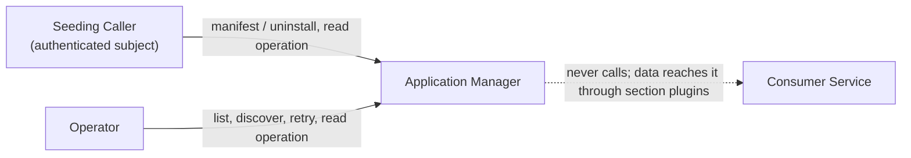
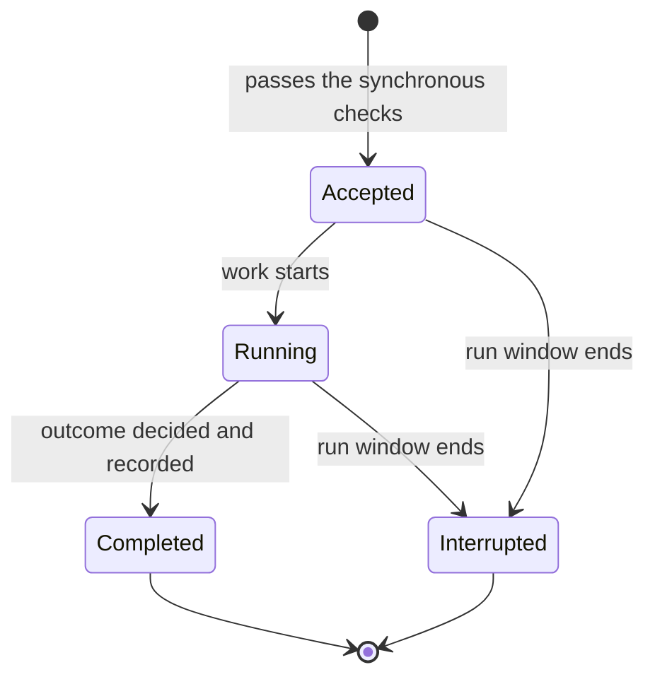

<!-- Created: 2026-10-05 by Constructor Tech -->

# PRD — Application Manager

The Application Manager must give every environment one trusted entry point where an application announces that it is installed, and must pass each part of that announcement to the section plugin that owns it. This PRD is written for platform product owners and for the application teams that seed their applications.

<!-- toc -->

- [1. Overview](#1-overview)
  - [1.1 Purpose](#11-purpose)
  - [1.2 Background / Problem Statement](#12-background--problem-statement)
  - [1.3 Goals (Business Outcomes)](#13-goals-business-outcomes)
  - [1.4 Glossary](#14-glossary)
- [2. Actors](#2-actors)
  - [2.1 Human Actors](#21-human-actors)
  - [2.2 System Actors](#22-system-actors)
  - [2.3 Actor Context](#23-actor-context)
- [3. Operational Concept & Environment](#3-operational-concept--environment)
  - [3.1 Gear-Specific Environment Constraints](#31-gear-specific-environment-constraints)
- [4. Scope](#4-scope)
  - [4.1 In Scope](#41-in-scope)
  - [4.2 Out of Scope](#42-out-of-scope)
- [5. Functional Requirements](#5-functional-requirements)
  - [5.1 Manifest and Validation](#51-manifest-and-validation)
  - [5.2 Dispatch and Outcomes](#52-dispatch-and-outcomes)
  - [5.3 Lifecycle and Registry](#53-lifecycle-and-registry)
  - [5.4 Discovery and Listing](#54-discovery-and-listing)
  - [5.5 Access Control and Audit](#55-access-control-and-audit)
- [6. Non-Functional Requirements](#6-non-functional-requirements)
  - [6.1 Gear-Specific NFRs](#61-gear-specific-nfrs)
  - [6.2 NFR Exclusions](#62-nfr-exclusions)
- [7. Public Library Interfaces](#7-public-library-interfaces)
  - [7.1 Public API Surface](#71-public-api-surface)
  - [7.2 External Integration Contracts](#72-external-integration-contracts)
- [8. Use Cases](#8-use-cases)
  - [First Seed](#first-seed)
  - [Re-Seed or Upgrade](#re-seed-or-upgrade)
  - [Retry After a Failed or Partly Failed Seed](#retry-after-a-failed-or-partly-failed-seed)
  - [Uninstall an Application](#uninstall-an-application)
  - [Track an Operation](#track-an-operation)
  - [Discover Required Section Keys and Schemas](#discover-required-section-keys-and-schemas)
  - [List Seeded Applications](#list-seeded-applications)
  - [Add or Remove a Section Plugin](#add-or-remove-a-section-plugin)
- [9. Acceptance Criteria](#9-acceptance-criteria)
- [10. Dependencies](#10-dependencies)
- [11. Assumptions](#11-assumptions)
- [12. Risks](#12-risks)
- [13. Open Questions](#13-open-questions)
- [14. Traceability](#14-traceability)

<!-- /toc -->

<!--
=============================================================================
PRODUCT REQUIREMENTS DOCUMENT (PRD)
=============================================================================
PURPOSE: Define WHAT the system must do and WHY — business requirements,
functional capabilities, and quality attributes.

SCOPE:
  ✓ Business goals and success criteria
  ✓ Actors (users, systems) that interact with this gear
  ✓ Functional requirements (WHAT, not HOW)
  ✓ Non-functional requirements (quality attributes, SLOs)
  ✓ Scope boundaries (in/out of scope)
  ✓ Assumptions, dependencies, risks

NOT IN THIS DOCUMENT (see other templates):
  ✗ Stakeholder needs (managed at project/task level by steering committee)
  ✗ Technical architecture, design decisions → DESIGN.md
  ✗ Why a specific technical approach was chosen → ADR/
  ✗ Detailed implementation flows, algorithms → features/

STANDARDS ALIGNMENT:
  - IEEE 830 / ISO/IEC/IEEE 29148:2018 (requirements specification)
  - IEEE 1233 (system requirements)
  - ISO/IEC 15288 / 12207 (requirements definition)

REQUIREMENT LANGUAGE:
  - Use "MUST" or "SHALL" for mandatory requirements (implicit default)
  - Do not use "SHOULD" or "MAY" — use priority p2/p3 instead
  - Be specific and clear; no fluff, bloat, duplication, or emoji
=============================================================================
-->
## 1. Overview

### 1.1 Purpose

The Application Manager is a platform gear that learns which applications are installed in an environment. When an application is deployed, a seeding caller sends the Application Manager a manifest. A manifest is one document that describes the application and carries one section for each section plugin.

The Application Manager checks the whole manifest and then dispatches each section to the section plugin that owns it. It holds no domain logic: all domain logic and all rollback live in the section plugins. It also keeps a small registry of seeded applications. For every seed and uninstall request, it writes audit events to a transactional outbox, in the same transaction as the change each one describes. It then delivers each event to an audit plugin, which keeps the audit trail.

Seed and uninstall run as operations. The system first makes a few quick checks. If a check fails, it refuses the request at once. Otherwise it answers at once with an operation id and does the rest of the work in the background. The caller then reads the operation to learn how the request ended. A seed calls every section plugin in turn, so it can take longer than the platform lets one request run.

### 1.2 Background / Problem Statement

An environment usually runs only a subset of all applications. Some services need to know which ones. A navigation menu is an illustration: it should show items only for applications that are installed. Today there is no single, trusted place where an application announces itself, so each service would need its own way to learn about installs.

Without a shared entry point, every application team must know every interested service and call each one differently. Failures are hard to trace, because there is no shared record of what each application sent and when. Adding a new kind of seeded data means changing every application's deployment process by hand.

The pain is easy to observe today. Answering "is application X installed here?" means checking each consumer service one by one, and their answers can disagree.

Where seeded data goes is up to each section plugin. A section plugin may provision data into a platform gear, or into a system outside the platform, such as a third-party identity provider (clients, redirect URIs, roles) or an API gateway (routes). The Application Manager behaves the same in every case: it validates the manifest and dispatches each section, and it never talks to the target system itself.

The Application Manager gives one door for this. The seeding caller sends one manifest. Section plugins decide what each part means and what to do with it. The platform gets one list of seeded applications and one audit trail, which the audit plugin owns.

Market positioning: not applicable, because this is an internal platform gear.

### 1.3 Goals (Business Outcomes)

Baseline today: there is no platform-wide record of which applications are installed, no shared entry point for seeding, no shared audit trail of what applications sent, and no shared description of what a seed must contain. Each goal is met when its success check holds at the first stable release of the gear, and it is checked again at every later release.

- **One record of installed applications.** Today: each consumer service learns about installs in its own way. Success check: every application deployed to an environment appears in the registry listing after its deploy, with the version it was deployed at.
- **An invalid manifest changes nothing.** Today: no shared check exists before data reaches the services that use it. Success check: for every request that ends as invalid manifest, no section plugin receives data.
- **Every seed and uninstall is traced.** Today: there is no shared record of what each application sent and when. Success check: every seed and uninstall request that reaches the system, including a failed one, has its audit events recorded and delivered to the audit plugin. The one exception is an idempotent replay, which only returns an existing operation. `cpt-cf-application-manager-nfr-audit-completeness` measures this.
- **One answer to "what is installed here?".** Today: an operator must check each consumer service one by one. Success check: an operator gets every seeded application with its version and how its last seed ended from the listing alone.
- **New kinds of seeded data need no gear change.** Today: a new kind of seeded data means changing every application's deployment process by hand. Success check: a section plugin is added and then removed with no change to the Application Manager's code, as `cpt-cf-application-manager-fr-plugin-extensibility` demonstrates.
- **Manifests can be built from discovery.** Today: a seeding team has no shared description of what to send. Success check: a manifest built only from the combined schema that discovery returns passes validation.
- **Failures are actionable.** Today: failures are hard to trace. Success check: every failed request states its outcome category, either in its synchronous refusal or in its operation report. The operation report gives the outcome of each section, and an invalid-manifest result lists every problem with its location, so the caller need not consult the audit trail.

There is no formal user-satisfaction metric, because the user group is small, known, and internal.

### 1.4 Glossary

This glossary is canonical. The DESIGN links to it and adds only design-level terms.

| Term | Definition |
|------|------------|
| The system | The Application Manager gear described in this PRD. Requirements use "the system" as their subject. |
| Application | A deployable unit that is seeded into the Application Manager. It has an application id and a version. |
| Application id | Any non-empty text within the stated limits (a configurable maximum length, no control characters) that names an application. The system never parses it, normalises it, or checks its format; it only checks whether two ids are equal, comparing the exact text. |
| Manifest | The whole document submitted for one application: an envelope plus its sections. |
| Envelope | The part of a manifest that names the application by its id and version. The Application Manager owns its rules. |
| Section | The part of a manifest meant for one section plugin. It is addressed by its section key. |
| Section key | The single key that one section plugin owns. Keys are read once, when the Application Manager starts. |
| Priority | A value that each section plugin announces at startup. It fixes the order of dispatch on seed and the order of removal on uninstall. No two section plugins share a priority. |
| Section plugin | An extension built on the platform's standard plugin mechanism that owns one section key and one priority, serves a schema for its section, and applies and removes sections. It owns all domain logic and any rollback. It may provision data into platform gears or into systems outside the platform, such as an identity provider or an API gateway. |
| Audit plugin | The one in-process extension, built on the platform's standard plugin mechanism, that implements the audit plugin trait. It receives the events the system delivers for seed and uninstall requests and keeps them as audit events. It owns storage, retention, purge, erasure, and any exposure of audit data. |
| Audit plugin trait | The in-process Rust trait through which the system delivers events to the audit plugin. `cpt-cf-application-manager-fr-audit-event` states its event catalog and the obligations of the audit plugin. |
| Composite plugin | An extension that would host other section plugins, for example to roll back changes across them. It is out of scope. |
| Plugin call | Any call from the system to a section plugin or to the audit plugin, including the delivery of one event to the audit plugin. |
| Time limit | The configured maximum wait for one plugin call. Operators set it through the time-limit setting; it is never hardcoded. |
| Seed / seeding | Submitting a manifest to the Application Manager. |
| Seeding caller | An authenticated subject, either a service or an operator, acting for an application. |
| Dispatch | Handing a section to its section plugin to apply, or asking a section plugin to remove an application. |
| Audit event kinds | The three kinds of event that the system records for a seed or uninstall request. An accepted event is recorded when a request becomes an operation. A finished event is recorded when that operation reaches a final state. A refused event is recorded for a synchronous refusal. `cpt-cf-application-manager-fr-audit-event` states what each kind carries. |
| Event id | The unique identifier of one recorded event. It stays the same on every delivery of that event, so the audit plugin can drop a duplicate. |
| Audit event | The record that the audit plugin keeps for one seed or uninstall request. It is built from the delivered events of that request, which share its operation id or request id. |
| Schema version | An opaque text that a section plugin returns together with its schema and changes whenever the schema's content changes. The system records it as sent, so later readers can tell which schema checked a section. |
| Combined schema | The envelope schema with every section plugin's current schema placed under its section key. It describes a whole valid manifest. |
| Outcome category | The single overall result that the system reports for a seed or uninstall request, such as succeeded or invalid manifest. It is given either in a synchronous refusal or in the operation report. |
| Synchronous refusal | The answer to a seed or uninstall request that fails one of the quick checks made before an operation starts. It carries the outcome category at once, and no operation is created. `cpt-cf-application-manager-fr-async-operations` lists these checks. |
| Request id | The identifier that the system assigns to a synchronous refusal. The refusal and its refused event both carry it, so an operator can find the matching audit event. |
| Operation | The background run of one accepted seed or uninstall request. It covers every plugin call for the request, the registry write, and the recording of the result. |
| Operation id | The identifier that the system returns when it accepts a seed or uninstall request. The caller uses it to read the operation. The accepted and finished events of the operation carry it too, so it links the operation to its audit event. |
| Operation status | Where an operation stands: accepted (taken, not yet started), running, completed (the outcome is decided and recorded), or interrupted (the operation did not finish within its run window). Completed and interrupted are final states. |
| Operation record | What the system stores about one operation: its status, its outcome category and section outcomes, and its timestamps. When the request carried an idempotency key, the record also holds that key and the caller subject it belongs to. It never holds manifest bodies or section content. |
| Operation report | The part of an operation record that a caller reads once the operation is final: the outcome category and each section's outcome, as `cpt-cf-application-manager-fr-response-content` states. |
| Operation storage | The platform storage that holds operation records. |
| Operation retention | The period, set by operators, for which the system keeps an operation record after the operation reaches a final state. The record is then purged. |
| Run window | The longest time an operation may take: its longest sequence of plugin calls, each capped by the time limit, plus a margin that operators set. An operation that is not final when its run window ends is reported as interrupted. |
| Idempotent replay | A seed or uninstall request that repeats an idempotency key (see `cpt-cf-application-manager-fr-idempotency-key`) with the same content. It returns the existing operation and starts nothing. |
| Registry | The system's record of seeded applications and of how and when each was last seeded. `cpt-cf-application-manager-fr-application-registry` states what it records. It is separate from the operation records. |
| Consumer service | A service that relies on data owned by a section plugin. The Application Manager does not know about it. |
| Platform-rejected request | A request that the platform turns away before it reaches the system: request protection such as body limits, malformed JSON, content-type checks and throttling, and authentication, scope and license checks. The platform logs it. The system does not audit it. |

## 2. Actors

> **Note**: Stakeholder needs are managed at project/task level by steering committee. Document **actors** (users, systems) that interact with this gear.

### 2.1 Human Actors

#### Operator

**ID**: `cpt-cf-application-manager-actor-operator`

- **Role**: Runs the platform, deploys section-plugin changes, and sets configuration such as the time-limit setting, the operation retention, and the run-window margin. Can also act as a seeding caller by hand, for example to retry a seed or to uninstall an application.
- **Needs**: To see which applications are seeded and how their last seed ended. To follow a running operation and read how it ended. To know which section keys a manifest needs. To retry safely after a failure. To get a clear signal when something in the gear fails.

### 2.2 System Actors

#### Seeding Caller

**ID**: `cpt-cf-application-manager-actor-seeding-caller`

- **Role**: An authenticated subject, either a service or an operator, that acts for an application. It sends manifests and uninstall requests through the platform's standard authentication. The system trusts only what the platform's access rules allow this subject to do.
- **Direction**: The seeding caller calls the system. The system never calls the seeding caller.
- **Data exchanged**: The seeding caller sends manifests and uninstall requests, each with an optional idempotency key. It can read discovery, the listing, and operations when it is permitted to. A request that passes the quick checks gets an operation id at once. The caller then reads the operation for its status and, once the operation is final, its report: one outcome category and the outcome of each section. A request refused synchronously gets its outcome category directly, with the request id that the system assigned to it. The operation id or the request id links the result to its audit event.
- **Availability**: The system does not depend on the seeding caller being available. A seeding caller that does not retry or re-seed leaves its application's registry entry as it was after its last request.

#### Consumer Service

**ID**: `cpt-cf-application-manager-actor-consumer-service`

- **Role**: An abstract service, inside or outside the platform, that relies on data about installed applications. A navigation menu that shows items only for installed applications, a third-party identity provider, and an API gateway are illustrations only. The Application Manager is not aware of consumer services, and they never call it. Only section plugins deal with them.

### 2.3 Actor Context

The diagram shows the clients of the Application Manager and how they relate to it. Solid arrows are calls. Dotted arrows are relationships outside the Application Manager. The Application Manager never calls a consumer service. The gear's dependencies, namely the section plugins, the audit plugin, platform access control, platform storage, and the others, are not actors. Section 10 lists them, and `cpt-cf-application-manager-fr-audit-event` states the audit plugin.

## 3. Operational Concept & Environment

> **Note**: Runtime, OS, architecture, lifecycle policy, and integration patterns are defined once at the project/foundational level, not per gear. Foundational sources for this repository: [Architecture Manifest](../../../../docs/ARCHITECTURE_MANIFEST.md) and the [security guidelines](../../../../guidelines/SECURITY.md). This gear has no parent gear with its own PRD.

### 3.1 Gear-Specific Environment Constraints

**Scope and state**

- The Application Manager works platform-wide. The whole environment shares one set of seeded applications, with no per-tenant view.
- The set of section keys is small and bounded. It is fixed each time the Application Manager starts. Adding or removing a section plugin needs a redeploy that restarts the Application Manager.
- The Application Manager keeps only its own registry and its operation records. Section data belongs to the section plugins, and audit data belongs to the audit plugin.
- Seed and uninstall run as operations in the background. Callers read an operation until it reaches a final state. The quick checks made before an operation starts, including the recording of their audit events, must fit within the platform request deadline.

**Authentication and users**

- Every actor, including an operator acting by hand, reaches the gear only as an authenticated subject through the platform's standard authentication pipeline. The gear has no login of its own.
- Platform-rejected requests, such as unauthenticated requests, requests over the body limit, with malformed JSON or with a wrong content type, throttled requests, and requests that fail scope or license checks, are turned away before they reach the Application Manager. The platform logs them, and they are not audited.
- Users are developers and operators who already know the platform. The interfaces are machine-facing, with no end-user screens.

**Data classification and stewardship**

- The registry records only which applications are seeded, at which version, and how and when each was last seeded. None of this is sensitive, and none of it is personal data.
- Operation records hold outcomes and timestamps. They never hold manifest bodies or section content, and none of their outcome data is sensitive. When a request carries an idempotency key, its record also keeps the key and the caller subject it belongs to, only so that a replay can be recognised. Operation reads never return the caller subject. The system keeps each record for the configured operation retention and then purges it.
- Events wait in the transactional outbox in platform storage until the audit plugin confirms them, and the system then deletes them. An event that reaches the delivery attempt limit moves to the outbox dead-letter store and stays there until an operator replays or discards it. Dead-lettered events are covered by every statement here about events that wait in the outbox. An accepted event, and the refused event of a seed, carry the full manifest and the caller subject. The system offers no way to read these events.
- Manifests are potentially sensitive. Section content is defined by section plugins, so the Application Manager cannot classify it.
- The system **MUST** state, as a rule of the seeding interface, that manifests must not carry secrets, such as passwords or keys. Manifests are also not expected to carry personal data. The system cannot detect either, so keeping them out is each seeding team's responsibility.
- Caller subjects are identifiers of services or people. They are not credentials. A caller subject that identifies a person is personal data, and every audit event carries one. It is the only personal data that the gear is expected to handle. Apart from audit events and the events that wait in the outbox, it appears only in operation records that carry an idempotency key, until their retention ends.
- The Application Manager only passes sections through. Section plugins own section data. The audit plugin owns audit events, including the manifests and caller subjects in them. The system owns only the registry, the operation records, and the events that wait in the outbox.
- Each data owner handles erasure and data-subject requests for its own data: the audit plugin for audit events, each section plugin for its own data, and the system for the registry, which holds no personal data, for the operation records, which hold a caller subject only until the operation retention ends, and for the events that wait in the outbox and in its dead-letter store, which it deletes once the audit plugin confirms them, or when an operator discards them.
- Cross-border transfer and data residency follow the platform baseline. The system adds no transfer of its own beyond passing data to the section plugins and the audit plugin.
- The system **MUST NOT** write manifest content into its own logs, diagnostics, or error text. Apart from the events that wait in the outbox, only the audit plugin keeps manifest content.
- Audit content exists only for tracing and investigating seed and uninstall requests.
- Uninstall does not remove audit events. How long they are kept is the audit plugin's policy.

**Formats and standards**

- Section schemas are defined through GTS (Global Type System), the platform's type system. The manifest format and the schema language are design matters.
- A changed section-plugin schema applies from the next seed. Existing registry entries are not checked again.
- Applicable standards are GTS and the platform baselines linked above.

**Capacity profile**

- The registry grows by one entry per seeded application.
- Operation records grow by one per accepted seed or uninstall request, and each is purged when the operation retention ends.
- Audit volume grows by two events per accepted request and by one event per synchronous refusal. An accepted event carries a full manifest.
- Events wait in the transactional outbox only until the audit plugin confirms them, so their number grows while the audit plugin is unavailable.
- Manifests are small documents sent at deploy time.
- The main burst is an environment-wide re-seed after a section-plugin change.
- Concurrent seeds of different applications are supported. For one application, only one seed or uninstall operation runs at a time. While one is accepted or running, a new seed or uninstall for that application is refused as conflict, and the refusal names the running operation (see `cpt-cf-application-manager-fr-one-operation-per-application` and section 13).
- Seasonal or historical load data: not applicable, because the gear is new and its load follows deploy events.

## 4. Scope

### 4.1 In Scope

- A manifest format made of an envelope and one required section per registered section key.
- Checking the whole manifest before any section plugin receives data.
- Dispatch of sections one at a time in section-plugin priority order, continuing after failures.
- Uninstall of an application by its id, in the same priority order.
- Startup checks on section keys, priorities, the audit plugin, and settings.
- A registry of seeded applications and a way to list them.
- A discovery view of the current section keys and their schemas.
- Clear outcome categories for every seed and uninstall request.
- Seed and uninstall as background operations: quick checks that refuse a request at once, an operation id for every accepted request, and a final state for every operation within its run window.
- Reading an operation by its id, to learn its status and how it ended.
- An optional idempotency key, so that a repeated seed or uninstall request does not start a second operation.
- One seed or uninstall operation per application at a time.
- An in-process audit plugin trait and its event catalog: audit events for every seed and uninstall request that reaches the system, written to the toolkit-db transactional outbox in the same transaction as the change each event describes, and delivered to the one audit plugin at least once.
- Access control on seed, uninstall, listing, schema discovery, and operation reads.

### 4.2 Out of Scope

- Kubernetes and deployment tooling. A seeding job or an operator is only an example of a caller.
- Credential provisioning for seeding callers.
- A login of the gear's own. Authentication belongs to the platform.
- Any rollback that spans several section plugins. That would need a composite plugin, which is out of scope.
- Per-tenant installs.
- Giving meaning to versions or to re-seeds. The system treats the version as opaque text and passes sections through unchanged.
- Reading or exposing audit data. The audit plugin decides whether and how audit data is exposed.
- An audit event schema on the platform event broker. Audit events may move to it in a later phase, as a later change to this PRD.
- Direct calls from consumer services to the Application Manager.
- Default sections or grace periods for a newly added section key.
- A prescribed rollout order for adding or removing section plugins.
- Replaying or driving re-seeds. Each application's seeding caller is responsible for re-seeding.
- Reconciliation. The system keeps no desired state for an application and runs no loop that compares section-plugin state with what was seeded or repairs drift. Each seed is a one-time fan-out to the section plugins. Reconciliation may come in a later phase, as a later change to this PRD.

## 5. Functional Requirements

> **Testing strategy**: All requirements verified via automated tests (unit, integration, e2e) targeting 90%+ code coverage unless otherwise specified. Document verification method only for non-test approaches (analysis, inspection, demonstration).

### 5.1 Manifest and Validation

#### Manifest Envelope

- [ ] `p1` - **ID**: `cpt-cf-application-manager-fr-manifest-envelope`

The system **MUST** accept a manifest made of an envelope and a set of sections. The system **MUST** require the envelope to carry an application id and a non-empty version, and **MUST** treat a manifest whose id or version is missing or empty as invalid. The system **MUST** own and enforce the envelope rules.

- **Rationale**: One predictable shape lets every seeding caller and every section plugin rely on the same identity for an application.
- **Actors**: `cpt-cf-application-manager-actor-seeding-caller`

#### Opaque Application Id

- [ ] `p1` - **ID**: `cpt-cf-application-manager-fr-application-id`

The system **MUST** accept any non-empty text within the stated limits (maximum length, no control characters) as an application id and as a version. It **MUST NOT** parse the id, normalise it, or check its format, and **MUST** only check whether two ids are equal by their exact text, for example to find a registry entry. The system **MUST** treat a manifest with an empty id, or with an id or version beyond the limits, as invalid. The maximum length is a configurable setting. The system **MUST** check these limits before a seed is accepted, so that a seed that breaks them is refused synchronously as invalid manifest.

- **Rationale**: Application teams already have their own names. Treating the id as opaque avoids a second naming scheme.
- **Actors**: `cpt-cf-application-manager-actor-seeding-caller`
- **Depends on**: `cpt-cf-application-manager-fr-manifest-envelope`
- **Verification Method**: Inspection of the envelope rules, plus tests with ids of unusual shape.

#### Opaque Version

- [ ] `p1` - **ID**: `cpt-cf-application-manager-fr-opaque-version`

The system **MUST** treat the application version as opaque text. It **MUST NOT** parse, compare, or sort versions. It **MUST** pass the version to section plugins on seed and on uninstall, and include it in the audit event.

- **Rationale**: Only a section plugin knows what a version means for its data.
- **Actors**: `cpt-cf-application-manager-actor-seeding-caller`
- **Depends on**: `cpt-cf-application-manager-fr-manifest-envelope`
- **Verification Method**: Inspection of the envelope rules, plus tests that seed versions of any shape in any order.

#### Required Sections

- [ ] `p1` - **ID**: `cpt-cf-application-manager-fr-required-sections`

The system **MUST** require a section for every registered section key. The system **MUST** treat a manifest with a missing section as invalid as a whole, and **MUST** name the missing keys in the result and in the audit event. The system **MUST** also treat as invalid as a whole a manifest that carries a section key no section plugin owns. When no section plugin is registered, a valid manifest has an empty set of sections.

- **Rationale**: Strict rules keep every section plugin in step with every application and make a wrong manifest visible at once.
- **Actors**: `cpt-cf-application-manager-actor-seeding-caller`
- **Depends on**: `cpt-cf-application-manager-fr-unique-section-keys`

#### Unique Section Keys

- [ ] `p1` - **ID**: `cpt-cf-application-manager-fr-unique-section-keys`

At startup, the system **MUST** read one section key from each section plugin, and **MUST** map each key to exactly one section plugin. If two section plugins claim the same key, the system **MUST** fail to start. The system **MUST** keep the key set the same until the next start.

- **Rationale**: A key that maps to one section plugin keeps routing clear, and conflicts show up at deploy time rather than at seed time.
- **Actors**: `cpt-cf-application-manager-actor-operator`

#### Section Plugin Priority

- [ ] `p1` - **ID**: `cpt-cf-application-manager-fr-section-priority`

At startup, the system **MUST** read one priority from each section plugin. The system **MUST** use the priority to fix the dispatch order on seed and the removal order on uninstall, from the lowest priority value to the highest. If two section plugins announce the same priority, the system **MUST** fail to start. The system **MUST** treat any change of order caused by a priority change as intentional.

- **Rationale**: A fixed, announced order makes dispatch predictable and lets section-plugin authors decide which section plugin goes first.
- **Actors**: `cpt-cf-application-manager-actor-operator`

#### Startup Checks

- [ ] `p1` - **ID**: `cpt-cf-application-manager-fr-startup-checks`

The system **MUST** fail to start in each of these cases:

- the plugin registration facility (the platform facility that lists plugins at startup) cannot be reached;
- a section plugin cannot report its section key or its priority;
- two section plugins claim the same section key or the same priority;
- no audit plugin is available;
- the transactional outbox cannot be started;
- more than one audit plugin is registered;
- the time-limit setting, or another required setting such as the operation retention or the run-window margin, is missing or invalid;
- a section key is not in the valid format (see `cpt-cf-application-manager-contract-section-plugin`).

If the plugin registration facility answers and reports no section plugins, the system **MUST** start with an empty set of section keys. The system **MUST NOT** treat an unreachable plugin registration facility as an empty set of section plugins.

The system **MUST** make each startup check once. Any failed check **MUST** stop the system from starting.

- **Rationale**: Configuration problems must show up at deploy time, when an operator is watching, and not later at seed time.
- **Actors**: `cpt-cf-application-manager-actor-operator`
- **Depends on**: `cpt-cf-application-manager-fr-unique-section-keys`, `cpt-cf-application-manager-fr-section-priority`, `cpt-cf-application-manager-fr-audit-event`, `cpt-cf-application-manager-fr-bounded-plugin-calls`

#### Per-Seed Schema Fetch and Whole-Manifest Validation

- [ ] `p1` - **ID**: `cpt-cf-application-manager-fr-validate-before-dispatch`

Inside every seed operation, the system **MUST** fetch the current schema from every section plugin, without reusing earlier answers. It **MUST** then validate the whole manifest: the envelope, and each section against its section plugin's schema. If any part is invalid, the system **MUST NOT** dispatch anything to any section plugin. The system **MUST** list every problem with its location in the manifest, in the synchronous refusal for an envelope problem found before acceptance, and in the operation report otherwise.

- **Rationale**: Validating everything first prevents half-applied installs caused by a bad manifest. Fetching schemas each time lets section plugins change their schema without a restart.
- **Actors**: `cpt-cf-application-manager-actor-seeding-caller`
- **Depends on**: `cpt-cf-application-manager-fr-required-sections`, `cpt-cf-application-manager-fr-plugin-served-schemas`
- **Verification Method**: Tests that count dispatches for invalid manifests.

#### Section Schema Ownership

- [ ] `p1` - **ID**: `cpt-cf-application-manager-fr-plugin-served-schemas`

The system **MUST** treat each section plugin as the only source of the schema for its section. The system **MUST NOT** keep its own copy of a section's rules. The system **MUST** apply a schema change made by a section plugin from the next seed, and **MUST NOT** check existing registry entries again.

- **Rationale**: The section plugin knows its domain. Keeping the rules in one place avoids drift between the schema and the behaviour.
- **Actors**: `cpt-cf-application-manager-actor-seeding-caller`
- **Verification Method**: Inspection of the system's configuration and public surface: no section rules are held outside the section plugins.

#### Section-Plugin-Driven Extensibility

- [ ] `p1` - **ID**: `cpt-cf-application-manager-fr-plugin-extensibility`

The system **MUST** let a kind of seeded data be added or removed only by adding or removing a section plugin, with no change to the system's own code.

- **Rationale**: New kinds of seeded data must not wait for a change to a shared gear.
- **Actors**: `cpt-cf-application-manager-actor-operator`
- **Depends on**: `cpt-cf-application-manager-fr-unique-section-keys`, `cpt-cf-application-manager-fr-plugin-served-schemas`
- **Verification Method**: Demonstration: a test section plugin is added and then removed, with no change to the system's code.

### 5.2 Dispatch and Outcomes

#### Seed and Uninstall as Operations

- [ ] `p1` - **ID**: `cpt-cf-application-manager-fr-async-operations`

The system **MUST** run every seed and uninstall request that passes its synchronous checks as an operation. The synchronous checks are:

- authentication, which the platform completes before the request reaches the system;
- the platform access check for the action;
- that registry storage and operation storage can answer;
- for seed, the envelope checks: the application id and the version are present, within the maximum length, and free of control characters;
- the conflict checks in `cpt-cf-application-manager-fr-idempotency-key` and `cpt-cf-application-manager-fr-one-operation-per-application`;
- for uninstall, that the application is in the registry;

The system **MUST** refuse a request that fails a synchronous check at once, with its outcome category, as `cpt-cf-application-manager-fr-outcome-precedence` ranks it. A synchronous refusal **MUST NOT** create an operation and **MUST NOT** call any section plugin. The system **MUST** still record a refused event for a synchronous refusal before it answers, as `cpt-cf-application-manager-fr-audit-ordering` states.

For a request that passes every synchronous check, the system **MUST** create its operation record and its accepted event in one atomic step, before anything is dispatched. It **MUST** then answer at once with the operation id and **MUST NOT** wait for any plugin call before it answers. All remaining work **MUST** run inside the operation: the schema fetch, the validation of the sections, dispatch or removal, the registry write, and the recording of the final report with its finished event.

An operation **MUST** move through these states:

- accepted, when its record and its accepted event are recorded and its id is returned;
- running, once its work starts;
- completed, once its outcome category is decided and its report and finished event are recorded;
- interrupted, when it is still accepted or running at the end of its run window.

The run window is counted from acceptance. It is derived from the time limit, as `cpt-cf-application-manager-fr-bounded-plugin-calls` states. When an operation is reported as interrupted, the system **MUST** keep the section outcomes recorded so far in its report. In the same atomic step, it **MUST** record the operation's finished event, which states that the operation was interrupted and carries the section outcomes so far. It **MUST NOT** start a new section-plugin call for that operation, **MUST NOT** change the registry for it, and **MUST NOT** later record a different final state for it. The system **MUST NOT** resume or replay an interrupted operation. The caller seeds or uninstalls again.

- **Rationale**: A seed calls every section plugin in turn, so it can take longer than the platform request deadline. Quick checks still answer at once, so a caller learns about a bad request or missing access without waiting. Creating the record and its accepted event first means no section plugin is called for an operation that the caller cannot find or that has no audit trace. The system can stop in the middle of an operation, and the run window makes sure every operation still reaches a final state.
- **Actors**: `cpt-cf-application-manager-actor-seeding-caller`, `cpt-cf-application-manager-actor-operator`
- **Depends on**: `cpt-cf-application-manager-fr-outcome-precedence`, `cpt-cf-application-manager-fr-audit-ordering`, `cpt-cf-application-manager-fr-bounded-plugin-calls`
- **Verification Method**: Tests that count plugin calls before the operation id is returned, and tests that stop the system during an operation and read the operation after its run window.

#### Idempotency Key

- [ ] `p2` - **ID**: `cpt-cf-application-manager-fr-idempotency-key`

The system **MUST** accept an optional idempotency key on every seed and uninstall request. It **MUST** scope each key to the caller subject, the action (seed or uninstall), and the application id. Within one scope, the system **MUST** apply these rules:

- same key and same request content: the system **MUST** return the existing operation with its operation id. It **MUST NOT** start a new operation, dispatch anything, or record any audit event. It **MUST** log the replay;
- same key and different request content: the system **MUST** refuse the request synchronously as conflict, and state that the key was already used for a different request;
- no key: the system **MUST** start a new operation for each request that passes the synchronous checks.

Same content means the same data, even if formatting such as spacing or key order differs. The system **MUST** recognise a replay only for a caller that platform access control permits for the action. It **MUST** recognise a replay before it checks whether the application is busy or, for uninstall, whether the application is in the registry.

The system **MUST** keep a key for as long as the operation record it belongs to, and **MUST** treat a key whose record was purged as unused. A request refused synchronously creates no operation, so its key is not kept.

An idempotent replay is a read of an existing operation, not a new request. It is not a new audit event (see section 13).

- **Rationale**: Deployment pipelines and gateways retry requests whose answer they did not see. A retry with the same key must not start a second operation or dispatch the same sections twice.
- **Actors**: `cpt-cf-application-manager-actor-seeding-caller`, `cpt-cf-application-manager-actor-operator`
- **Depends on**: `cpt-cf-application-manager-fr-async-operations`, `cpt-cf-application-manager-fr-authorization`

#### One Operation per Application

- [ ] `p1` - **ID**: `cpt-cf-application-manager-fr-one-operation-per-application`

The system **MUST** run at most one seed or uninstall operation for an application at a time. While an operation for an application is accepted or running, the system **MUST** refuse a new seed or uninstall for the same application synchronously as conflict. The refusal **MUST** state that the application is busy and **MUST** name the id of the running operation. An idempotent replay **MUST** still return its own operation and is not refused.

An operation that is completed, or that is reported as interrupted, **MUST** free its application. The system **MUST** compare applications by their exact id, as `cpt-cf-application-manager-fr-application-id` states. Operations for different applications **MUST NOT** wait for each other. How the system enforces this is left to the DESIGN.

- **Rationale**: Overlapping operations for one application would interleave dispatches to the section plugins and leave the registry with whichever result was written last. One operation at a time gives each application one clear current state and one clear audit sequence.
- **Actors**: `cpt-cf-application-manager-actor-seeding-caller`, `cpt-cf-application-manager-actor-operator`
- **Depends on**: `cpt-cf-application-manager-fr-async-operations`, `cpt-cf-application-manager-fr-idempotency-key`
- **Verification Method**: Tests that send seeds and uninstalls for the same application at the same time, from parallel callers, and count operations and dispatches.

#### Ordered Dispatch That Continues Past Failures

- [ ] `p1` - **ID**: `cpt-cf-application-manager-fr-ordered-dispatch`

After validation succeeds, the system **MUST** dispatch sections to their section plugins one at a time, in section-plugin priority order. The system **MUST** keep dispatching the remaining sections after a section plugin fails. The system **MUST** record the outcome of each section.

- **Rationale**: One failing section plugin must not stop the others from receiving data. Dispatching one at a time keeps behaviour easy to follow and audit.
- **Actors**: `cpt-cf-application-manager-actor-seeding-caller`
- **Depends on**: `cpt-cf-application-manager-fr-validate-before-dispatch`, `cpt-cf-application-manager-fr-section-priority`

#### Section Dispatch Without Interpretation

- [ ] `p1` - **ID**: `cpt-cf-application-manager-fr-pass-through`

The system **MUST** give each section plugin only its own section, with the same content the caller sent, together with the envelope. Same content means the same data, even if formatting such as spacing or key order differs. The system **MUST NOT** compare, merge, or keep history of sections between seeds, and **MUST NOT** keep any per-section state. Apart from the events that wait in the outbox, the audit plugin's copy of the manifest is the only copy that is kept.

- **Rationale**: Domain meaning belongs to section plugins. Passing data through unchanged keeps the Application Manager free of domain logic.
- **Actors**: `cpt-cf-application-manager-actor-seeding-caller`
- **Verification Method**: Contract conformance test that compares what a section plugin receives with what the caller sent and checks that the plugin returns a non-empty schema version within the bounded length, plus inspection of the registry content.

#### Section-Plugin-Owned Rollback and Re-Seed Semantics

- [ ] `p1` - **ID**: `cpt-cf-application-manager-fr-plugin-owned-semantics`

The system **MUST** leave rollback, replace-or-update behaviour, idempotency, and version rules to the section plugins. The system **MUST** validate, dispatch, and audit every seed on its own. An idempotent replay is not a new seed: it returns the existing operation, as `cpt-cf-application-manager-fr-idempotency-key` states. The system **MUST NOT** undo anything after a failed dispatch.

- **Rationale**: Only the section plugin knows what re-seeding or undoing means for its data. Rollback across section plugins would need a composite plugin, which is out of scope.
- **Actors**: `cpt-cf-application-manager-actor-seeding-caller`
- **Verification Method**: Tests showing that a failed dispatch is followed by no further call to that section plugin for that request.

#### Caller-Visible Outcome Categories

- [ ] `p1` - **ID**: `cpt-cf-application-manager-fr-outcome-categories`

The system **MUST** report every seed and uninstall request as exactly one of these outcome categories, apart from an idempotent replay, which returns an existing operation, and an interrupted operation, which has no category:

- succeeded: every section, or every section plugin for uninstall, succeeded;
- invalid manifest: the manifest failed validation, and nothing was dispatched;
- plugin rejected: at least one section plugin refused its section as unacceptable;
- not permitted: before dispatch, platform access control refused the caller; or, after dispatch, a section plugin refused because the caller lacks an extra permission;
- conflict: the request was refused before any operation started, for one of two causes, which the refusal names: the idempotency key was already used for a different request, or another operation for the same application is accepted or running; nothing was dispatched;
- not found: an uninstall named an unknown application, and no section plugin was called;
- internal failure: at least one section plugin failed unexpectedly or exceeded the time limit, or, after a seed was dispatched, the system could not update the registry (see `cpt-cf-application-manager-fr-dependency-failures`), or, inside an uninstall operation, the system could not delete the registry entry;
- temporarily unavailable: before dispatch, platform access control, registry storage, operation storage, or a section plugin's schema could not be reached; nothing was dispatched, and the caller can retry.

The system **MUST** report each category in the place listed here:

- only in a synchronous refusal: conflict and not found;
- only in the operation report: succeeded, plugin rejected, and internal failure;
- in either: not permitted (by platform access control in a synchronous refusal, by a section plugin in the operation report), invalid manifest (an envelope problem in a synchronous refusal, a section problem in the operation report), and temporarily unavailable (platform access control or storage in a synchronous refusal, a schema in the operation report).

The audit plugin plays no part in any outcome category, because the system delivers events to it apart from request handling.

Interrupted is not an outcome category. It is a final operation state for an operation that did not finish within its run window. Its report carries the section outcomes recorded so far and no outcome category, as `cpt-cf-application-manager-fr-async-operations` states.

When more than one category applies, `cpt-cf-application-manager-fr-outcome-precedence` decides which one is reported. Platform-rejected requests never reach the system, so they get none of these categories.

- **Rationale**: Callers need to tell "fix my manifest" from "try again later" from "ask for access".
- **Actors**: `cpt-cf-application-manager-actor-seeding-caller`, `cpt-cf-application-manager-actor-operator`

#### Outcome Precedence

- [ ] `p1` - **ID**: `cpt-cf-application-manager-fr-outcome-precedence`

Before dispatch, the system **MUST** apply the categories in this order, and **MUST** let the first match decide the outcome.

Decided synchronously, before the request is accepted:

1. temporarily unavailable, because platform access control cannot answer, or, for a permitted caller, registry storage or operation storage cannot answer;
2. not permitted by platform access control;
3. conflict, because the idempotency key was already used for a different request, or because the application is busy with another operation;
4. not found, for an uninstall of an application that is not in the registry;
5. invalid manifest, for an envelope problem.

Then comes acceptance: the system records the operation record and its accepted event in one transaction. When that cannot be done, the system **MUST** refuse the request as temporarily unavailable. This check applies only when items 2 to 5 did not match.

Decided inside the operation, for seed only, before dispatch:

6. temporarily unavailable, because a section plugin cannot serve its schema;
7. invalid manifest, for a section problem: a missing required section, an unknown key, or a schema violation.

This order ranks categories only. Which audit events the system records, and when, is set by `cpt-cf-application-manager-fr-audit-ordering`. An idempotent replay is not ranked, because it returns an existing operation and has no outcome of its own.

After dispatch, when section plugins fail in different ways, the system **MUST** report not permitted first, then plugin rejected, then internal failure.

- **Rationale**: A fixed order gives the same answer in the same situation and points the caller to the most important fix first. A caller is never told "not permitted", "conflict", or "not found" when the system could not check permission, the operations, or the registry. Storage is consulted only for a permitted caller, so a refused caller ends as not permitted even when storage is down. Conflict ranks before not found, so an uninstall that arrives while the first seed of an application is still running learns that the application is busy.
- **Actors**: `cpt-cf-application-manager-actor-seeding-caller`, `cpt-cf-application-manager-actor-operator`
- **Depends on**: `cpt-cf-application-manager-fr-outcome-categories`, `cpt-cf-application-manager-fr-audit-ordering`

#### Response Content

- [ ] `p1` - **ID**: `cpt-cf-application-manager-fr-response-content`

The system **MUST** include in every synchronous refusal:

- the outcome category, and for conflict, its cause and, when the application is busy, the id of the running operation;
- what the caller should fix, retry, or request, including every envelope problem with its location for invalid manifest;
- the request id that the system assigned to the refusal, which its refused event also carries.

The system **MUST** include in the report of every completed operation:

- the outcome category;
- the outcome of each section, or of each section plugin for uninstall;
- every problem with its location, for invalid manifest;
- the operation id, which its accepted and finished events also carry;
- a statement that the registry was not updated, or not deleted, whenever `cpt-cf-application-manager-fr-dependency-failures` applies.

The report of an interrupted operation **MUST** state that the operation was interrupted, and **MUST** include the operation id and the section outcomes recorded so far. Through the synchronous refusal or the operation read, every failed request **MUST** tell the caller what to fix, retry, or request, without the caller consulting the audit trail.

- **Rationale**: Per-section results let callers act on partial failures, and the operation id or the request id links the result to the audit trail. A synchronous refusal names its cause at once, so the caller does not need to read an operation that was never created.
- **Actors**: `cpt-cf-application-manager-actor-seeding-caller`, `cpt-cf-application-manager-actor-operator`
- **Depends on**: `cpt-cf-application-manager-fr-outcome-categories`, `cpt-cf-application-manager-fr-audit-event`, `cpt-cf-application-manager-fr-async-operations`

#### Bounded Plugin Calls

- [ ] `p1` - **ID**: `cpt-cf-application-manager-fr-bounded-plugin-calls`

The system **MUST** apply one configurable time limit to every plugin call, including each delivery of an event to the audit plugin. The system **MUST** end a plugin call that exceeds the time limit as follows:

- schema fetch: the request is temporarily unavailable, and nothing is dispatched;
- section dispatch or removal: that section is an internal failure, audited as a timeout, and the remaining section plugins are still called;
- delivery of an event: the event counts as not delivered, stays in the outbox, and is delivered again later, up to the attempt limit, after which it moves to the dead-letter store, as `cpt-cf-application-manager-fr-audit-event` states. A delivery never blocks a request and never changes its outcome.

The system **MUST NOT** cancel or undo work that a section plugin has already started.

The system **MUST** derive each operation's run window from the time limit: the longest sequence of plugin calls the operation can make, each capped by the time limit, plus the run-window margin that operators set. A synchronous refusal makes no plugin call.

- **Rationale**: One slow section plugin or a slow audit plugin must not hang a whole request or hold up the delivery of later events, and operators must be able to tune the time limit. A run window built from the same limit gives every operation a known end.
- **Actors**: `cpt-cf-application-manager-actor-operator`
- **Verification Method**: Tests with test section plugins and a test audit plugin that exceed the time limit, plus inspection that the section plugin contract offers no way to cancel or undo work.

#### Dependency Failures at Run Time

- [ ] `p1` - **ID**: `cpt-cf-application-manager-fr-dependency-failures`

The system **MUST** fail closed when platform access control cannot answer: it **MUST** refuse the request as temporarily unavailable and **MUST NOT** call any section plugin.

A request that the system cannot take on at the moment **MUST** be refused synchronously as temporarily unavailable, with its refused event, and nothing is started. The system **MUST** establish that registry storage and operation storage can answer before it accepts a seed or an uninstall. When either cannot answer, including when the system cannot store the new operation record and its accepted event, the system **MUST** refuse the seed or uninstall synchronously as temporarily unavailable, **MUST NOT** create an operation, and **MUST NOT** dispatch anything. When registry storage cannot answer a listing, or operation storage cannot answer an operation read, the system **MUST** end that read as temporarily unavailable.

When a seed has already been dispatched and the system then cannot create or update its registry entry, the system **MUST NOT** report temporarily unavailable, because sections were dispatched. The system **MUST** instead:

- count the registry failure as an internal failure, ranked by the after-dispatch order in `cpt-cf-application-manager-fr-outcome-precedence`;
- report the outcome of each section in the operation report and state that the registry was not updated;
- record the registry failure in the finished event, and log it.

Seeding the application again repairs its registry entry, as `cpt-cf-application-manager-nfr-recovery` states.

When the system cannot record the final report of an operation in operation storage, it cannot record the finished event either, because both belong to one atomic step. The system **MUST** log the failure. That operation is reported as interrupted once its run window ends, and its finished event is recorded then, with the section outcomes recorded so far, as `cpt-cf-application-manager-fr-async-operations` states.

When storage cannot record the refused event of a synchronous refusal, the system **MUST** still return the refusal with its outcome category, as `cpt-cf-application-manager-fr-audit-ordering` states. Where the pre-dispatch outcomes in this requirement rank against other categories is set by `cpt-cf-application-manager-fr-outcome-precedence`.

- **Rationale**: An outage of a platform service must never let a request through unchecked or leave half-applied changes. When storage fails only after dispatch, the caller must still learn what each section plugin did, and the finished event must still hold what is known of the result.
- **Actors**: `cpt-cf-application-manager-actor-seeding-caller`, `cpt-cf-application-manager-actor-operator`
- **Depends on**: `cpt-cf-application-manager-fr-outcome-categories`, `cpt-cf-application-manager-fr-outcome-precedence`, `cpt-cf-application-manager-fr-async-operations`
- **Verification Method**: Tests that make each dependency unavailable in turn and count section-plugin calls, plus tests in which registry storage fails after a seed is dispatched and in which operation storage fails when the final report is recorded.

### 5.3 Lifecycle and Registry

#### Uninstall

- [ ] `p1` - **ID**: `cpt-cf-application-manager-fr-uninstall`

The system **MUST** let an authorized caller uninstall an application by its id. The system **MUST** accept an uninstall as an operation only when it passes the synchronous checks in `cpt-cf-application-manager-fr-async-operations`: platform access control permits the caller, storage can answer, no conflict applies, and the application is in the registry. The uninstall operation and its accepted event are recorded in one atomic step, so removal never starts without a durable audit trace.

Inside the operation, the system **MUST** delete the registry entry, whatever the section plugins return, including when a section plugin refuses as not permitted. It **MUST** then ask every registered section plugin to remove the application, one at a time in the same priority order as seed dispatch, and continue after failures. It **MUST** pass the last seeded version to the section plugins. The system **MUST** report section-plugin outcomes only in the operation report and the finished event. If the system cannot delete the registry entry, it **MUST** still ask every section plugin to remove the application in priority order, count the delete failure as an internal failure ranked by the after-dispatch order in `cpt-cf-application-manager-fr-outcome-precedence`, record it in the finished event, and log it; uninstalling again completes the delete.

For an uninstall that is refused synchronously, including one whose operation and accepted event cannot be recorded, the system **MUST** leave the registry unchanged and **MUST NOT** call any section plugin for removal.

- **Rationale**: Retiring an application must clean up every section plugin's data from a single request.
- **Actors**: `cpt-cf-application-manager-actor-seeding-caller`, `cpt-cf-application-manager-actor-operator`
- **Depends on**: `cpt-cf-application-manager-fr-section-priority`, `cpt-cf-application-manager-fr-application-registry`, `cpt-cf-application-manager-fr-audit-ordering`, `cpt-cf-application-manager-fr-async-operations`

#### Application Registry

- [ ] `p1` - **ID**: `cpt-cf-application-manager-fr-application-registry`

The system **MUST** keep a registry that records each seeded application, the version it was last seeded with, how its last seed ended, and when. The system **MUST** link each registry entry to the operation id of that application's last seed. The same operation id identifies that seed's audit event. The link to the operation stays in the entry after the operation record is purged, and reading that operation then ends as not found.

The system **MUST** create or update the entry for every seed that passes validation, whatever the dispatch outcome. This includes a seed in which a section plugin refused as not permitted. The system **MUST** make this write in the same atomic step as the seed's final report and finished event, as `cpt-cf-application-manager-fr-audit-ordering` states. The system **MUST** record how the last seed ended as one of:

- succeeded;
- partially failed, when at least one section succeeded and at least one failed;
- the winning failure category after dispatch, when no section succeeded.

If the system cannot write the entry after dispatch, the outcome is the one that `cpt-cf-application-manager-fr-dependency-failures` states.

The system **MUST NOT** change the registry for any request that ends before dispatch: temporarily unavailable, not permitted by platform access control, conflict, not found, or invalid manifest. An idempotent replay **MUST NOT** change the registry either. An interrupted operation can leave the registry entry out of date, and seeding again repairs it. Platform-rejected requests never reach the system.

- **Rationale**: Product owners need a reliable list of what is installed and how the last seed ended.
- **Actors**: `cpt-cf-application-manager-actor-operator`, `cpt-cf-application-manager-actor-seeding-caller`
- **Verification Method**: Tests that compare the registry before and after each outcome that ends before dispatch.

#### Retry After Failure

- [ ] `p2` - **ID**: `cpt-cf-application-manager-fr-retry`

The system **MUST** let a caller retry a failed, partly failed, or interrupted seed by seeding again. The system **MUST** let a caller retry a failed or interrupted uninstall by seeding the application again and then uninstalling it again. A retry is a new request without an idempotency key or with a new one. A request that repeats the key of an earlier operation returns that operation and starts nothing, as `cpt-cf-application-manager-fr-idempotency-key` states. A retry is accepted only once the earlier operation for the application is final, as `cpt-cf-application-manager-fr-one-operation-per-application` states.

- **Rationale**: The Application Manager keeps no history of applied state, so a fresh seed is the simple and predictable way to recover.
- **Actors**: `cpt-cf-application-manager-actor-seeding-caller`, `cpt-cf-application-manager-actor-operator`
- **Depends on**: `cpt-cf-application-manager-fr-application-registry`, `cpt-cf-application-manager-fr-uninstall`, `cpt-cf-application-manager-fr-idempotency-key`

#### Validation Rules When Section Plugins Change

- [ ] `p2` - **ID**: `cpt-cf-application-manager-fr-plugin-rollout`

When a section plugin is added or removed, the system **MUST** apply only its normal validation rules, with no default sections and no grace period:

- a manifest that lacks the section of a newly added section plugin is invalid;
- a manifest that still carries the section of a removed section plugin is invalid.

The system **MUST NOT** fill in sections, replay seeds, or drive re-seeds. Re-seeding is the responsibility of each application's seeding caller. This PRD prescribes no rollout order, and any data held by a removed section plugin is that section plugin's concern.

- **Rationale**: The same strict rules in every situation avoid silent gaps in section-plugin data and keep re-seeding with the team that owns each application.
- **Actors**: `cpt-cf-application-manager-actor-seeding-caller`, `cpt-cf-application-manager-actor-operator`
- **Depends on**: `cpt-cf-application-manager-fr-required-sections`, `cpt-cf-application-manager-fr-unique-section-keys`
- **Verification Method**: Inspection of the public surface: no interface fills in sections, replays seeds, or starts a re-seed.

### 5.4 Discovery and Listing

#### Discovery of Section Keys and Schemas

- [ ] `p1` - **ID**: `cpt-cf-application-manager-fr-discovery`

The system **MUST** let an authorized caller:

- list the current section keys, without any plugin call;
- read the current schema for one section key;
- read the combined schema for a whole manifest.

Each schema read **MUST** return the schema together with its schema version, and the combined schema read **MUST** return the schema version of each section.

The system **MUST** serve schemas live from the section plugins. If the section plugin for a key cannot answer, the system **MUST** end the read of that schema as temporarily unavailable. If any one section plugin cannot answer, the system **MUST** end the read of the combined schema as temporarily unavailable.

- **Rationale**: Application teams need to know what to put in a manifest before they seed.
- **Actors**: `cpt-cf-application-manager-actor-seeding-caller`, `cpt-cf-application-manager-actor-operator`
- **Depends on**: `cpt-cf-application-manager-fr-plugin-served-schemas`, `cpt-cf-application-manager-fr-unique-section-keys`

#### Listing Seeded Applications

- [ ] `p2` - **ID**: `cpt-cf-application-manager-fr-list-applications`

The system **MUST** let an authorized caller list seeded applications with their versions, how each last seed ended, and when, without any plugin call.

- **Rationale**: Product owners and operators need a quick answer to "what is installed here?".
- **Actors**: `cpt-cf-application-manager-actor-operator`
- **Depends on**: `cpt-cf-application-manager-fr-application-registry`

#### Reading an Operation

- [ ] `p1` - **ID**: `cpt-cf-application-manager-fr-operation-read`

The system **MUST** let an authorized caller read an operation by its operation id. The read **MUST** return the operation status. Once the operation is final, the read **MUST** also return its report, as `cpt-cf-application-manager-fr-response-content` states. The system **MUST** apply these rules to every operation read:

- the caller needs the read-operations permission, which platform access control checks separately from every other permission;
- an unknown operation id, or the id of a purged record, ends as not found;
- the read makes no plugin call, so it works while the audit plugin is unavailable;
- the read never returns manifest bodies, section content, or the caller subject kept with an idempotency key;
- when platform access control or operation storage cannot answer, the read ends as temporarily unavailable.

The system **MUST** keep each operation record for the operation retention that operators set, counted from when the operation reaches a final state, and **MUST** then purge it. An operation read is not a seed or uninstall request, so it is not audited.

- **Rationale**: An accepted request ends in the background, so callers need a way to learn how it ended. A separate permission lets operators decide who may see results without granting the right to seed or uninstall. Keeping records for a set period bounds storage.
- **Actors**: `cpt-cf-application-manager-actor-seeding-caller`, `cpt-cf-application-manager-actor-operator`
- **Depends on**: `cpt-cf-application-manager-fr-async-operations`, `cpt-cf-application-manager-fr-response-content`, `cpt-cf-application-manager-fr-authorization`

### 5.5 Access Control and Audit

#### Caller Authentication

- [ ] `p1` - **ID**: `cpt-cf-application-manager-fr-authentication`

The system **MUST** accept requests only from subjects authenticated through the platform's standard authentication pipeline. It **MUST NOT** offer a bypass, a shared secret, or a login of its own. This applies to every actor, including an operator acting by hand.

- **Rationale**: Seeding changes what other services believe is installed, so every request must be traceable to a known subject.
- **Actors**: `cpt-cf-application-manager-actor-seeding-caller`, `cpt-cf-application-manager-actor-operator`
- **Verification Method**: Inspection of the public surface: no route or setting skips platform authentication.

#### Caller Authorization

- [ ] `p1` - **ID**: `cpt-cf-application-manager-fr-authorization`

The system **MUST** check the platform's access rules separately for seed, uninstall, listing, schema reading, and operation reading. The system **MUST** check seed and uninstall as separate permissions, and **MUST** check them for an idempotent replay too. Platform access control, through the authorization plugin and the platform policy decision point, **MUST** decide for each action whether the caller may act at platform level. The system holds no tenant scope of its own and keeps no access rules of its own. The system **MUST** let a section plugin that needs an extra permission refuse a request as not permitted.

- **Rationale**: Seeding and uninstalling change what other services believe is installed, so they must be tightly controlled.
- **Actors**: `cpt-cf-application-manager-actor-seeding-caller`, `cpt-cf-application-manager-actor-operator`
- **Depends on**: `cpt-cf-application-manager-fr-authentication`

#### Audit Plugin Contract & Event Catalog

- [ ] `p1` - **ID**: `cpt-cf-application-manager-fr-audit-event`

The system **MUST** define an audit plugin contract through which one deployment-specific audit plugin receives the audit events of seed and uninstall requests. The contract **MUST** be an in-process Rust trait, the audit plugin trait, registered through the platform plugin model. Exactly one audit plugin **MUST** be registered. When none or more than one is registered, the system **MUST** fail to start, as `cpt-cf-application-manager-fr-startup-checks` states.

For every seed and uninstall request that reaches the system, apart from an idempotent replay, the system **MUST** emit the events that make up one audit event. This includes requests that end as not permitted, conflict, not found, invalid manifest, or temporarily unavailable. An idempotent replay returns an existing operation, so it is logged and not audited. `cpt-cf-application-manager-fr-audit-ordering` states when each event is written. The system **MUST** emit events for this catalog of event kinds:

- `accepted` — a request was accepted as an operation. It carries the envelope, the caller subject, the receive time, and, for seed, the full manifest as sent. For uninstall, the envelope is the application id and its last seeded version;
- `finished` — an operation reached a final state. It carries the outcome category, the validation result with any problems found, the outcome of each section with the schema version used for that section, and the registry result. For seed, it is `updated`, `not_updated` (the write was not confirmed), or `unchanged` (nothing was dispatched). For uninstall, it is `deleted` or `delete_failed` (the delete was not confirmed). For an interrupted operation, it states that the operation was interrupted and carries the section outcomes recorded so far;
- `refused` — a request was refused synchronously. It carries the caller subject, the receive time, the action, the application id and version as sent, the outcome category with any problems found, and, for seed, the full manifest as sent. An application id or version that can never be stored (too long or not valid) is not carried as sent: the refused event carries its length and its SHA-256 digest instead.

Every event **MUST** also carry a unique event id, its kind, and the time it was written. An accepted or finished event **MUST** carry the operation id. A refused event **MUST** carry the request id that the system assigned to the refusal. The operation id or the request id ties the events of one request together.

The system **MUST** write every event to the toolkit-db transactional outbox in the same transaction as the change it describes, so that the change and its event are committed together or not at all. The system **MUST** deliver every event in the outbox to the audit plugin at least once: an event may reach the audit plugin more than once, and an event is not lost, also across restarts. These delivery rules apply:

- the events of one operation are delivered in the order in which they were written, so the accepted event always comes before the finished event;
- every delivery of one event carries the same event id;
- a delivery that fails or exceeds the time limit, or that the audit plugin refuses, counts as not delivered, and the event stays in the outbox and is delivered again later, with backoff, up to an attempt limit that an operator sets;
- an event that reaches the attempt limit is moved to the outbox dead-letter store. It is kept there, not lost, until an operator replays or discards it. The system logs the move and raises an operator signal. Later events of the same operation continue after it is dead-lettered. A discard is an explicit operator action;
- the system deletes an event from the outbox only once the audit plugin confirms it;
- delivery runs apart from request handling, so it never delays a seed, an uninstall, or a read, and never changes an outcome.

The audit plugin **MUST** meet these obligations:

- confirm an event only once it has stored it;
- drop a duplicate delivery by its event id, and still confirm it;
- join the events that share an operation id or a request id into one audit event, and keep that audit event unaltered once its finished or refused event is stored;
- keep manifest bodies unexposed through any interface, such as an endpoint, a push, an export, or a log, unless an operator enables exposure through an explicit setting that is off by default and documented as security-relevant;
- use stored content only for tracing and investigating seed and uninstall requests;
- own retention, purge, and erasure of audit events, including erasure and other data-subject requests for the caller subjects in them, and document what it stores, how long it keeps it, and how it purges and erases it;
- keep audit events when an application is uninstalled, and delete them only under its own retention policy;
- come with a contract conformance test, owned by the audit plugin's owner, that shows these obligations are met.

The system **MUST NOT** offer any way to read audit data, including the events that wait in the outbox. Adding event content to the trait is backward compatible. Deleting or renaming event content needs a new major version of the trait.

Privacy by design applies, because a caller subject can identify a person. The full manifest is kept on purpose: it is the only record of what an application sent, and the system cannot tell which section content matters for tracing, because it never interprets sections. Manifests must not carry secrets and are not expected to carry personal data (see section 3.1), so the caller subject is the only personal data expected in an audit event. Pseudonymization is not applicable beyond that: how caller subjects are stored, pseudonymized, or erased is the audit plugin's concern. Purpose limitation, exposure that is off by default, and retention are covered by section 3.1 and by the audit plugin obligations above.

Audit events may later move to an audit event schema on the platform event broker, as a later change to this PRD (see section 4.2).

- **Rationale**: A complete trail lets teams answer what was sent, by whom, and what each section plugin did. Writing each event in the same transaction as its change means the trail and the change never disagree. Delivering from the outbox at least once keeps the trail complete while the audit plugin is down and keeps seeding independent of it, and a stable event id makes a duplicate harmless. One audit plugin gives one trail, and keeping audit reads out of the Application Manager keeps its surface small. Manifests contain other section plugins' data, so exposure stays off by default to avoid leaking it past those section plugins' access rules.
- **Actors**: `cpt-cf-application-manager-actor-operator`
- **Depends on**: `cpt-cf-application-manager-fr-bounded-plugin-calls`
- **Verification Method**: Tests with a test audit plugin that is unavailable, slow, or confirms late, counting the events it stores and the duplicates it receives; inspection of the public surface, which shows no interface that returns audit data; and the audit plugin's contract conformance test, plus review of its documentation.

#### Audit Before Dispatch

- [ ] `p1` - **ID**: `cpt-cf-application-manager-fr-audit-ordering`

The system **MUST** write the accepted event of a request to the transactional outbox in the same transaction that creates its operation record, so that both are committed or neither is. The system **MUST NOT** dispatch anything for a request until its accepted event is committed. When the accepted event cannot be written, the operation is not created either, and the system **MUST** refuse the request synchronously as temporarily unavailable, with nothing dispatched.

For a synchronous refusal, the system **MUST** write the refused event to the outbox before it answers. Synchronous refusals include requests refused as temporarily unavailable, as not permitted by platform access control, as conflict, as not found, or as invalid manifest for an envelope problem. If storage cannot write the refused event, the system **MUST** still return the refusal with its outcome category, **MUST** log the missing event, and **MUST** raise an operator signal. Nothing is dispatched for such a request.

The system **MUST** write the finished event of an operation in the same transaction as its final report and, for a seed, its registry write. When the registry write fails after dispatch, the system **MUST** record the final report and the finished event with that failure. When an operation is reported as interrupted, the system **MUST** write its finished event in the same transaction that marks it interrupted. Operations that end without dispatch also get a finished event: invalid manifest, and temporarily unavailable, for example because a schema could not be served.

An idempotent replay writes no audit event.

- **Rationale**: Writing the accepted event together with the operation means no change happens without a committed trace. Writing the finished event together with the final report means the audit trail and the operation report always tell the same story. A refusal writes its event to storage, with no plugin call, so it still answers quickly.
- **Actors**: `cpt-cf-application-manager-actor-seeding-caller`
- **Depends on**: `cpt-cf-application-manager-fr-audit-event`, `cpt-cf-application-manager-fr-async-operations`
- **Verification Method**: Tests that make storage fail while an operation and its accepted event are written, counting section-plugin calls, and tests that stop the system during an operation and check its finished event.

## 6. Non-Functional Requirements

> **Global baselines**: Project-wide NFRs (performance, security, reliability, scalability) are defined once at the project/foundational level. Baseline sources: [Architecture Manifest](../../../../docs/ARCHITECTURE_MANIFEST.md) and the [security guidelines](../../../../guidelines/SECURITY.md). This gear has no parent PRD. Only gear-specific NFRs are listed here.
>
> **Testing strategy**: NFRs verified via automated benchmarks, security scans, and monitoring unless otherwise specified.

### 6.1 Gear-Specific NFRs

#### Complete Audit Trail

- [ ] `p1` - **ID**: `cpt-cf-application-manager-nfr-audit-completeness`

The system **MUST** write a complete set of events to the transactional outbox for every seed and uninstall request that reaches the system, whatever its outcome and whether it was refused synchronously or accepted as an operation:

- one accepted event for every operation, written in the same transaction that creates the operation;
- one finished event for every operation that reaches a final state, completed or interrupted, written in the same transaction as its final report;
- one refused event for every synchronous refusal, unless storage cannot write it.

The system **MUST** deliver every event in the outbox to the audit plugin at least once, except an event that an operator discards from the dead-letter store, and **MUST NOT** dispatch anything for a request until its accepted event is committed, as `cpt-cf-application-manager-fr-audit-event` and `cpt-cf-application-manager-fr-audit-ordering` state. The system relies on the audit plugin obligations in `cpt-cf-application-manager-fr-audit-event` for the rest of the guarantee: the audit plugin confirms an event only once it has stored it, and drops duplicates by event id.

The only request with no audit event is a synchronous refusal whose refused event storage could not write. Nothing is dispatched for it, and the system logs the missing event and raises an operator signal. A request that the system cannot take on while it starts up or stops is not exempt: it is refused as temporarily unavailable, and its refused event is recorded if storage can answer. Platform-rejected requests never reach the system, are logged by the platform, and are not audited. An idempotent replay is not a request for this count: it returns an existing operation, records no event, and is logged (see section 13).

- **Threshold**: In every test run, all of these hold (only requests that reach the system are counted, and idempotent replays are not counted as requests):
  - accepted events equal the operations created, with none missing and no two distinct event ids for the same event. Redelivery of one event id is expected, and the audit plugin deduplicates it;
  - finished events equal the operations that reached a final state, with none missing and no two distinct event ids for the same event;
  - refused events equal the synchronous refusals, minus the refusals whose refused event failed to write, and each of those has a logged failure;
  - no event is in the outbox for a change whose transaction did not commit;
  - every event written to the outbox is delivered to the audit plugin at least once, also when the audit plugin was unavailable or the system stopped, except events an operator discarded from the dead-letter store, and each event id is stored once by the audit plugin;
  - an event that fails or is refused until the attempt limit is moved to the dead-letter store, with a log entry and an operator signal, and is kept there until an operator replays or discards it;
  - no dispatch happens for a request until its accepted event is committed;
  - every idempotent replay has a log entry and writes no event.
- **Rationale**: An audit trail with gaps cannot be trusted, and an audit trail that depends on the audit plugin being up would stop seeding during an audit outage.
- **Verification Method**: Automated tests for the system's part, and the audit plugin's contract conformance test, owned by the audit plugin's owner, for the audit plugin's part.
- **Architecture Allocation**: See [DESIGN.md § NFR Allocation](./DESIGN.md#nfr-allocation) for how this is realized

#### Platform-Wide Scope

- [ ] `p1` - **ID**: `cpt-cf-application-manager-nfr-platform-scope`

The system **MUST** treat all seeded applications as one platform-wide set. The system **MUST NOT** make registry data or operation records owned by or visible per tenant, and **MUST** make both reachable only through the platform's access checks.

- **Threshold**: No registry or operation record read or write skips the access check. No per-tenant copy of the registry or of the operation records exists.
- **Rationale**: Installed applications are a property of the environment, not of a tenant.
- **Verification Method**: Inspection of the public surface and of data ownership, plus tests on every action.
- **Architecture Allocation**: See [DESIGN.md § NFR Allocation](./DESIGN.md#nfr-allocation) for how this is realized

#### No Section Plugin Call Without Authorization

- [ ] `p1` - **ID**: `cpt-cf-application-manager-nfr-authorized-before-plugin`

The system **MUST NOT** call any section plugin, for schema, dispatch, or removal, for a caller who is not authorized for that action. The request still records its refused event, as `cpt-cf-application-manager-nfr-audit-completeness` requires.

- **Threshold**: No section-plugin call happens for requests that end as not permitted or whose permission could not be checked, in tests on every action.
- **Rationale**: Callers without permission must not be able to trigger section-plugin work or probe section-plugin schemas.
- **Verification Method**: Tests with a test section plugin that records every call it receives.
- **Architecture Allocation**: See [DESIGN.md § NFR Allocation](./DESIGN.md#nfr-allocation) for how this is realized

#### Bounded Plugin Call Time

- [ ] `p1` - **ID**: `cpt-cf-application-manager-nfr-bounded-call-time`

The system **MUST** stop waiting for any plugin call once the time limit has passed. The system **MUST NOT** hardcode the time limit; operators set it through the time-limit setting.

- **Threshold**: Every plugin call ends within the time limit. Changing the time-limit setting changes the time limit with no code change. A missing or invalid time-limit setting stops the system from starting.
- **Rationale**: A stuck section plugin or audit plugin must not block seeding callers for an unbounded time.
- **Verification Method**: Tests with slow test section plugins and a slow test audit plugin, plus inspection of the settings.
- **Architecture Allocation**: See [DESIGN.md § NFR Allocation](./DESIGN.md#nfr-allocation) for how this is realized

#### Bounded Request Time

- [ ] `p2` - **ID**: `cpt-cf-application-manager-nfr-bounded-request-time`

The system **MUST** keep seed and uninstall as non-interactive operations run at deploy time. The system **MUST** answer every seed and uninstall request within the platform request deadline, with a synchronous refusal or with an operation id. The synchronous part **MUST** make no plugin call. It consists of the access check and its storage reads and writes, including the recording of its audit event. The system **MUST** bring every operation to a final state, completed or interrupted, within its run window.

- **Threshold**: In tests with a test audit plugin that always reaches the time limit, every synchronous answer comes within the platform request deadline. In tests with test section plugins and a test audit plugin that always reach the time limit, every operation is completed, or is reported as interrupted, by the end of its run window.
- **Rationale**: Deployment pipelines need a predictable upper bound for how long a seed can take, and the platform ends any request that runs past its deadline. Answering quickly and finishing in the background meets both needs.
- **Architecture Allocation**: See [DESIGN.md § NFR Allocation](./DESIGN.md#nfr-allocation) for how this is realized

#### Validation Failure Leaves Section Plugins Untouched

- [ ] `p1` - **ID**: `cpt-cf-application-manager-nfr-no-partial-on-invalid`

The system **MUST NOT** dispatch anything to any section plugin when a manifest is invalid, or for any request that ends as temporarily unavailable or as conflict (see `cpt-cf-application-manager-fr-outcome-categories`). A registry write that fails after a seed was dispatched is not a temporarily unavailable outcome; `cpt-cf-application-manager-fr-dependency-failures` states its outcome.

- **Threshold**: No section dispatch happens for requests that end as invalid manifest, temporarily unavailable, or conflict.
- **Rationale**: Bad input and platform outages must never cause partial installs.
- **Verification Method**: Tests that count section dispatches for each of these outcomes.
- **Architecture Allocation**: See [DESIGN.md § NFR Allocation](./DESIGN.md#nfr-allocation) for how this is realized

#### Traceable Subject

- [ ] `p2` - **ID**: `cpt-cf-application-manager-nfr-traceable-subject`

The system **MUST** include the authenticated caller subject in every audit event.

- **Threshold**: Every audit event carries the authenticated caller subject. Tests find no event without one.
- **Rationale**: Security reviews must show who seeded or uninstalled which application.
- **Architecture Allocation**: See [DESIGN.md § NFR Allocation](./DESIGN.md#nfr-allocation) for how this is realized

#### Availability

- [ ] `p2` - **ID**: `cpt-cf-application-manager-nfr-availability`

The system **MUST** be available whenever deploys can happen in its environment. These rules also apply:

- during the restart that a section-plugin change needs, seeding is unavailable and callers retry;
- seed and uninstall do not need the audit plugin: while it is down, they still run, and their events wait in the transactional outbox until it recovers;
- listing applications, listing section keys, and reading operations need no plugin call, so they stay available when the audit plugin is down;
- reading schemas does not need the audit plugin, but it does need the section plugins;
- an operation that is running when the system stops is reported as interrupted once its run window ends, and its caller seeds or uninstalls again.

- **Threshold**: Seeds, uninstalls, listing, discovery, and operation reads succeed in tests while the audit plugin is unavailable, and the events recorded meanwhile are delivered after it recovers. There is no gear-specific availability percentage; the platform baseline applies.
- **Rationale**: Deploys must not wait on this gear, and seeding and read access must survive an audit outage.
- **Architecture Allocation**: See [DESIGN.md § NFR Allocation](./DESIGN.md#nfr-allocation) for how this is realized

#### Recovery by Re-Seeding

- [ ] `p2` - **ID**: `cpt-cf-application-manager-nfr-recovery`

The system **MUST** let its registry be fully rebuilt by re-seeding. The registry is a view of the last seeds, so recovery means each application's seeding caller seeds again. An interrupted operation, or a seed whose registry write failed after dispatch, can leave the registry out of date, and re-seeding that application fixes it. A purged or lost operation record **MUST NOT** affect the registry. Reading that operation ends as not found.

- **Threshold**: In tests, after the registry is emptied, re-seeding every application restores one entry for each of them. In tests, purging or losing operation records leaves every registry entry unchanged. There is no gear-specific backup, data-loss, or downtime objective; platform storage baselines apply.
- **Rationale**: The registry holds no data that cannot be sent again, so a simple rebuild is enough.
- **Architecture Allocation**: See [DESIGN.md § NFR Allocation](./DESIGN.md#nfr-allocation) for how this is realized

#### Operational Signals

- [ ] `p2` - **ID**: `cpt-cf-application-manager-nfr-operational-signals`

The system **MUST** give operators a visible signal for refused events that failed to record, for a growing delivery backlog, repeated delivery failures to the audit plugin, or events rejected into the dead-letter store, for startup failures, and for repeated section-plugin timeouts. It **MUST** make counts of each outcome category, of plugin-call timeouts, of interrupted operations, of idempotent replays, of events that wait in the outbox, and of events in the dead-letter store observable. The system **MUST** keep its operational logs to the platform baseline.

Support ownership by outcome category:

- invalid manifest, conflict, or not found: the application team;
- plugin rejected or internal failure: the owner of the section plugin involved;
- temporarily unavailable, not permitted, an interrupted operation, or a refused event that failed to record: the operator;
- audit delivery or recording problems: the audit-plugin owner;
- events rejected into the dead-letter store: the audit-plugin owner, who finds the cause, and the operator, who replays or discards them.

- **Threshold**: Each of the five conditions raises an operator-visible signal in tests. Category, timeout, interrupted-operation, replay, waiting-event, and dead-letter counts can be read by operators.
- **Rationale**: Operators must notice failures early and route them to the right owner.
- **Architecture Allocation**: See [DESIGN.md § NFR Allocation](./DESIGN.md#nfr-allocation) for how this is realized

#### Documentation

- [ ] `p2` - **ID**: `cpt-cf-application-manager-nfr-documentation`

The system **MUST** come with this documentation:

- machine-readable API documentation for the seeding, operations, and discovery interfaces;
- documentation of the section plugin contract and the audit plugin trait for the teams that build section plugins and the audit plugin, including how to choose a priority;
- documentation for operators of the configurable settings, such as the time-limit setting, the operation retention, the run-window margin, and audit exposure.

- **Threshold**: Each listed document exists and matches the released interfaces at every release.
- **Rationale**: The users are a small technical group who work from documentation rather than training.
- **Verification Method**: Inspection at each release.
- **Architecture Allocation**: See [DESIGN.md § NFR Allocation](./DESIGN.md#nfr-allocation) for how this is realized

### 6.2 NFR Exclusions

- Per-tenant isolation: not applicable, because the Application Manager is platform-wide and per-tenant installs are out of scope.
- High-volume throughput targets: not applicable, because the set of section keys is small and bounded, and seeds are infrequent, automated, deploy-time requests.
- Rate limiting at gear level: not applicable, because callers are trusted service subjects acting at deploy time. Platform request protection applies.
- Data retention and cleanup of audit data: excluded, because the audit plugin owns them (see `cpt-cf-application-manager-fr-audit-event`).
- Response caching of schemas: excluded on purpose, because every seed must use fresh schemas.
- Resuming interrupted operations: excluded on purpose. An interrupted operation stays interrupted, and the caller seeds or uninstalls again, because section plugins own re-seed behaviour (see `cpt-cf-application-manager-fr-plugin-owned-semantics`).
- Cancelling operations: excluded on purpose, in line with the rule that the system never cancels or undoes work that a section plugin has started (see `cpt-cf-application-manager-fr-bounded-plugin-calls`).
- multi-factor authentication (MFA), single sign-on (SSO)/federation, and session management: not applicable, because the gear has no interactive sessions. The platform authentication layer owns them.
- Safety: not applicable, because the gear only handles information and has no physical interaction or potential for harm.
- Usability, including accessibility, internationalization, device and platform support, and inclusivity: not applicable, because the interfaces are machine-facing, with no end-user user interface (UI) and known internal users. Diagnostic text is written for developers and is not localized.
- Regulatory compliance: no gear-specific obligations; platform baselines apply. Obligations for stored audit content belong to the audit plugin.
- Legal and privacy topics, namely terms of service, privacy policy, consent, data-subject rights, and contracts: not applicable to the gear itself, because it is an internal platform gear with no end users; platform baselines apply. Data-subject requests, including erasure, go to the owner of the data: the audit plugin for audit events and the caller subjects in them, each section plugin for its own data, and the system for the registry, which holds no personal data. See section 3.1.
- Geographic availability: not applicable, because each environment runs its own platform-wide instance.
- Availability percentage target: inherited from the platform baseline; see `cpt-cf-application-manager-nfr-availability`.
- Gear-specific backup, data-loss, and downtime objectives: not applicable, because the registry is rebuilt by re-seeding. Platform storage baselines apply.
- Disaster recovery for section data and audit data: not applicable to this gear, because section plugins and the audit plugin own that data.
- Service level agreement (SLA) and support tier: inherited from the platform baseline.
- Training material and help system: not applicable, because there is no end-user UI. The documentation requirement covers the small technical audience.

## 7. Public Library Interfaces

Define the public API surface, versioning/compatibility guarantees, and integration contracts provided by this library.

### 7.1 Public API Surface

#### Seeding and Uninstall Interface

- [ ] `p1` - **ID**: `cpt-cf-application-manager-interface-seeding`

- **Type**: REST API
- **Stability**: unstable, meaning until the first stable release.
- **Description**: Lets an authorized seeding caller submit a manifest for an application and uninstall an application by its id, each with an optional idempotency key. A request that passes the synchronous checks returns 202 Accepted with an operation id at once, and the caller learns the result by reading the operation through `cpt-cf-application-manager-interface-operations`. An idempotent replay returns the same operation id. A request that fails a synchronous check is refused at once with its outcome category (temporarily unavailable, not permitted, conflict, not found, or invalid manifest for an envelope problem), what to fix, the conflict cause and the running operation id when they apply, and the request id that the system assigned to the refusal.
- **Breaking Change Policy**: Additive changes are backward compatible. Breaking changes, including changes to the manifest envelope, the outcome categories, the operation states, or the idempotency key rules, need a major version bump and notice to application teams. Callers can tell which interface version they use.

#### Operations Interface

- [ ] `p1` - **ID**: `cpt-cf-application-manager-interface-operations`

- **Type**: REST API
- **Stability**: unstable, meaning until the first stable release.
- **Description**: Lets a caller with the read-operations permission read an operation by its operation id. Returns the operation status (accepted, running, completed, or interrupted). For a completed operation it also returns the operation report: the outcome category, the outcome of each section or section plugin, any validation problems, the operation id, and any statement that the registry was not updated. For an interrupted operation it returns the section outcomes recorded so far. An unknown or purged operation id ends as not found. Reading an operation makes no plugin call.
- **Breaking Change Policy**: Additive changes are backward compatible. Breaking changes, including changes to the operation states, the outcome categories, or the report content, need a major version bump and notice to application teams. Callers can tell which interface version they use.

#### Discovery and Listing Interface

- [ ] `p1` - **ID**: `cpt-cf-application-manager-interface-discovery`

- **Type**: REST API
- **Stability**: unstable, meaning until the first stable release.
- **Description**: Lets an authorized caller list section keys, read one section schema or the combined schema, and list seeded applications with their versions and how and when each was last seeded.
- **Breaking Change Policy**: Additive changes are backward compatible. Breaking changes, including removing or renaming returned information, need a major version bump and notice to application teams. Callers can tell which interface version they use.

### 7.2 External Integration Contracts

#### Section Plugin Contract

- [ ] `p1` - **ID**: `cpt-cf-application-manager-contract-section-plugin`

- **Direction**: required from client
- **Actors**: `cpt-cf-application-manager-actor-operator`
- **Protocol/Format**: Platform plugin model, with section schemas defined through GTS. Each section plugin:
  - announces one section key and one priority at startup, in the format that the section plugin contract fixes;
  - serves the schema for its section, defined through GTS; a schema the system cannot use to validate its section is a section-plugin defect;
  - returns a schema version with the schema, as opaque text within a bounded length that the contract fixes, and changes the version whenever the schema content changes. Returning the same version for different content, or a missing, empty, or too long version, is a section-plugin defect. A missing, empty, or too long version makes the schema unusable, so the read or seed ends as temporarily unavailable, like any other unusable schema;
  - applies its section for an application;
  - removes an application on uninstall;
  - reports failures as rejected, not permitted, or internal;
  - uses its own service credentials for any work it does, never the caller's;
  - takes care of its own data when it is removed from the environment.
- **Compatibility**: Changes to the contract need coordinated updates of all section plugins. A schema change needs a new schema version and applies from the next seed, with no restart.

The audit plugin trait is an in-process contract of the same platform plugin model. `cpt-cf-application-manager-fr-audit-event` states its event catalog, its delivery rules, and the obligations of the audit plugin, so it has no separate entry here.

## 8. Use Cases

### First Seed

- [ ] `p2` - **ID**: `cpt-cf-application-manager-usecase-first-seed`

**Actor**: `cpt-cf-application-manager-actor-seeding-caller`

**Preconditions**:

- The application is not yet in the registry.
- The caller is authenticated and authorized to seed.
- The manifest has a section for every registered key.

**Main Flow**:

1. The seeding caller submits the manifest, optionally with an idempotency key.
2. The system checks that the caller may seed, that storage can answer, that the envelope is valid, and that no other operation for the application is accepted or running.
3. The system creates the operation together with its accepted event, in one atomic step, and returns 202 Accepted with the operation id.
4. Inside the operation, the system fetches every schema and validates the whole manifest.
5. The system dispatches each section to its section plugin, one at a time in priority order.
6. In one atomic step, the system creates the registry entry, records the operation as completed, and records the finished event.
7. The caller reads the operation until it is completed. The report shows succeeded, with per-section results and the operation id.
8. Apart from the request, the system delivers the accepted and finished events to the audit plugin, which confirms each one.

**Postconditions**:

- The application is listed with its version and a succeeded result.
- The operation is completed and reports succeeded.
- The audit plugin has confirmed the accepted and finished events, and holds one audit event for the request.

**Alternative Flows**:

- **Caller not permitted**: Platform access control refuses the caller. The request is refused synchronously as not permitted, and no operation is created. No section plugin is called. The system records a refused event, and the registry is unchanged.
- **Platform access control or storage cannot answer**: The request is refused synchronously as temporarily unavailable, and nothing is dispatched. This includes the case in which the system cannot store the new operation record and its accepted event. The system records a refused event if storage can answer; otherwise it logs the missing event and raises an operator signal. The registry is unchanged.
- **Envelope invalid**: The application id or version is missing, too long, or carries a control character. The request is refused synchronously as invalid manifest, with each problem listed, and no operation is created. The system records a refused event.
- **Idempotent replay**: The caller sends the same request again with the same key, for example after a lost answer. The system returns 202 Accepted with the same operation id, starts nothing, records no audit event, and logs the replay.
- **Key reused with a different manifest**: The caller sends a different manifest with a key it already used for this application. The request is refused synchronously as conflict, naming the key reuse as the cause.
- **Application busy**: Another seed or uninstall operation for the application is accepted or running. The request is refused synchronously as conflict, naming the running operation's id. The caller reads that operation until it is final and then sends the request again.
- **Audit plugin unavailable**: The seed runs and completes as in the main flow. Its events wait in the transactional outbox, and the system delivers them once the audit plugin recovers. Operators get a signal while the delivery backlog grows.
- **Schema temporarily unavailable**: A section plugin cannot serve its schema within the time limit. The operation reports temporarily unavailable, nothing is dispatched, and the caller can retry with a new request.
- **Unknown section key**: The manifest carries a key that no section plugin owns. The operation reports invalid manifest naming that key, and nothing is dispatched.
- **Manifest invalid**: Nothing is dispatched. The operation reports invalid manifest with every problem listed. The registry is unchanged.
- **Section plugin exceeds the time limit**: That section ends as an internal failure and is audited as a timeout. The remaining sections are still dispatched, and the registry records the result.
- **Registry cannot be updated after dispatch**: The operation reports internal failure, or a category that ranks higher after dispatch, with the per-section results and a statement that the registry was not updated. The finished event records the failure, and seeding again repairs the entry. See `cpt-cf-application-manager-fr-dependency-failures`.
- **Operation interrupted**: The system stops while the operation runs. Once the run window ends, reading the operation shows interrupted, with the section outcomes recorded so far, and the application is free again. The finished event states that the operation was interrupted. The caller seeds again.
- **Final report cannot be recorded**: Operation storage fails when the system records the final report, so the finished event is not recorded either. The failure is logged. Once the run window ends, the operation shows as interrupted, and its finished event is recorded with the section outcomes recorded so far.

### Re-Seed or Upgrade

- [ ] `p2` - **ID**: `cpt-cf-application-manager-usecase-reseed`

**Actor**: `cpt-cf-application-manager-actor-seeding-caller`

**Preconditions**:

- The application may already be seeded, with any version.

**Main Flow**:

1. The seeding caller submits a manifest with a new version or new content.
2. The system makes the synchronous checks and returns 202 Accepted with an operation id.
3. Inside the operation, the system validates and dispatches the manifest exactly like a first seed.
4. Each section plugin decides whether to replace, update, or ignore its section.
5. The system updates the registry entry and records the operation as completed.
6. The caller reads the operation until it is completed.

**Postconditions**:

- The registry shows the new version and the last result.
- The audit plugin has received the accepted and finished events of the new operation, as a new audit event.

**Alternative Flows**:

- **A section plugin refuses its section**: Other section plugins still receive their sections. The operation reports plugin rejected, and the registry records the failed result.
- **A section plugin refuses because the caller lacks an extra permission**: Other section plugins still receive their sections. The operation reports not permitted, which ranks first after dispatch.
- **An earlier operation for the application is still running**: The re-seed is refused synchronously as conflict, naming the running operation's id. The caller waits until that operation is final and seeds again. The registry entry is still updated with how the seed ended, for example partially failed when another section succeeded.

### Retry After a Failed or Partly Failed Seed

- [ ] `p2` - **ID**: `cpt-cf-application-manager-usecase-retry`

**Actor**: `cpt-cf-application-manager-actor-operator`

**Preconditions**:

- A previous seed ended as plugin rejected, internal failure, or temporarily unavailable, or its operation was interrupted.

**Main Flow**:

1. The operator reads the failed operation and uses its per-section results. If needed, the operator looks up its audit event by the operation id through the audit plugin's own facilities, if it provides any.
2. The operator or the section-plugin owner fixes the cause.
3. The seeding caller seeds the same manifest again, without an idempotency key or with a new one.
4. The system treats it as a fresh seed and returns 202 Accepted with a new operation id.
5. The caller reads the new operation until it is completed.

**Postconditions**:

- The registry shows the newest result.
- Each attempt has its own operation and its own audit event, linked by its operation id.

**Alternative Flows**:

- **Section plugin cannot repeat the seed safely**: The section plugin's own rules decide the result, because the system gives no meaning to a repeat.
- **Retry with the earlier key**: The caller repeats the key and the content of the failed operation. The system returns that operation again and starts nothing, so the caller sends the retry with a new key.

### Uninstall an Application

- [ ] `p2` - **ID**: `cpt-cf-application-manager-usecase-uninstall`

**Actor**: `cpt-cf-application-manager-actor-operator`

**Other actors**: `cpt-cf-application-manager-actor-seeding-caller`

**Preconditions**:

- The application is in the registry.
- The caller is authenticated and authorized to uninstall.

**Main Flow**:

1. The caller requests an uninstall by application id, optionally with an idempotency key.
2. The system checks the permission, checks that no other operation for the application is accepted or running, and finds the application in the registry.
3. The system creates the operation together with its accepted event, in one atomic step, and returns 202 Accepted with the operation id.
4. Inside the operation, the system deletes the registry entry.
5. The system asks each section plugin to remove the application, one at a time in priority order.
6. In one atomic step, the system records the operation as completed and records the finished event.
7. The caller reads the operation until it is completed. The report shows the result of each section plugin with the operation id.
8. Apart from the request, the system delivers the accepted and finished events to the audit plugin, which confirms each one.

**Postconditions**:

- The application is absent from the listing.
- The operation is completed.
- The audit plugin has confirmed the accepted and finished events, and holds one audit event for the request.

**Alternative Flows**:

- **Caller not permitted**: Platform access control refuses the caller. The request is refused synchronously as not permitted. The registry entry is unchanged, and no section plugin is called. The system records a refused event.
- **Unknown application**: The request is refused synchronously as not found, and no section plugin is called. The system records a refused event.
- **Application busy**: A seed or uninstall operation for the application is accepted or running. The request is refused synchronously as conflict, naming the running operation's id, and no section plugin is called.
- **Idempotent replay**: The caller repeats the uninstall with the same key. The system returns the same operation id and starts nothing.
- **Audit plugin unavailable**: The uninstall runs and completes as in the main flow. Its events wait in the transactional outbox, and the system delivers them once the audit plugin recovers.
- **Operation and accepted event cannot be recorded**: Storage cannot record them, so no operation is created. The request is refused synchronously as temporarily unavailable. The registry entry is unchanged, and no section plugin is called.
- **A section plugin fails or refuses, including as not permitted**: Other section plugins are still asked, and the registry entry stays deleted. To retry, seed again and uninstall again.
- **Operation interrupted**: The system stops while the uninstall runs. Once the run window ends, reading the operation shows interrupted, with the section-plugin outcomes recorded so far. To finish, seed again and uninstall again, or uninstall again if the entry is still listed.

### Track an Operation

- [ ] `p2` - **ID**: `cpt-cf-application-manager-usecase-track-operation`

**Actor**: `cpt-cf-application-manager-actor-seeding-caller`

**Other actors**: `cpt-cf-application-manager-actor-operator`

**Preconditions**:

- The caller holds an operation id from an accepted seed or uninstall, or from an application busy refusal.
- The caller is authorized to read operations.

**Main Flow**:

1. The caller reads the operation by its id.
2. While the status is accepted or running, the caller waits a moment and reads again.
3. Once the status is completed, the read returns the operation report: the outcome category and the outcome of each section.
4. The caller acts on the report, for example by fixing the manifest or by asking the section-plugin owner for help.

**Postconditions**:

- The caller knows how the seed or uninstall ended, without consulting the audit trail.

**Alternative Flows**:

- **Operation interrupted**: The read shows interrupted, with the section outcomes recorded so far. The caller seeds or uninstalls again with a new request.
- **Unknown or purged operation**: The id is unknown, or the operation retention has passed. The read ends as not found. The listing still shows how the application's last seed ended.
- **Caller not permitted**: The caller lacks the read-operations permission. The read ends as not permitted.
- **Audit plugin unavailable**: The read still works, because it makes no plugin call.
- **Platform access control or operation storage cannot answer**: The read ends as temporarily unavailable, and the caller reads again later.

### Discover Required Section Keys and Schemas

- [ ] `p2` - **ID**: `cpt-cf-application-manager-usecase-discovery`

**Actor**: `cpt-cf-application-manager-actor-seeding-caller`

**Preconditions**:

- The caller is authorized to read schemas.

**Main Flow**:

1. The caller asks for the current section keys.
2. The caller reads the schema for one key, or the combined schema.
3. The caller builds a manifest that matches.

**Postconditions**:

- The caller knows exactly which sections a valid manifest needs.

**Alternative Flows**:

- **Section plugin cannot serve its schema**: Reading that schema, or the combined schema, ends as temporarily unavailable, and the caller can try again. Listing the section keys still works.

### List Seeded Applications

- [ ] `p2` - **ID**: `cpt-cf-application-manager-usecase-list-applications`

**Actor**: `cpt-cf-application-manager-actor-operator`

**Preconditions**:

- The caller is authorized to list.

**Main Flow**:

1. The caller asks for the list of seeded applications.
2. The system returns each application with its version, last result, and last seed time.

**Postconditions**:

- The caller knows what is installed and how each last seed ended.

**Alternative Flows**:

- **No applications seeded**: The list is empty.

### Add or Remove a Section Plugin

- [ ] `p2` - **ID**: `cpt-cf-application-manager-usecase-plugin-change`

**Actor**: `cpt-cf-application-manager-actor-operator`

**Other actors**: `cpt-cf-application-manager-actor-seeding-caller`

**Preconditions**:

- A new section plugin announces a section key and a priority that no other section plugin uses.

**Main Flow**:

1. A new section plugin is built, or an existing one is retired.
2. The operator deploys the change, which restarts the system.
3. At startup, the system reads each section plugin's key and priority, and the key set changes.
4. Discovery shows the new key set.
5. From then on, a manifest that lacks a new key, or still carries a removed key, ends as invalid manifest.
6. Each application's seeding caller updates its manifest and re-seeds.

This use case shows the effect of a change only. It prescribes no order between deploying the change and updating manifests.

**Postconditions**:

- Re-seeded manifests match the new key set.
- A removed section plugin has taken care of its own data.

**Alternative Flows**:

- **Duplicate key or priority**: The system fails to start. The operator resolves the conflict and deploys again.
- **Seed with an outdated manifest**: The operation reports invalid manifest naming each missing or unknown key, and nothing is dispatched.

## 9. Acceptance Criteria

- [ ] A seed or uninstall that passes the synchronous checks returns an operation id at once, before any plugin call, and its operation record exists before anything is dispatched (`cpt-cf-application-manager-fr-async-operations`).
- [ ] A valid manifest with every required section is accepted as an operation that completes as succeeded and creates a registry entry, and the system records one accepted event and one finished event for it.
- [ ] A request refused synchronously, as temporarily unavailable because platform access control or storage cannot answer, as not permitted, as conflict, as not found, or as invalid manifest for an envelope problem, gets its category and its request id at once, creates no operation, makes no plugin call, and records one refused event (`cpt-cf-application-manager-fr-audit-ordering`).
- [ ] Sections are dispatched one at a time in section-plugin priority order, and an uninstall removes the application in the same order.
- [ ] A manifest with a missing, unknown, or invalid section is accepted as an operation that reports invalid manifest, with no dispatch and a finished event naming each problem.
- [ ] A manifest with an empty or missing application id, or with a missing or empty version, is refused synchronously as invalid manifest, with no dispatch. So is an id or version beyond the maximum length or with control characters, and the check happens before the request is accepted as an operation.
- [ ] A manifest that still carries the key of a removed section plugin, or lacks the key of a newly added one, ends as invalid manifest in its operation report.
- [ ] When one section plugin fails, all others still receive their sections. The operation report shows per-section results and the category that the precedence rules give.
- [ ] A seed in which at least one section succeeded and at least one failed is recorded in the registry as partially failed. A seed in which no section succeeded is recorded with the category that the after-dispatch order gives.
- [ ] A seed in which a section plugin refuses because the caller lacks an extra permission still dispatches the other sections, reports not permitted, and updates the registry entry with how the seed ended.
- [ ] A section plugin that exceeds the time limit is reported in the operation report as an internal failure, audited as a timeout, and does not block the remaining sections.
- [ ] An uninstall accepted as an operation deletes the registry entry and asks every section plugin to remove the application. The entry stays deleted when a section plugin fails or refuses as not permitted.
- [ ] When the registry entry cannot be deleted inside an uninstall operation, every section plugin is still asked to remove the application, the operation reports internal failure, or a category that ranks higher after dispatch, the finished event records the delete failure, the failure is logged, and uninstalling again completes the delete.
- [ ] An uninstall of an unknown application is refused synchronously as not found and calls no section plugin.
- [ ] An uninstall by a caller that platform access control refuses is refused synchronously as not permitted, keeps the registry entry, and calls no section plugin.
- [ ] A caller that platform access control refuses causes no section-plugin call, for schema, dispatch, or removal.
- [ ] A caller permitted only to seed is refused an uninstall as not permitted, and a caller permitted only to uninstall is refused a seed as not permitted. A caller without the listing, schema-reading, or read-operations permission is refused that read as not permitted, and the seed and uninstall permissions do not grant operation reads (`cpt-cf-application-manager-fr-operation-read`).
- [ ] A seed or uninstall that is refused synchronously as not permitted by platform access control, as conflict, or as not found records one refused event before the refusal is returned.
- [ ] An operation that ends without dispatch, as invalid manifest or as temporarily unavailable, also records one finished event.
- [ ] No section plugin is called for a request unless its accepted event is durable. When the operation and its accepted event cannot be recorded, no operation is created, the request is refused synchronously as temporarily unavailable, and nothing is dispatched (`cpt-cf-application-manager-fr-audit-ordering`).
- [ ] An uninstall whose operation and accepted event cannot be recorded keeps the registry entry and calls no section plugin.
- [ ] When storage cannot record the refused event of a synchronous refusal, the caller still gets the outcome category, nothing is dispatched, and the system logs the missing event and raises an operator signal.
- [ ] Every event is written to the transactional outbox in the same transaction as the change it describes: when that transaction fails, neither the change nor the event is committed (`cpt-cf-application-manager-fr-audit-event`).
- [ ] Every event in the outbox is delivered to the audit plugin at least once, the accepted event of an operation before its finished event, and the system delivers an event again, with backoff, until the audit plugin confirms it or the operator-set attempt limit is reached, after which the event is kept in the dead-letter store until an operator replays or discards it, with a log entry and an operator signal, also after the system stops (`cpt-cf-application-manager-fr-audit-event`).
- [ ] A delivery that exceeds the time limit counts as not delivered and is delivered again, and it changes no request outcome.
- [ ] A duplicate delivery is harmless: when an event arrives twice, the audit plugin drops the duplicate by its event id and still confirms it, and the audit event holds the event once (`cpt-cf-application-manager-fr-audit-event`).
- [ ] While the audit plugin is unavailable, seeds and uninstalls still complete with their normal outcome categories, and the events written meanwhile are delivered after the audit plugin recovers (`cpt-cf-application-manager-fr-audit-event`).
- [ ] The audit plugin's contract conformance test, owned by the audit plugin's owner, shows that it confirms an event only once it is stored, drops duplicates by event id, keeps each complete audit event unaltered, keeps manifest exposure off by default, and keeps audit events after an application is uninstalled. Its documentation states what it stores and how it handles retention, purge, and erasure (`cpt-cf-application-manager-fr-audit-event`).
- [ ] An interrupted operation has exactly one finished event, recorded when the operation is reported as interrupted, with the section outcomes recorded so far.
- [ ] Repeating a seed or uninstall with the same idempotency key and the same content returns the same operation id, starts no operation, records no audit event and makes no dispatch, and is logged as a replay. It is not counted as a request for audit completeness (`cpt-cf-application-manager-fr-idempotency-key`).
- [ ] Repeating an idempotency key with different content for the same caller, action, and application is refused synchronously as conflict, and the refusal names the key reuse as the cause.
- [ ] Two seeds for the same application without an idempotency key, the second sent after the first operation is final, start two operations with different ids.
- [ ] While a seed or uninstall operation for an application is accepted or running, a new seed or uninstall for that application is refused synchronously as conflict, the refusal names the application as busy and gives the running operation's id, and no section plugin is called. Once that operation is completed or interrupted, a new request for the application is accepted (`cpt-cf-application-manager-fr-one-operation-per-application`).
- [ ] Seeds for different applications run at the same time, and neither waits for the other.
- [ ] Reading an operation returns its status, and once it is completed, its report with the outcome category and the outcome of each section (`cpt-cf-application-manager-interface-operations`, `cpt-cf-application-manager-usecase-track-operation`).
- [ ] Reading an unknown operation id, or an operation whose record was purged after the operation retention, ends as not found. Purging a record leaves the registry unchanged.
- [ ] Reading an operation makes no plugin call and still works while the audit plugin is unavailable. The read returns no manifest body, no section content, and no caller subject.
- [ ] An operation that is still accepted or running when its run window ends is reported as interrupted, with the section outcomes recorded so far, and its application is free for a new request. No section plugin is called for it after that, and its final state does not change again.
- [ ] When the system cannot store the new operation record, the seed or uninstall is refused synchronously as temporarily unavailable, and nothing is dispatched.
- [ ] When the system cannot record the final report of an operation, no finished event is recorded with it, the failure is logged, and the operation is reported as interrupted once its run window ends, with its finished event recorded then.
- [ ] When platform access control cannot answer, the request is refused synchronously as temporarily unavailable and no section plugin is called. A seed or uninstall in that state still records a refused event.
- [ ] When registry storage cannot answer, a seed or uninstall is refused synchronously as temporarily unavailable, a listing ends as temporarily unavailable, nothing is dispatched, and the registry is unchanged.
- [ ] When several pre-dispatch causes apply, the category follows `cpt-cf-application-manager-fr-outcome-precedence`. For example, a request while platform access control cannot answer ends as temporarily unavailable even when the application is also busy, an uninstall of an unknown application by a refused caller ends as not permitted, and an uninstall that arrives while the application's first seed is still running ends as conflict.
- [ ] When registry storage fails after a seed was dispatched, the operation reports internal failure, or a category that ranks higher after dispatch, with the per-section results and a statement that the registry was not updated. The finished event records the failure, and seeding again restores the registry entry.
- [ ] When a section plugin serves a schema that the system cannot use, the seed operation reports temporarily unavailable, nothing is dispatched, and the failure is reported as a section-plugin defect.
- [ ] A refused caller ends as not permitted even while registry storage or operation storage cannot answer.
- [ ] When a section plugin cannot serve its schema, the seed operation reports temporarily unavailable and nothing is dispatched. Reading that schema ends as temporarily unavailable, reading the combined schema ends as temporarily unavailable, and listing the section keys still works.
- [ ] The registry is unchanged after requests that end before dispatch: invalid manifest, temporarily unavailable, not permitted by platform access control, conflict, or not found. An idempotent replay also leaves it unchanged.
- [ ] Every synchronous answer, refusal or operation id, comes within the platform request deadline in tests with a test audit plugin that always reaches the time limit.
- [ ] The system fails to start when two section plugins share a key or a priority, or when a section plugin reports no key or priority.
- [ ] The system fails to start when the plugin registration facility cannot be reached, when no audit plugin is available, when more than one audit plugin is registered, when the time-limit setting, the operation retention, or the run-window margin is missing or invalid, or when a section key is not in the valid format.
- [ ] When the plugin registration facility reports no section plugins, the system starts with an empty set of section keys, and a manifest with an empty set of sections is accepted as an operation that completes as succeeded.
- [ ] Discovery shows the current section keys and live schemas.
- [ ] Listing applications, listing section keys, and reading operations still work while the audit plugin is unavailable.
- [ ] Inspection of the public surface shows no way to read audit data, manifests, or the events that wait in the outbox through the Application Manager, and inspection of the operation records shows no manifest body or section content.
- [ ] Inspection of the public surface shows no way to resume or cancel an operation.

## 10. Dependencies

| Dependency | Description | Criticality |
|------------|-------------|-------------|
| Section plugins | Own section keys and priorities, serve schemas, and apply and remove sections. The system calls them, and they never call the system. The system reads each key and priority at startup, fetches the schema on every seed and on schema discovery, dispatches the plugin's own section together with the envelope, and asks it to remove an application on uninstall. A section plugin returns success, rejected, not permitted, or internal failure. If it cannot serve its schema, the seed reports temporarily unavailable and nothing is dispatched. If it fails or exceeds the time limit during dispatch, its section ends as an internal failure, and the remaining sections still go ahead. A section plugin that cannot report its key or priority stops the system from starting. When the plugin registration facility reports none, the system starts with an empty key set. See `cpt-cf-application-manager-fr-startup-checks`. | p1 |
| Audit plugin | The one in-process extension that implements the audit plugin trait. It receives the events of every seed and uninstall request that reaches the system, apart from idempotent replays, confirms each one once stored, drops duplicates by event id, and keeps them as audit events. It owns retention, purge, erasure, and any exposure of audit data, with exposure off by default. Without exactly one, the system fails to start. While it is down, requests are not affected: events wait in the transactional outbox and are delivered once it recovers. See `cpt-cf-application-manager-fr-audit-event`. | p1 |
| Platform access control | Authenticates callers, before a request reaches the system, and decides seed, uninstall, listing, schema-read, and operation-read permissions. The system calls it on every request and sends the caller subject and the action (seed, uninstall, listing, schema reading, or operation reading). It never calls the system. If it cannot answer, the system fails closed. See `cpt-cf-application-manager-fr-dependency-failures`. | p1 |
| Plugin registration facility | Lets the system find its section plugins and its audit plugin once, at startup. If it cannot be reached at startup, the system fails to start; an unreachable facility is never read as "no section plugins". See `cpt-cf-application-manager-fr-startup-checks`. | p1 |
| Platform storage | Never calls the system. Holds no section content, and manifests appear in it only inside events that wait in the outbox. Holds the registry, the operation records, and the toolkit-db transactional outbox, where events wait for delivery to the audit plugin, and its dead-letter store, where events that reached the delivery attempt limit are kept until an operator replays or discards them. The outbox must expose a count of waiting events for the backlog signal. Until it does, the backlog signal relies on delivery-failure and rejection counts. If the outbox cannot be started at startup, the system fails to start. If it cannot answer before a seed or uninstall is accepted, including when the new operation record and its accepted event cannot be stored, the request is refused synchronously as temporarily unavailable, and nothing is dispatched. If it cannot record a refused event, the refusal keeps its category and the missing event is logged. Listing and operation reads end as temporarily unavailable. If it fails after a seed was dispatched, or when the final operation report is recorded, see `cpt-cf-application-manager-fr-dependency-failures`. | p1 |
| Platform error format | The platform's standard format for failed responses. Synchronous refusals and failed operation reads use it. A synchronous refusal carries the outcome category, what to fix, the conflict cause and the running operation id when they apply, and the request id, so the format must keep what the system adds. Today it drops added content, and the change is pending with the platform owners. Until it lands, a synchronous refusal tells the caller only the outcome category and the error detail, so `cpt-cf-application-manager-fr-response-content` is not yet met for synchronous refusals. The operation report states its outcome category in the same terms; it is returned as the result of a successful operation read, so it is not affected. | p1 |
| Platform observability facility | Carries the system's operational logs, metrics, and operator signals, as `cpt-cf-application-manager-nfr-operational-signals` requires. If it loses signals, request handling is not affected. | p2 |

## 11. Assumptions

- The set of section keys is small and bounded, and it is fixed while the Application Manager runs.
- Seeding callers authenticate through the platform as service subjects or as operators, and their credentials are provisioned outside this gear.
- Each application's seeding caller is responsible for re-seeding after a section plugin is added or removed.
- Section plugins use their own service credentials for any work they do, never the caller's.
- Seeding teams keep secrets out of manifests.
- Seeding happens at deploy time and not on user request paths.
- The platform plugin model lets each section plugin announce a priority.
- Section plugins and the audit plugin are registered before the system starts.
- Seeding callers read an operation until it reaches a final state, at a moderate pace, and they hold the read-operations permission.
- Platform storage has room for the events that wait in the outbox, and in its dead-letter store, while the audit plugin is unavailable.
- The toolkit-db transactional outbox exposes a count of waiting events. Until it does, the backlog signal relies on delivery-failure and rejection counts.
- The transactional outbox can be started at startup. If it cannot, the system fails to start.
- Operators set the operation retention long enough for callers to read each operation after it ends.

## 12. Risks

| Risk | Impact | Mitigation |
|------|--------|------------|
| A section plugin is slow or down during seeding | Seeds end as temporarily unavailable or as internal failures | Configurable time limit, per-section results in the operation report, and retry by seeding again |
| Partial success leaves section plugins out of step | Some consumer services see the application and others do not | Section-plugin-owned rollback, clear per-section results, the audit trail, and retry |
| Adding or removing a section plugin makes existing manifests invalid | Seeds fail until each application re-seeds with the new key set | Discovery shows the current key set, the invalid-manifest result names each missing or unknown key, and each seeding caller re-seeds |
| A priority change reorders dispatch | A section plugin that relies on another's data sees a different order | Order changes are treated as intentional, and section-plugin authors document how they choose a priority |
| The audit trail holds full manifests | Exposure could leak other section plugins' data | The audit plugin obligations in `cpt-cf-application-manager-fr-audit-event` forbid manifest exposure by default; exposure is an explicit, off-by-default operator setting |
| A manifest carries a secret | The secret is stored in the audit trail | The rule that manifests must not carry secrets, and exposure off by default |
| Two seeds or uninstalls for the same application arrive together | The later request is refused as conflict, and its caller must send it again | Only one operation per application runs at a time, so section plugins never see interleaved dispatches; the refusal names the running operation, so the caller can read it until it is final and then send the request again; every operation reaches a final state within its run window, which frees the application |
| An operation is interrupted | The application is left partly seeded or partly removed, and stays busy until the run window ends | The report of an interrupted operation shows the section outcomes recorded so far; the caller seeds or uninstalls again once the application is free; operators see a count of interrupted operations |
| A caller reads an operation without end | Load on the system grows, and the caller never acts on the result | Every operation reaches a final state within its run window; operation reads make no plugin call; platform request protection throttles callers |
| A caller reuses an idempotency key for a different request | The second request could be mistaken for a replay and never run | A key reused with different content is refused as conflict, naming the key reuse as the cause |
| An operation record is purged before the caller reads it | The caller cannot read how its request ended | Operators set the operation retention; the listing still shows how the application's last seed ended, and the audit trail keeps the full result |
| Registry and section-plugin state disagree after a failed uninstall | The application looks removed while a section plugin still holds data | The audit trail shows section-plugin outcomes; retry by seeding and uninstalling again |
| Registry storage fails after a seed was dispatched | The registry misses that seed's result while section plugins hold its data | The operation reports internal failure with the per-section results and a statement that the registry was not updated, the finished event records it, and seeding again repairs the entry |
| The audit plugin is unavailable | Events wait in the transactional outbox, the audit trail falls behind, and the backlog grows until the audit plugin recovers | Requests are not affected; the system keeps every event in the outbox and delivers it once the audit plugin recovers, or, after the operator-set attempt limit, keeps it in the dead-letter store until an operator replays or discards it (see `cpt-cf-application-manager-fr-audit-event`); operators get a signal while the backlog grows and when events reach the dead-letter store; the system fails to start without an audit plugin |
| Storage cannot record a refused event | A synchronous refusal has no audit event | The caller still gets the outcome category, nothing is dispatched, and the system logs the missing event and raises an operator signal |
| A request is turned away by the platform before it reaches the system | The request has no audit event, because request protection (body limits, malformed JSON, content-type checks, throttling) and authentication, scope and license checks run first | The platform logs these requests; only requests that reach the system are audited (see `cpt-cf-application-manager-nfr-audit-completeness`) |
| The platform error format change does not land | Synchronous refusals lack the conflict cause, the running operation id, and the request id, so a caller refused as conflict cannot tell which operation to wait for | The dependency is raised with the platform owners; operation reports are unaffected, so every accepted request still reports its per-section outcomes and operation id; the audit trail and the application listing still record how each request ended |
| The audit plugin confirms an event it has not stored, or does not drop duplicates | Audit events are lost or recorded twice | The obligations to confirm only stored events and to drop duplicates by event id are part of the audit plugin trait in `cpt-cf-application-manager-fr-audit-event`, backed by a contract conformance test owned by the audit plugin's owner |

## 13. Open Questions

- **OQ2 — Concurrent seeds for the same application**: resolved. Only one seed or uninstall operation per application runs at a time. While one is accepted or running, a new seed or uninstall for that application is refused as conflict, naming the running operation, as `cpt-cf-application-manager-fr-one-operation-per-application` states. The mechanism that enforces this is left to the DESIGN.
- **OQ3 — Synchronous or asynchronous seed and uninstall**: resolved. A seed calls every section plugin in turn, so its worst case can pass the platform request deadline. Seed and uninstall therefore run as operations: quick checks refuse a request at once, an accepted request gets an operation id, and the caller reads the operation for its result (`cpt-cf-application-manager-fr-async-operations`, `cpt-cf-application-manager-fr-operation-read`). An optional idempotency key stops a repeated request from starting a second operation (`cpt-cf-application-manager-fr-idempotency-key`). An interrupted operation is not resumed.
- **OQ4 — Is an idempotent replay audited?**: stated default, open for review. A replay only returns an existing operation, so it is treated as a read: it is logged, it is not a new audit event, and audit-completeness counting excludes it (`cpt-cf-application-manager-nfr-audit-completeness`). A reviewer may require an audit event for every replay.

## 14. Traceability

Links to related specification artifacts.

- **Design**: [DESIGN.md](./DESIGN.md)
- **ADRs**: [ADR/](./ADR/)
- **Features**: not applicable — this gear's document set has no separate feature specifications.
